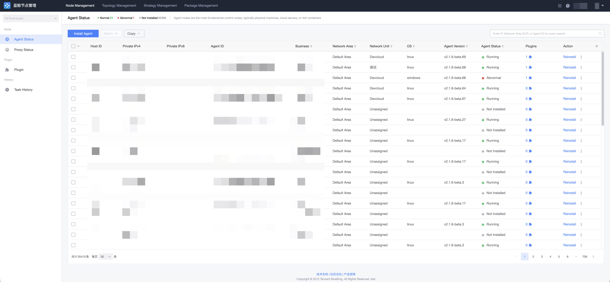
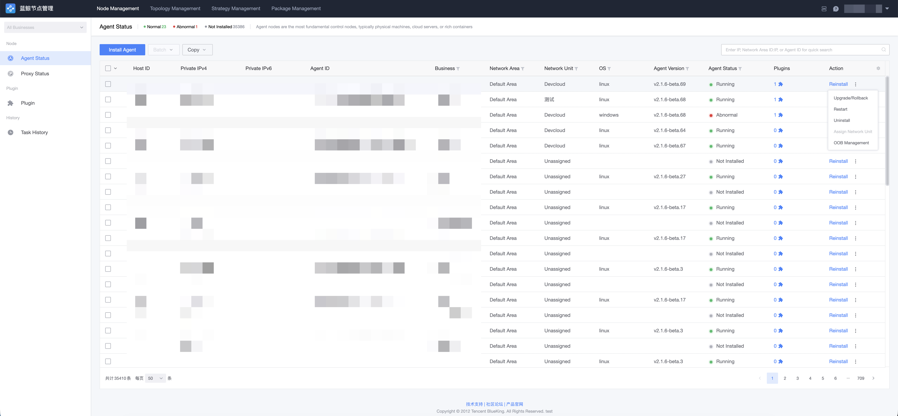

# Agent Management

When target hosts are network-reachable from the BlueKing management plane (or bridged via a Proxy), you can install Agents by filling in host, port, and password/key information. An Agent node is the most basic managed node — typically a physical machine, a cloud server, or a rich container.

## Agent Status Query

Go to the "Node Manager → Agent Status" page to see the status of all Agents that the current account has permission to view. Filtering by business, network area, IP, operating system, status, and other attributes is supported.

## Install Agent

Click "Install Agent", fill in the installation parameters (business, network area/network unit, IP address, login IP, operating system, login port, login account, authentication method, etc.), and start the installation. For detailed steps, see Quick Start:

- [Install Agent (Direct Network Unit)](../QuickStart/DirectUnitInstallAgent.md)
- [Install Agent (Custom Network Area)](../QuickStart/CustomCloudAreaInstallAgent.md)

> During installation, hosts are validated by the "network area + internal IP" combination; hosts that already exist are skipped with a prompt. The host's CMDB network area must match the area of the selected network unit.

## Agent Maintenance

After the Agent is installed, routine maintenance operations include:

| Operation | Description |
| --- | --- |
| Reinstall | Reinstall the Agent on the target host. |
| Upgrade | Upgrade the Agent to a specified version. Upgrade packages are pushed via the GSE file channel and commands are issued via GSE, without SSH login to the target machine. |
| Reconfig | Triggers the installer to re-render configuration and write back execution status; used to apply changes such as access points or configuration policies. Reconfig restarts the node service — schedule it at an appropriate time. |
| Restart | Restart the Agent process; the result is confirmed by polling the GSE Agent status. |
| Uninstall | Uninstall the Agent from the target host. |
| Remove | Remove the host from Node Manager. |
| Assign Network Unit | Change the network unit the host belongs to. |
| Out-of-Band Management | Maintain the host's out-of-band management information. |

Select target hosts in the list and click the corresponding operation. Task progress can be viewed in "Task History".

## Proxy Status

The "Node Manager → Proxy Status" page shows the running status of Proxy nodes in each network unit. Proxy nodes converge policies and bridge Agent nodes across network units, and support maintenance operations such as upgrade, reconfig, restart, and uninstall as well.

> Proxy upgrade and reconfig always write back status via the Relay callback on the Proxy itself. Before uninstalling a Proxy, make sure no Agents are connected to it.
