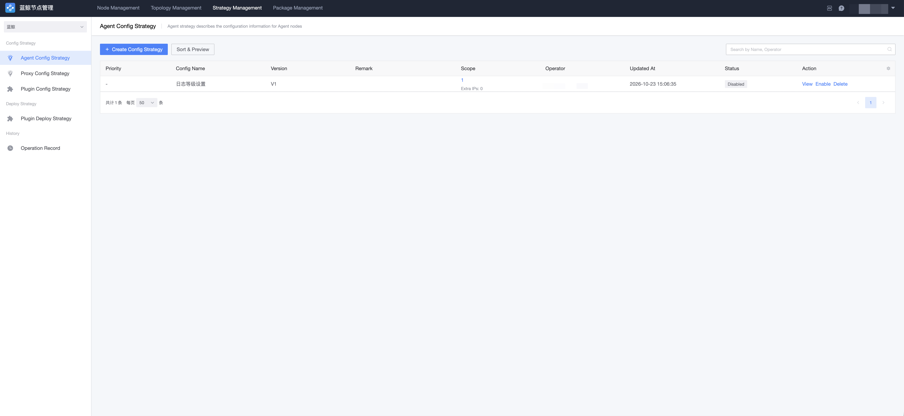

# Configuration Policy

Configuration policies customize node configurations by combining conditions and orchestrating their delivery — a general configuration capability maintained by administrators. There are three types: Agent configuration policies, Proxy configuration policies, and plugin configuration policies.

## Agent Configuration Policy

Agent configuration policies describe the configuration of Agent nodes. For example, the `logger_path` (log storage path) option controls the output directory of the Agent process's log files. Options are not delivered by default; they are delivered with the policy only after being enabled and filled with values. After a configuration policy is delivered, the installer re-renders the configuration on the Agent's next heartbeat report or when a Reconfig is triggered — no host restart is required.

## Proxy Configuration Policy

Proxy configuration policies describe the configuration of Proxy nodes. For example, `all_logger_path` overrides the log storage directories of the Agent, file, and data processes on a Proxy node at once, and `all_logger_level` overrides log levels.

## Plugin Configuration Policy

Plugin configuration policies describe the configuration and installation rules of plugin nodes, and are used to deliver and manage plugin process configurations in a unified way.

## How Changes Take Effect

Configuration policy changes do not update existing nodes immediately: after delivery, the installer re-renders configuration and writes back execution status through the node's Reconfig action. Reconfig restarts the node service — schedule it at an appropriate time and confirm the task succeeded in "Task History".

The history of policy operations can be viewed on the "Configuration Policies → Operation Records" page.
