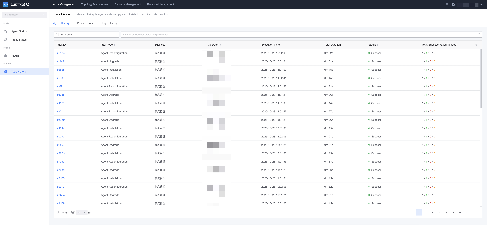
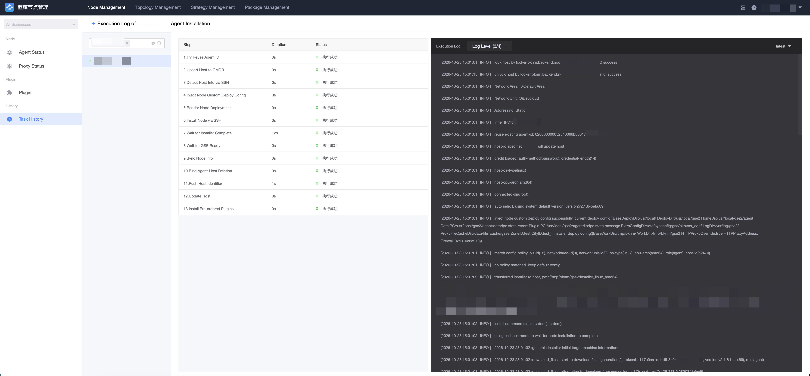

# Task History

Node Manager tasks such as install, upgrade, reconfig, restart, and uninstall are long-running asynchronous workflows. "Task History" lets you query the status and execution logs of these node operation tasks.

## View Task History List

Go to the "Node Manager → Task History" page to view operation tasks related to Agents, Proxies, and plugins. You can filter by business, operator, task type, status, and other conditions.

## Task Details and Logs

Click a task to view its details, including the execution status of each sub-task (each host). Click a host again to open the log details and view the sub-task's real-time execution log to locate the cause of failure.

## Other Operation Records

In addition to node task history, the following modules provide their own operation record pages:

- "Topology → Operation Records": history of topology operations (network areas, network units, access points, etc.);
- "Deploy Policies / Configuration Policies → Operation Records": history of policy operations;
- "Package Management → Operation Records": history of package management operations.
