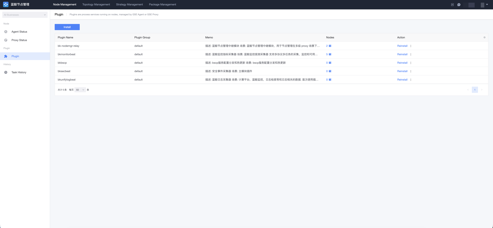
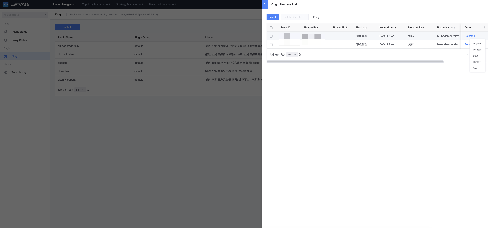
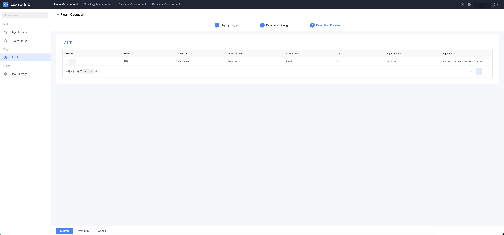
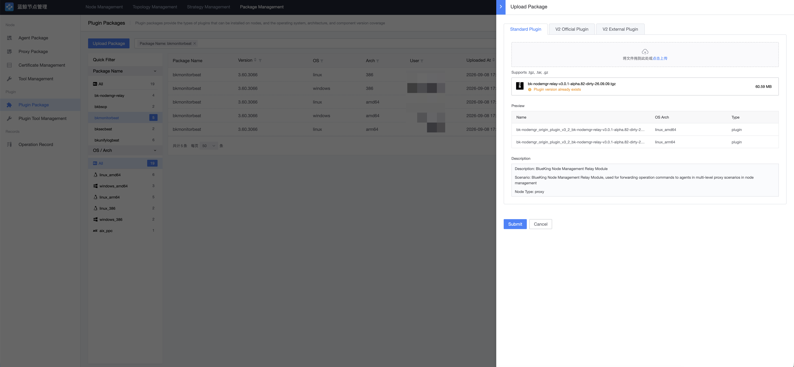

# Plugin Management

Plugins are process services running on nodes, hosted by the GSE Agent or GSE Proxy. You can deploy and manage these plugins through the plugin management features, or import additional third-party plugins.

## Concepts

| Concept | Description |
| --- | --- |
| Plugin Package (Package) | A static resource with an explicit version, shared globally; provides the kinds of plugins a node can install, along with the operating systems, architectures, and component versions they cover. |
| Plugin | A business concept, isolated per tenant, unique within the same tenant, and does not carry a version itself. |
| Process | A running instance of a plugin on a host, with a lifecycle; each plugin can have only one process instance per host. |

## Plugin Status Query

Go to the "Node Manager → Plugin" page to query the running status and version information of plugins on hosts by specified conditions.

## Plugin Maintenance and Installation

Select the hosts to manage and click "Plugin Operation", then choose the operation and plugins in the pop-up window. Plugin maintenance includes the following operations:

- **Install/Update**: Install or update the plugin program;
- **Start**: Start the plugin process;
- **Stop**: Stop the plugin process;
- **Restart**: Restart the plugin program (plugin support required);
- **Reload**: Typically used for configuration updates (plugin support required);
- **Host (Trusteeship)**: Register the plugin with the GSE Agent for management. If the plugin process exits abnormally, the GSE Agent will try to bring it back up automatically;
- **Unhost**: Remove the plugin from GSE Agent management; it will no longer be automatically restarted after abnormal exits.

## Deploy Policy

In addition to manual maintenance, you can use "Deploy Policies" for automated plugin deployment management. A deploy policy declaratively defines the desired deployment state of plugins on target nodes and consists of two parts:

- **Scope**: The targets covered by the policy. Supports dynamic topology (topo), set templates (set_template), service templates (service_template), instances (instance), dynamic groups (dynamic_group), and more; target types include hosts and service instances.
- **Spec**: The state the targets are expected to reach, e.g. `specify_plugin` (ensure the plugin with the specified name and version is installed on target hosts — install if absent, upgrade if the version mismatches), specifying plugin sub-configurations / sub-configuration templates (configuration-only updates), and more.

Nodes covered by the scope are automatically deployed according to the rules defined by the deploy policy.

### Policy Conflicts and Suppression

When multiple deploy policies hit the same target, policy suppression occurs and exactly one policy takes effect: the policy created first wins.

> Note: If the plugin version on a target host differs from the policy version, the deploy policy will overwrite the target host to the policy version. Once a target host is managed by a deploy policy, manual plugin management follows the policy definition.

### Install Plugins

On the "Node Manager → Plugin" page, select target hosts and deploy plugins through the install operation on the plugin page:

1. Select the plugins to install;
2. Select plugin versions — the system automatically matches the corresponding plugin packages based on the operating system and CPU architecture of the selected hosts; if multiple versions are available, you can choose manually;
3. Parameter configuration — some plugin packages support custom parameters;
4. Execution preview — confirm all hosts and operations, then execute the installation.

### Edit and Disable Deploy Policies

For existing deploy policies, you can adjust attributes such as the scope, plugin version, and plugin package parameters.

Use the "Disable" function to pause a policy's automatic behavior; a disabled policy can be re-enabled at any time. Disabling controls whether the policy participates in calculation — it does not request deletion of already deployed targets.

## Add New Plugin Packages to Node Manager

**Step 1: Obtain a plugin package**

You can get plugin packages from the [S-mart market](https://bk.tencent.com/s-mart/) on the BlueKing official website, or develop custom plugins with the plugin development framework.

**Step 2: Upload the plugin package**

Go to the "Package Management → Plugin Package Management" page, click "Import Plugin", select or drag in the plugin package to import, and complete the upload after the system parses it successfully.

**Step 3: Enable the plugin package version**

A plugin package version has two independent attributes:

- **Enabled**: Controls whether the package can be used by install, reinstall, upgrade, and other workflows; only enabled versions can be deployed to hosts;
- **Hidden (is_hidden)**: Controls whether the plugin package is shown in frontend selection lists; used only for display filtering and does not affect business availability.

After enabling the target version on the plugin package details page, it can be selected in plugin operations or deploy policies.
