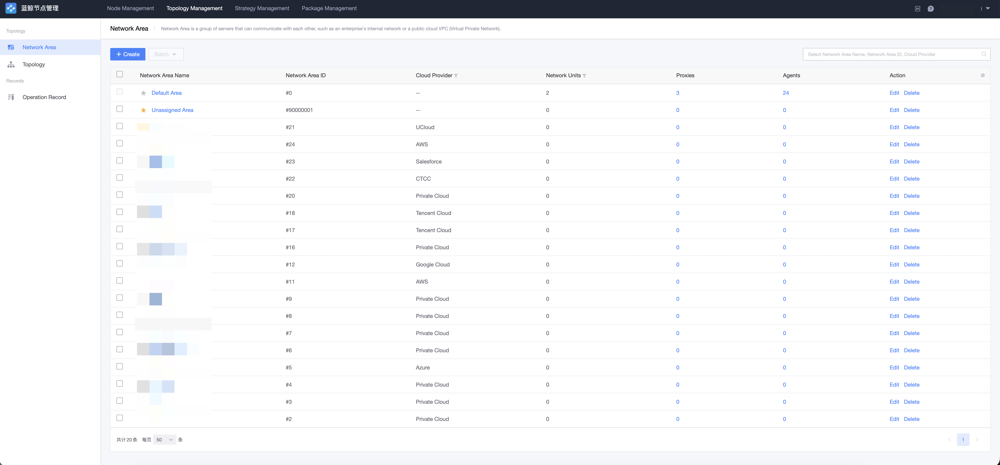
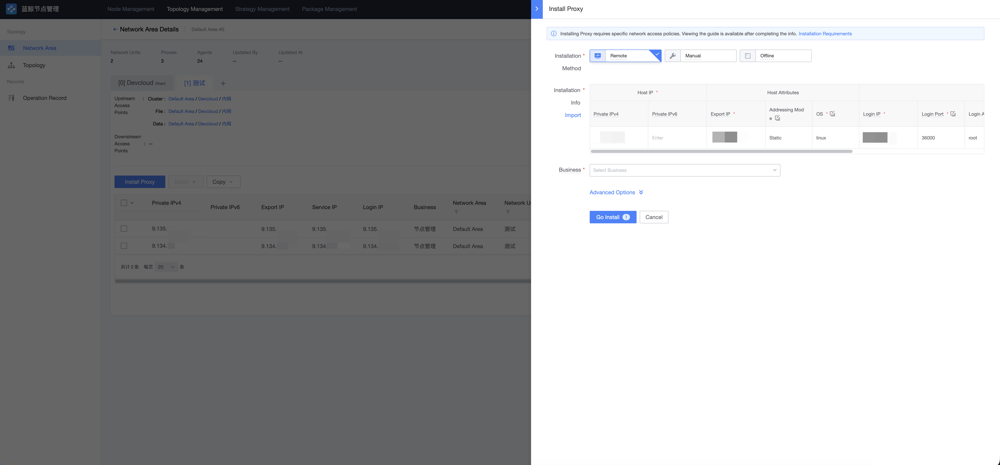

# Topology Management (Network Area)

A network area is the network scope of a group of server units that can communicate directly with each other, such as an enterprise LAN or a public cloud VPC (Virtual Private Cloud). It corresponds to the network area (cloud area) in CMDB.

BlueKing includes the default network area (ID 0) after initial deployment. When hosts have direct network connectivity with the BlueKing management plane, use a direct network unit under the default area. If the enterprise network is segmented (e.g. office network isolated from production, headquarters isolated from branches, domestic isolated from overseas), you can plan and create multiple network areas based on actual network connectivity.

## Concept Relationships

| Concept | Question it answers |
| --- | --- |
| Network Area | Which network scope does a host belong to? |
| Network Unit | Through what path are these nodes managed: direct to GSE, or via a Proxy? |
| Access Point | Through which addresses do other network units connect here? |

**Areas describe network ownership, units describe management paths, and access points describe connection addresses between units.** A network area can contain multiple network units. Dividing multiple units within the same area does not solve the problem of duplicate internal IPs among hosts.

## View Network Areas

Go to the "Topology → Network Area" page to view existing network areas and their network units.

## Create a Network Area

Click "New" to create a network area, filling in the area name, cloud service provider, and other information. After creation, the area is synchronized to CMDB.

> Creating an area only establishes ownership information; it does not automatically set up a Proxy, configure access points, or connect networks. Before installation, you still need to prepare the services and network connectivity required by the network unit.

## Create a Network Unit

Create a network unit under an area, fill in a name, and select a type:

| Type | Agent connection path | Required configuration | Proxy requirement |
| --- | --- | --- | --- |
| Direct unit | Agents connect directly to GSE. | The cluster, file, and data GSE addresses in the direct configuration. | No Proxy is used, and Proxies cannot be installed in it. |
| Non-direct unit | Agents connect to the unit's Proxy, and the Proxy connects upstream. | Select the upstream network area, upstream network unit, and access point. | Requires healthy Proxies providing control, file, and data channels. |

After a unit is created, its area and direct type cannot be changed by editing.

## Install Proxy

A non-direct unit requires an available Proxy first. The first Proxy in an empty unit needs to be established through **cross-unit installation** or **offline installation**. Once installation capability is available (i.e. a Proxy with the Relay plugin running properly exists), Agents and additional Proxies can be installed through the unit itself.

Proxy installation parameters:

- Internal IP: the IP used for network communication with Agents in the unit. **The first internal IP must be a real internal address reachable by Agents / Proxies in the same unit** — it is used as the Relay service's listen and callback address;
- Export IP: the egress address the Proxy uses to communicate with upstream GSE services, common in public network or NAT scenarios;
- Login IP: the IP from which the installation source can SSH into this Proxy host; optional, defaults to the internal IP;
- Operating System: the Proxy host must run Linux;
- Login Port / Login Account / Authentication Method: SSH connection information; password or key supported;
- Business Ownership: the CMDB business under which the Proxy is registered after installation; requires the corresponding business permission.

You can install multiple Proxies in one network unit for higher availability and load balancing.

## Access Point Management

An access point is a named set of GSE access addresses (cluster signaling, file, and data channels) configured on a network unit, for Proxies of other network units to connect to. When the same unit faces different networks, multiple access points can be configured, and downstream units choose the one they can reach.

> An access point only records addresses; it does not automatically create routes, NAT, or firewall rules. After changing an access point or upstream selection, existing nodes are not updated immediately — you need to reconfig the corresponding Agents or Proxies.

## Topology Graph

The "Topology → Topology Graph" page shows the link connections between network units, giving an overall view of management paths across areas.

## Uninstall Proxy and Delete Network Area

- Before uninstalling a Proxy, make sure no Agents are connected to it, otherwise the operation will fail;
- Before deleting a network area, make sure all Proxies under that area have been completely uninstalled.
