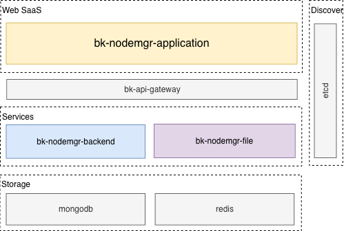
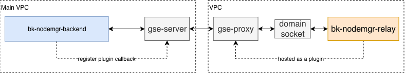
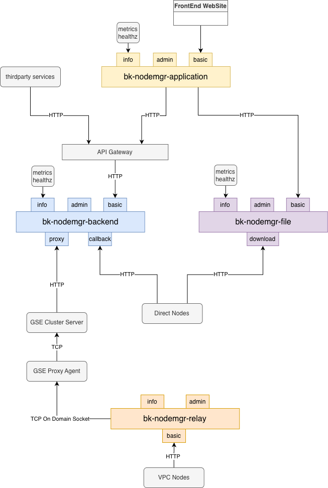

# Product Architecture

## Basic Modules

The Node Manager service layer consists of 3 basic modules:

- **bk-nodemgr-application**: The SaaS service, providing basic product pages, user login, and other functions. Stateless and horizontally scalable. It can be deployed on the BlueKing PaaS platform, or directly via Helm / docker-compose.
- **bk-nodemgr-backend**: The main backend service module, providing data management, workflow execution, and other functions. Stateless and horizontally scalable.
- **bk-nodemgr-file**: The backend file service module, providing file management functions such as upload and download. Stateless and horizontally scalable.

Node installation relies on SSH (Linux/macOS) or WMI (Windows) channels to trigger the installer on the target host. File distribution and status write-back during installation are completed via the Server or the Relay plugin on a Proxy, depending on the topology of the node's network unit.

## Cross-Network Management

When managing nodes in a non-direct network unit, Node Manager hosts a set of plugins called `bk-nodemgr-relay` on the node where gse-proxy resides, acting as a resident service that provides node management capabilities for that unit. For communication, the Relay communicates with the Proxy node's Agent via domain socket, relying on GSE's upstream/downstream signaling channels for cross-network communication.

If an enterprise needs to manage hosts in different network areas, it only needs to provide a Linux host in the target area as a Proxy node; other hosts in the same unit only need to communicate with the Proxy to achieve cross-network management.

## Service Ports

### Application

- `info`: Provides metrics and healthz information; generally not exposed externally.
- `admin`: Provides internal management functions; generally not exposed externally.
- `basic`: The basic frontend service port; exposed externally.

### Backend

- `info`: Provides metrics and healthz information; generally not exposed externally.
- `admin`: Provides internal management functions; generally not exposed externally.
- `basic`: Provides basic functions; generally exposed externally through the APIGW.
- `callback`: Provides the node callback service; exposed to directly connected nodes.
- `proxy`: Provides the proxy service; exposed to the GSE-Cluster.

### File

- `info`: Provides metrics and healthz information; generally not exposed externally.
- `admin`: Provides internal management functions; generally not exposed externally.
- `basic`: Provides basic functions; exposed externally.
- `download`: Provides the download service; exposed to directly connected nodes.

### Relay

- `info`: Provides metrics and healthz information; generally not exposed externally.
- `admin`: Provides internal management functions; generally not exposed externally.
- `basic`: Provides the combined `backend/callback` + `file/download` service; exposed to nodes in the current network unit.
