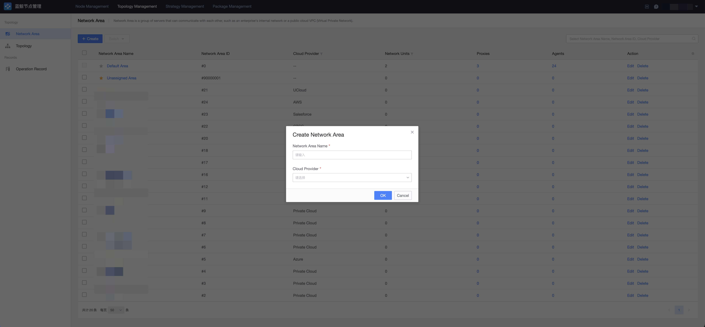
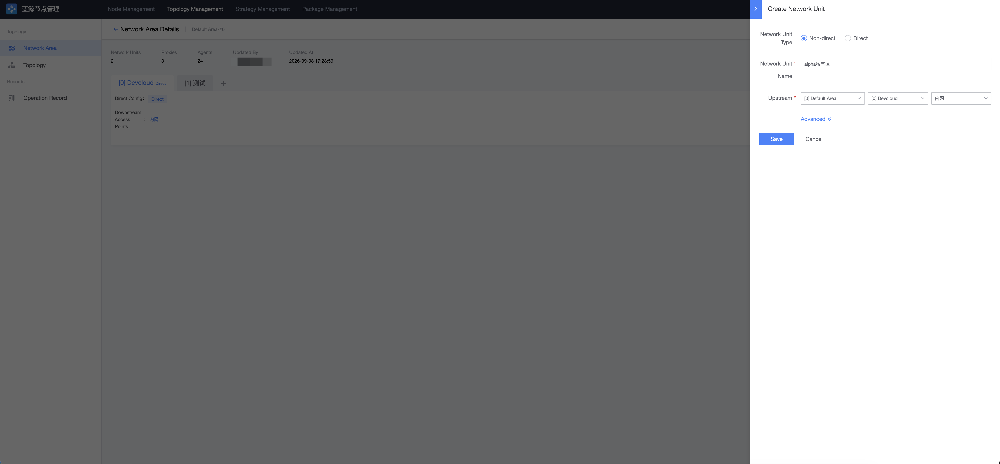
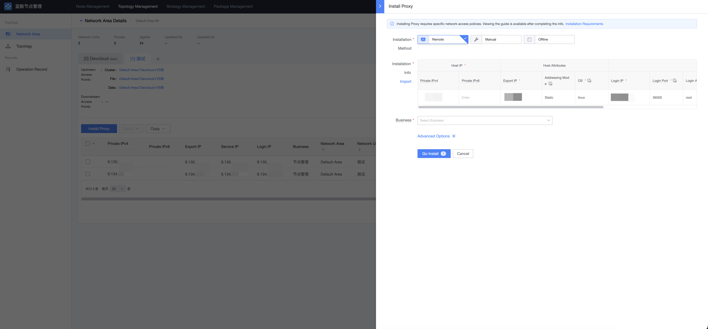
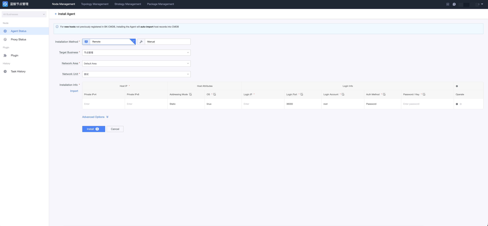
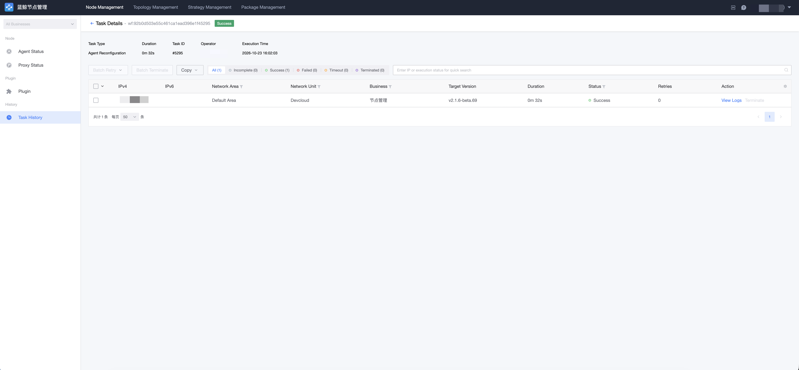

# Install Agent (Custom Network Area)

Applicable scenario: the network where the target hosts reside is isolated from the BlueKing management plane, and BlueKing cannot access the target hosts directly. In this case, create a custom network area, a non-direct network unit, and install a Proxy to bridge and manage the hosts in that area.

## Step 1: Create a Network Area

Go to the "Topology → Network Area" page and click "New" to create a network area, filling in the area name, cloud service provider, and other information. After creation, the area is synchronized to CMDB.

> Creating an area only establishes ownership information; it does not automatically set up a Proxy or connect networks.

## Step 2: Create a Non-Direct Network Unit

Create a network unit under the newly created network area, select the "non-direct" type, and choose the upstream network area, upstream network unit, and access point (the cluster / file / data channel addresses the Proxy uses to communicate upstream).

## Step 3: Install Proxy

A non-direct unit requires an available Proxy before Agents can be installed. The first Proxy in an empty unit needs to be established through one of the following methods:

- **Cross-unit installation**: Initiated from another network unit that already has installation capability (such as a direct unit in the default area), remotely installing onto the target Proxy host;
- **Offline installation**: When the target environment has no access to the management network at all, manually download the offline package and run it on the target host.

Follow the page instructions to fill in the Proxy installation parameters (internal IP, export IP, login IP, authentication method, business ownership, etc.), click Install, and wait for the task to succeed.

> Note: The Proxy host must run Linux. The Proxy's first internal IP must be a real internal address reachable by Agents / Proxies in the same unit — it is used as the Relay service's listen and callback address.

## Step 4: Install Agent

After the Proxy is installed successfully, go to the "Node Manager → Agent Status" page, click "Install Agent", select the newly created non-direct unit as the network area / network unit, complete the target host details, and click "Install".

The installation task is then executed by the Relay plugin on the unit's Proxy as the operation source: target nodes pull the installation package from the Relay and write back execution status to the Relay.

## Step 5: Check Execution Status

After submission, you are automatically redirected to the task page. Wait for the Agent installation to complete. If the task fails, click the corresponding host to view the installation log.

