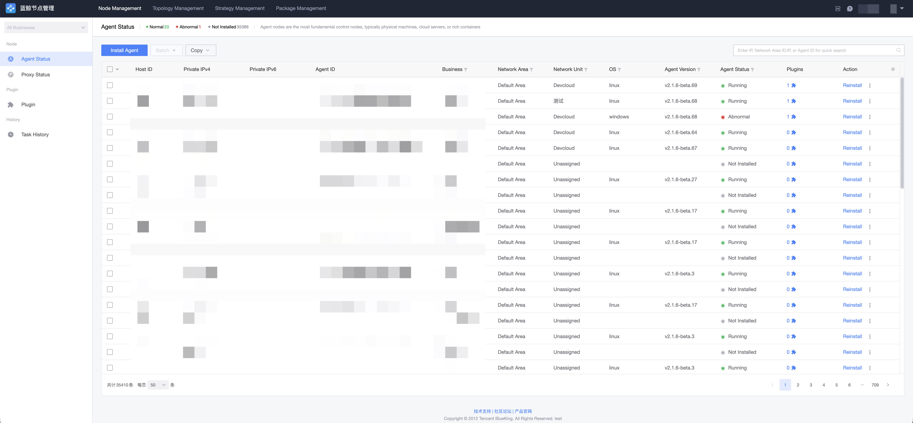
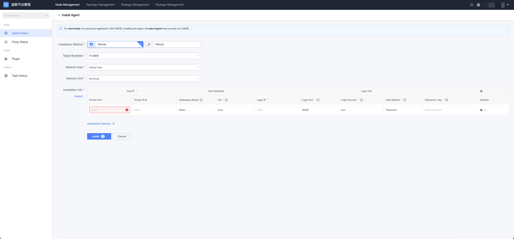
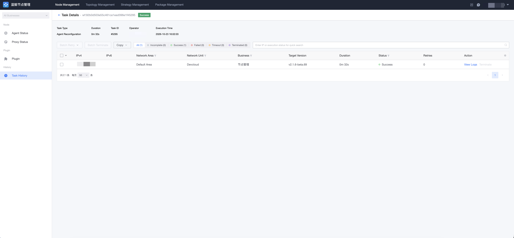

# Install Agent (Direct Network Unit)

Applicable scenario: the target hosts are network-reachable from the BlueKing management plane and can connect directly to GSE services. In this case, simply install the Agent into a direct network unit under the default network area (ID 0).

## Prerequisites

- The SSH (Linux/macOS) or WMI (Windows) login channel of the target host is available; a login account and credentials (password or key) are required for installation.
- The target host can access the `download` address of the Node Manager File service and the `callback` address of Backend (during online installation, the target node pulls the installation package from File and writes back status to Backend).
- The direct network unit has been configured with usable GSE direct addresses (cluster / file / data channels).

## Step 1: Start Installing Agent

Go to the "Node Manager → Agent Status" page and click the "Install Agent" button.

## Step 2: Fill In Installation Parameters

- **Install to Business**: After the Agent is installed, specify which business in BlueKing CMDB the host should be registered under.
- **Network Area / Network Unit**: Select a direct network unit under the default network area.
- **Installation Information**:
    - IP Address: the internal IP address of the host;
    - Login IP: the address used to log in to the target host during installation. Usually the same as the internal IP; fill this in only when they differ;
    - Operating System: the OS type of the host (linux / windows / darwin). Login methods differ across systems, so be sure to fill this in correctly;
    - Login Port: usually SSH port 22 (WMI port for Windows);
    - Login Account: use root for Linux/macOS, Administrator for Windows;
    - Authentication Method: password or key.

After confirming everything is correct, click "Install" to start the installation task.

## Step 3: Check Execution Status

After submission, you are automatically redirected to the task page. Wait for the Agent installation to complete. If the task fails, click the corresponding host to view the installation log.

> In addition to online automatic installation, you can also choose manual installation: the system generates a bootstrap command, and the administrator copies it to the target host and runs it manually.
