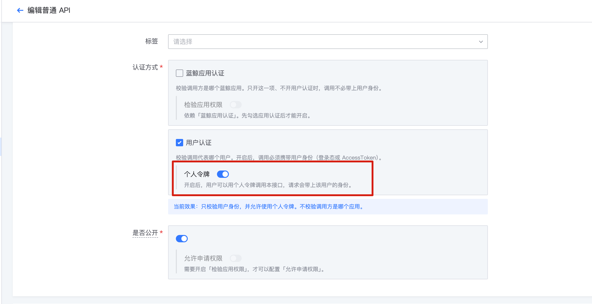
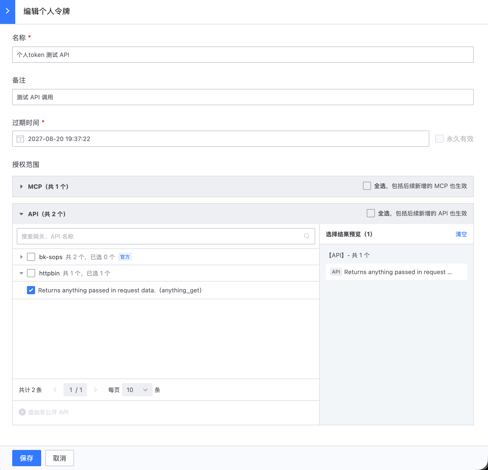
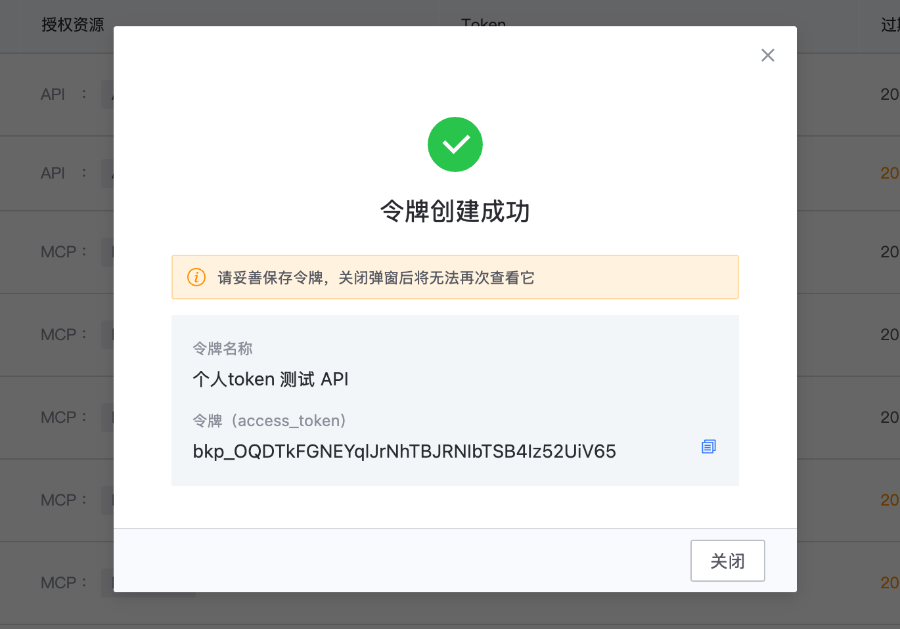

# 使用个人 Token 调用网关 API

## 背景

bkauth 支持生成个人 Token。生成 Token 时，可以配置该 Token 能够调用的 MCP Server 或 API。

一个个人 Token 可以调用生成时已授权的全部 MCP Server 和 API。

## API 配置

配置 API 时，如果已开启**用户认证**，可以选择开启**个人 Token**。



使用 apigw-manager SDK 或镜像自动同步网关配置时，请参阅 [apigw-manager resources.yaml 配置说明](https://github.com/TencentBlueKing/bkpaas-python-sdk/blob/master/sdks/apigw-manager/docs/sync_apigateway.md#12-resourcesyaml)。

> 注意：开启个人 Token 的前提是已开启用户认证。

## 如何使用

### 1. 生成个人 Token

进入 bkauth 个人 Token 页面，配置并勾选允许调用的 API 列表。

可以勾选整个网关，也可以按照最小权限原则，只勾选网关下的指定接口。如果对应 API 未公开，需要手工填写。





复制生成的 Token。

### 2. 使用个人 Token 调用 API

将个人 Token 作为 Bearer Token 添加到 `Authorization` 请求头：

```bash
curl -H "Authorization: Bearer <personal_token>" \
  https://bkapi.example.com/api/httpbin/prod/anything
```

## 常见问题

### 希望调用的网关或 API 未开启个人 Token 支持，怎么办

联系对应网关的负责人，根据实际需求评估并开启。

> 注意：开启个人 Token 要求对应 API 为已开启用户认证的用户态接口。

长期目标是按需严格区分以下接口类型：

- 应用态接口：供可信系统或内部系统之间调用。
- 用户态接口：供个人或 Agent 调用。
- 应用态和用户态接口：供普通 SaaS 或不可信第三方调用。
