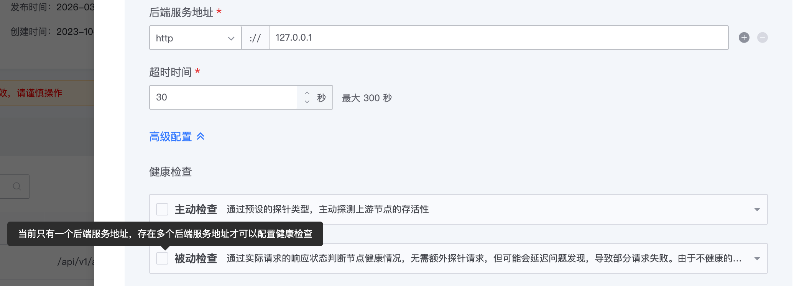
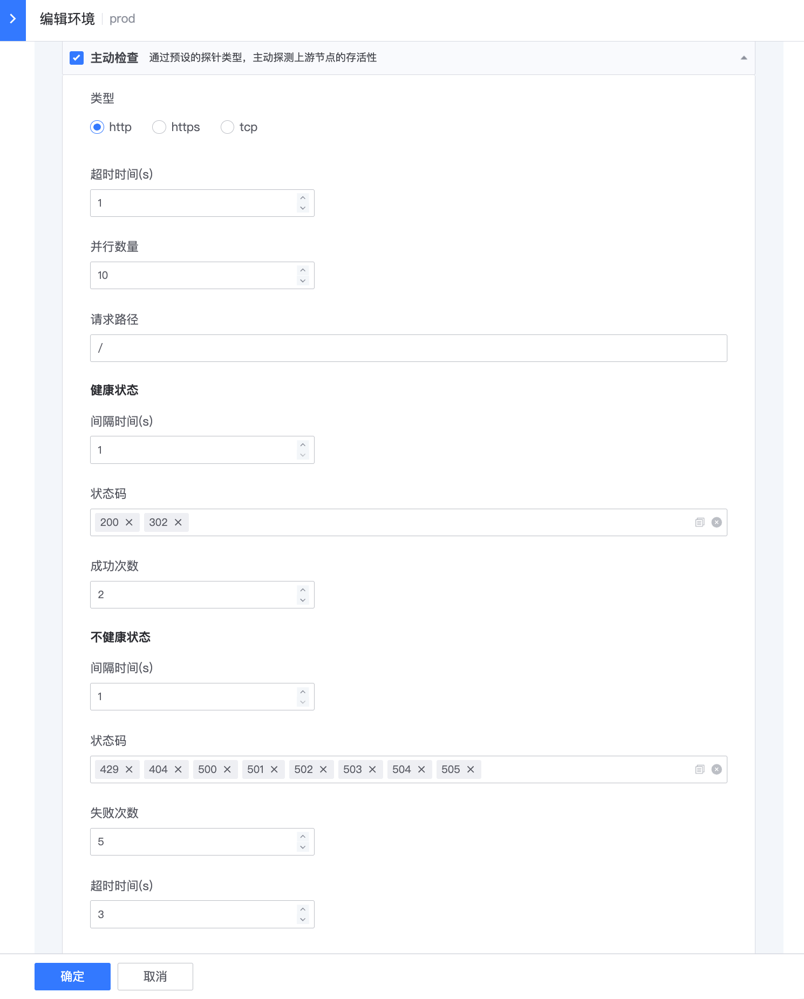
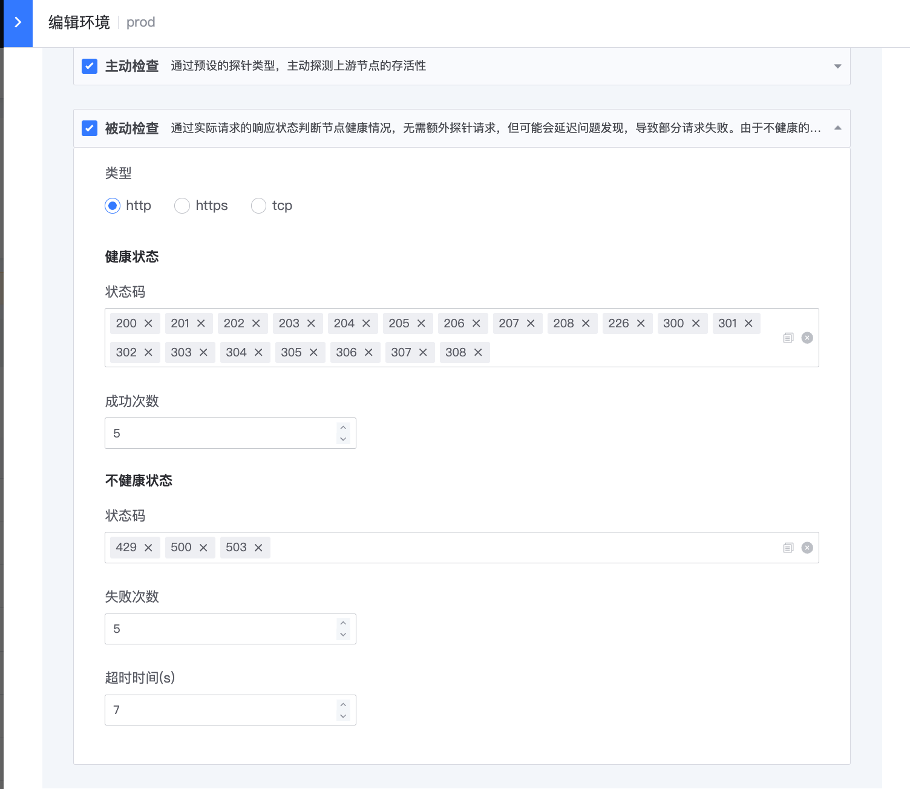

# 健康检查

> 网关管理端暂未暴露健康检查配置入口。

健康检查功能可以在上游节点发生故障或迁移时，将请求代理到健康节点，最大程度避免服务不可用。

蓝鲸共享网关支持完整的 [Apache APISIX 健康检查](https://apisix.apache.org/zh/docs/apisix/tutorials/health-check/)。

## 概念说明

### 主动健康检查

主动健康检查是指 APISIX 通过预设的探针类型，主动探测上游节点的存活状态。目前 APISIX 支持 HTTP、HTTPS、TCP 三种探针类型。

当发向健康节点 A 的 N 个连续探针都失败时（取决于具体配置），该节点将被标记为不健康。不健康的节点会被 APISIX 的负载均衡器忽略，无法收到请求。若某个不健康的节点连续 M 个探针都成功，该节点将被重新标记为健康，进而可以被代理。

### 被动健康检查

被动健康检查是指通过判断 APISIX 转发到上游节点的请求响应状态，判断对应的上游节点是否健康。与主动健康检查相比，被动健康检查不需要发起额外探针，但无法提前感知节点状态，可能会产生一定量的失败请求。

若发向健康节点 A 的 N 个连续请求都被判定为失败（取决于具体配置），该节点将被标记为不健康。

> 注意：由于不健康的节点无法收到请求，仅使用被动健康检查策略无法将节点重新标记为健康，因此通常需要结合主动健康检查策略。

## 使用指南

进入后端服务编辑页面，依次选择 **高级配置 > 健康检查**。

### 前提条件

仅当后端服务存在多个地址时，才允许开启健康检查。

### 配置

- 如果后端服务地址使用 HTTP，可选择 `http` 或 `tcp` 类型。
- 如果后端服务地址使用 HTTPS，可选择 `https` 或 `tcp` 类型。
- 各字段含义请参阅 [Apache APISIX 健康检查](https://apisix.apache.org/zh/docs/apisix/tutorials/health-check/)。

> 注意：如果配置被动健康检查，需要同时配置主动健康检查。

