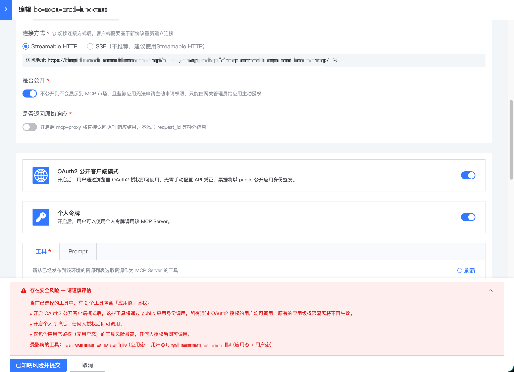
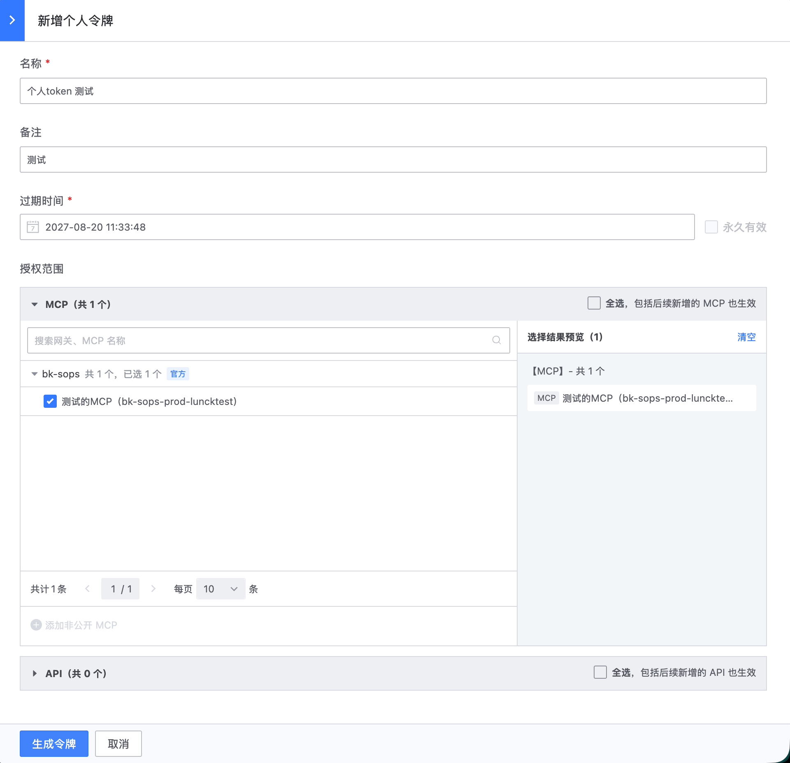
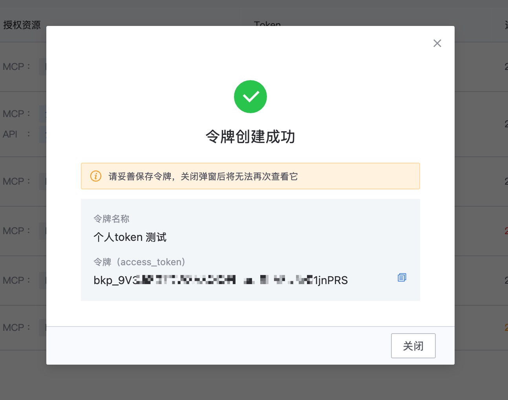
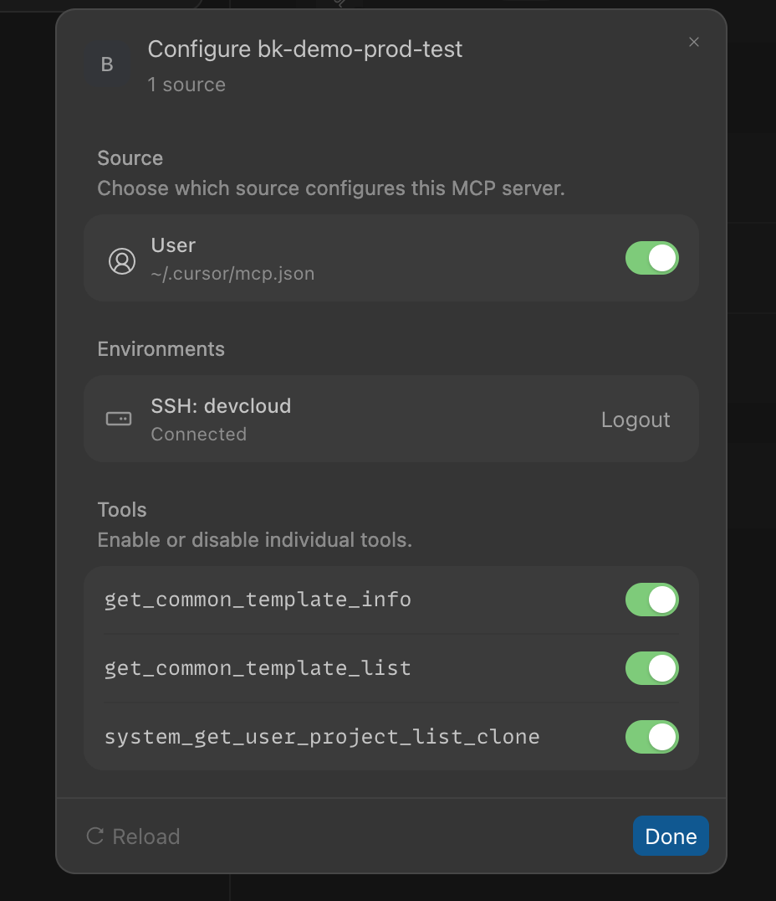
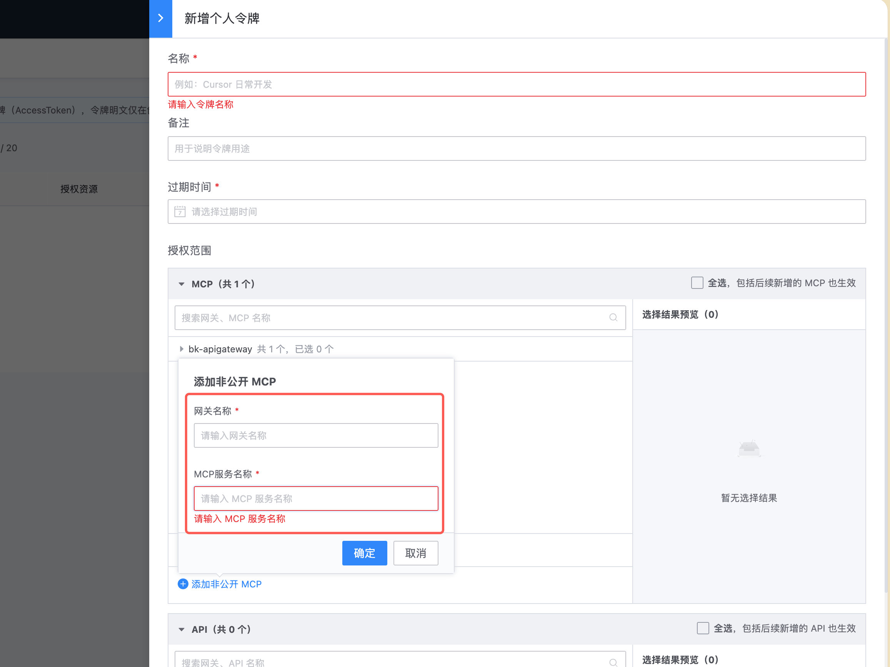
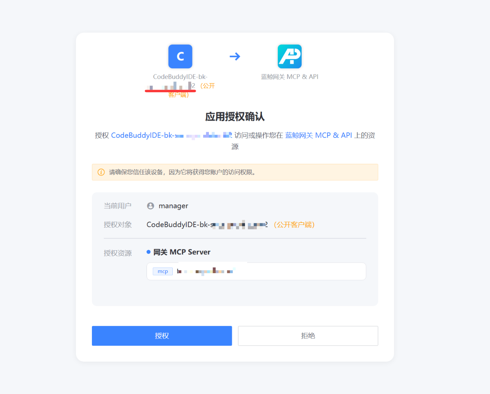

# 使用个人 Token 调用 MCP Server

## 背景

bkauth 支持生成个人 Token。生成 Token 时，可以配置该 Token 能够调用的 MCP Server 或 API。

一个个人 Token 可以调用生成时已授权的全部 MCP Server 和 API。

## MCP Server 配置

配置 MCP Server 时，可以开启个人 Token。



使用 apigw-manager SDK 或镜像自动同步网关配置时，请参阅 [apigw-manager MCP Server 配置说明](https://github.com/TencentBlueKing/bkpaas-python-sdk/blob/master/sdks/apigw-manager/docs/sync_apigateway.md#14-mcp-server-%E9%85%8D%E7%BD%AE%E8%AF%B4%E6%98%8E)。

## 如何使用

### 1. 生成个人 Token

进入 bkauth 个人 Token 页面，配置并勾选允许调用的 MCP Server 列表。





复制生成的 Token。

### 2. 使用个人 Token 调用 MCP Server

复制 **MCP 使用指引** 中对应的 IDE 配置，并在 `headers` 中添加 Bearer Token：

```text
Authorization: Bearer <personal_token>
```

以下仅为 Cursor 配置示例，使用时请根据实际情况修改：

```json
{
  "mcpServers": {
    "bk-demo-prod-test": {
      "url": "https://bkapi.example.com/api/bk-apigateway/prod/api/v2/mcp-servers/bk-demo-prod-test/mcp/",
      "headers": {
        "X-Bk-Tenant-Id": "system",
        "X-Bkapi-Allowed-Headers": "X-Bk-Tenant-Id",
        "Authorization": "Bearer <personal_token>"
      }
    }
  }
}
```

保存配置。



## 常见问题

### 希望调用的 MCP Server 未开启个人 Token 支持，怎么办

联系对应 MCP Server 或网关的负责人，根据实际需求评估并开启。

> 注意：开启个人 Token 要求对应 MCP Server 中的工具为用户态接口。如果工具为应用态接口，系统会显示风险提示，MCP Server 或网关负责人需要谨慎评估风险。

长期目标是按需严格区分以下接口类型：

- 应用态接口：供可信系统或内部系统之间调用。
- 用户态接口：供个人或 Agent 调用。
- 应用态和用户态接口：供普通 SaaS 或不可信第三方调用。

### 希望调用的 MCP Server 未出现在列表中，怎么办

如果管理员将 MCP Server 设置为私有，它默认不会出现在列表中。

请联系 MCP Server 管理员获取 MCP 信息，然后手工填写。



### 个人 Token 过期后，为什么点击授权会进入 OAuth2 公开客户端流程

使用个人 Token 的 MCP 配置会在 `headers` 中携带 `Authorization`；OAuth2 公开客户端配置则不包含该请求头。

已知行为：

- Cursor 不会触发 OAuth2 跳转。
- CodeBuddy IDE 会触发 OAuth2 跳转。



原因是 MCP Server 使用同一个调用端点，无论开启的是 OAuth2 公开客户端还是个人 Token。当 Token 无效时，网关无法获得足以区分两种方式的特征信息，只能统一返回 `401` 状态码和 `WWW-Authenticate` 响应头。

Cursor 等客户端能够判断凭据来自用户配置还是 OAuth2 跳转配置，因此个人 Token 失效、过期或非法时不会触发 OAuth2 跳转。

CodeBuddy IDE 等客户端没有判断用户是否已填写 `Authorization` 请求头，因此 Token 无效时会触发 OAuth2 跳转。

解决方法：使用个人 Token 时，如果出现跳转，请忽略跳转并查看 IDE 日志。如果 Token 已过期，请单独续期；如果 Token 已删除，请重新申请。
