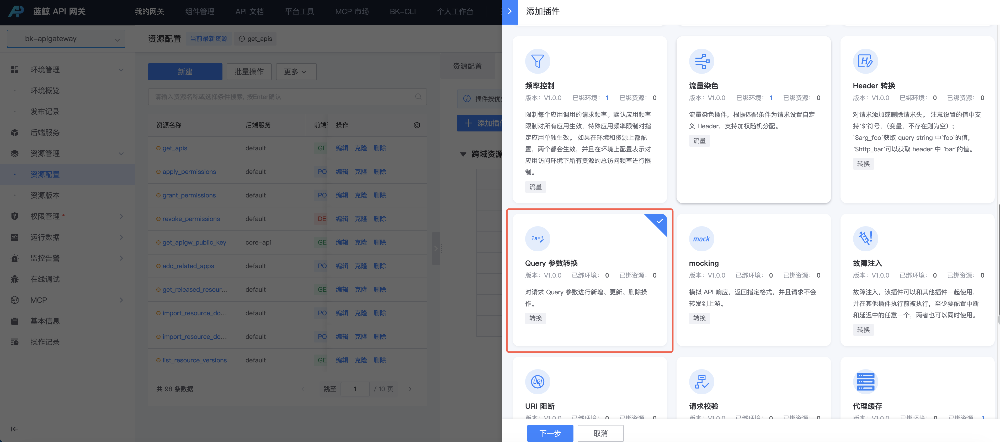
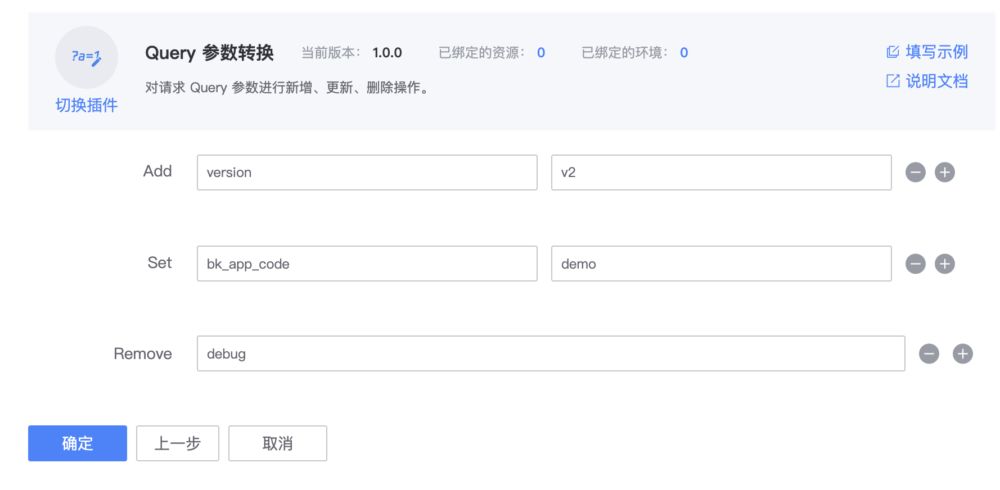

# Query 参数转换插件 bk-query-string-rewrite

> 适用版本：bk-apigateway >= 1.23.x

## 背景

网关后端服务升级、接口迁移或参数协议调整后，请求 Query 参数可能需要进行兼容转换。例如，旧接口使用 `app_code`，新接口改为 `bk_app_code`；也可能需要为请求补充固定 Query 参数、覆盖已有参数或移除不再支持的参数。

为了降低客户端改造成本，避免后端参数变更影响存量调用方，网关新增 `bk-query-string-rewrite` 插件，用于在请求转发到后端之前改写 Query 参数。插件支持 `add`、`set`、`remove` 三类操作，分别用于新增参数、设置参数值和删除参数。

## 配置步骤

### 1. 选择资源

在资源上新建 **Query 参数转换** 插件。

入口：**资源管理 > 资源配置 > 找到资源 > 点击插件名称或插件数 > 添加插件**。



### 2. 配置插件

配置 `Add`、`Set` 和 `Remove` 操作。



假设原始请求为：

```http
GET /users?name=tom&debug=true
```

经过图示插件配置处理后，请求变为：

```http
GET /users?name=tom&version=v2&bk_app_code=demo
```
