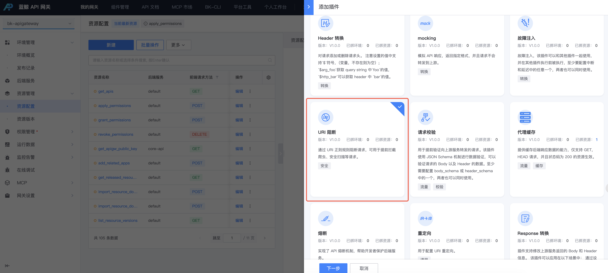
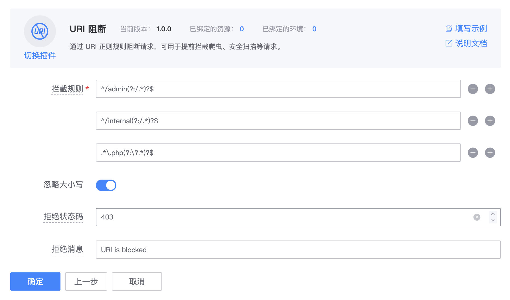

# URI 阻断插件 uri-blocker

## 背景

通过 URI 正则规则阻断请求，可用于提前拦截爬虫、安全扫描等请求。

## 配置步骤

### 1. 选择资源

在资源上新建 **URI 阻断** 插件。

入口：**资源管理 > 资源配置 > 找到资源 > 点击插件名称或插件数 > 添加插件**。



### 2. 配置插件

填写以下示例配置：

```text
^/internal(?:/.*)?$
.*\.php(?:\?.*)?$
```

- 忽略大小写：`true`
- 拒绝状态码：`403`
- 拒绝消息：`URI is blocked`


