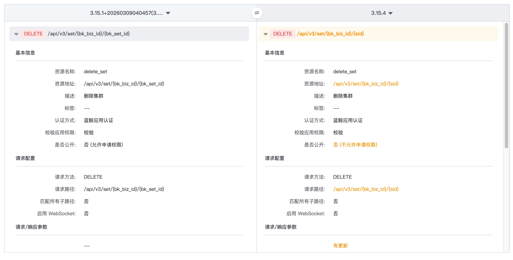

## 底层依赖

网关使用的 apisix 的方案

- 底层依赖 [lua-resty-radixtre](https://github.com/api7/lua-resty-radixtree)
- 相关文档 [路由 RadixTree](https://apisix.apache.org/zh/docs/apisix/router-radixtree/)

## 共享网关配置

支持基于路径参数的匹配

```yaml
apisix:
  router:
    http: 'radixtree_uri_with_parameter'
```

## 当前匹配规则

### 1. 静态路径同参数路径共存

完整静态路径与参数路径共存 => 静态优先

```text
DELETE /sets/batch    => 优先匹配到这个
DELETE /sets/{set_id}
```

### 2. 都是参数路径

都存在参数 => 长度优先

```text
DELETE /api/v3/set/{bk_biz_id}/batch
DELETE /api/v3/set/{bk_biz_id}/{bk_set_id}  => 优先匹配到这个
```

### 3. 都是参数路径且长度一致

长度相同，注册顺序优先 => 谁先注册命中谁

```text
DELETE /api/v3/set/{bk_biz_id}/batch
DELETE /api/v3/set/{bk_biz_id}/{bks}
```

## 已知问题

#### 1. 现象

如果在页面上配置如下 2 个 URL

```text
# 网关页面配置
DELETE /api/v3/set/{bk_biz_id}/batch
DELETE /api/v3/set/{bk_biz_id}/{bk_set_id}
```

那么此时，由于 [lua-resty-radixtree](https://github.com/api7/lua-resty-radixtree/pull/145/changes) 中，是按照路径最长的优先级最高

```text
# lua radixtree
DELETE /api/v3/set/:bk_biz_id/batch
DELETE /api/v3/set/:bk_biz_id/:bk_set_id  # 更长
```

此时一个请求进来 /api/v3/set/6/batch ， 将会始终命中更长的这个

这个行为可能跟 golang 或其他框架的路由匹配规则有差异

#### 2. 解决方案

网关使用 lua-resty-radixtree， 其命中规则有别于其他语言的实现

- gin 等框架：字面值优先级高于参数
- django: 依赖于代码中配置 url 的顺序

是否默认改成跟 golang 一致， 影响较大，目前调研中。

目前的解决方案: 修改参数名，将优先级更低的路径长度变短，**开发者自行控制路径长度调整优先级**

```text
# 网关页面配置
DELETE /api/v3/set/{bk_biz_id}/batch
DELETE /api/v3/set/{bk_biz_id}/{sid}
```

```text
# lua radixtree
DELETE /api/v3/set/:bk_biz_id/batch  # 更长
DELETE /api/v3/set/:bk_biz_id/:sid
```


