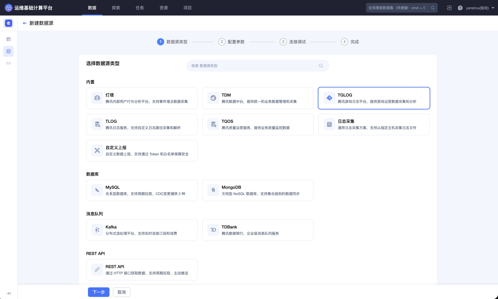
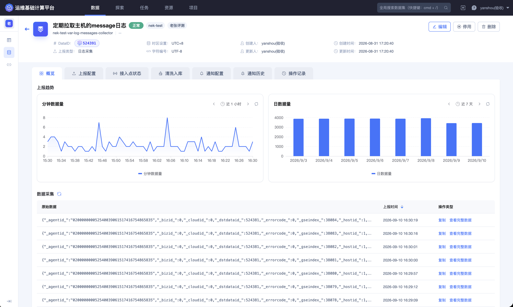
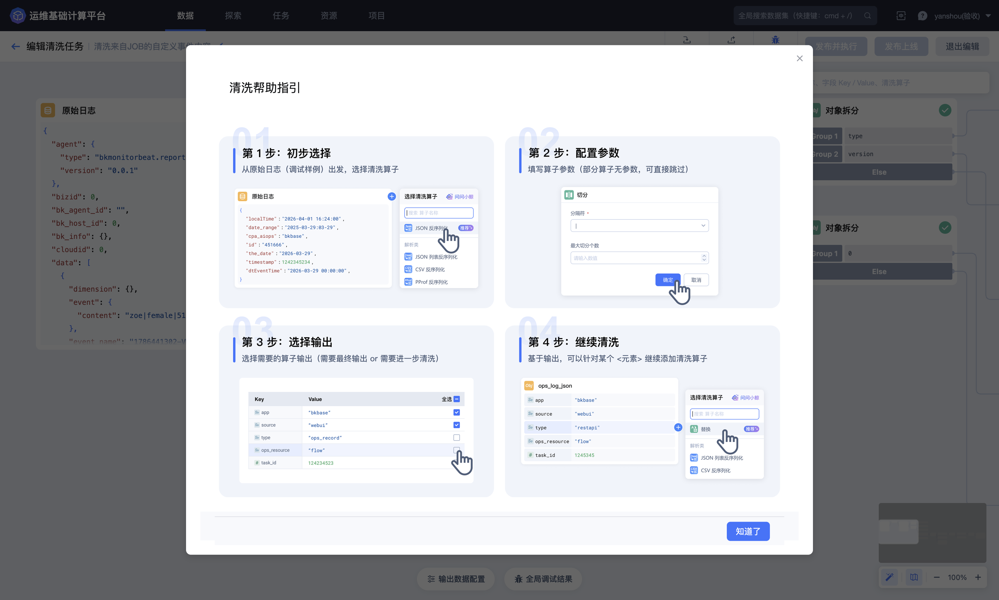
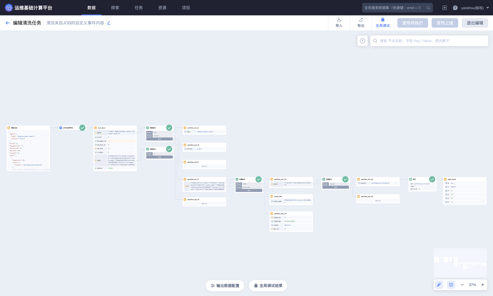
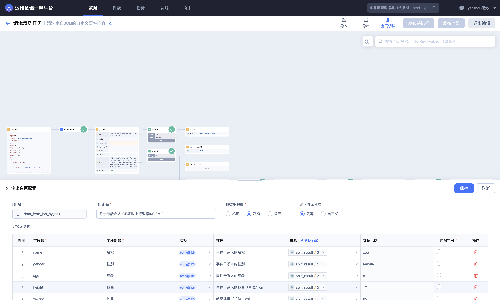
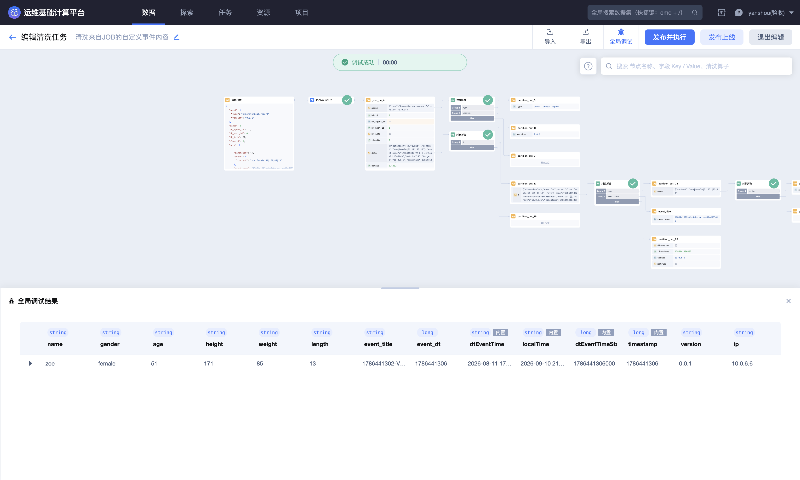
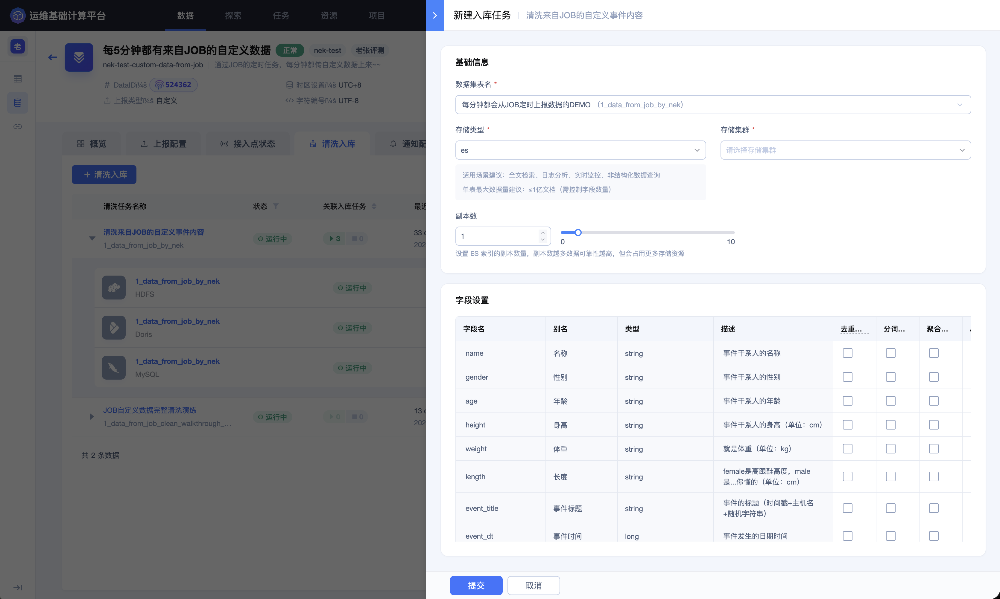

## 日志接入，并通过清洗标准化写入ES实现检索

游戏客户端、服务器和周边服务会持续产生登录、支付、战斗、匹配和错误日志。原始日志往往采用 JSON、Key-Value 或分隔符文本，字段命名、时间格式和异常处理不统一，难以直接检索和长期维护。

本实践介绍如何使用 BKBase 的数据源、清洗和入库能力，把业务日志转换为结构稳定的结果数据并写入 ES。

### 场景目标

- 按时间、游戏、区服、玩家、事件类型和结果检索日志；
- 统一不同上报端的字段名称和类型；
- 识别并观测无法解析的异常日志；
- 控制敏感字段的可见范围；
- 为后续 Dataflow、分析或可视化提供稳定输入。

### 推荐链路

> 游戏日志 → 数据源接入 → 获取样例 → 解析与字段提取 → 时间和类型标准化 → 输出 Schema → ES 入库 → BKSQL 检索

创建数据源时，应先按日志实际产生和传输方式选择接入类型。日志采集、自定义上报、Kafka 和 REST API 的配置方式不同。

接入完成后，从数据源概览检查最新原始样例和上报趋势，再开始设计清洗规则。

### 设计原始日志

能够调整上报格式时，优先使用结构稳定的 JSON，并约定：

- 字段名称使用固定英文标识；
- 时间戳明确秒或毫秒，并统一时区；
- 枚举值使用稳定编码，例如 `success`、`failed`；
- 每条日志包含可以定位来源的游戏、区服和事件标识；
- 不上报业务处理不需要的密码、Token 或完整认证信息。

无法调整原始格式时，应先收集多种真实样例，覆盖正常、空值、字段缺失、格式漂移和异常字符等情况。

### 选择清洗方式

清洗算子会根据当前节点的数据类型动态显示：

| 原始格式 | 首选方式 | 后续处理 |
| --- | --- | --- |
| JSON 字符串 | JSON 反序列化 | 从结构化对象选择字段，必要时进行对象拆分 |
| CSV 或固定分隔符 | CSV 反序列化或切分 | 按位置映射字段，并处理列数不一致 |
| Key-Value 文本 | KV 提取 | 检查重复键、缺失键和分隔符冲突 |
| 固定模式文本 | 正则提取 | 使用命名字段，并为无法匹配的数据设置异常策略 |
| Base64 内容 | base64 解码 | 解码后根据内容格式继续解析 |

不要把算子列表当作固定菜单。某个算子不可见时，应检查当前节点的输入类型和所在分支。

多个算子通过画布连线组成完整规则链。应沿数据流向逐节点观察输入和输出，避免只检查最后一个节点。

### 建立标准 Schema

以登录日志为例，建议至少包含：

| 字段 | 类型 | 说明 | 检索建议 |
| --- | --- | --- | --- |
| `event_time` | long | 事件发生时间 | 作为时间范围过滤条件 |
| `event_type` | string | 事件类型 | 精确筛选 |
| `game_id` | string | 游戏标识 | 精确筛选 |
| `zone_id` | string | 区服标识 | 精确筛选 |
| `player_id` | string | 玩家标识 | 按授权范围使用 |
| `channel` | string | 渠道 | 精确筛选和聚合 |
| `client_version` | string | 客户端版本 | 排查版本问题 |
| `result` | string | 处理结果 | 精确筛选和聚合 |
| `error_code` | string | 错误码 | 故障定位 |
| `message` | string | 日志摘要 | 按实际检索方式配置 |

字段名称和类型一旦被下游使用，应保持稳定。需要改变语义或类型时，优先增加新字段并为下游预留迁移时间。

### 正确处理时间

时间是日志检索最重要的条件之一。配置时应确认：

1. 原始值是秒、毫秒还是格式化字符串；
2. 原始日志使用 UTC 还是业务时区；
3. 输出时间字段是否已在页面中标记；
4. 调试结果与原始事件时间是否一致；

特别提醒：秒和毫秒混淆可能使数据落在错误日期，进而表现为“入库正常但查询不到”。

### 设计异常处理

生产规则不应只用一条正常样例验收。至少验证：

- 非法 JSON；
- 字段缺失；
- 空字符串和 `NULL`；
- 时间格式错误；
- 分隔符出现在业务内容中；
- 字段数量多于或少于预期；
- 超长文本和异常字符。

选择丢弃异常数据时，应同时配置异常量观测和通知。异常比例持续上升通常意味着上报格式发生变化，不应只在清洗层静默处理。

发布前使用全局调试检查完整规则链、输出字段和平台时间字段，确认顶部显示调试成功。

### 配置 ES 入库

选择 ES 时重点考虑：

- 需要精确筛选的标识字段；
- 需要全文检索的文本字段；
- 时间字段和常用组合过滤条件；
- 敏感字段是否真的需要写入和索引；
- 日均数据量、单条大小和正式保留周期。

ES 适合日志检索，但不意味着每个字段都应建立索引。索引过多会增加写入和存储成本，也会让字段治理更加困难。

### 验证结果

在探索模块中先执行带 `LIMIT` 和过滤条件的小范围查询，再逐步验证：

- 最近时间范围内持续有新数据；
- 游戏、区服、事件和结果字段可以正确筛选；
- 解析后的字段与原始日志对应；
- 异常日志数量符合预期；
- 查询使用了目标 ES 存储；
- 无权限用户无法查看受限字段或数据。

### 维护建议

- 为数据源、清洗任务和结果表指定负责人；
- 上报格式变更前同步评估清洗规则和下游任务；
- 通过通知配置监控无数据、异常、波动和延迟；
- 定期复核 ES 保留周期和索引字段；
- 对字段改名、类型变化和敏感度变化进行版本化管理；
- 删除或停用数据源前，先检查入库任务、Dataflow 和查询依赖。

具体操作请参阅 [数据源](../Features/Data/Data-source.md) 和 [数据查询](../Features/Explore/Data-query.md)。
