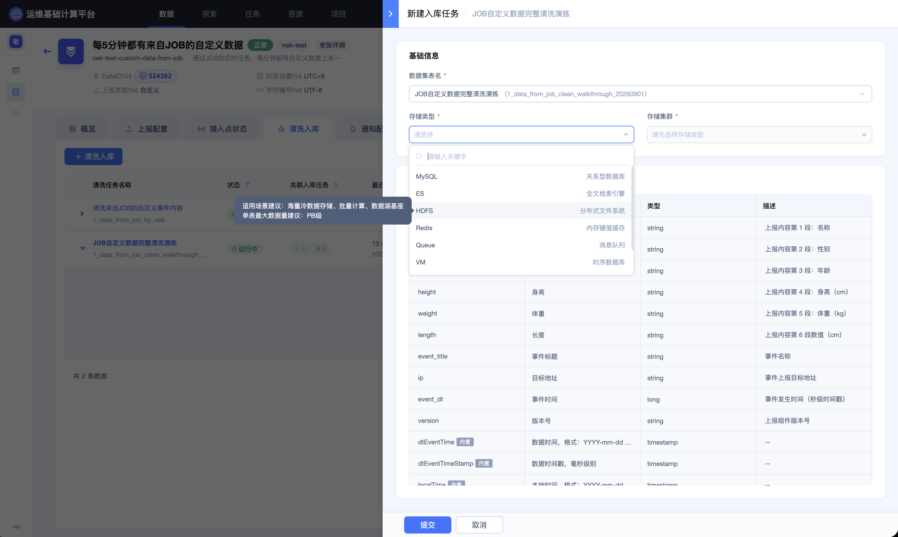
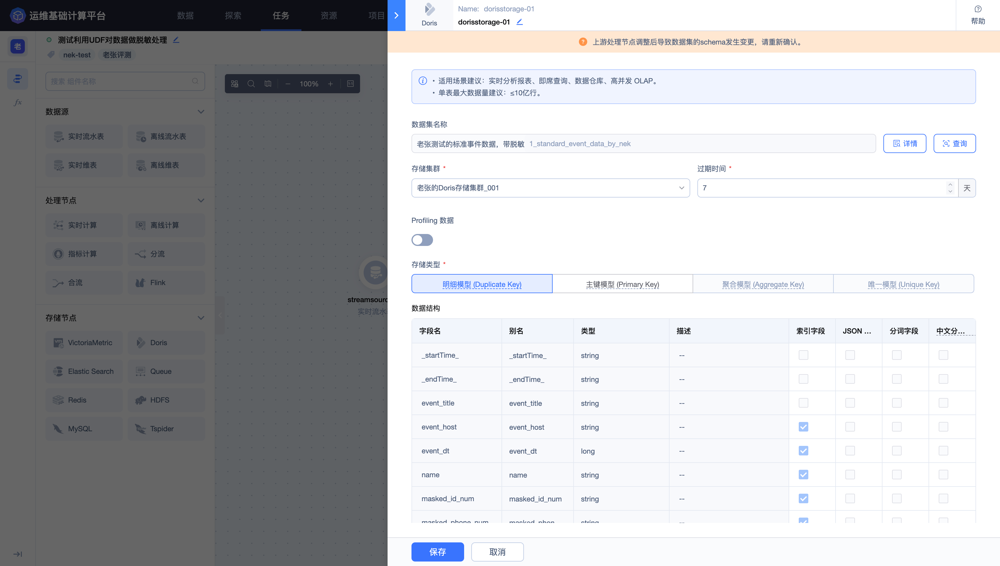
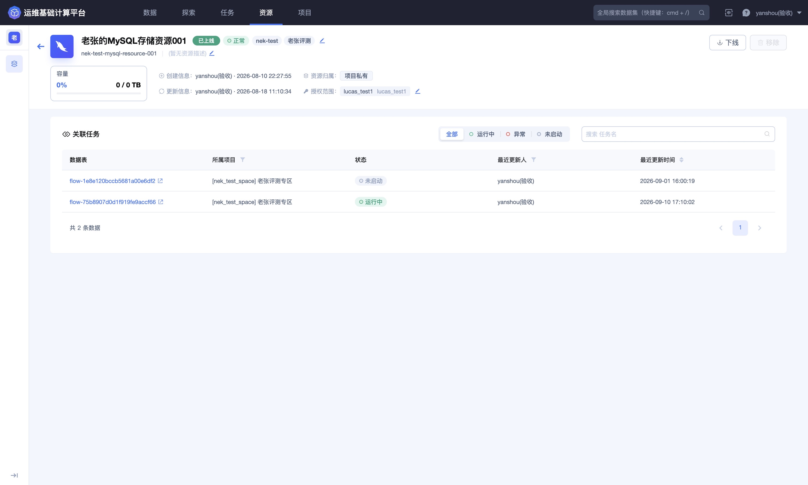
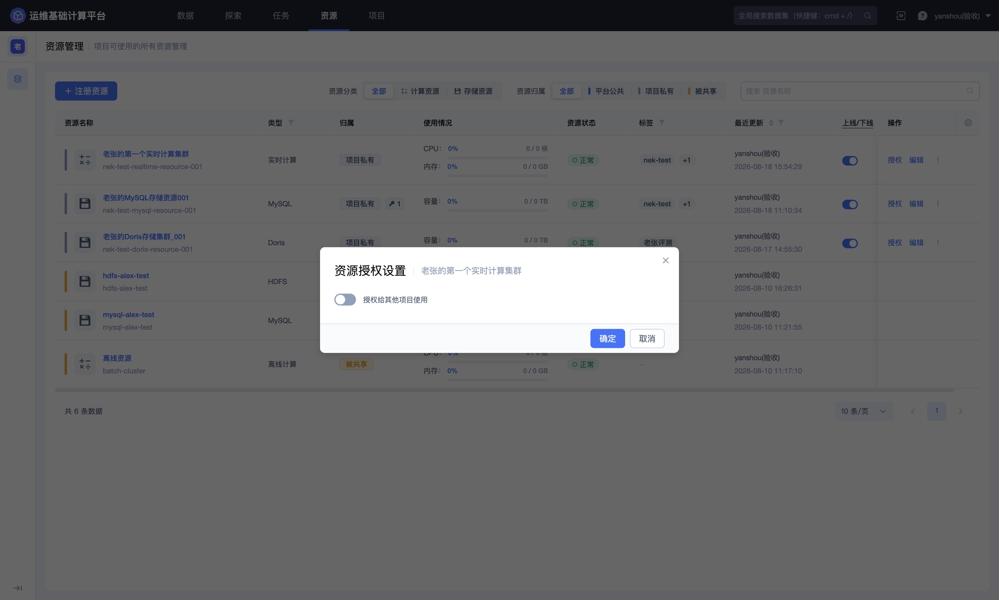

## 为不同消费场景设计多存储策略

同一份结果数据可能同时服务日志检索、运营分析、离线归档、指标观测和低延迟读取。使用一种存储承载所有需求，通常会造成查询体验、数据模型、成本或保留周期之间的冲突。

BKBase 支持为清洗结果或 Dataflow 结果配置不同存储。本实践介绍如何从消费方式出发设计存储组合。

在数据源详情的清洗入库区域，可以展开同一清洗任务查看关联的多个入库任务、存储类型、状态、保留时间和集群。

### 从消费需求开始

在选择存储前回答：

- 主要查询是精确过滤、全文检索还是多维聚合？
- 数据是明细、聚合指标还是维表？
- 是否需要更新已有记录？
- 数据量和增长速度如何？
- 查询延迟要求是多少？
- 需要保留多久？
- 下游通过查询、缓存还是消息方式消费？

### 常见存储定位

| 存储 | 适合场景 | 设计重点 |
| --- | --- | --- |
| ES | 日志检索、多条件过滤、文本搜索 | 索引字段、分词方式、保留周期、敏感字段 |
| Doris | 明细分析、聚合查询、高并发 OLAP | 存储模型、Key、字段类型、分区和数据规模 |
| HDFS | 长期保存、离线处理、历史重算 | 生命周期、文件组织、离线任务依赖 |
| MySQL | 关系型查询、小规模结果和应用读取 | 主键、索引、更新方式和容量 |
| VictoriaMetric | 时序指标查询与观测 | 指标、标签、时间字段和基数 |
| Redis | 低延迟键值访问、维表查询 | Key 设计、过期时间、容量和更新策略 |
| Queue | 下游消息订阅和流式消费 | 消费者、积压、重复消费和顺序要求 |

实际可选资源和字段配置以当前项目页面为准。

### 组合一：日志检索与长期归档

> 标准化日志 → ES（近期检索）＋ HDFS（长期保存）

适用于故障定位、审计和历史重算。ES 使用较短的在线检索周期，HDFS 按合规或业务要求保留更长时间。

应确保两条入库链路使用同一结果数据，并分别监控写入状态。不能因为 ES 到期删除就认为 HDFS 数据也已删除。

### 组合二：运营分析与明细追溯

> 清洗明细 → Doris（多维分析）＋ ES（单条日志定位）

Doris 承担按游戏、区服、渠道和版本的聚合分析，ES 用于根据玩家、请求或错误信息定位具体事件。两种存储可以使用不同的字段和索引策略。

### 组合三：指标观测与分析结果

> Dataflow 指标结果 → VictoriaMetric（时序观测）＋ Doris（报表分析）

VictoriaMetric 用于按时间和标签观察趋势，Doris 用于周期报表和多维分析。应控制标签基数，避免把每个玩家等高基数字段直接作为时序标签。

### 组合四：应用服务与数据分析

> 标准化维度数据 → Redis（在线读取）＋ Doris 或 MySQL（管理与分析）

Redis 提供低延迟读取，Doris 或 MySQL 保留可管理、可查询的结果。更新策略和过期时间必须保持一致，避免缓存长期落后于结果数据。

Dataflow 中的存储节点会根据存储类型展示对应配置。例如，Doris 节点需要选择存储资源、模型、Key 和字段设置。

### 字段与权限分层

不同存储不必暴露完全相同的字段：

- 日志检索保留故障定位需要的字段；
- 运营分析只保留业务维度和指标；
- 在线缓存只保留应用读取所需的 Key 与值；
- 长期归档按合规要求决定是否保留原始字段；
- 敏感字段根据用途脱敏、移除或限制权限。

### 生命周期管理

为每个存储分别记录：

- 数据负责人；
- 正式保留周期；
- 容量预估；
- 查询或消费方；
- 到期和删除策略；
- 任务停止后的恢复方式。

缩短保留周期、修改 Key 或改变存储模型可能影响查询和下游任务，应先评估依赖后再变更。

资源详情用于确认资源归属、状态、连接能力和授权情况。将资源授权给其他项目时，应按最小范围控制使用方。

### 验收检查

1. 各入库任务状态正常，最近写入时间持续推进；

2. 同一时间范围内各存储的数据量差异可以解释；

3. 查询实际命中了预期存储；

4. 字段、索引、Key 和标签符合对应消费方式；

5. 保留周期与容量预算一致；

6. 项目和下游用户只获得必要的资源与数据权限。

具体操作请参阅 [数据源：清洗和入库](../Features/Data/Data-source.md#清洗和入库)、[资源管理](../Features/Resource/Resource-management.md) 和 [数据集](../Features/Data/Data-set.md)。
