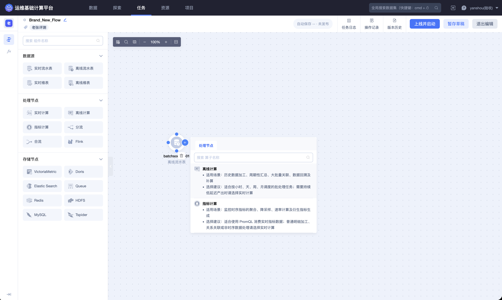
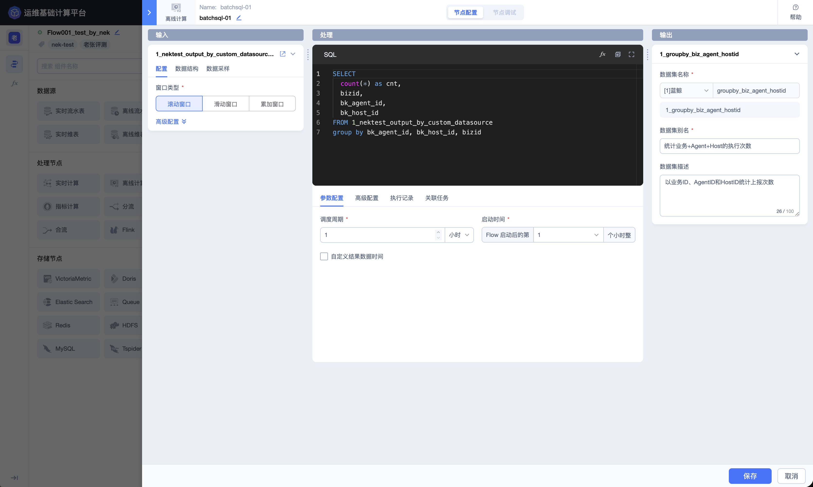
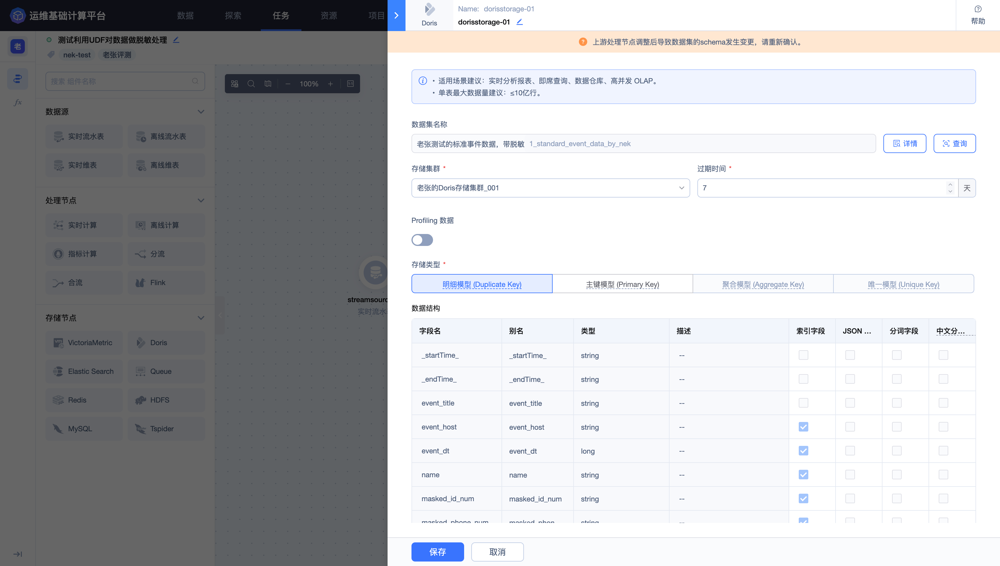
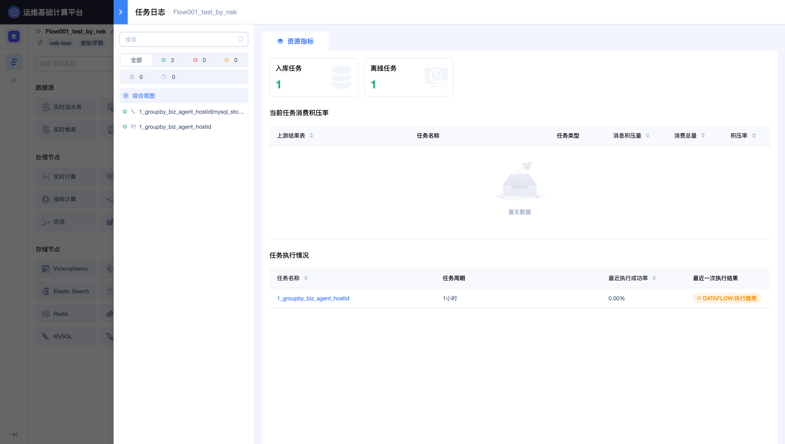

## 构建实时游戏运营指标

游戏运营通常需要持续关注登录量、成功率、失败原因、渠道分布和区服活跃情况。直接查询明细日志虽然灵活，但重复扫描大量数据会增加查询成本，也难以统一指标口径。

本实践使用清洗后的事件数据和 Dataflow 窗口计算，持续产生面向运营的指标结果。

### 场景目标

- 每隔固定时间产出登录次数、成功次数和失败次数；
- 按游戏、区服或渠道查看指标；
- 统一统计窗口和过滤条件；
- 让明细数据与指标数据分开存储和授权；
- 通过日志和运行状态持续观察计算链路。

### 推荐链路

> 登录事件结果表 → 实时计算节点 → 窗口统计 → 指标结果表 → Doris 或 VictoriaMetric → 查询、观测或可视化

Dataflow 的节点面板提供实时计算、指标计算以及多种存储节点。选择前可先查看节点帮助，确认处理方式和目标存储与指标场景匹配。



### 先定义指标口径

在创建任务前明确：

| 指标 | 示例口径 |
| --- | --- |
| 登录次数 | 窗口内全部登录事件数量 |
| 登录成功次数 | `login_result = 'success'` 的事件数量 |
| 登录失败次数 | `login_result = 'failed'` 的事件数量 |
| 登录成功率 | 成功次数 ÷ 登录次数 |
| 活跃玩家数 | 窗口内去重玩家数量，以平台支持的函数和校验结果为准 |

指标名称、过滤条件、维度和窗口必须同时记录，避免不同团队使用同名但不同口径的指标。

### 选择窗口

| 窗口 | 适用情况 | 注意事项 |
| --- | --- | --- |
| 无窗口 | 逐条转换、过滤或标准化 | 不用于固定周期聚合 |
| 滚动窗口 | 每 5 分钟、每小时等互不重叠的周期统计 | 最适合常规周期报表 |
| 滑动窗口 | 每分钟计算最近 5 分钟等重叠统计 | 同一事件可能进入多个窗口 |
| 累加窗口 | 在一个周期内逐步扩大统计范围 | 适合观察周期累计值 |
| 会话窗口 | 根据事件之间的空闲间隔划分会话 | 需要稳定的事件时间和合理间隔 |

时间范围聚合应优先通过节点窗口配置表达。SQL 的 `GROUP BY` 只保留游戏、区服、渠道等业务维度，除非业务明确点名某个字段作为统计时间字段。

### 编写计算逻辑

以下只展示业务维度和指标逻辑，实际字段与函数必须以输入 Schema 和平台校验为准：

```sql
SELECT
  game_id,
  zone_id,
  channel,
  COUNT(*) AS login_count,
  SUM(CASE WHEN login_result = 'success' THEN 1 ELSE 0 END) AS success_count,
  SUM(CASE WHEN login_result = 'failed' THEN 1 ELSE 0 END) AS failed_count
FROM <登录事件结果数据表ID>
GROUP BY game_id, zone_id, channel
```

窗口长度和统计频率在节点配置中设置，不在 SQL 中对平台时间字段进行截断或分桶。任何函数都应先通过当前平台的函数列表、签名说明和 SQL 校验确认可用。



### 选择目标存储

- 需要多维分析、报表和高并发查询时，优先评估 Doris；
- 需要面向时间序列进行指标查询和观测时，评估 VictoriaMetric；
- 需要长期保留明细或进行离线重算时，可为明细数据配置 HDFS；
- 不要让指标表同时承担原始日志检索职责。

选择 Doris 时，还需配置存储模型、Key、字段和保留周期。



### 运行与观测

任务上线后关注：

- 输入数据是否持续到达；
- 任务是否处于运行状态；
- 是否出现消费积压；
- SQL 或函数是否报错；
- 窗口产出时间是否符合预期；
- 存储节点是否持续写入；
- 指标是否出现不合理突增、归零或长时间不变。

运行页中的拓扑和节点状态用于确认整条指标链路是否成功部署。




### 验证指标

使用一小段已知范围的明细数据进行对账：

1. 明细总数是否等于登录次数；

2. 成功数与失败数之和是否符合业务状态集合；

3. 分区服、渠道汇总后是否与总量一致；

4. 窗口边界附近的事件是否进入预期周期；

5. 延迟数据是否按平台当前窗口规则处理。

通过探索模块抽样查询指标结果，并与已知明细范围进行对账。


### 变更原则

修改窗口、维度、过滤条件或指标算法会改变数据口径。上线前应记录新旧差异、评估下游影响，并决定是升级现有结果表还是创建新的指标结果表。

具体操作请参阅 [Dataflow](../Features/Flow/Dataflow.md) 和 [数据查询](../Features/Explore/Data-query.md)。
