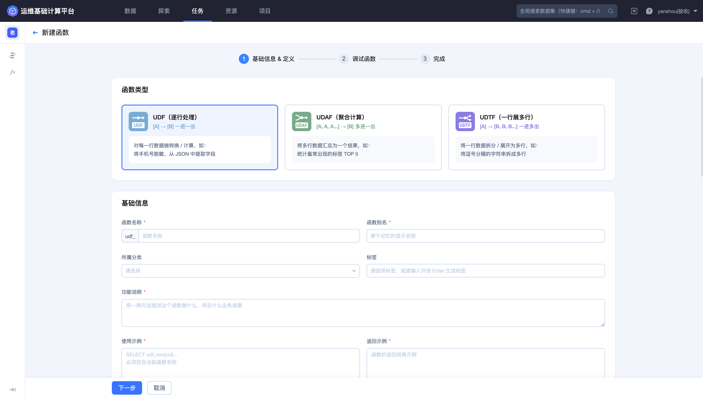
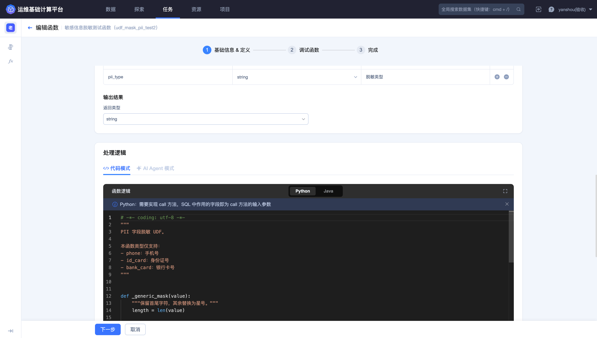
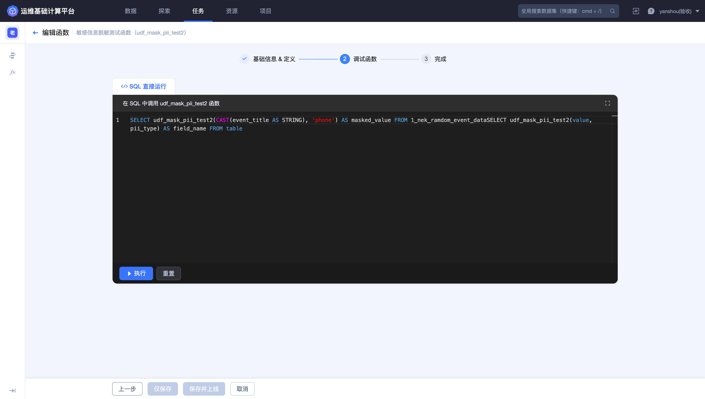
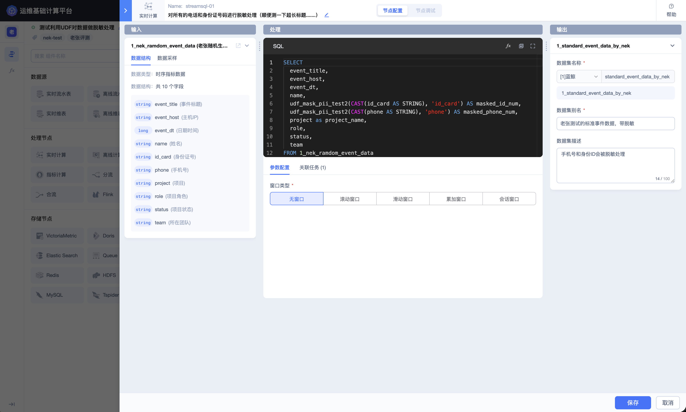
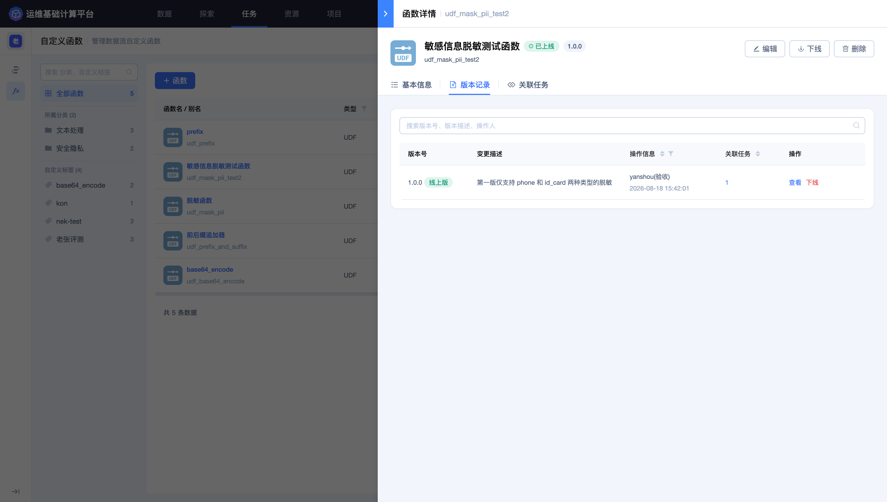
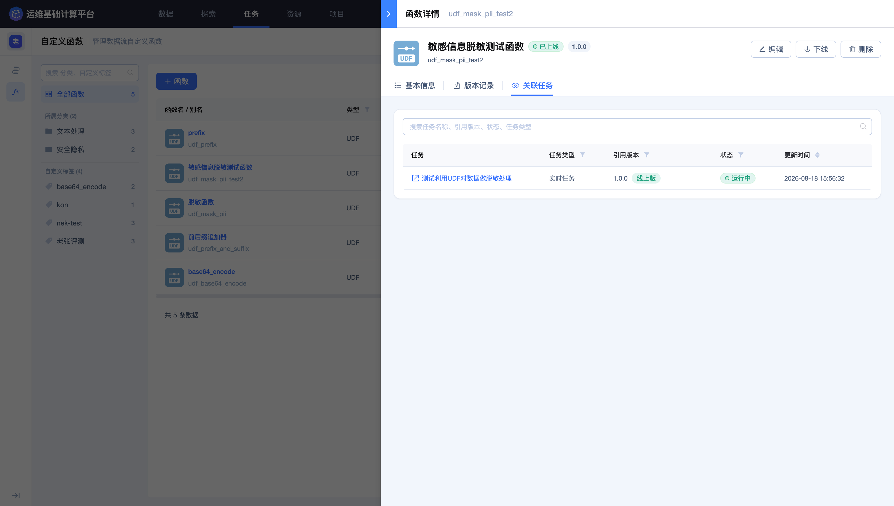
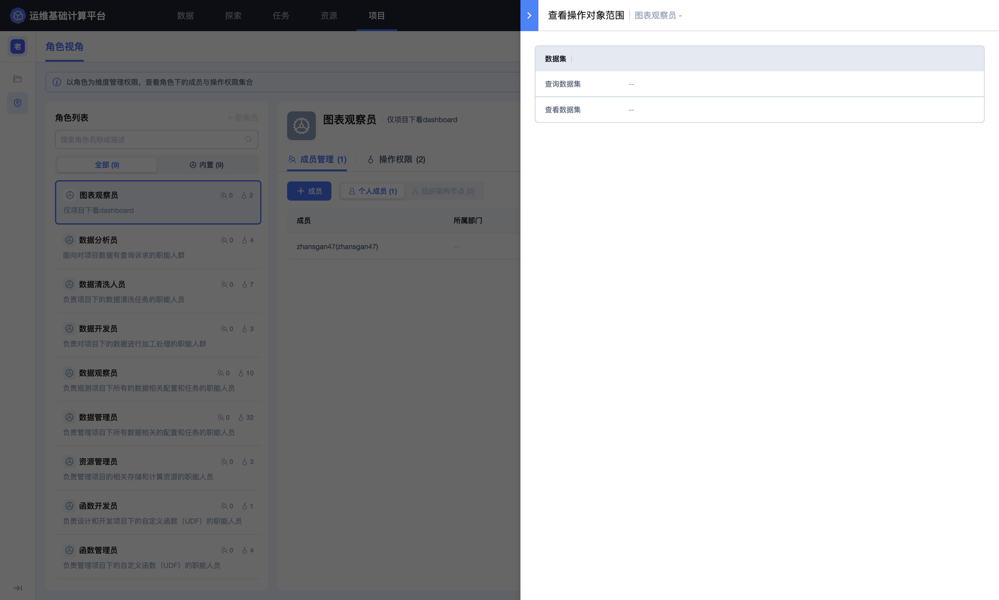

## 使用 UDF 和 Dataflow 处理敏感数据

业务日志和用户数据中可能包含手机号、证件号、邮箱、IP 或玩家标识。将原始值直接提供给分析、测试或可视化场景，会扩大敏感数据的暴露范围。

本实践通过自定义函数封装脱敏逻辑，并在 Dataflow 中统一调用，形成可复用、可追踪的敏感数据处理链路。

### 场景目标

- 对同类敏感字段使用一致的处理规则；
- 让下游默认消费脱敏后的结果数据；
- 保留函数版本和关联任务，便于评估变更影响；
- 对空值、非法值和边界输入给出明确结果；
- 限制原始敏感字段的查询和传播范围。

### 推荐链路

> 原始结果数据 → 创建脱敏 UDF → SQL 调试 → 函数上线 → Dataflow 调用 → 输出脱敏结果表 → 面向分析人员授权

### 选择函数类型

逐行脱敏通常选择 **UDF**。每个输入值对应一个输出值，便于在 `SELECT` 中对指定字段调用。

UDAF 用于多行聚合，UDTF 用于一行展开多行，不适合仅对单个手机号或证件号做逐行掩码。



### 设计函数接口

函数接口应稳定、清晰。例如：

```text
udf_mask_sensitive(value, sensitive_type) → string
```

- `value`：待处理的原始字符串；
- `sensitive_type`：`phone`、`id_card`、`email` 等规则标识；
- 返回值：脱敏字符串，无法识别时按约定返回空值或安全占位值。

上线前必须明确：

- `NULL` 和空字符串的处理方式；
- 长度不符合规则时的处理方式；
- 未知类型是否报错；
- 是否保留足够字符用于业务核对；
- 返回类型是否始终与函数定义一致。

函数定义页同时包含基础信息、输入输出、代码和依赖配置。参数名称、类型和顺序必须与代码方法保持一致。



### 完成函数调试

调试用例至少覆盖：

| 输入类别 | 示例目标 |
| --- | --- |
| 正常手机号 | 仅保留允许显示的前后字符 |
| 空值 | 返回 `NULL` 或约定值，不抛出异常 |
| 位数不足 | 返回安全结果，不泄露完整原值 |
| 非数字内容 | 按明确规则处理 |
| 未知敏感类型 | 返回安全结果或明确失败 |

调试数据应使用授权样例，结果截图不应显示真实个人信息。



### 在 Dataflow 中调用

调用前在函数详情中确认名称、状态、版本、参数顺序和返回类型，再根据输入 Schema 编写 SQL：

```sql
SELECT
  event_time,
  game_id,
  zone_id,
  player_id,
  udf_mask_sensitive(CAST(phone AS STRING), 'phone') AS masked_phone,
  login_result
FROM <输入结果数据表ID>
```

示例名称仅用于说明。实际使用的函数必须已经在当前平台上线，并且参数和适用场景通过页面校验。

如果下游不需要原始值，不要把 `phone` 同时选入输出结果。必须保留原值时，应把原始表和脱敏表设置为不同的访问范围。



### 管理版本影响

修改函数前先查看 **`关联任务`** 和 **`版本记录`**。以下变更可能不兼容：

- 增加、删除或调整参数顺序；
- 修改输入或返回类型；
- 改变空值、非法值处理方式；
- 修改掩码规则，导致相同输入产生不同输出；
- 变更依赖包及其版本。

无法同时升级全部调用方时，应新建函数或保留兼容版本，而不是直接覆盖现有接口。



下线或修改函数前，还应在关联任务页逐项确认正在使用该函数的 Dataflow。



### 验证结果

1. Dataflow 任务日志中没有函数加载、参数或返回类型错误；

2. 下游抽样查询只显示脱敏字段；

3. 正常值、空值和非法值均符合规则；

4. 原始结果表仍只对必要人员开放；

5. 函数详情能够看到引用该版本的任务。

敏感数据结果的使用范围应通过项目角色和操作对象权限控制。



### 安全原则

- 数据最小化：不接入、不输出、不索引业务不需要的敏感字段；
- 权限最小化：只向确有需要的角色开放原始数据；
- 展示最小化：截图、查询示例和日志中使用脱敏样例；
- 变更可追踪：保留函数版本、操作记录和关联任务；
- 下线有前置检查：确认所有调用方迁移后再下线或删除函数。

具体操作请参阅 [自定义函数](../Features/Flow/Custom-function.md)、[Dataflow](../Features/Flow/Dataflow.md) 和 [权限管理](../Features/Project/Permission-management.md)。
