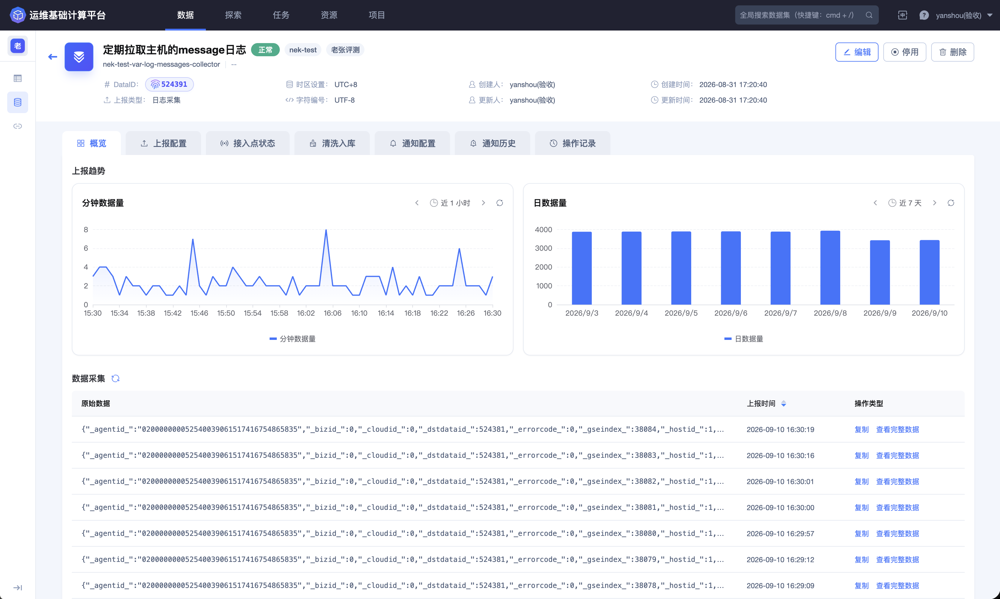
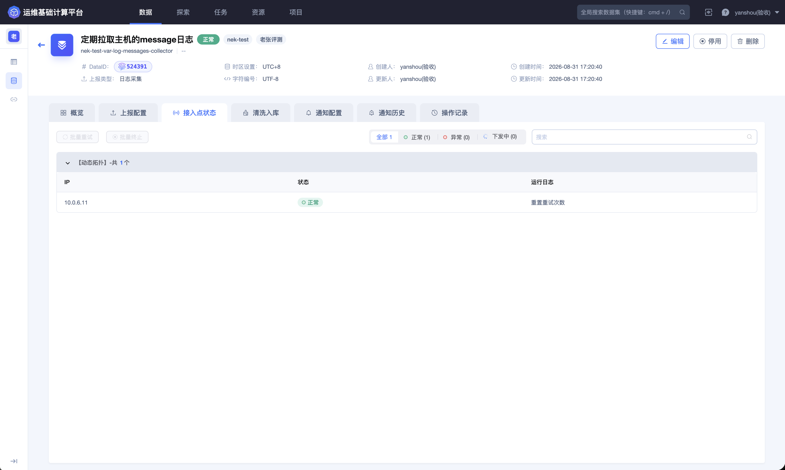
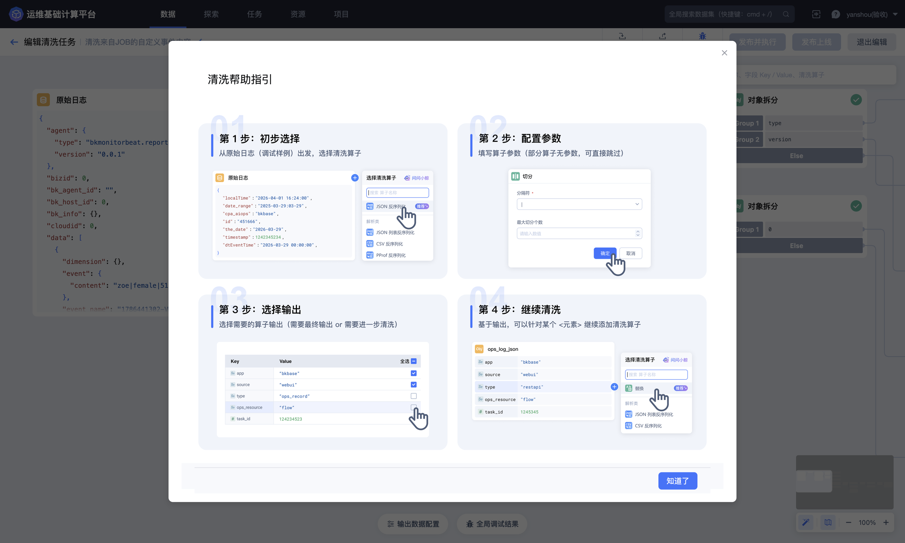
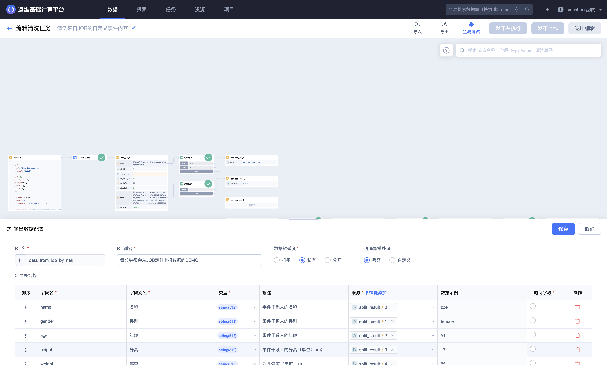
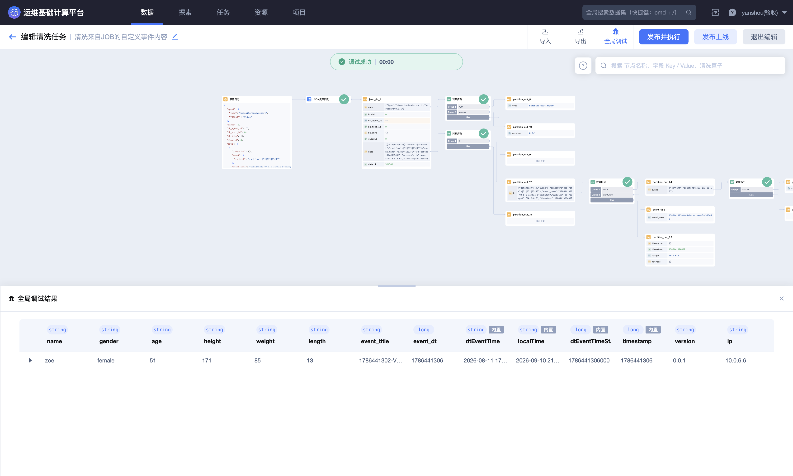
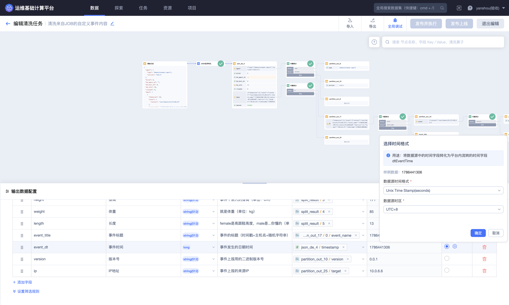
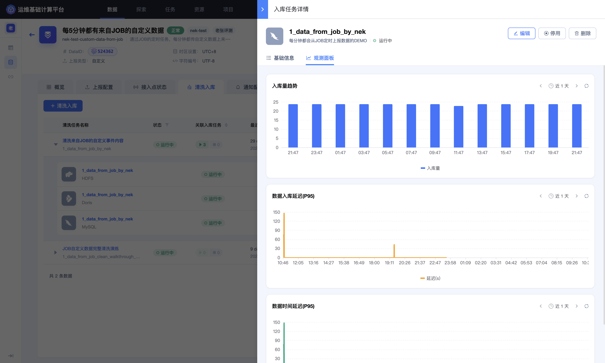
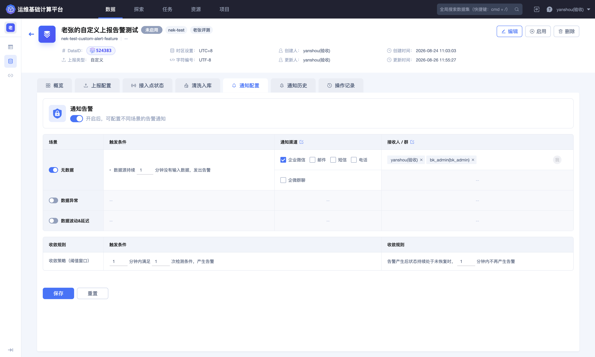

## 数据源与清洗常见问题

本页用于排查数据接入、样例数据、清洗算子、输出 Schema 和入库链路中的常见问题。建议始终按“数据源 → 样例 → 清洗 → 入库”的顺序定位。

### 数据源已经启用，为什么一直没有新数据？

可能原因包括上报端没有发送数据、连接或白名单不可用、采集范围配置错误、字符编码异常，或者数据源虽然启用但接入实例没有正常运行。

处理方法：

1. 在数据源列表检查最近上报时间；
2. 在详情页 **`概览`** 查看分钟数据量和最新原始数据；
3. 主动采集类来源进入 **`接入点状态`** 检查实例；
4. 复核数据连接、白名单、采集范围、时区和编码；
5. 查看通知历史和操作记录，确认是否发生过停用或配置变更；
6. 在上报端检查发送日志，但不要在协作渠道中粘贴密码、Token 或认证请求头。

恢复后，最近上报时间和趋势图应持续推进。

### 为什么“接入点状态”没有可展示的信息？

被动接收数据的自定义上报等来源可能没有平台主动部署的采集实例，因此页面无法展示接入点。这不等于数据源异常。

应改为检查 **`概览`** 中是否持续出现最新原始数据，再检查 **`清洗入库`** 中是否有输入和输出。

### 为什么在当前节点找不到某个清洗算子？

算子会根据当前节点的数据类型和上下文动态显示。例如，JSON 反序列化适用于字符串输入，对象拆分则通常在结构化节点后出现。

处理方法：

1. 在数据树中确认当前输入是字符串、字典还是数组；
2. 确认是从正确的输出分支点击 **`+`**；
3. 先使用解析算子把原始字符串转换为结构化数据；
4. 再从结构化节点选择对象拆分、删除元素或插入元素等处理算子；
5. 以当前页面的算子列表和表单为准，不套用其他版本的算子名称。

### 为什么页面上没有“赋值”算子？

BKBase V4 清洗编辑器不提供“赋值”算子。字段名称、类型、来源、说明和时间字段应在画布底部的 **`输出数据配置`** 中完成映射。

如果算子已经产生输出，但结果 Schema 中没有对应字段，应检查输出数据配置是否选择了正确的数据路径。

### 清洗节点为什么没有输出？

常见原因包括：

- 当前样例没有命中 Group 或条件分支；
- JSON、CSV、正则或分隔符与真实内容不一致；
- 对象字段路径或数组索引错误；
- 上游节点没有成功输出；
- 输入类型与算子要求不匹配。

先从上游开始逐节点运行，比较输入、输出和错误信息。某个 `Else` 分支为空可能只是样例命中了正常分支，不应单独判断为失败。

### 单个节点有输出，为什么全局调试仍然失败？

单节点运行只验证局部规则。全局调试还会检查完整链路、输出字段映射、字段类型、时间字段和最终 Schema。

应重点检查：

- 所有输出字段的数据路径仍然存在；
- 数组索引没有越界；
- 源值能够转换为目标字段类型；
- 时间戳单位、格式和时区正确；
- 必填字段在当前样例中有值；
- 异常处理策略符合当前数据。

### 为什么只有部分样例进入异常数据？

这通常意味着原始格式发生漂移，或者规则只覆盖了其中一种格式。比较正常样例和异常样例的字段数量、嵌套层级、分隔符、时间格式和空值情况。

不要为了让调试通过而直接忽略所有异常。应先判断异常是无效数据、上报版本差异，还是清洗规则遗漏，再决定增加分支、调整规则或丢弃。

### 修改算子后，输出 Schema 为什么没有同步变化？

输出 Schema 与算子输出路径是独立配置。算子重命名、删除或改变输出结构后，原有字段映射可能失效。

重新打开 **`输出数据配置`**，逐项核对字段来源、类型和示例值，再执行全局调试。字段已经被下游使用时，还应评估 Schema 变化对入库任务和 Dataflow 的影响。

### 时间字段应该如何配置？

先确认原始时间的单位和格式：

- Unix 时间戳需要区分秒和毫秒；
- 字符串时间需要匹配实际格式；
- 时区必须与事件产生端一致；
- 输出数据配置中应明确标记时间字段。

调试时同时比较原始值、转换结果和平台生成的时间字段。若日期偏移很多，优先检查秒／毫秒；若相差固定小时数，优先检查时区。

### 清洗任务运行中，为什么仍然查询不到数据？

“清洗任务运行中”只表示规则正在消费并产生结果数据，不代表已经写入可查询存储。

检查清洗任务下是否存在入库任务，再确认：

1. 入库任务已经启动；
2. 目标存储和存储资源正确；
3. 最近写入时间持续推进；
4. 入库延迟和异常没有持续增长；
5. 查询选择了已实际入库的结果数据表和存储。

入库任务详情中的状态、存储时长和存储集群可以帮助确认数据是否已经进入目标存储。

### CDC 数据源为什么不能创建普通清洗任务？

CDC 数据源通常在接入阶段同步表结构并配置目标存储，由平台直接处理变更数据，因此不再创建传统清洗任务或单独入库任务。

需要调整字段或存储时，应返回接入配置检查 CDC 的 Schema 和目标存储。需要进一步加工时，可以在 CDC 结果数据进入平台后，根据当前产品支持方式使用 Dataflow 构建下游结果。

### 发布后发现规则有问题，应该怎么办？

先确认影响范围：错误开始时间、异常比例、下游入库和 Dataflow 是否已经消费。修改规则后重新使用代表性样例完成全局调试，再按页面提示发布。

涉及消费范围、历史重放或下游重复写入时，应先确认幂等性和恢复方案，不要直接反复停止、启动或改变消费起点。

需要持续监控无数据、异常、波动或延迟时，在数据源详情中配置对应通知场景和收敛规则。

更多页面说明请参阅 [数据源](../Features/Data/Data-source.md)。
