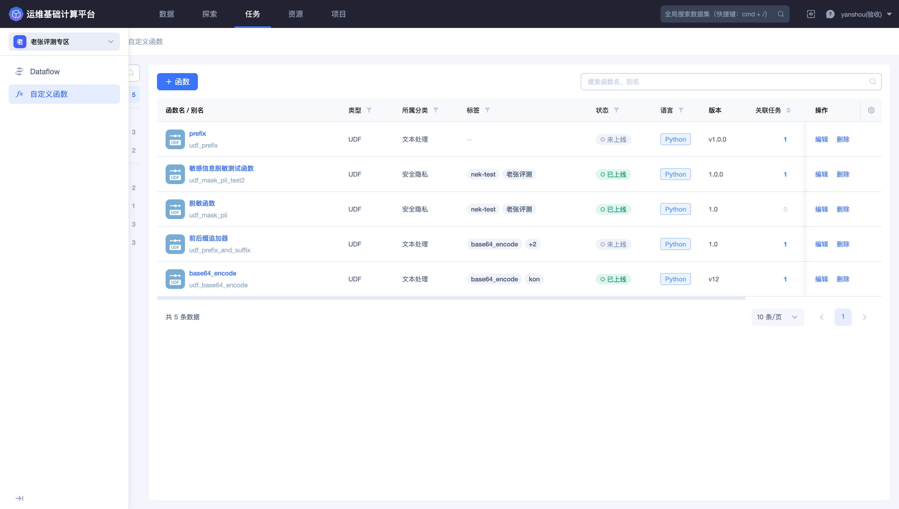
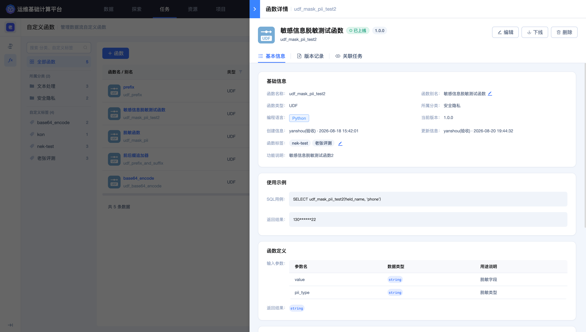
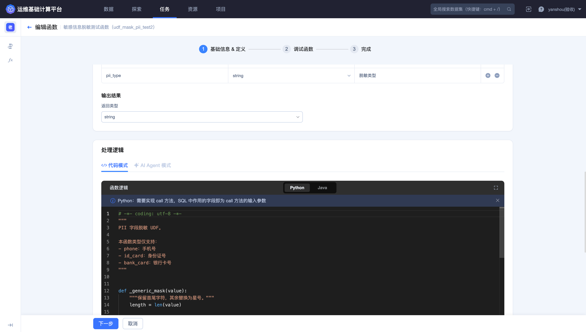
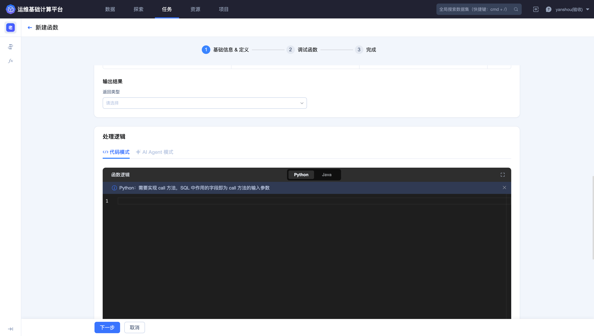
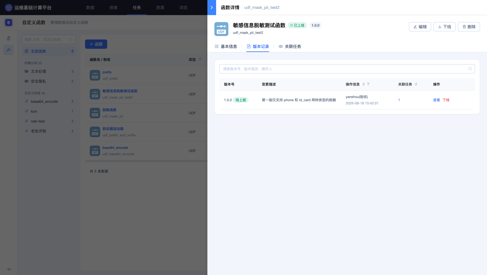
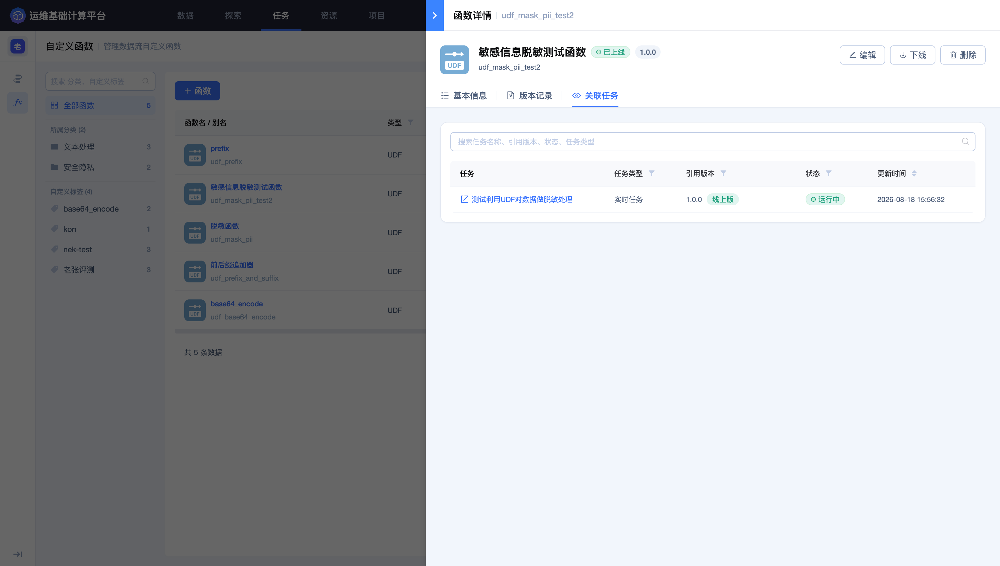
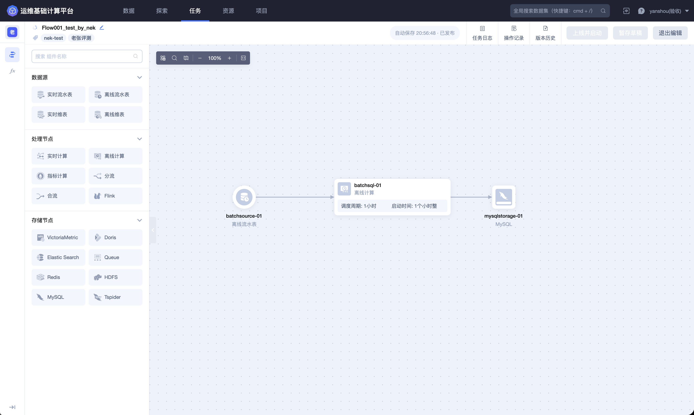
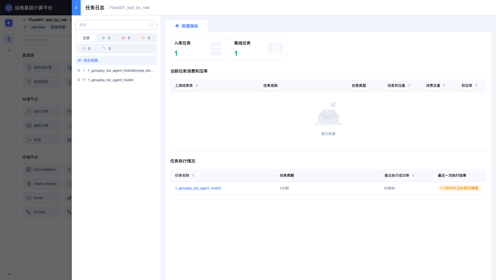
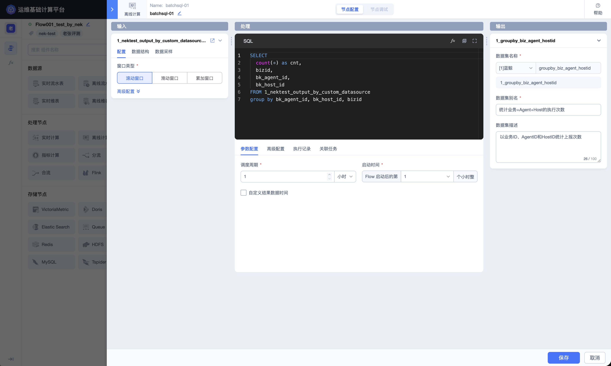
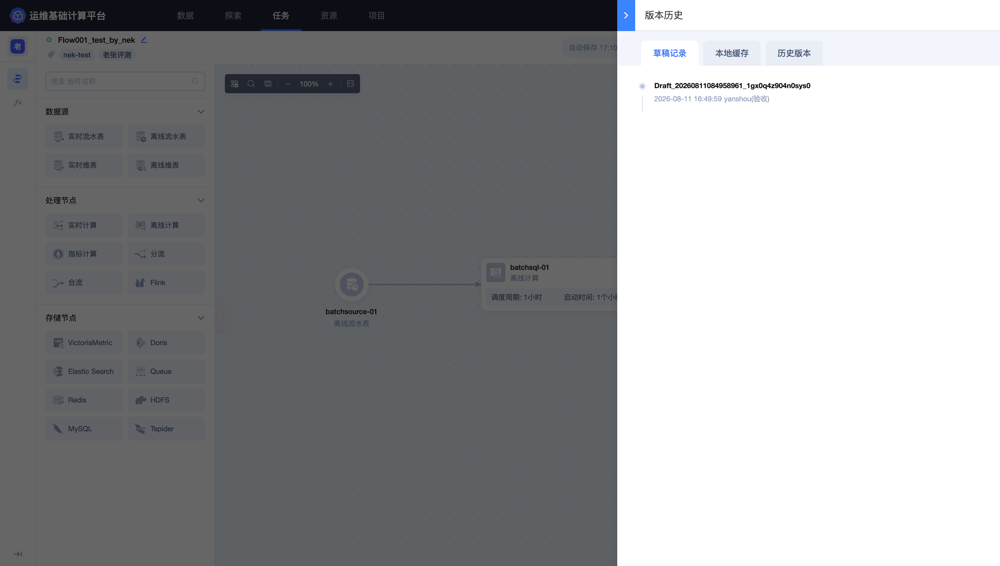

## Dataflow 与自定义函数常见问题

本页用于排查自定义函数创建、调试、上线，以及 Dataflow 节点配置、任务上线和运行中的常见问题。

### UDF 已经创建，为什么 Dataflow 中无法调用？

优先检查：

1. 函数是否已经上线，而不是仅创建；
2. SQL 中使用的是否为函数详情页显示的完整名称；
3. 当前计算类型是否与函数适用场景一致；
4. 输入参数数量、顺序和类型是否匹配；
5. 当前项目和用户是否有权使用该函数；
6. 函数是否已下线，或引用了不再可用的版本。

函数最终能否使用以当前页面函数列表、函数详情和 BKSQL 校验结果为准。

### UDF 调试为什么提示参数类型不匹配？

页面定义、代码方法和 SQL 调用三处必须完全一致：

- 参数数量相同；
- 参数顺序相同；
- 输入类型兼容；
- 代码返回值与返回类型相同。

源字段类型不匹配时，可根据函数定义使用 `CAST` 显式转换。不要只修改 SQL 而忽略代码中的处理方式。

### 为什么 UDF 调试 SQL 不能使用某些子句？

自定义函数调试使用页面限定的 SQL 运行规则，可能不支持普通查询中可用的全部子句。例如，当前流式调试场景可能拒绝 `LIMIT`。

应根据调试页面错误提示简化 SQL，只选择必要字段并调用当前函数。正式 Dataflow 中的 SQL 仍需重新通过对应节点校验。

### Python 依赖包无法使用，应该如何处理？

检查：

- 安装包名是否与 `import` 名混淆；
- 版本表达式是否符合页面规则；
- 依赖版本是否支持平台 Python 运行环境；
- 是否错误添加了已经内置的标准库；
- 包来源、许可证和安全策略是否允许使用。

优先减少不必要的第三方依赖，并使用明确版本或兼容范围保证可复现。仍无法安装时，应选择平台支持的替代包或改写逻辑。

### 修改 UDF 后，已有 Dataflow 为什么报错？

函数签名或行为发生了不兼容变化。常见情况包括参数增删、顺序变化、类型变化、返回类型变化或依赖更新。

进入函数的 **`版本记录`** 和 **`关联任务`**，确认哪些 Dataflow 使用了受影响版本。无法一次升级全部任务时，应保留兼容版本或新建函数。

### Dataflow 上线失败，应该先检查什么？

按节点顺序检查：

1. 数据源节点选择的结果数据表是否仍然可用；
2. 输入 Schema 是否发生变化；
3. SQL 字段、别名和函数是否通过校验；
4. 窗口、输出结果表和数据时间是否完整；
5. 存储节点是否选择了可用资源；
6. 当前用户是否具有编辑和执行权限；
7. 任务日志是否给出具体节点错误。

不要在尚未理解错误原因时反复上线或重启。

### Flow 显示运行中，为什么没有输出？

运行中只说明任务已经启动。无输出还可能由以下原因造成：

- 上游数据源没有新数据；
- 任务存在消费积压；
- SQL 过滤掉了全部记录；
- 窗口尚未达到触发条件；
- UDF 对输入产生异常；
- 输出 Schema 或存储写入失败；
- 查询的是错误结果表或错误时间范围。

依次查看上游最近数据、任务日志、计算节点输出、存储节点状态和结果表查询结果。

### 如何选择无窗口、滚动窗口和滑动窗口？

- 逐条清洗、映射和脱敏：使用无窗口；
- 每 5 分钟或每小时生成一个互不重叠结果：使用滚动窗口；
- 每分钟计算最近 5 分钟等重叠结果：使用滑动窗口；
- 周期内逐步累计：使用累加窗口；
- 按用户或连接的活动间隔划分：使用会话窗口。

窗口配置负责时间范围聚合。SQL 默认只按业务维度分组，不应再对平台时间字段重复分桶。

### 为什么窗口结果与预期数量不同？

检查窗口大小、滑动步长、触发频率、数据时间、延迟数据和业务过滤条件。滑动窗口中同一事件可能进入多个窗口，因此不能直接把所有窗口结果相加当作去重总量。

用一小段已知数据对账，并把窗口边界附近的数据单独检查。

### 上游 Schema 变化后应该如何处理？

先查看输入节点当前字段，再逐项检查：

- SQL 中引用的字段是否仍存在；
- 字段类型是否变化；
- UDF 参数是否仍兼容；
- 输出字段与 SQL 别名是否一致；
- 存储 Key、索引或字段配置是否受影响。

完成修改后先暂存和校验，再评估新版本对下游任务的影响。

### 暂存草稿和上线并启动有什么区别？

暂存草稿用于保存当前编辑内容，不会自动替换正在运行的版本。上线并启动会让新配置进入运行链路，可能改变数据处理结果。

修改运行任务时，应先检查版本差异、字段兼容性、窗口口径和存储结构，再决定上线时间。

### 停止、重启和节点重做分别适用于什么情况？

- **停止**：中断整个 Flow 的持续处理；
- **重启**：配置不变时重新拉起运行任务；
- **节点重做**：针对指定节点重新处理数据。

这些操作可能造成数据积压、重复处理或短时中断。操作前应确认消费起点、上游是否可回放、下游是否幂等以及恢复方案。

### 如何确认 Dataflow 中的 UDF 正常工作？

同时检查：

1. 函数处于上线状态；
2. Dataflow SQL 校验通过；
3. 任务日志没有函数加载或执行异常；
4. 输出字段类型正确；
5. 使用正常值、空值和边界值抽样查询；
6. 函数详情的关联任务中能看到该 Dataflow。

更多说明请参阅 [自定义函数](../Features/Flow/Custom-function.md) 和 [Dataflow](../Features/Flow/Dataflow.md)。
