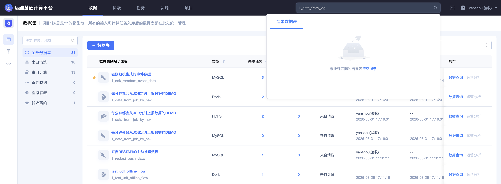
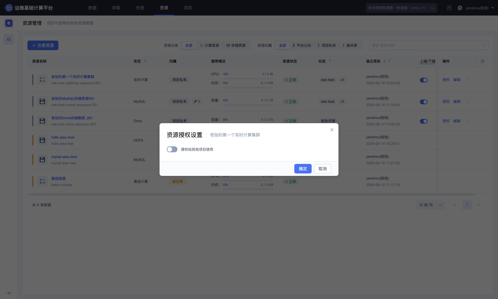
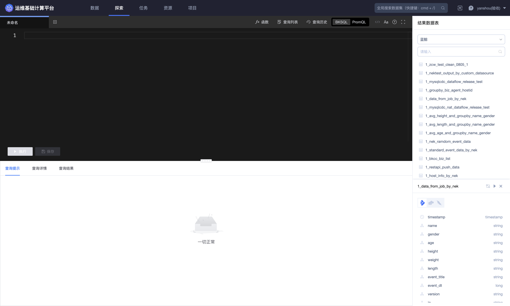
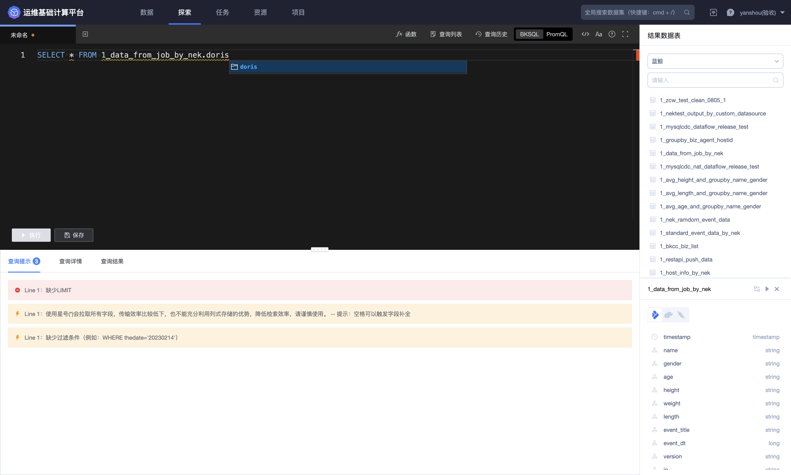
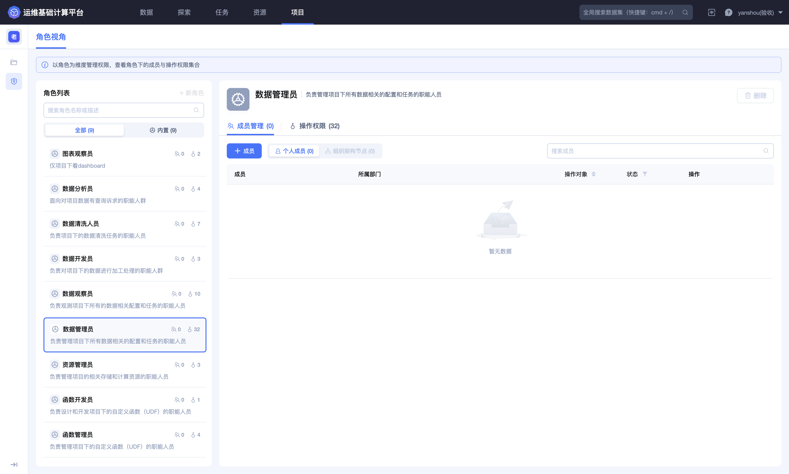
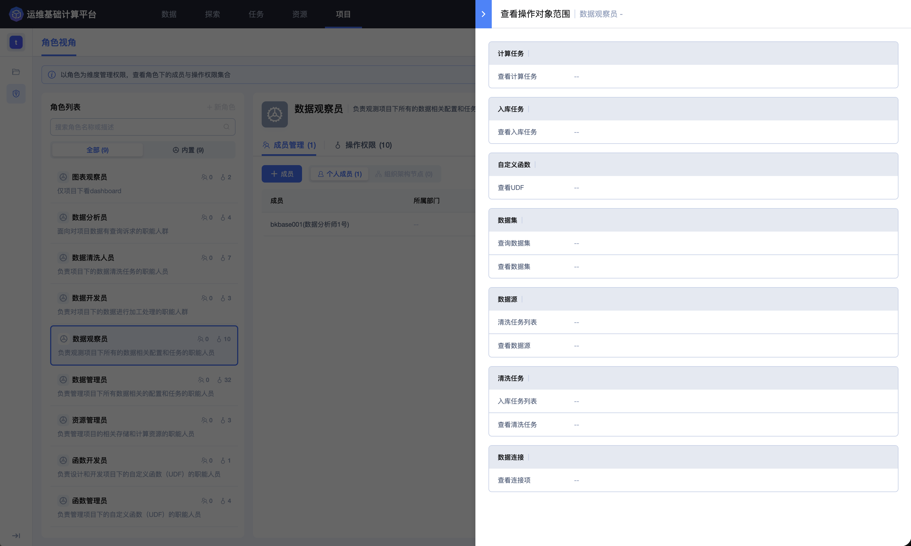
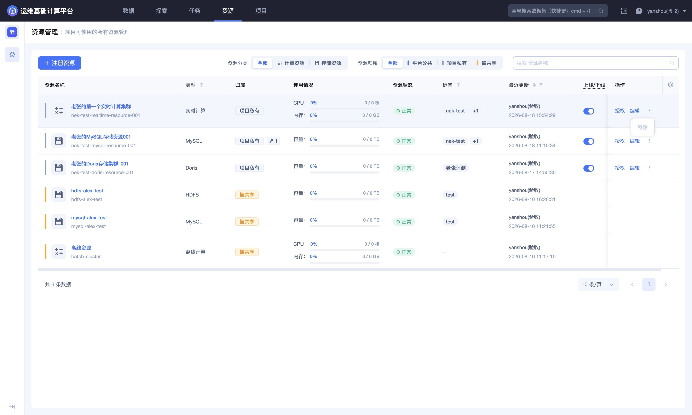

## 存储、查询与权限常见问题

本页用于排查结果数据已经生成但无法入库、查询或访问，以及项目角色和权限配置相关的问题。

### 数据已经清洗，为什么仍然查询不到？

清洗任务产生结果数据后，还需要存在正常运行的入库任务。检查：

1. 清洗任务下是否已添加存储；
2. 入库任务是否已启动；
3. 目标存储资源是否在线并对当前项目可用；
4. 最近写入时间和延迟是否正常；
5. 查询选择的是否为正确结果数据表；
6. 查询时间范围是否覆盖实际数据时间；
7. 当前用户是否拥有查询权限。

### 如何判断结果数据实际写入了哪些存储？

可以从以下位置确认：

- 数据源详情的 **`清洗入库`**：展开清洗任务查看关联入库任务；
- 数据集详情：查看结果数据的存储和关联任务；
- Dataflow 拓扑：查看结果表连接的存储节点；
- 探索模块：选择结果表后查看可查询 Schema 和存储信息。

不要仅根据结果表名称推断存储类型。

### ES、Doris 和 HDFS 应该如何选择？

- ES：日志检索、多条件过滤和文本搜索；
- Doris：多维分析、明细查询和高并发 OLAP；
- HDFS：长期保存、离线处理和历史重算。

选择时还要考虑数据规模、更新方式、保留周期、查询延迟和下游消费方式。需要同时支持多种消费模式时，可以为同一结果数据配置多存储。

### 为什么某个存储资源在配置页面不可选？

可能原因包括：

- 资源没有授权给当前项目；
- 资源处于下线或不可用状态；
- 资源类型与当前节点不匹配；
- 当前用户缺少使用或管理权限；
- 结果 Schema 不满足该存储的配置要求。

进入资源管理查看资源状态和项目授权，再返回任务页面重新选择。不要通过创建重复资源绕过已有资源的权限或状态问题。

### 入库任务运行中，为什么最近写入时间不更新？

检查上游清洗或 Dataflow 是否有新输出，再查看入库延迟和异常。如果上游持续有数据但存储没有写入，应检查存储资源状态、字段兼容性、Key 或索引配置，以及存储容量。

修改入库字段、存储模型或保留周期前，应先评估已有数据和下游查询影响。

### 为什么 BKSQL 查询没有返回数据？

按以下顺序排查：

1. 结果数据表名称是否正确；
2. 页面 Schema 中是否存在查询字段；
3. 数据是否已经写入可查询存储；
4. 时间和业务过滤条件是否过严；
5. 是否选择了错误的存储；
6. 当前用户是否拥有查询权限；
7. 查询提示是否指出缺少 `LIMIT`、使用 `SELECT *` 或缺少过滤条件。

先使用明确字段和较小 `LIMIT` 验证，再逐步增加过滤、聚合和函数。

查询编辑器会针对缺少 `LIMIT`、使用 `SELECT *` 或缺少过滤条件等情况提供提示。

### 为什么能够查看数据集，却不能查询数据？

查看元数据和查询数据属于不同权限。用户可能可以看到结果表名称、字段和血缘，但没有读取实际数据的权限。

确认用户拥有对应结果数据的查询权限，并检查操作对象范围是否包含当前表。不要通过复制数据到新表绕过原有权限控制。

### 为什么能够查看 Flow，却不能编辑或启动？

查看、编辑和执行属于不同操作权限。项目角色提供一组关联权限，更细粒度的能力还受操作权限和操作对象范围限制。

进入项目的权限管理，确认当前用户所在角色、有效期、操作权限和对象范围。启动、停止或重启运行任务前，还应确认业务影响。

### 项目管理员和项目观察员有什么区别？

这两个字段承载角色权限模型。把人员加入对应字段后，人员即拥有该角色关联的权限：

- 项目管理员面向项目维护和管理工作；
- 项目观察员以查看、观察和协作为主。

具体可执行操作以权限管理页面中的当前角色定义为准。如果成员只需要部分对象，应结合更细粒度的操作对象范围进行控制。

### 新增成员后为什么仍然无法操作？

检查：

- 成员是否已加入正确角色；
- 授权是否已经保存并生效；
- 授权有效期是否过期；
- 角色是否包含目标操作；
- 操作对象范围是否包含当前项目、数据或任务；
- 页面是否仍使用旧的项目上下文。

重新进入目标项目后再验证，不要直接扩大到全部对象范围。

### 如何排查查询速度慢？

优先优化查询范围：

- 显式选择需要的字段，避免 `SELECT *`；
- 增加时间和业务过滤条件；
- 使用合理的 `LIMIT`；
- 确认查询使用适合当前场景的存储；
- 避免一次返回大量明细；
- 检查常用筛选字段是否按存储特点配置；
- 对重复使用的聚合结果，考虑通过 Dataflow 产出稳定结果表。

一次查询只用于临时验证；需要持续复用的结果应固化为数据处理任务，而不是依赖手工重复查询。

### 修改保留周期有什么影响？

缩短保留周期可能使历史数据更早到期，延长周期会增加存储容量和成本。修改前应确认合规要求、下游查询范围、历史重算需求和容量预算。

不同存储的到期策略彼此独立，不应假设修改一种存储会同步改变其他存储。

### 删除数据源、Flow、函数或资源前应检查什么？

删除可能中断采集、计算、入库或下游消费。操作前至少检查：

- 当前运行状态和负责人；
- 关联清洗、入库和 Dataflow；
- 结果数据的下游血缘；
- 自定义函数的关联任务；
- 资源授权项目和承载任务；
- 数据备份、保留和恢复方案；
- 审批与变更窗口。

确认页面展示的最终影响范围后再决定是否执行删除。

更多说明请参阅 [数据查询](../Features/Explore/Data-query.md)、[资源管理](../Features/Resource/Resource-management.md) 和 [权限管理](../Features/Project/Permission-management.md)。
