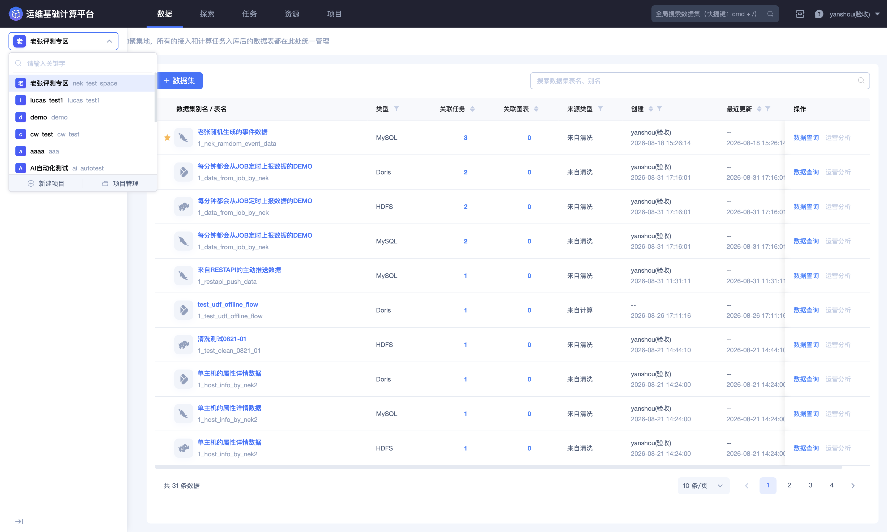
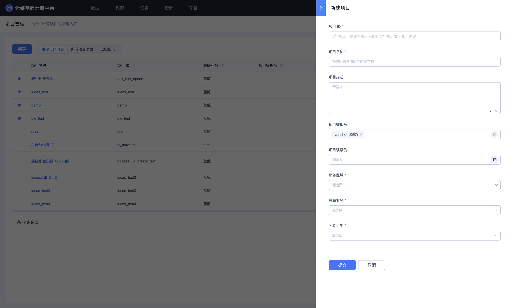
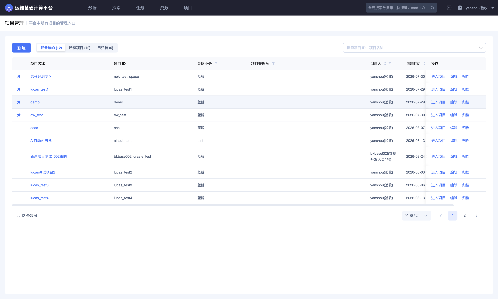
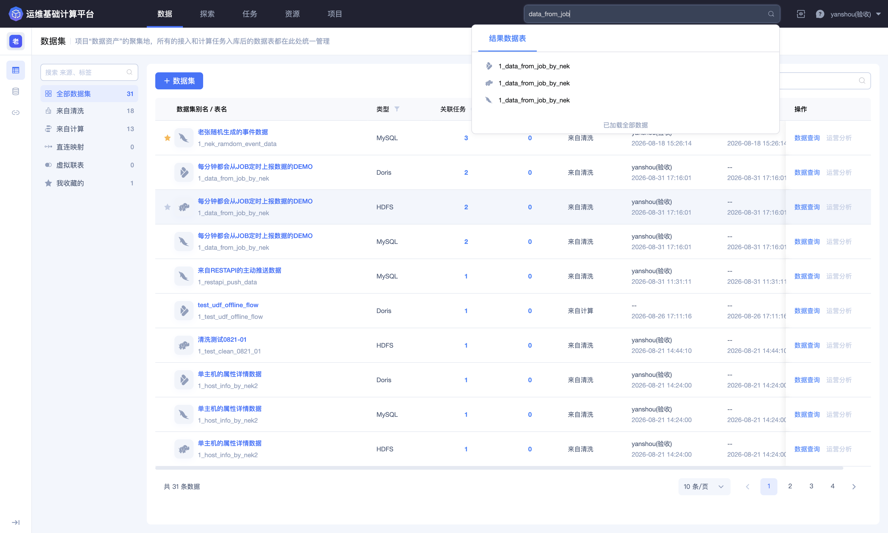
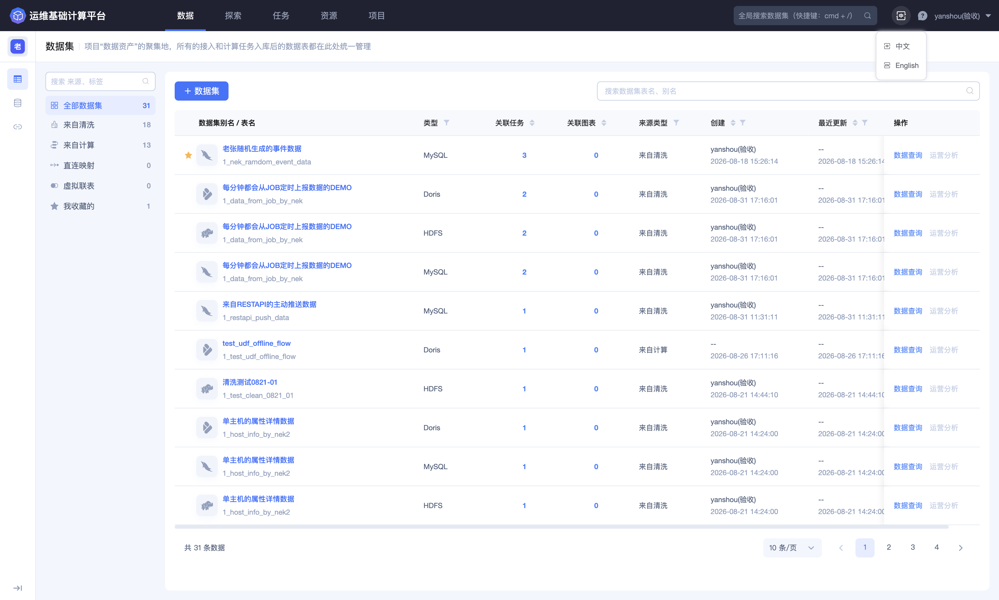
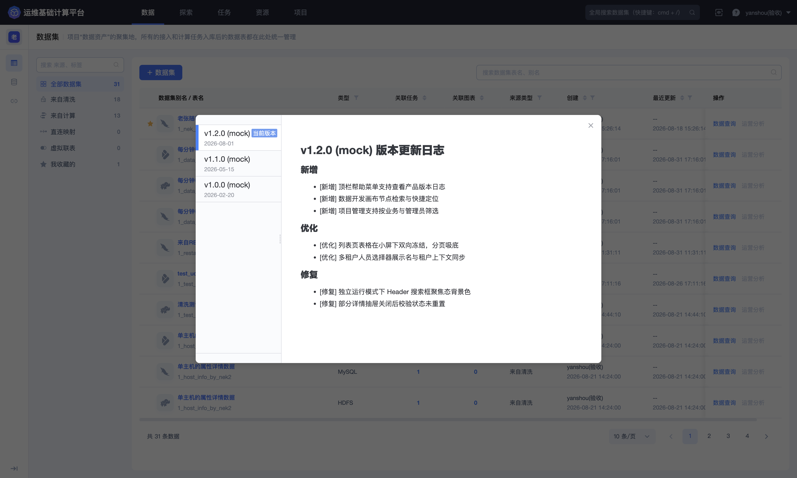
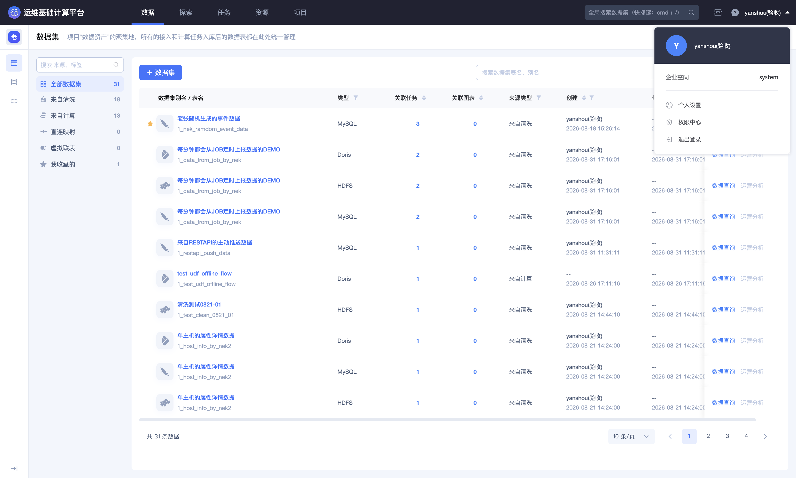

## 全局功能

BKBase 在页面左上角提供项目选择器，在顶部导航条提供全局搜索，并在右上角提供语言、版本日志和用户信息入口，这些功能在不同项目都是通用的。

### 项目选择器

左上角显示当前项目的头像或名称。点击该区域可打开项目选择器，查看有权访问的项目，并按项目名称或项目 ID 搜索。

项目选择器底部提供 **`新建项目`** 和 **`项目管理`** 两个入口。

#### 新建项目

点击 **`新建项目`**，打开项目管理页和新建项目表单。

| 配置项 | 是否必填 | 说明 |
| --- | --- | --- |
| 项目 ID | 是 | 项目的唯一标识；以字母或下划线开头，只能包含字母、数字和下划线 |
| 项目名称 | 是 | 面向用户展示的名称，最多 50 个字符 |
| 项目描述 | 否 | 说明项目用途、业务范围或使用对象，最多 100 个字符 |
| 项目管理员 | 是 | 负责项目维护的成员；保存后，所选人员直接获得项目管理员角色权限 |
| 项目观察员 | 否 | 需要查看项目的成员；保存后，所选人员直接获得项目观察员角色权限 |
| 服务区域 | 是 | 项目使用的服务地域，可选项由平台环境决定 |
| 关联业务 | 是 | 项目归属或服务的业务 |
| 关联组织 | 是 | 项目对应的组织范围 |

成员选择器中的 **`我`** 可快速选择当前用户。完成配置后点击 **`提交`** 创建项目；点击 **`取消`** 关闭表单。

创建前应重点核对项目 ID、项目管理员、关联业务和关联组织。项目 ID 用于接口调用、权限范围和对象定位，创建后不能在项目详情中修改。

#### 项目管理

点击项目选择器底部的 **`项目管理`**，进入平台的项目管理页。

页面支持以下项目范围：

| 范围 | 说明 |
| --- | --- |
| 我参与的 | 当前用户作为项目成员参与的项目 |
| 所有项目 | 平台所有当前用户可见的项目 |
| 已归档 | 已进入归档状态的项目 |

搜索框支持按项目 ID 或项目名称查找。项目列表展示项目名称、项目 ID、关联业务、项目管理员、创建人和创建时间。

每个项目可提供以下操作：

- **进入项目**：切换到该项目，并进入项目内的功能页面；

- **编辑**：修改项目名称、描述、管理员、观察员、服务区域、关联业务和关联组织；

- **归档**：结束项目的活跃使用状态。

归档属于高影响操作。归档前应检查数据源采集、清洗与入库任务、Dataflow、数据集、资源和成员交接情况，并根据确认信息核对归档后的访问、恢复和数据保留策略。

### 全局搜索

顶部导航条右侧的搜索框用于快速查找结果数据表。点击搜索框，或使用页面提示的 **`cmd + /`** 快捷键聚焦输入框。

输入完整或部分结果表名称，然后按 **`Enter`** 查看搜索结果。

结果在「结果数据表」分组中展示。每条结果包含存储类型图标和结果表名称。同一结果表配置了多种存储时，会按存储分别显示入口。

点击结果后，平台会使用对应存储打开数据集详情或数据预览。选择时应注意存储类型，避免在需要查询 Doris、HDFS、MySQL 或其他存储时进入错误入口。

搜索结果受当前用户的数据访问权限影响。找不到目标结果表时，可缩短搜索关键词，并确认结果表标识、所属项目和数据集查看权限。

### 右上角功能

右上角依次提供语言切换、版本日志入口和用户信息菜单。

#### 语言切换

点击语言图标，可在 **`中文`** 和 **`English`** 之间切换。

语言设置会切换导航、按钮、字段名称和提示信息，不会修改项目名称、数据表名称、字段名称或业务数据。

#### 版本日志

点击问号图标打开菜单，再点击 **`版本日志`**。

版本日志窗口左侧展示版本号、发布日期和当前版本标记；选择版本后，右侧展示对应的更新内容。

更新内容通常分为：

- **新增**：新上线的功能或入口；

- **优化**：交互、性能或可用性改进；

- **修复**：已解决的问题。

平台升级后，如果页面入口、字段规则或交互方式发生变化，可通过版本日志了解变更。具体版本号和内容以所在环境实际显示为准。

#### 用户信息

点击右上角的用户名称，打开用户信息菜单。

菜单顶部显示当前用户和企业空间，并提供：

| 入口 | 说明 |
| --- | --- |
| 个人设置 | 进入蓝鲸用户中心，维护个人账户相关设置 |
| 权限中心 | 进入蓝鲸权限中心，查看或申请平台相关权限 |
| 退出登录 | 结束当前登录会话 |

企业空间用于标识当前用户所在的租户上下文。排查数据或功能不可见问题时，应同时核对用户、企业空间、当前项目和角色权限。

退出登录前，应保存尚未提交的表单、查询语句和编辑器内容。退出后需要重新完成身份认证才能继续使用平台。
