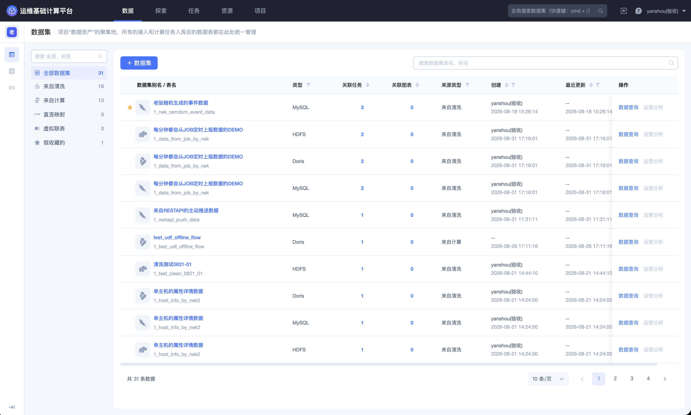
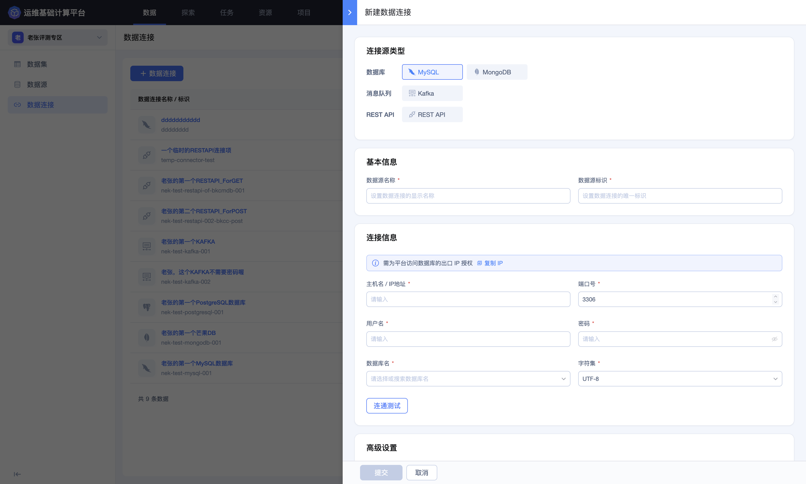

## 数据连接

「数据连接」用于集中保存外部数据库、消息队列和 REST API 的连接定义，供数据源创建和采集配置复用。连接定义描述如何访问外部系统，本身不等同于数据源或数据集。

进入平台后，点击顶部导航栏的 **`数据`**，再点击左侧的 **`数据连接`**。

### 查看数据连接列表

列表展示数据连接名称与唯一标识、类型、关联数据源数量、创建和最近更新信息，并提供编辑和删除入口。

关联数据源数量用于判断连接的影响范围。准备修改主机、端口、认证信息或数据库范围前，应先检查所有关联数据源，避免造成多个采集任务同时中断。

### 新建数据连接

点击 **`数据连接`** 打开新建面板。当前页面支持 MySQL、MongoDB、Kafka 和 REST API；实际可用类型以当前环境为准。

以数据库连接为例，配置流程如下：

1. 选择连接源类型；

2. 填写显示名称和唯一标识；

3. 按页面提示，将平台出口 IP 加入目标系统白名单；

4. 填写主机、端口、用户名、密码、数据库名和字符集；

5. 根据需要设置最大连接数、连接等待时长和查询超时时长；

6. 点击 **`连通测试`**，确认网络、认证和基础访问权限；

7. 核对配置后再提交。

MongoDB、Kafka 和 REST API 的字段与数据库不同，认证方式、连接参数和高级设置应以所选类型表单为准，不应套用其他类型的配置。

### 配置原则

- 使用只具备采集所需权限的专用账号，避免使用管理员账号；

- 白名单只开放平台需要的出口地址和端口；

- 最大连接数、超时和采集频率要与源端承载能力匹配；

- REST API 应明确请求方式、鉴权、分页、限流、重试和响应结构；

- Kafka 应明确 Broker、Topic、消费起点和鉴权方式；

- 连接测试成功只代表当前网络和认证可用，不代表字段结构、数据量和持续采集一定满足要求。

密码、Token、认证请求头、私钥和内部连接地址属于敏感配置，只应在受控配置页面中填写，请勿通过非受控渠道传播。

### 编辑和复用连接

数据源可复用已有连接。修改连接前应确认关联数据源数量、采集状态和维护窗口；修改后需要重新执行连通测试，并回到关联数据源检查最近上报时间和接入点状态。

### 删除数据连接

存在关联数据源时，删除连接可能导致采集中断。删除前应确认关联数据源已经迁移或停止，并明确连接凭据在外部系统中的后续处理。

> **删除提示**：删除数据连接前，应确认关联数据源已经迁移或停止，并在最终确认页再次核对连接名称和影响范围。
