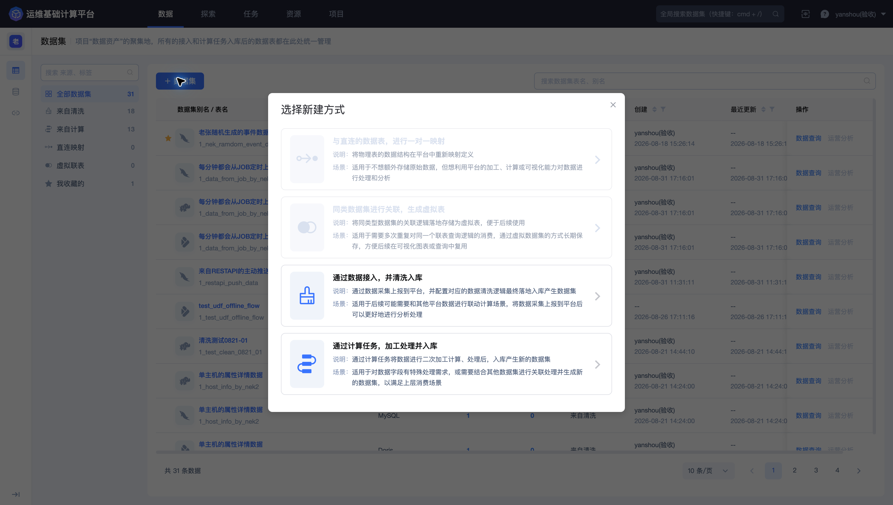
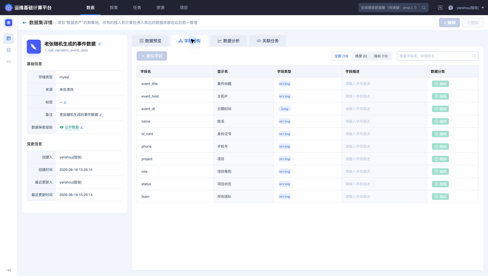
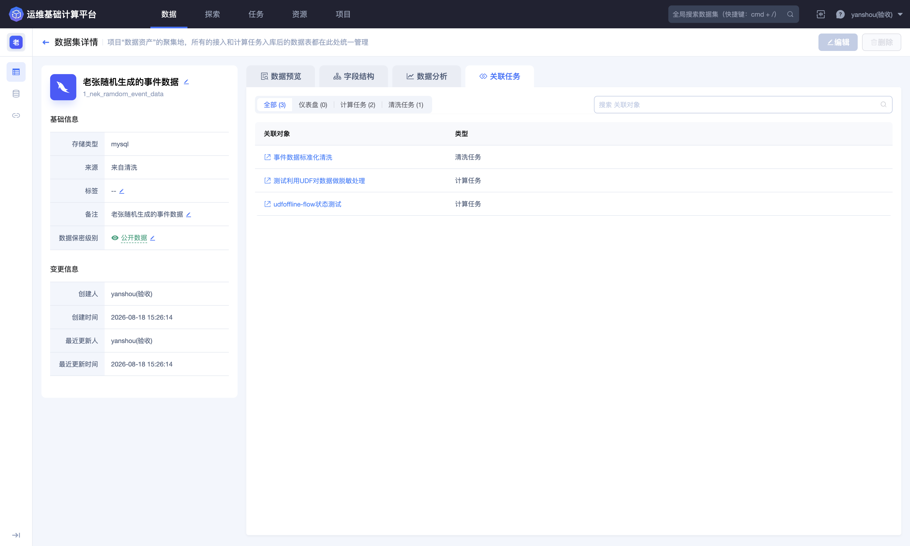

## 数据集

「数据集」是项目数据资产的统一入口。数据接入并完成清洗入库，或计算任务产出并入库后，都会在这里形成可查询、可分析、可被下游任务引用的数据表。

进入平台后，点击顶部导航栏的 **`数据`**，再点击左侧的 **`数据集`**。

### 查看数据集列表

页面左侧可按来源和用途筛选数据集，包括全部数据集、来自清洗、来自计算、直连映射、虚拟联表和我收藏的；右侧列表展示：

- 数据集名称、结果表标识和当前存储类型；

- 字段数、关联任务数和数据来源；

- 创建、最近更新信息；

- **`数据查询`**、**`运营分析`** 等消费入口。

可通过搜索框按数据集表名或别名定位目标表。使用数据集前，建议同时确认结果表标识、来源、存储类型和最近更新时间，避免选择名称相近但口径不同的数据。

### 新建数据集

点击 **`数据集`**，平台提供四种新建方式。

- **直连映射**：将外部物理表一对一映射为平台数据集，适合不额外复制原始数据、但需要使用平台计算或分析能力的场景；

- **虚拟联表**：保存同类数据集的关联逻辑，形成可重复使用的虚拟数据集；

- **数据接入并清洗入库**：从数据源采集数据，经过清洗和存储配置后形成数据集；

- **计算任务加工入库**：由实时或离线计算任务加工后生成新的结果表。

不同方式的前置条件不同。直连映射依赖可用数据连接；清洗入库依赖数据源和存储资源；计算入库依赖任务、计算资源和目标存储。

### 查看数据集详情

点击数据集名称进入详情页。左侧基础信息展示存储类型、来源、标签、备注、数据保密级别以及创建和更新信息；右侧提供数据预览、字段结构、数据分析和关联任务。

#### 数据预览

「数据预览」用于抽样检查最近数据。页面通常只展示有限条数，并提供刷新或查询更多入口。

预览前应确认数据保密级别和字段内容。包含账号、手机号、证件号、内部地址或其他敏感信息时，请勿通过非受控渠道传播原始记录。

#### 字段结构

「字段结构」展示字段名、显示名、类型、描述和数据分类，可按维度、指标筛选，也可搜索字段。

字段结构是查询、清洗和计算任务之间的契约。使用前应重点检查：

- 字段名和类型是否与上游输出一致；

- 显示名、描述和数据分类是否准确；

- 时间字段、业务主键和敏感字段是否定义清楚；

- 下游任务是否仍依赖准备修改的字段。

#### 数据分析

「数据分析」用于对字段分布和数据质量进行辅助检查。具体可用能力与当前数据集、存储类型和权限有关，分析结果不能替代业务口径确认。

#### 关联任务

「关联任务」汇总使用或产出该数据集的对象，可按仪表盘、计算任务和清洗任务筛选。

编辑字段定义、调整存储或准备删除数据集前，应先检查关联任务和下游消费，评估查询、计算和可视化的影响。

### 查询和分析数据

列表中的 **`数据查询`** 会进入探索模块并载入目标结果表；**`运营分析`** 用于进入面向业务分析的消费场景。实际可用入口取决于数据权限和存储类型。

> **删除提示**：删除数据集可能影响关联清洗、计算、查询和下游消费。操作前应检查关联任务、数据权限和下游依赖，并在最终确认页再次核对目标数据集。
