## 数据源

「数据源」用于统一管理项目的数据接入项。平台可从内置系统、日志、数据库、消息队列和 REST API 等来源获取数据，并在数据源详情中继续完成清洗、结果表定义和入库配置。

进入平台后，点击顶部导航栏的 **`数据`**，再点击左侧的 **`数据源`**。

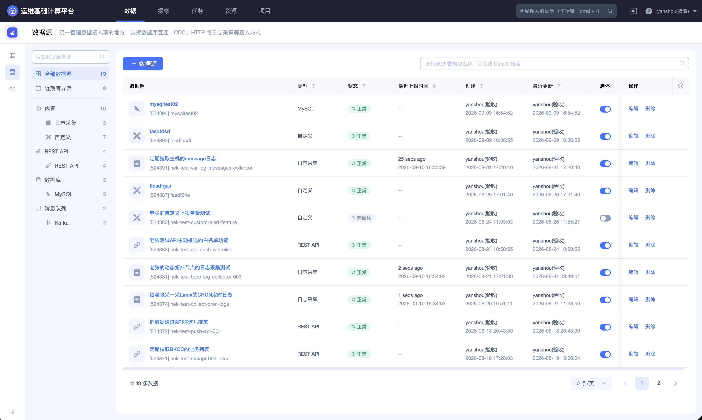

### 查看数据源列表

页面左侧按来源类型统计并筛选数据源，右侧列表展示数据源名称与标识、类型、状态、最近上报时间、创建与最近更新信息，以及启停和编辑入口。

排查数据未更新时，建议依次检查：

1. 数据源是否启用、状态是否正常；

2. 最近上报时间是否持续推进；

3. 数据连接、白名单或接入点是否可用；

4. 清洗任务是否有输入、输出或异常丢弃；

5. 入库任务是否运行以及延迟是否异常。

### 新建数据源

点击 **`数据源`**，先选择数据源类型，再按向导完成配置参数、连接调试和创建。

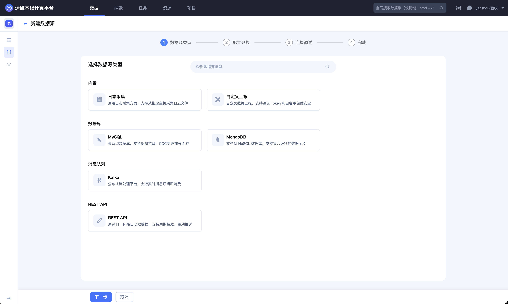

当前页面可见的接入类型包括：

- **内置**：日志采集和自定义上报

- **数据库**：MySQL 和 MongoDB，其中 MySQL 支持周期拉取和 CDC 变更捕获

- **消息队列**：Kafka

- **REST API**：支持周期拉取或主动推送

普通采集一般按“接入 → 获取样例 → 配置清洗 → 定义输出 → 存储入库”的路径形成数据集。CDC 场景通常在接入阶段同步表结构并配置目标存储，不再单独建立传统清洗任务，具体以页面向导为准。

连接外部系统时，应先准备网络白名单、最小权限账号、访问范围和采集频率。密码、Token、认证请求头和内部连接地址只应在受控配置页面中使用，请勿通过非受控渠道传播。

### 查看数据源详情

点击数据源名称进入详情页。页面顶部集中展示名称、状态、标识、说明、DataID、时区、创建与更新信息、上报类型和字符编码，并提供编辑、启停和删除入口。删除数据源可能中断数据链路，操作前应先检查关联任务和下游消费。

详情页共有 7 个标签，可分别查看采集概况、接入配置、任务状态、通知和操作历史。

#### 概览

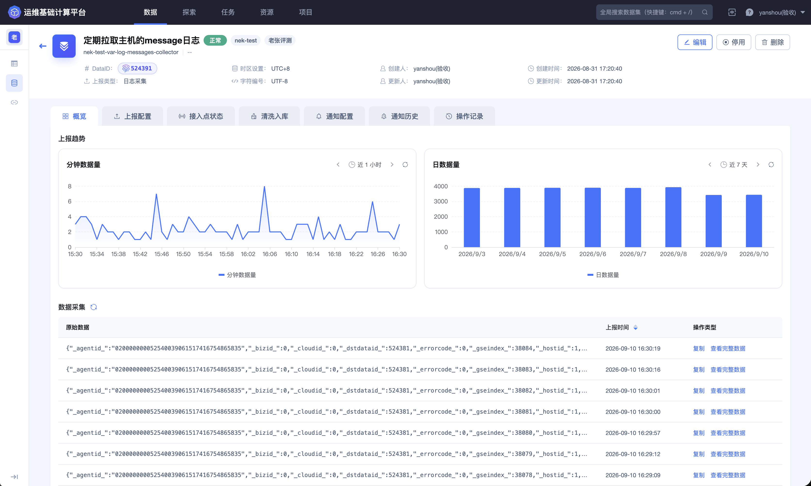

「概览」由上报趋势和数据采集两部分组成。上报趋势分别展示近 1 小时的分钟数据量和近 7 天的日数据量；数据采集表展示原始数据、上报时间以及复制、查看完整数据等操作。原始样例可能包含业务数据或个人信息，查看、复制或共享前应确认数据权限并做好脱敏。

#### 上报配置

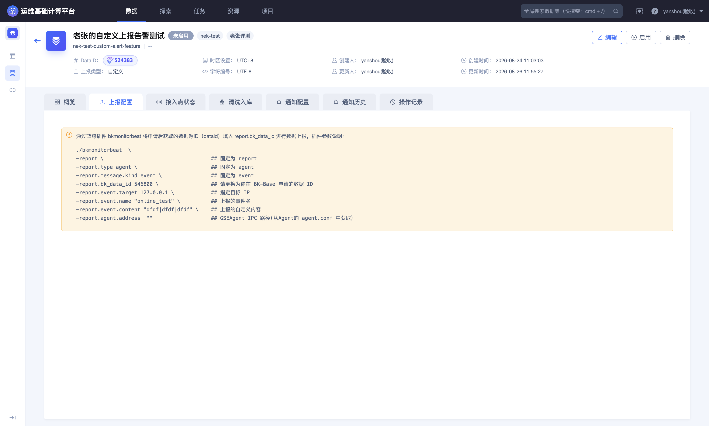

「上报配置」展示与当前来源类型匹配的接入说明。自定义上报示例会说明 `report` 命令、数据 ID、目标、事件名、事件内容和 Agent 通信地址等参数。实际使用时应替换示例值，并避免通过非受控渠道传播密码、Token、认证请求头和内部地址。

#### 接入点状态

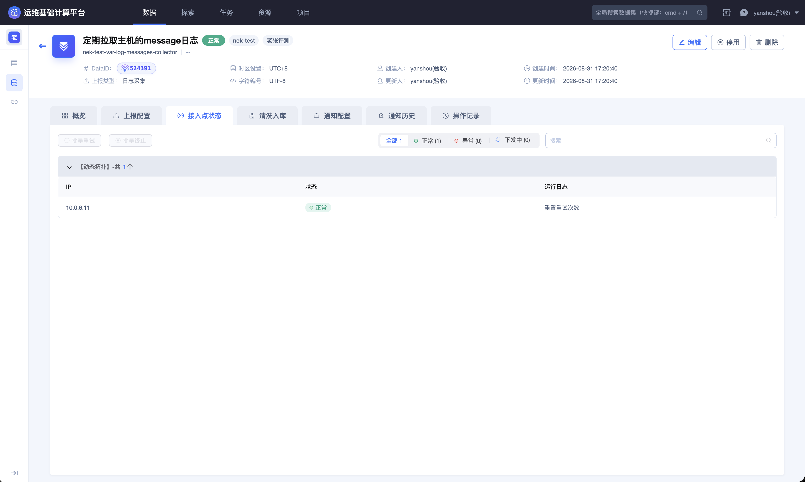

「接入点状态」用于检查平台主动采集类来源的接入实例与运行状态。对于被动接收数据的自定义上报，页面会提示无法显示接入点信息，此时应结合「概览」的最近数据和「清洗入库」的输入情况判断链路是否正常。

#### 清洗入库

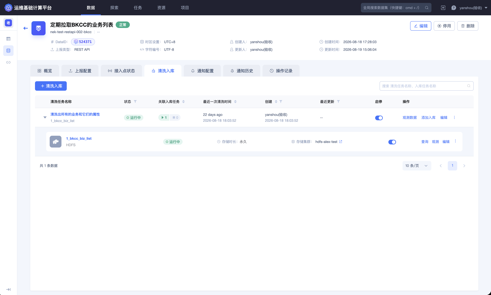

「清洗入库」提供新建清洗任务、搜索清洗任务或入库任务、查看任务状态和展开关联入库任务等功能。空数据源会显示空列表；已有清洗任务的数据源会显示任务状态、关联入库数量、异常数量、最近清洗时间和操作入口。

#### 通知配置

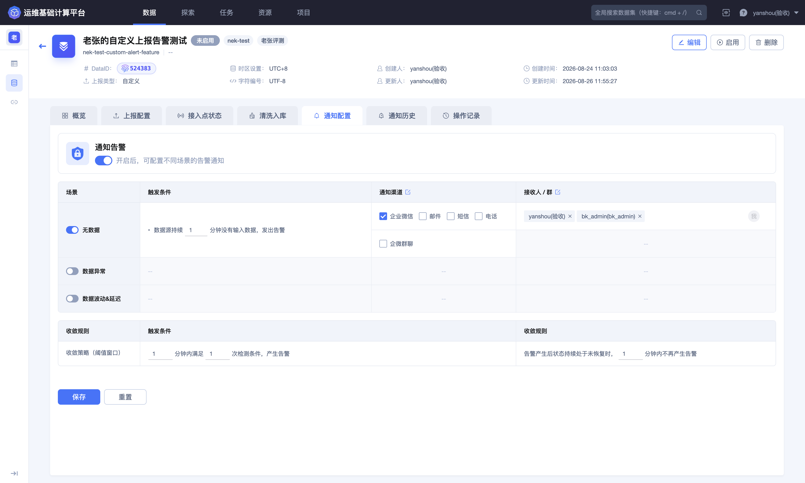

「通知配置」包含通知告警开关、告警场景、触发条件、通知渠道、接收人或群以及收敛规则。可用场景包括无数据、数据异常、数据波动与延迟；通知渠道包括企业微信、邮件、短信、电话和企微群聊。收敛规则可配置阈值窗口内满足检测条件的次数，以及告警未恢复时的重复通知间隔。完成修改后，点击 **`保存`** 使配置生效。

#### 通知历史

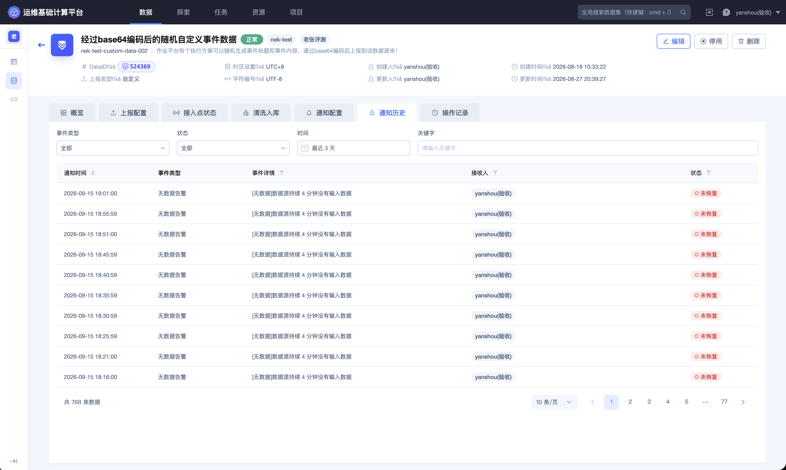

「通知历史」可按事件类型、状态、时间和关键字筛选，列表展示通知时间、事件类型、事件详情、接收人和恢复状态，用于确认告警是否产生、发送给谁以及是否恢复。

#### 操作记录

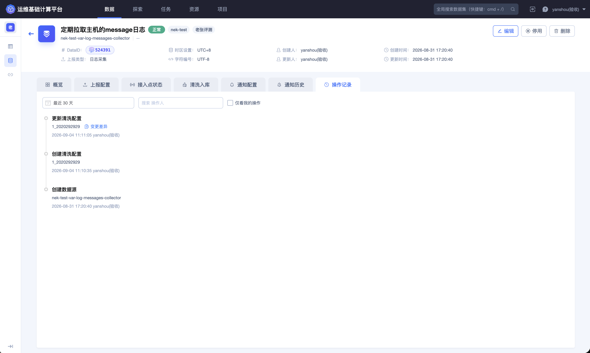

「操作记录」可按日期范围和操作人筛选，也可仅查看自己的操作。记录会标明启用、停用、更新等动作；存在配置变更时，可通过「变更差异」查看修改内容。

### 清洗和入库

「清洗入库」把接入的原始数据转换为稳定结果表，并将同一结果表写入适合不同消费场景的存储，是数据源详情中最关键的处理链路。

列表以清洗任务为主行，展开后显示关联入库任务。清洗任务区域展示结果表标识、运行状态、关联入库数量、异常数量、最近清洗时间、创建和更新信息；每个入库任务展示存储类型、状态、存储时长和存储集群。

同一清洗结果可以同时写入多个存储。例如，MySQL 适合关系型查询，HDFS 适合长期或离线处理，Doris 适合分析查询。配置多存储时，应分别评估保留周期、容量、查询模式和成本，不能仅按存储名称选择。

#### 配置清洗规则

点击清洗任务的 **`编辑`** 可进入可视化清洗编辑器。页面包含以下区域：

- **原始样例**：选择最近上报的数据，作为规则调试输入；

- **数据树**：展示当前节点输出的数据结构，便于定位对象字段和数组位置；

- **算子画布**：通过节点和连线组织页面提供的清洗步骤；

- **输出数据配置**：定义结果表及最终字段 Schema；

- **全局调试结果**：按节点查看输入、输出和失败原因；

- **编辑工具**：提供规则导入、导出、搜索、缩放、全局调试、发布和退出编辑。

当样例包含手机号、证件号、内部 IP 等敏感值时，只应在获准的受控环境中调试，并避免复制、下载或传播原始样例值。

##### 算子使用说明

算子选择器会根据当前节点的数据类型提供可用算子。BKBase V4 清洗编辑器不提供“赋值”算子；结果表的字段名、类型和来源应在「输出数据配置」中完成映射。

##### 清洗算子完整清单

点击原始日志或节点右侧的 **`+`** 打开「选择清洗算子」，可按算子名称搜索。算子会根据当前节点的数据类型动态变化：原始日志入口可见 12 个算子，下游字符串或结构化节点会增加结构处理类算子。不同输入上下文中可用算子的并集为 17 个，分为解析类、处理类和其他三组。

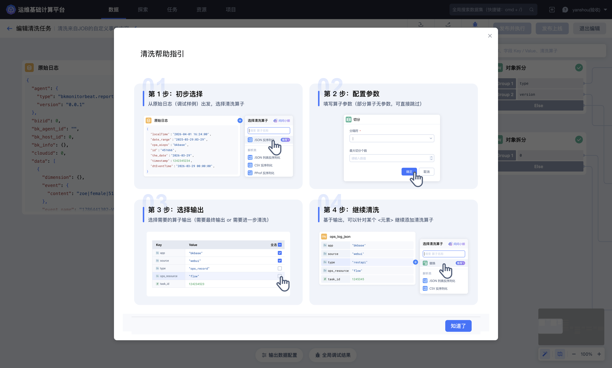

| 分类 | 算子 | 用法说明 | 输出 |
| --- | --- | --- | --- |
| 解析类 | JSON 反序列化 | 将 JSON 字符串反序列化为字典；解析失败会报错 | `dict` |
| 解析类 | CSV 反序列化 | 解析 CSV 格式数据，例如将 `a,b,c` 解析为数组 | `list` |
| 解析类 | URL 反序列化 | 解析 URL 参数 | `dict` |
| 解析类 | base64 解码 | 对 Base64 内容进行解码 | `str` |
| 解析类 | PProf 反序列化 | 解析 PProf 性能数据 | `dict` |
| 处理类 | 切分 | 按分隔符切分字符串 | `list` |
| 处理类 | 正则提取 | 按正则表达式提取字段，支持从日志中提取命名字段 | `dict` |
| 处理类 | KV 提取 | 提取 Key-Value 对 | `dict` |
| 处理类 | 时间格式转换 | 按指定格式和时区把输入时间字符串转换为目标时间字符串 | `str` |
| 处理类 | 替换 | 字符串替换 | `str` |
| 处理类 | 遍历 | 遍历数组或列表元素 | `list` |
| 处理类 | 删除元素 | 删除指定字段 | `dict` |
| 处理类 | zip | 将2个列表合并在一起 | `list` |
| 处理类 | 对象拆分 | 将对象拆分为多个字段 | `list` |
| 处理类 | 插入元素 | 插入新字段 | `dict` |
| 处理类 | 条件分支 | 根据某个字段值的不同匹配条件，执行不同的清洗逻辑分支 |  按需处理|
| 其他 | 自定义算子 | 使用平台提供的算子框架开发业务个性化的定制清洗逻辑 |  按需处理|

表中的“页面说明”和“输出”以算子悬浮说明为准。部分算子只显示通用示例“根据算子参数对输入内容进行处理”，具体参数需在选择算子后查看右侧配置表单。选择算子后，节点会直接添加到画布，再通过右侧表单配置参数。

> 算子列表不是固定菜单。例如，原始日志入口显示 JSON、CSV、URL、Base64、PProf 等解析类算子；字符串字段的下游菜单不再显示这些解析类算子，而会显示遍历、删除元素、zip、对象拆分和插入元素等结构处理算子。选择算子时应先确认当前节点的输入类型和上下文。

##### 规则链示例

以下规则链演示如何解析包含事件对象和分隔文本的 JSON 数据：

1. 原始日志分别进入 JSON 反序列化节点；

2. 对字典对象使用「对象拆分」节点选择字段。「对象拆分」不会出现在原始日志入口的菜单中，但会出现在适配结构化节点的上下文算子菜单中；

3. 其中一条分支选择 `agent` 对象的 `type`、`version`；另一条分支依次选择数组索引 `0`、对象字段 `event`、`event_name`，再从 `event` 中选择 `content`；

4. 「切分」节点以 `partition_out_33.content` 为来源，分隔符为 `|`，最大切分个数为 `10`，输出数组 `split_result`；

5. 输出表将 `split_result / 0` 至 `split_result / 5` 映射到 6 个业务字段，并将事件名、原始时间戳、版本和来源地址分别映射到对应字段。

节点卡片会直接展示当前规则。例如，「对象拆分」按 `Group 1`、`Group 2` 和 `Else` 展示输出分支；「切分」卡片展示来源、分隔符和最大切分个数。节点操作区提供编辑、单节点运行和删除入口。删除节点会改变处理链，操作前应确认其上下游连接和输出字段依赖。

##### 输出数据配置

点击画布底部的 **`输出数据配置`** 可查看结果表定义。当前页面包括：

- **结果表来源**：当前任务为「新建 RT」；

- **基础信息**：RT 名、RT 别名；

- **数据敏感度**：机密、私有、公开；

- **清洗异常处理**：丢弃、自定义；

- **表结构**：排序、字段名、字段别名、类型、描述、来源、数据示例、时间字段和操作。

示例将 `event_dt` 标记为时间字段。字段来源既可以是字典路径，也可以是数组索引路径；每个字段还会显示异常处理策略。

##### 配置示例：清洗来自 JOB 的自定义数据

以下以数据源「每5分钟都有来自JOB的自定义数据」为例，介绍清洗任务的配置、调试、发布和启动流程。示例配置如下：

| 配置项 | 示例值 |
| --- | --- |
| 清洗任务名称 | `JOB自定义数据完整清洗演练` |
| 结果表 | `1_data_from_job_clean_walkthrough_20260901` |
| 结果表别名 | `JOB自定义数据完整清洗演练` |
| 数据敏感度 | 私有 |
| 清洗异常处理 | 丢弃 |
| 启动消费范围 | 按顺序正常消费（页面推荐项） |
| 入库任务 | 未配置；清洗任务启动后可按需添加 |

编辑器不提供“赋值”算子；最终字段名、类型和来源均在「输出数据配置」中完成映射。

###### 1. 选择算子

点击原始日志或当前节点右侧的 **`+`** 后，页面会按输入类型展示可用算子。对于原始 JSON 字符串，先选择「JSON 反序列化」。

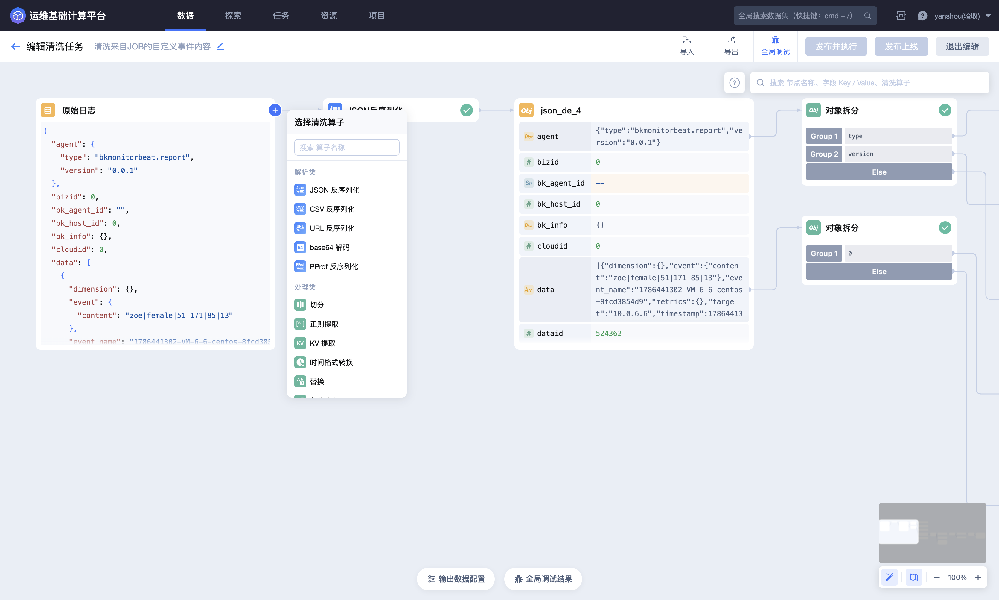

选择算子后，节点会先出现在画布中，再通过右侧表单配置输入和规则。结构化节点上可选择「对象拆分」，其表单通过 `Group` 和 `Else` 定义匹配输出与兜底输出。

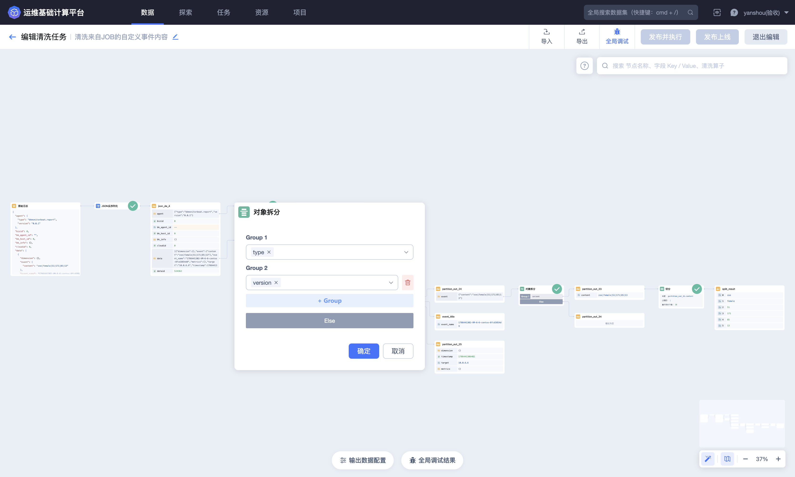

填写字段或数组索引后，节点卡片同步显示规则和输出节点名，便于继续从指定输出分支添加下一个算子。

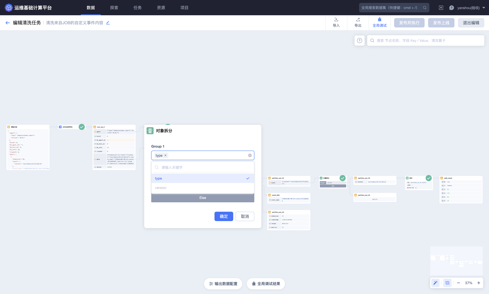

###### 2. 配置完整算子链

示例主链如下。四个「对象拆分」节点分别处理 `agent`、`data[0]`、事件对象和 `event.content`，最后再对内容字符串执行「切分」。

| 顺序 | 算子 | 输入 | 关键参数 | 主要输出 | 输出样式 |
| --- | --- | --- | --- | --- | --- |
| 1 | JSON 反序列化 | 原始日志 | 使用页面默认 JSON 解析 | `json_de_4` | 字典，可展开 `agent`、`data`、`timestamp` 等字段 |
| 2 | 对象拆分 | `json_de_4/agent` | Group 1 选择 `type`，Group 2 选择 `version` | `partition_out_8`、`partition_out_10`；兜底 `partition_out_9` | 分别输出 Agent 类型和版本号 |
| 3 | 对象拆分 | `json_de_4/data` | 选择数组索引 `0` | `partition_out_17`；兜底 `partition_out_18` | 取出 `data` 数组首个事件对象 |
| 4 | 对象拆分 | `partition_out_17/0` | Group 选择 `event`、`event_name` | `partition_out_24`、`event_title`；兜底 `partition_out_25` | 输出事件对象、事件标题，并在兜底分支保留 `target` 等字段 |
| 5 | 对象拆分 | `partition_out_24/event` | Group 选择 `content` | `partition_out_33`；兜底 `partition_out_34` | 输出事件内容字符串 |
| 6 | 切分 | `partition_out_33/content` | 分隔符 `\|`；最大切分个数 `10` | `split_result` | 数组索引 `0` 至 `5` 分别承载 6 段内容 |

选择「切分」后，表单会要求指定来源、分隔符、最大切分个数和输出节点名。

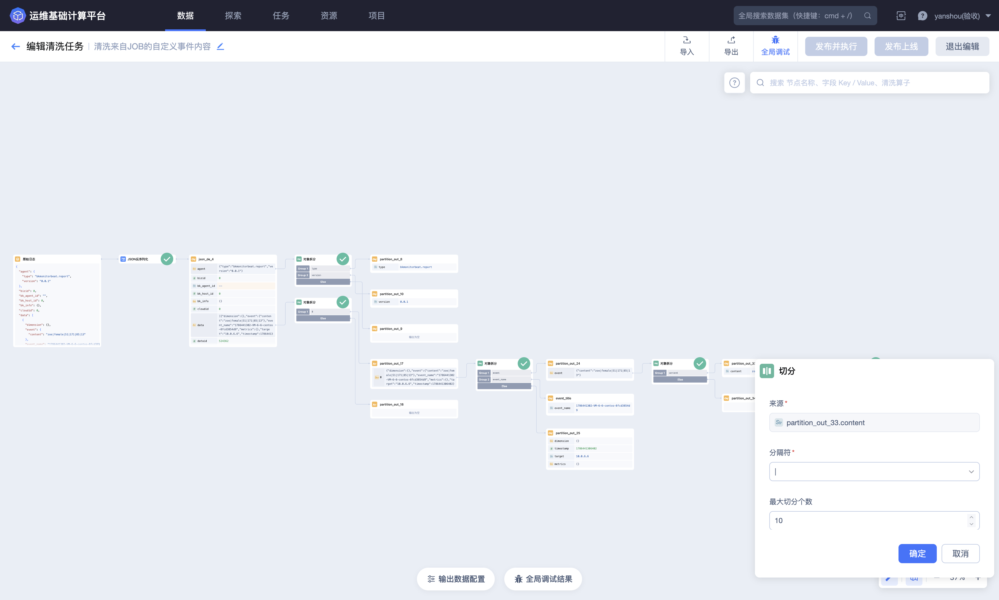

填入分隔符 `|` 和最大切分个数 `10` 后，页面在节点卡片中展示完整参数。

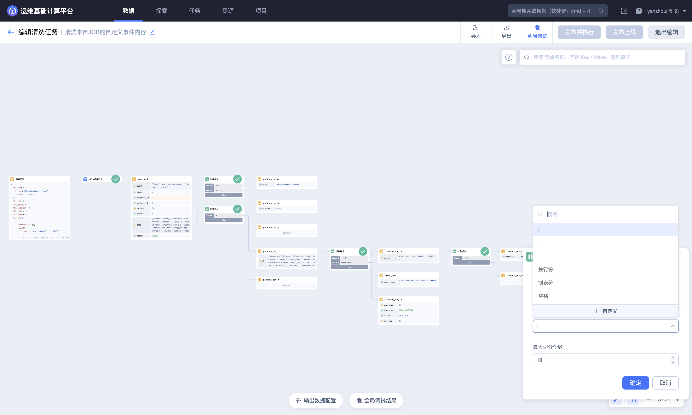

运行节点后，输出区以数组索引显示切分结果。示例产生索引 `0` 至 `5`，表示六段内容已按预期拆开。`Else` 分支显示“输出为空”是因为当前样例命中了 Group 规则，不代表节点执行失败。

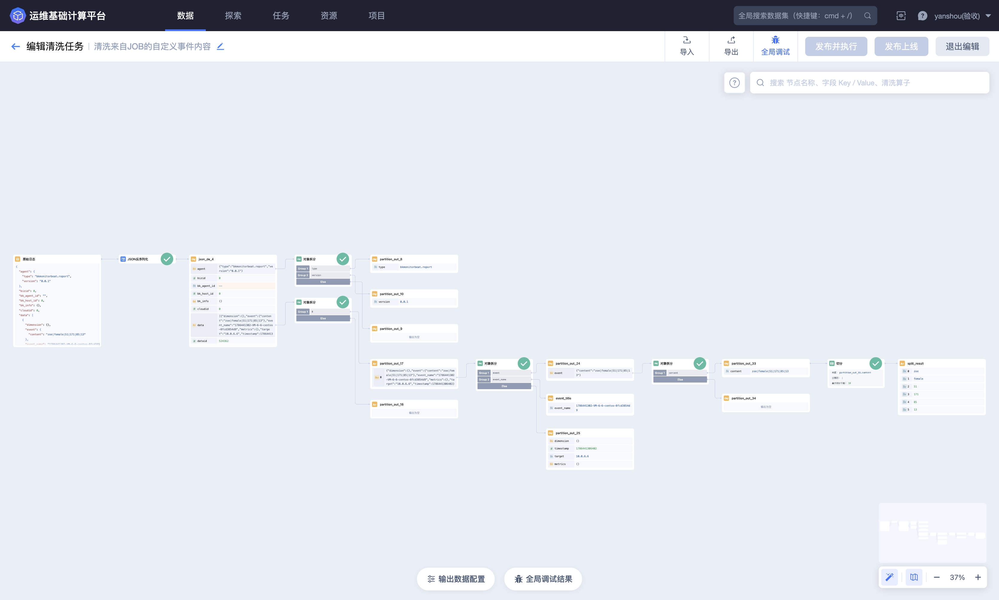

###### 3. 配置输出字段和时间字段

在「输出数据配置」中把拆分结果和结构化节点字段映射到结果表。`event_dt` 选为时间字段，来源为 `json_de_4/timestamp`，源格式选择 Unix Time Stamp（seconds），时区为 UTC+8。

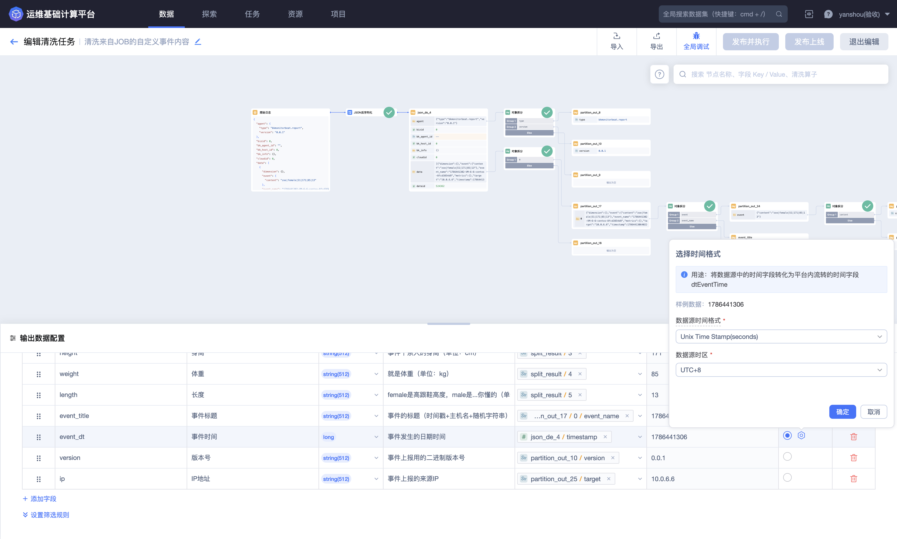

最终业务字段配置如下；平台还会在调试结果中补充 `dtEventTime`、`localTime`、`dtEventTimeStamp` 和 `timestamp` 等内置字段。

| 字段 | 类型 | 来源 | 别名/用途 |
| --- | --- | --- | --- |
| `name` | string | `split_result/0` | 名称 |
| `gender` | string | `split_result/1` | 性别 |
| `age` | string | `split_result/2` | 年龄 |
| `height` | string | `split_result/3` | 身高（cm） |
| `weight` | string | `split_result/4` | 体重（kg） |
| `length` | string | `split_result/5` | 第 6 段数值（cm） |
| `event_title` | string | `partition_out_17/0/event_name` | 事件标题 |
| `ip` | string | `partition_out_25/target` | 目标地址 |
| `event_dt` | long | `json_de_4/timestamp` | 事件时间；时间字段 |
| `version` | string | `partition_out_10/version` | 版本号 |

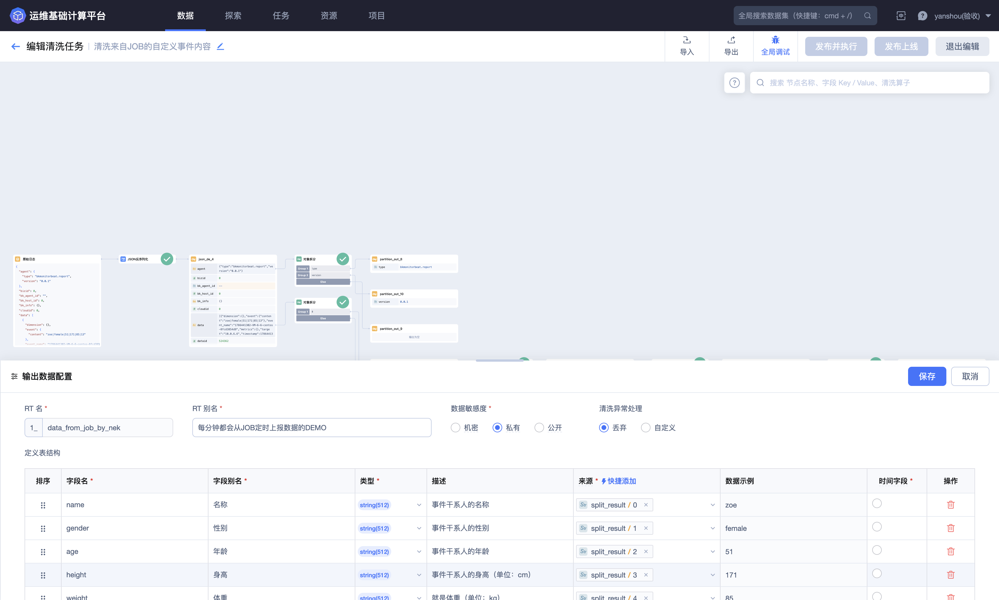

###### 4. 全局调试

点击 **`全局调试`** 后，页面在 00:00 内返回「调试成功」。结果表同时显示 10 个业务字段和平台内置时间字段；六段切分内容、事件标题、目标地址、事件时间和版本号均能从配置的来源取得值。

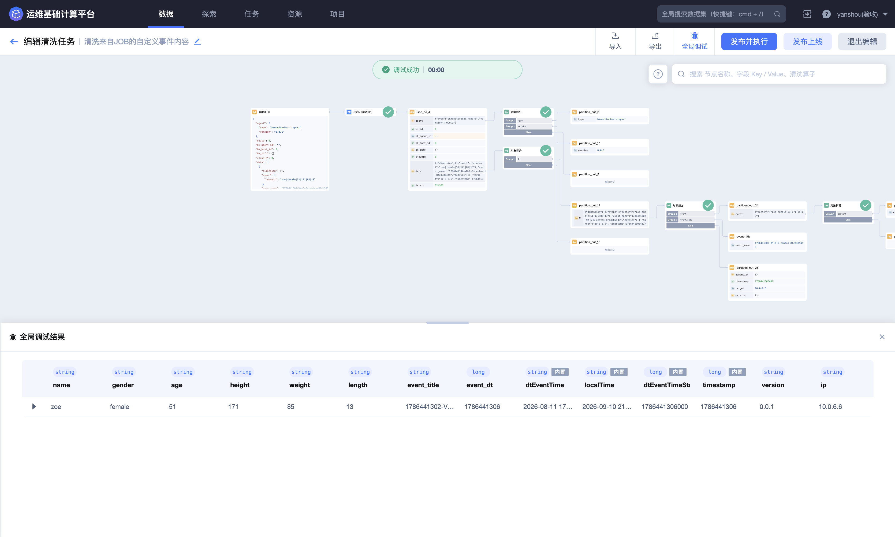

调试检查要点：

- 顶部明确显示「调试成功」，而不是只看某个节点有输出；

- `split_result` 的索引 `0` 至 `5` 均有值，并与 6 个目标字段一一对应；

- `event_title`、`ip`、`event_dt` 和 `version` 均来自预期的结构化路径；

- 内置时间字段已生成，`event_dt` 的秒级时间戳按 UTC+8 转换；

- Group 分支有输出、Else 分支为空符合当前样例的命中逻辑。

###### 5. 发布并执行

确认规则、结果表和影响范围后，点击 **`发布并执行`**，在「选择数据清洗范围」中保留推荐的「按顺序正常消费」，再点击 **`确定`**。页面返回数据源详情并提示清洗任务启动成功；新任务先显示「启用中」，随后切换为「运行中」。任务行显示结果表 `1_data_from_job_clean_walkthrough_20260901`、关联入库任务数 `0`、异常数 `0`，原有任务保持运行。

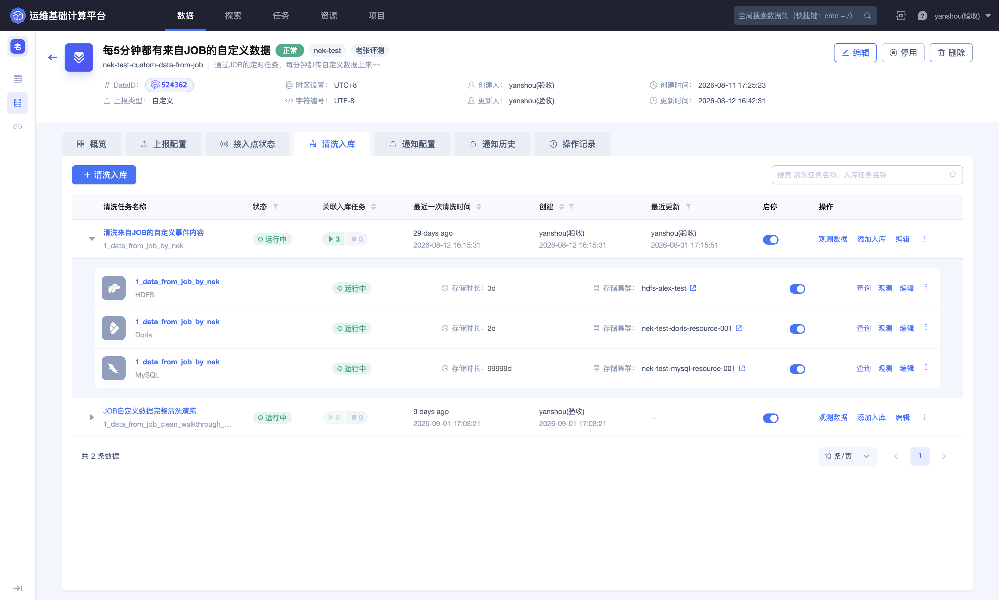

清洗任务显示“运行中”，只表示任务正在持续消费并产出结果表，不代表数据已经写入 HDFS、Doris、MySQL 等存储。如需持久化数据，还应添加入库任务，并配置存储类型、资源和保留策略。

##### 调试、发布与退出

编辑器顶部提供导入、导出、全局调试、发布并执行、发布上线和退出编辑；画布还提供节点搜索、自动排版、适应画布和缩放。没有未发布变更时，发布按钮为禁用状态；产生编辑变更后才会启用。

「发布并执行」会保存规则并启动清洗任务；「发布上线」的具体生效方式应以页面提示为准。发布前应先完成全局调试，并确认结果表结构、消费范围和下游影响。

#### 观测清洗任务

点击 **`观测数据`**，可查看指定时间范围内的数据输入、输出以及异常丢弃趋势。

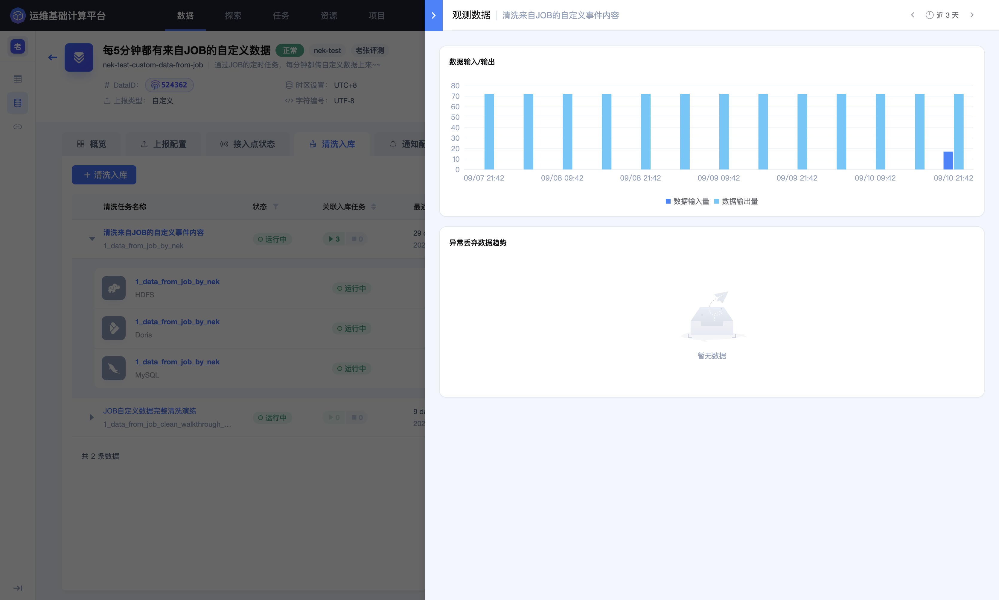

观测时应关注：

- 输入有数据但输出为零：检查解析路径、过滤条件、字段类型和时间字段；

- 输出突然下降：检查上游样例是否变化、算子是否匹配以及异常策略是否丢弃整条记录；

- 异常丢弃持续增加：结合调试结果定位具体节点和字段，不要只重启任务；

- 输入也为零：优先回到上报配置和接入点状态排查。

#### 添加入库任务

点击清洗任务的 **`添加入库`**，选择目标存储类型和可用存储集群，再配置存储时长及该存储要求的字段选项。

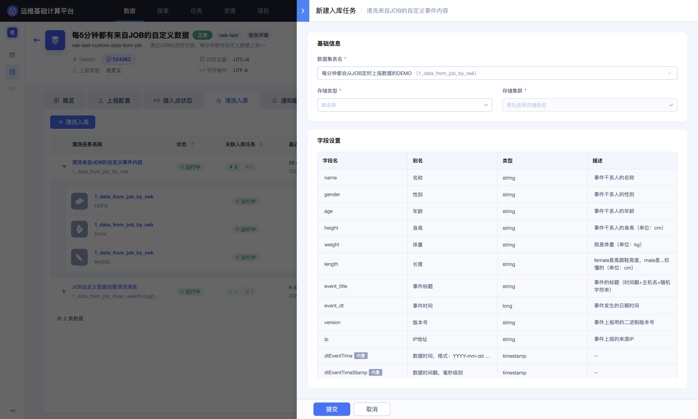

表单会展示业务字段，并补充 `dtEventTime`、`dtEventTimeStamp`、`localTime` 和 `thedate` 等平台时间字段。不同存储类型的字段设置不同，应以所选类型的页面为准。

以 MySQL 为例，编辑页可配置存储时长，并查看每个字段是否作为索引字段或去重字段。

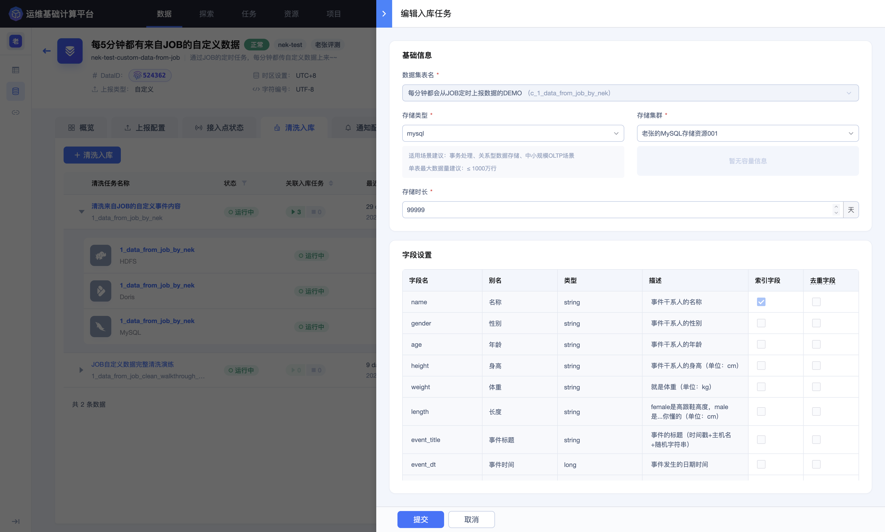

配置时建议：

- 索引围绕高频过滤、关联和排序字段设置，避免把所有字段都设为索引；

- 去重字段必须能稳定标识业务记录，并与更新或覆盖语义一致；

- 保留时长应满足业务追溯和合规要求，同时与存储容量匹配；

- 修改已有入库任务前，先检查下游查询和数据兼容性。

#### 观测入库任务

点击具体存储任务的 **`观测`**，可查看入库量趋势、数据入库延迟 P95 和数据时间延迟 P95。

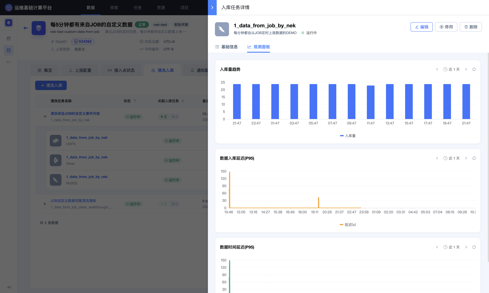

- **入库量趋势**：判断写入是否持续、是否与清洗输出大致一致；

- **数据入库延迟**：反映平台处理到存储完成的耗时；

- **数据时间延迟**：反映业务事件时间与当前处理时间之间的差距。

若清洗输出正常但入库量下降，应检查存储任务状态、集群容量、字段兼容性和写入错误；若入库延迟正常但数据时间延迟很高，则更可能是上游晚到或事件时间本身异常。

#### 管理任务状态和变更

清洗任务和入库任务均提供启停、编辑及更多操作。启停会影响持续处理，编辑可能改变结果表结构或存储行为。执行前应确认影响范围、下游依赖和回退方案。

> **删除提示**：删除数据源、清洗任务或入库任务可能中断数据链路，并影响结果表和下游消费。操作前应检查关联任务、结果表和消费方，并在最终确认页再次核对删除对象及影响范围。
