## 数据查询

「探索」提供项目内结果表的交互式查询能力。用户可以选择结果表及其存储，编写并执行 BKSQL 或 PromQL，通过查询提示、执行详情和查询结果核对语句，也可以保存常用查询并从查询列表或查询历史重新加载。

进入平台后，点击顶部导航栏的 **`探索`**，进入「数据查询」页面。

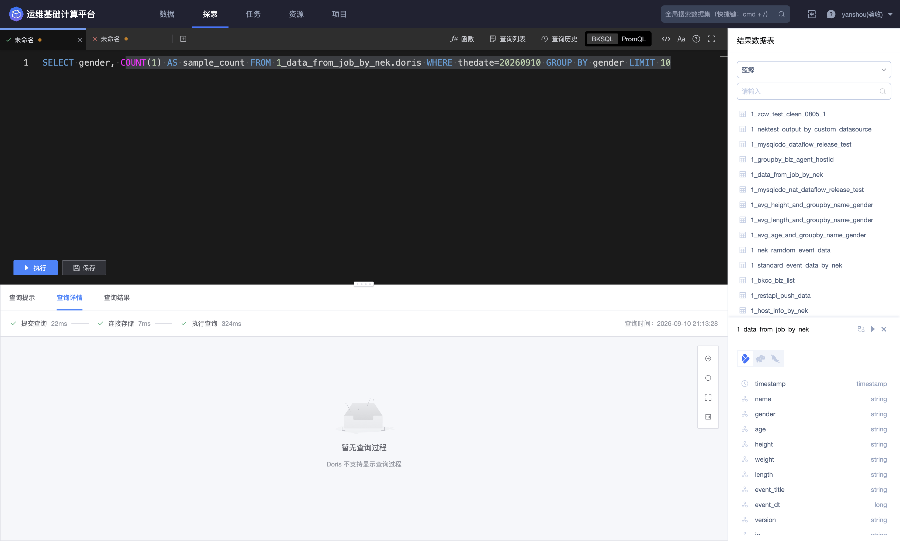

页面主要分为以下区域：

- **查询标签页**：同一页面可同时打开多个已保存查询或未命名查询；

- **编辑器**：编写 BKSQL 或 PromQL，执行、保存或另存查询；

- **查询反馈区**：通过「查询提示」「查询详情」「查询结果」核对语句和执行状态；

- **结果数据表**：按业务搜索结果表，展开字段结构并选择存储；

- **辅助工具**：函数、查询列表、查询历史、格式化、自动换行、帮助和全屏。

以下操作以结果表 `1_data_from_job_by_nek` 的 Doris 存储为例介绍 BKSQL 查询，并通过一个未配置 VM 存储的普通结果表说明 PromQL 的存储前置条件。查询操作不会修改结果表中的源数据。

### 选择结果数据表

右侧「结果数据表」用于定位当前业务下可查询的数据。

1. 在业务选择框中选择业务；

2. 在搜索框输入结果表 ID；

3. 点击结果表行展开结果表别名、更新时间、存储类型和字段；

4. 在存储图标中选择查询使用的存储；

5. 点击结果表右侧的执行图标，平台根据字段和选中存储生成默认 SQL。

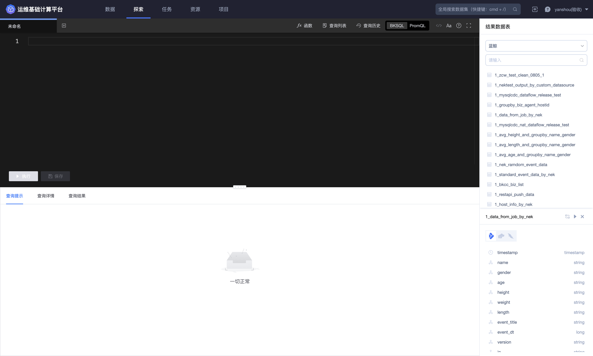

示例结果表 `1_data_from_job_by_nek` 同时具有 Doris、HDFS 和 MySQL 存储。展开后可见业务字段及类型，包括 `name`、`gender`、`age`、`height`、`weight`、`length`、`event_title`、`event_dt`、`version`、`ip`，以及存储侧时间字段。

> 同一结果表在不同存储上的可查询字段、查询性能和查询过程展示可能不同。编写 SQL 前应先选择存储并查看页面返回的真实字段，不要凭结果表名称猜测 Schema。

### 使用 BKSQL 查询

「BKSQL」用于查询 HDFS、MySQL、Doris 等结构化存储。选中 Doris 后，页面自动生成包含真实字段、当天 `thedate` 过滤条件和 `limit 10` 的默认 SQL。

默认 SQL 的结构如下：

```sql
select
  `thedate`,
  `dtEventTime`,
  `dtEventTimeStamp`,
  `localTime`,
  `name`,
  `gender`,
  `age`,
  `height`,
  `weight`,
  `length`,
  `event_title`,
  `event_dt`,
  `version`,
  `ip`
from 1_data_from_job_by_nek.doris
where thedate = 20260902
limit 10
```

点击 **`执行`** 后，查询结果区会显示返回记录、执行耗时和结果有效期。以下示例返回 10 条记录，总耗时 232ms。

#### 聚合查询示例

需要按性别统计记录数时，可以执行以下聚合查询：

```sql
select
  gender,
  count(1) as sample_count
from 1_data_from_job_by_nek.doris
where thedate = 20260902
group by gender
limit 10
```


示例执行结果包含 2 个分组，总耗时 187ms。结果区同时显示查询时间、结果数据有效期、记录数和下载入口。页面在表格视图外还提供折线、柱状、饼图和散点等结果视图图标；是否适合图表展示取决于返回字段类型。

> 复用示例 SQL 时，应根据目标结果表的数据日期调整 `thedate`，并保留必要的过滤条件和合理的 `limit`。

### 查询提示

「查询提示」会在执行前检查语句。例如，以下语句会触发高风险扫描提示：

```sql
select * from 1_data_from_job_by_nek.doris
```

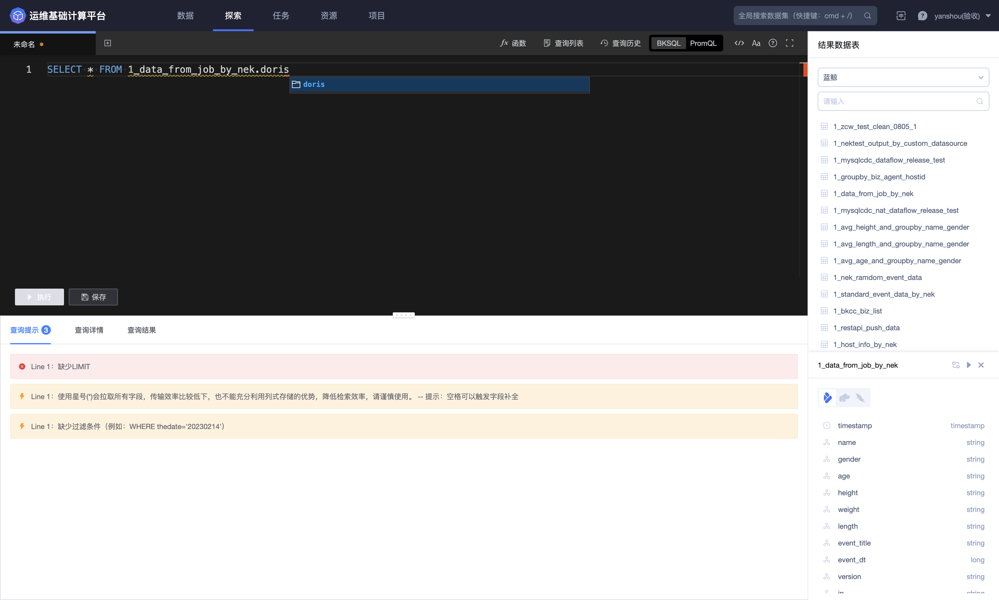

当前页面明确给出 3 条提示：

| 级别 | 页面提示 | 建议处理 |
| --- | --- | --- |
| 错误 | 缺少 LIMIT | 为探索查询设置合理的返回上限 |
| 警告 | 使用星号会拉取所有字段，降低传输和检索效率 | 只选择分析需要的字段 |
| 警告 | 缺少过滤条件，例如 `WHERE thedate='20230214'` | 增加日期或业务过滤条件，减少扫描范围 |

修正为显式字段、日期过滤和 `limit` 后，查询提示恢复为「一切正常」。

### 查询详情

「查询详情」展示查询各阶段的状态和耗时。


示例 Doris 聚合查询的阶段信息如下：

| 阶段 | 示例结果 |
| --- | --- |
| 提交查询 | 16ms |
| 连接存储 | 6ms |
| 执行查询 | 165ms |
| 总耗时 | 187ms |

Doris 页面同时提示「Doris 不支持显示查询过程」，因此只能查看阶段耗时，不能展开更细的查询过程。不同存储的详情能力可能不同，应以所选存储的页面为准。

查询失败时，优先检查查询详情中的错误，再按以下顺序排查：

1. 结果表是否存在且有查询权限；

2. 查询使用的存储是否已配置并处于可用状态；

3. 字段名是否来自当前存储的真实 Schema；

4. SQL 语法、函数、日期范围和数据类型是否正确。

### 查询结果

查询成功后，「查询结果」显示：

- 查询时间；

- 结果数据有效期和保留截止日期；

- 总耗时和记录数；

- 表格及图表视图；

- 下载入口。

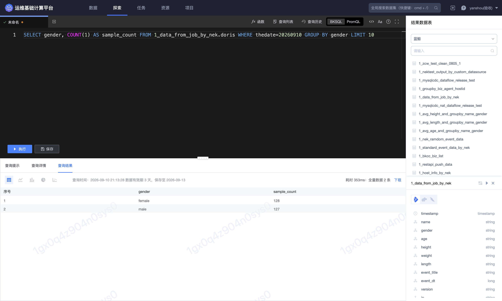

页面会显示查询结果的有效期和保留截止日期。历史查询超过结果保留期后，查询定义仍可能存在，但原结果不应被视为永久保存。

点击 **`下载`** 会把查询结果导出到本地。下载属于数据外发，应只下载业务需要的字段，并按结果表敏感级别和使用范围妥善处理文件。

### 使用函数面板

点击工具栏的 **`函数`**，可按名称或说明搜索函数，也可按分类浏览。

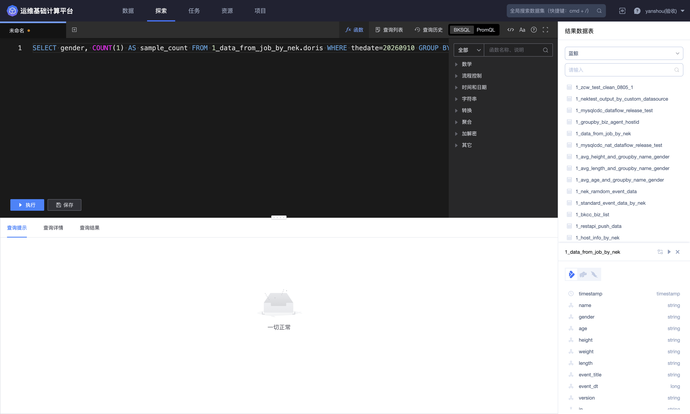

当前页面展示的分类为：

- 数学；

- 流程控制；

- 时间和日期；

- 字符串；

- 转换；

- 聚合；

- 加解密；

- 其它。

展开「聚合」后可见 `MIN`、`AVG`、`COUNT`、`SUM`、`MAX`、`PERCENTILE`、`GROUP_CONCAT`、窗口函数等条目。点击函数会把函数名称插入编辑器当前光标位置，并显示「插入成功」；因此使用前应先把光标放到正确的表达式位置，插入后再补齐参数。

> 函数面板中的条目会随平台版本、存储和查询场景变化。是否可用仍以当前页面提示及实际执行结果为准。

### 保存查询

查询逻辑需要复用时，可使用 **`保存`** 或 **`另存为`**。

- **保存**：更新当前已保存查询；

- **另存为**：创建新的查询定义，保留原查询；

- **名称**：必填，最多 50 个字符；

- **标签**：用于在查询列表中筛选和识别。

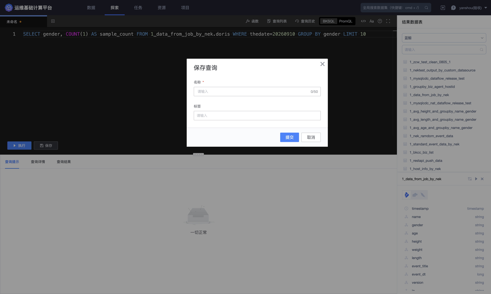

提交「另存为」后，按钮会切换为「已保存」，新查询会出现在查询列表中。可通过名称和标签快速定位并再次打开。

> 「另存为」会默认在原名称后添加“副本”；保存前应确认名称和标签，并以查询列表最终显示的名称为准。

### 查询列表

点击 **`查询列表`**，可搜索已保存查询。

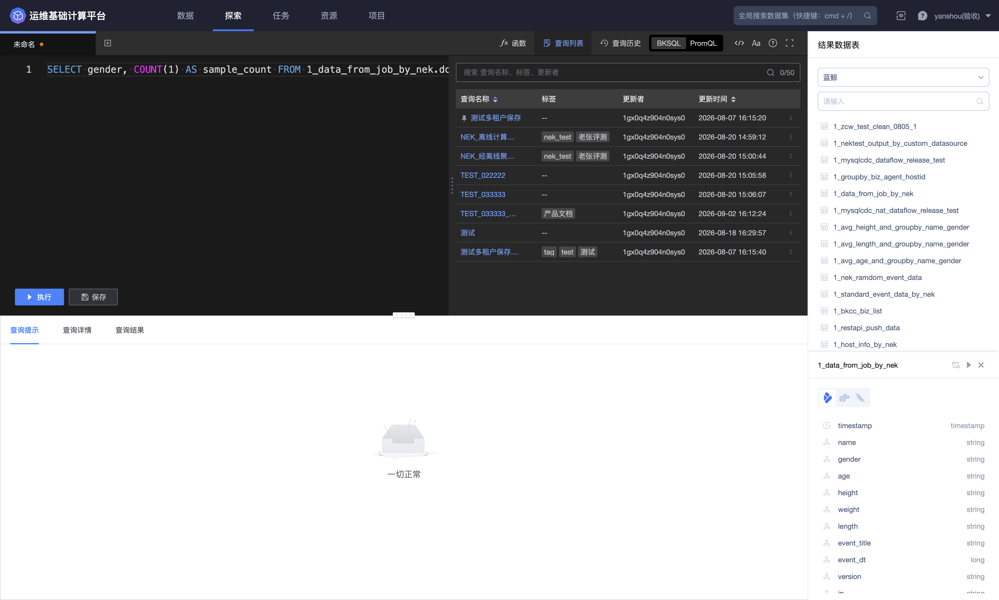

列表字段包括：

| 字段 | 说明 |
| --- | --- |
| 查询名称 | 点击后在标签页中加载查询 |
| 标签 | 保存查询时配置的标签 |
| 更新者 | 最近更新查询的用户 |
| 更新时间 | 最近保存时间 |

列表支持按查询名称、标签和更新者搜索。每行右侧提供更多操作入口。删除查询前，应确认该查询不再被需要；删除只影响保存的查询定义，不会删除结果表。

### 查询历史

点击 **`查询历史`**，可查看项目内已经执行的查询。

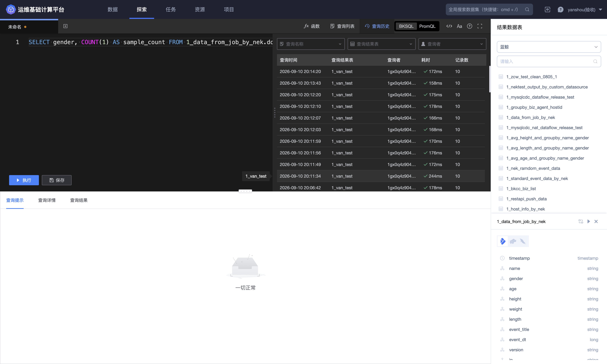

历史面板支持按查询名称、查询结果表和查询者筛选，列表展示：

- 查询时间；

- 查询结果表；

- 查询者；

- 耗时；

- 记录数。

执行后的 BKSQL 会出现在列表顶部。示例中的明细查询耗时 232ms、返回 10 条，聚合查询耗时 187ms、返回 2 条。列表底部提供「加载更多数据」。

### 使用 PromQL 查询

「PromQL」用于查询已配置 VM 存储的指标结果表。它不是所有结果表都能使用的通用查询方式。

#### 切换查询语言

当前标签页已有内容时切换 BKSQL/PromQL，页面提示「切换查询语言会清空已有内容」，并提供：

- **新开 Tab 并切换**：保留当前查询，在新标签页打开另一种查询语言；

- **清空并切换**：清空当前标签页内容并切换。

若希望保留当前 BKSQL，选择「新开 Tab 并切换」；若当前内容不再需要，可以选择「清空并切换」。

#### PromQL 查询表单

PromQL 页面包含数据表、时间范围、步长和编辑器 4 个必要区域。

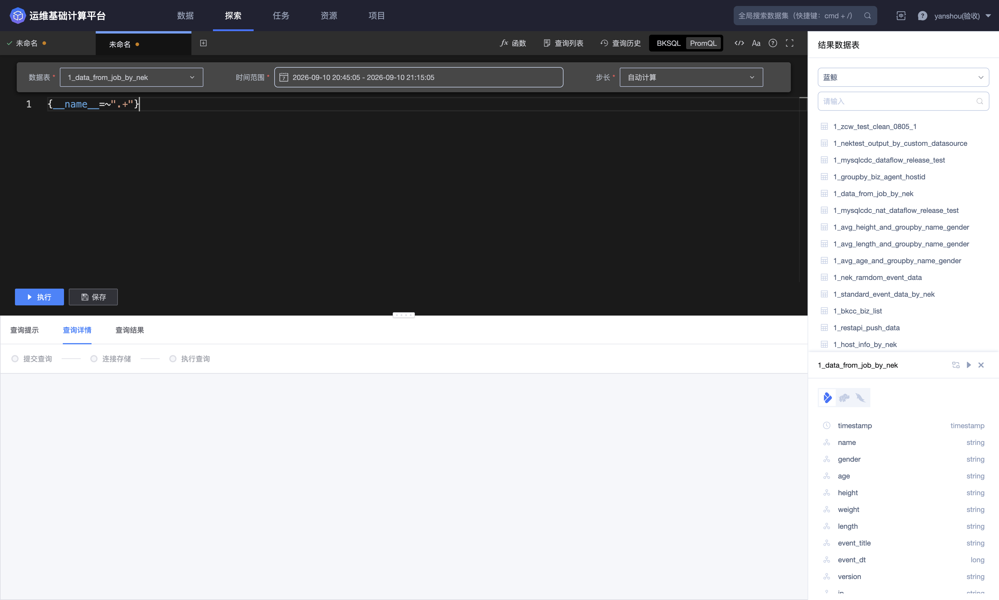

| 配置 | 页面行为 |
| --- | --- |
| 数据表 | 从当前业务的结果表中选择；执行时会进一步检查 VM 存储 |
| 时间范围 | 默认近 30 分钟，也可选择预设或自定义范围 |
| 步长 | 可自动计算，也可自定义 |
| PromQL | 输入指标选择器或计算表达式 |

#### 时间范围

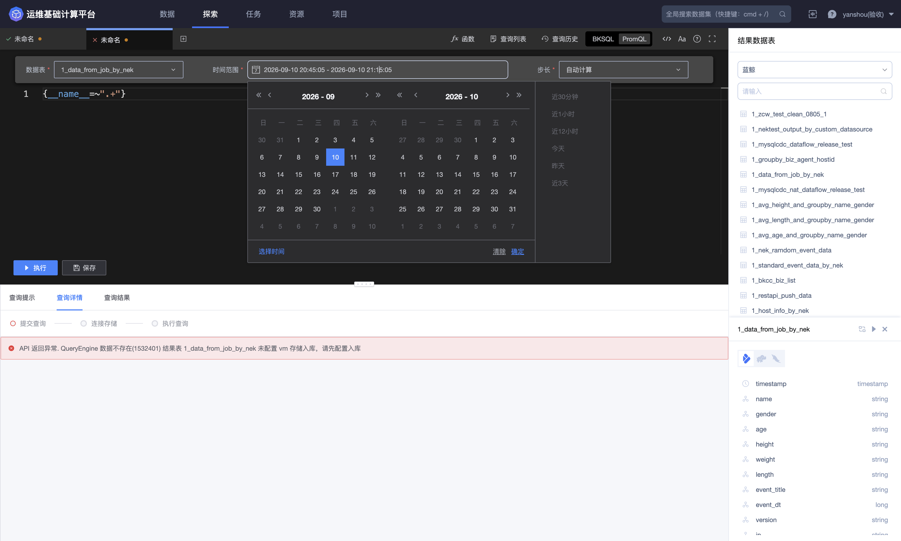

当前页面提供以下快捷范围：

- 近 30 分钟；

- 近 1 小时；

- 近 12 小时；

- 今天；

- 昨天；

- 近 3 天。

也可以通过双月日历和「选择时间」配置自定义起止时间。

#### 查询步长

步长支持「自动计算」和「自定义」。

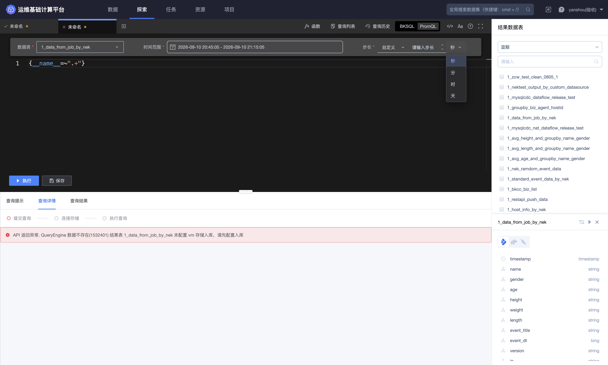

选择「自定义」后，需要填写数值并选择单位；当前页面可选秒、分、时、天。时间范围越长，步长通常应越大，避免返回过密的采样点。

#### VM 存储校验

如果对未配置 VM 入库的结果表执行以下 PromQL：

```promql
{__name__=~".+"}
```

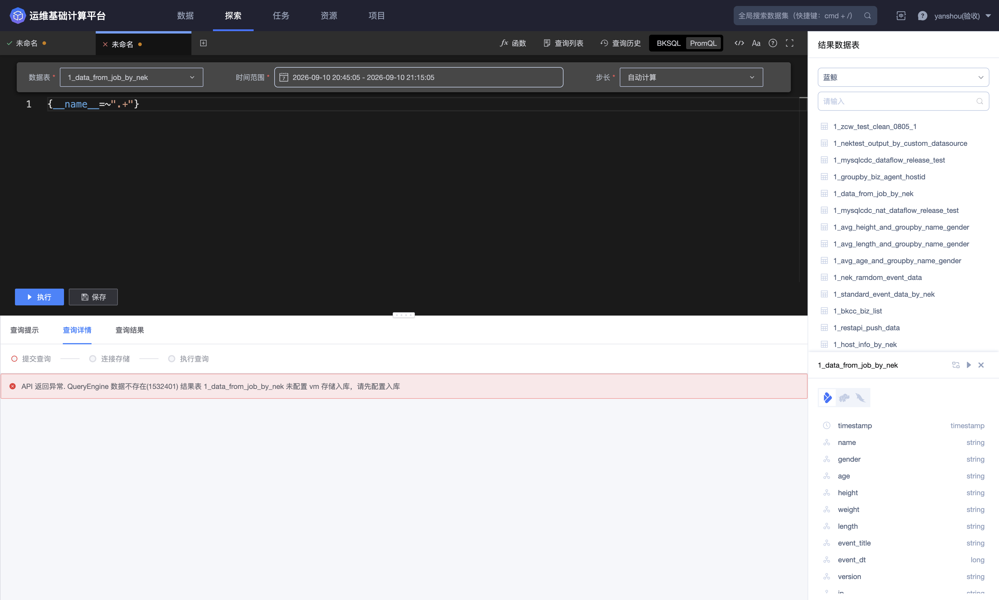

平台在查询详情中返回：

> 结果表 `1_zcw_test_clean_0805_1` 未配置 VM 存储入库，请先配置入库。

这表明“数据表”下拉框允许先选择普通结果表，但最终执行会检查 VM 存储。要完成成功查询，必须先选择已配置 VM 入库的结果表；如果当前项目没有此类表，应先在数据或任务模块完成指标结果表和 VM 存储建设，再回到探索页面。

新增 VM 入库会产生持续写入和资源占用。配置前应确认存储资源、字段映射和数据保留策略。

### 编辑器辅助工具

编辑器右上方提供以下图标：

- **格式化**：整理当前查询语句的缩进和换行；

- **自动换行**：切换长语句是否在编辑区内换行；

- **帮助**：打开数据查询帮助；

- **全屏**：扩大编辑器区域。

多个查询以标签页并列显示。标签上的关闭按钮会关闭当前页面标签；若内容未保存，平台会提示是否离开，确认离开后未保存的内容会丢失。

### 安全与操作边界

- BKSQL 和 PromQL 查询均为读取操作，不会修改源结果表；

- 保存或另存为只创建查询定义，不会复制或固化结果数据；

- 下载会把数据写入本地文件，应按数据敏感度控制字段和传播范围；

- 大范围查询应使用字段裁剪、日期过滤和 `limit`，避免不必要的资源消耗；

- 删除保存查询只影响查询定义，不删除结果表，但仍属于破坏性操作。

> **删除提示**：删除保存查询前，应核对查询名称和使用范围。该操作会删除查询定义，但不会删除结果表或其中的数据。
