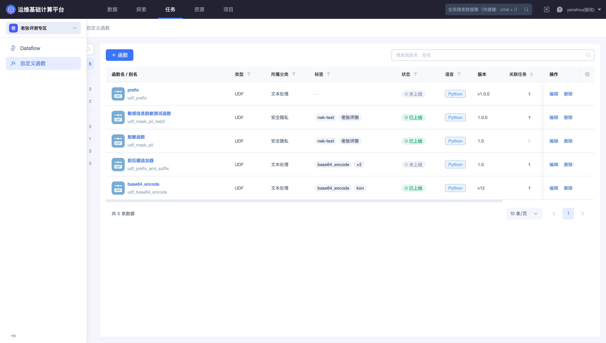
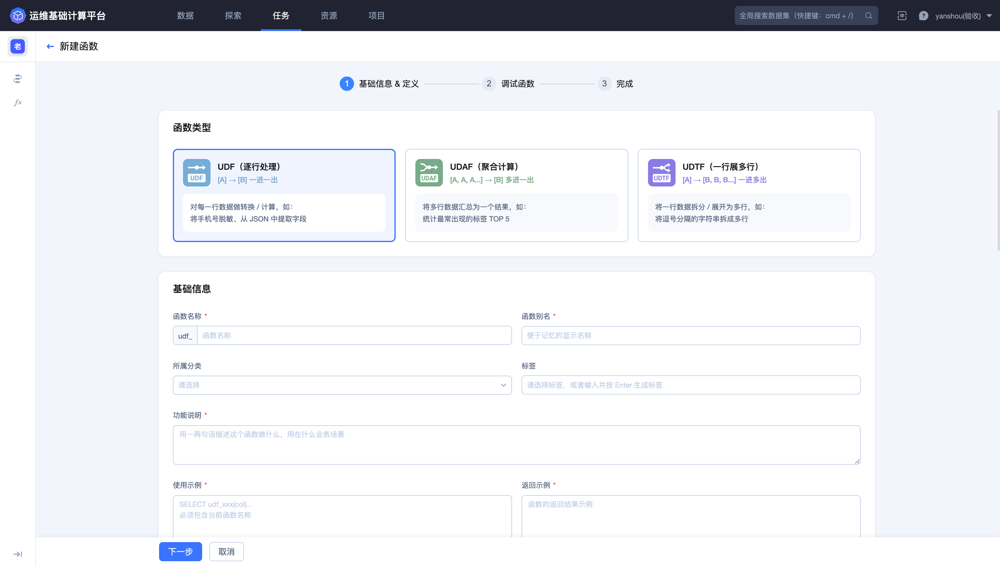
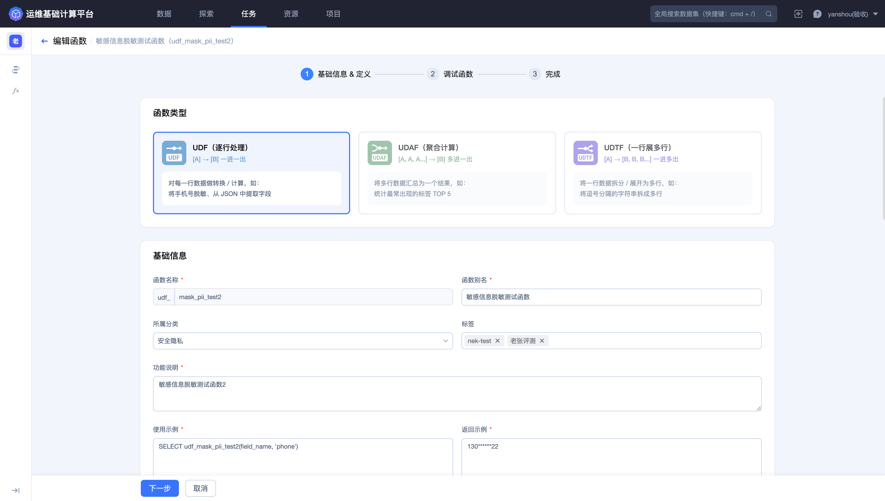
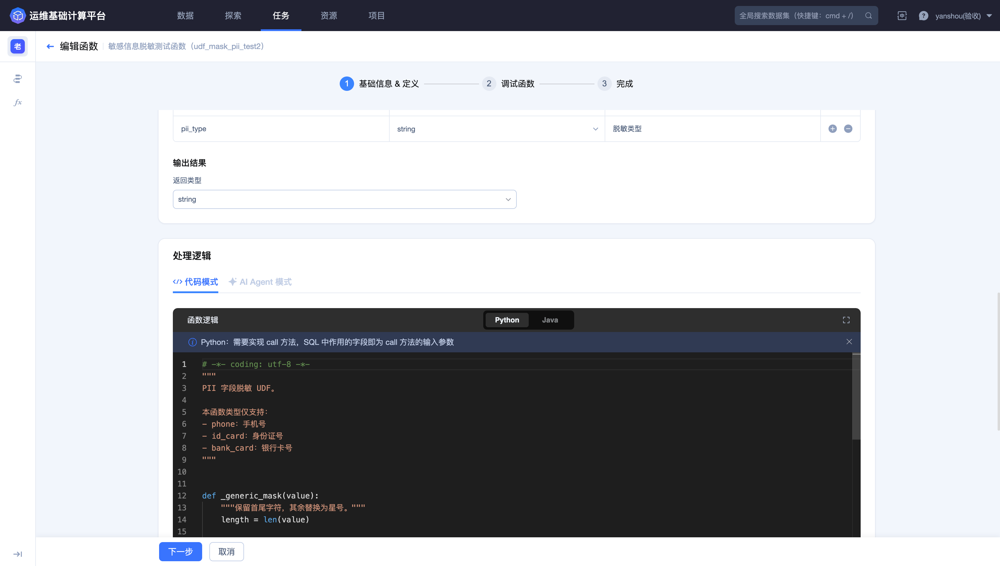
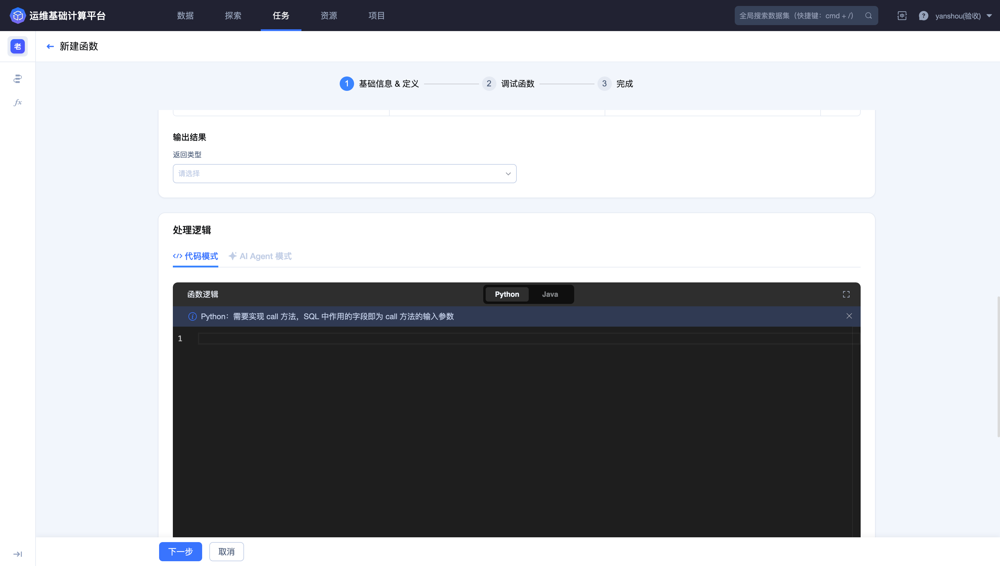
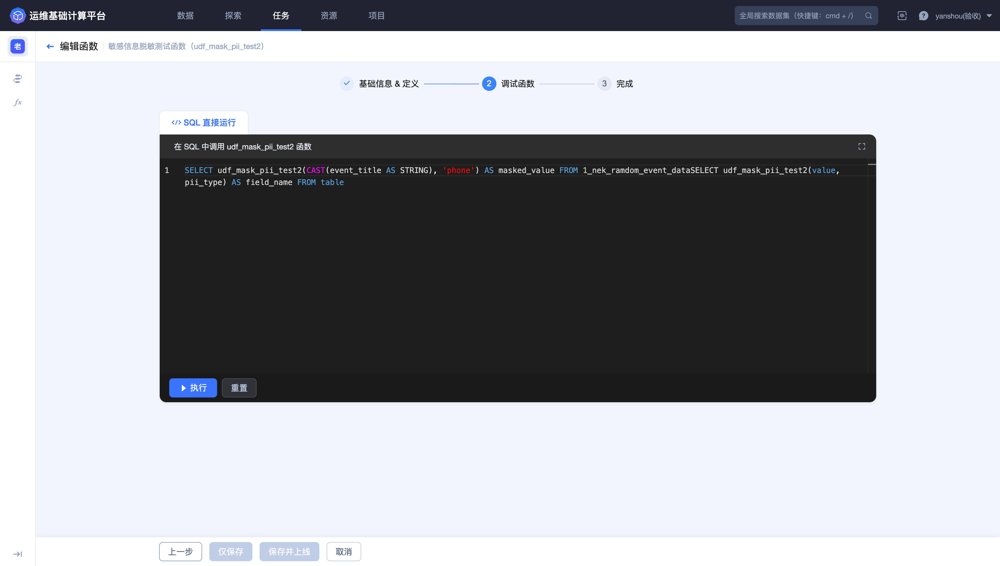
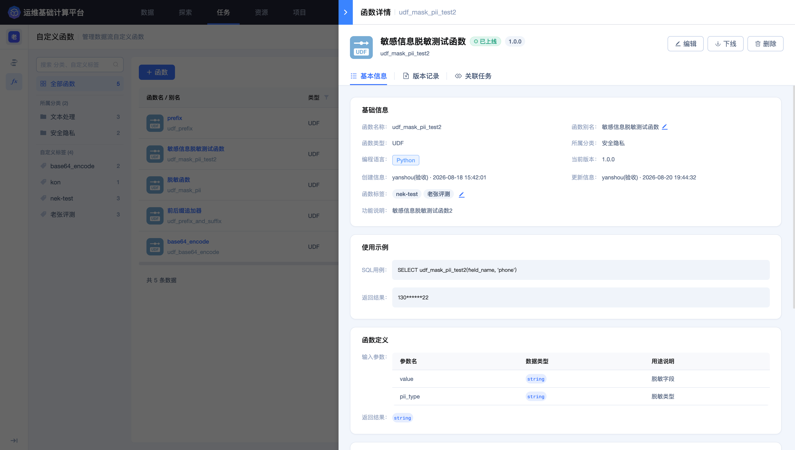
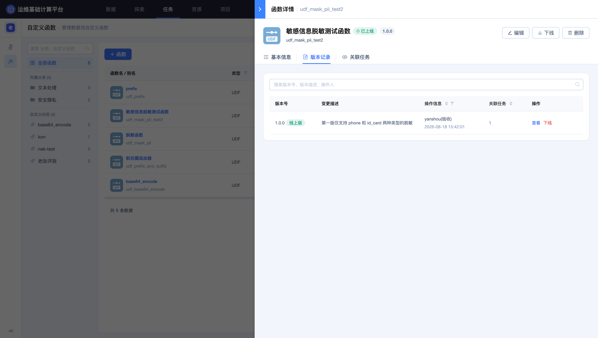
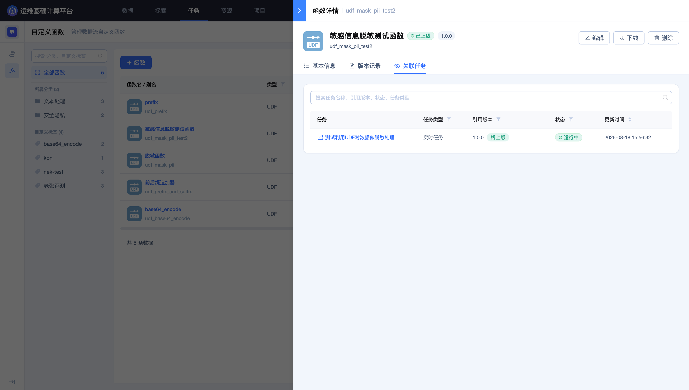
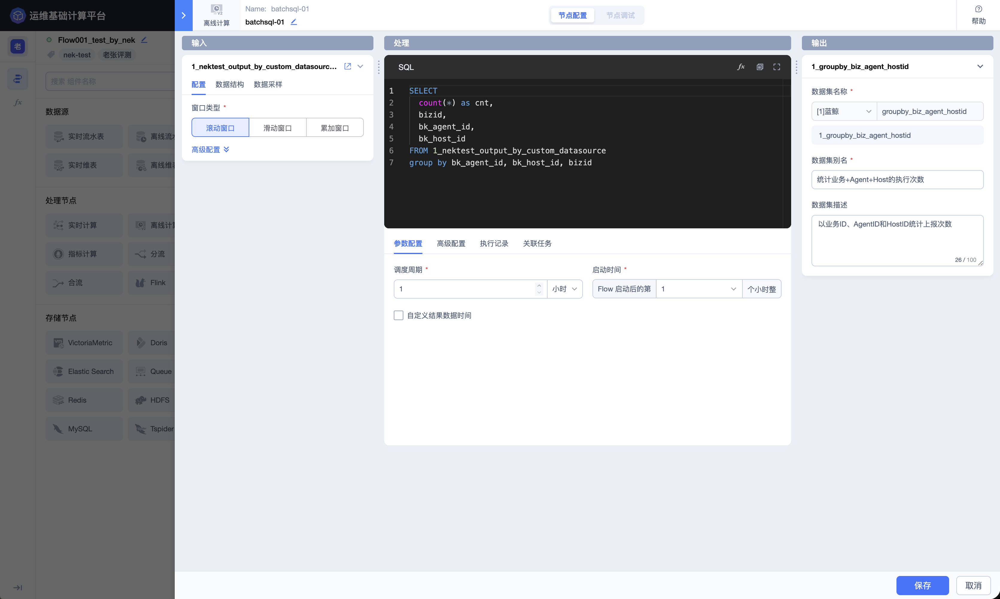

## 自定义函数

「自定义函数」用于把可复用的业务处理逻辑封装为 SQL 函数。函数上线后，可在 Dataflow 的实时 SQL 中调用，用于字段标准化、脱敏、解析、聚合或一行展开多行等场景。

进入平台后，点击顶部导航栏的 **`任务`**，再点击左侧的 **`自定义函数`**。

### 查看函数列表



列表支持按函数名称搜索，并可通过分类、状态和标签筛选。主要字段包括：

| 字段 | 说明 |
| --- | --- |
| 函数名称／别名 | SQL 中使用的函数标识及面向用户显示的名称 |
| 函数类型 | UDF、UDAF 或 UDTF |
| 分类／标签 | 函数用途和管理标签 |
| 状态 | 已上线或未上线 |
| 开发语言 | Python 或 Java |
| 版本 | 当前函数版本 |
| 关联任务 | 引用该函数的 Dataflow 数量或入口 |
| 创建／更新信息 | 创建人、创建时间和最近更新时间 |

已上线函数可以被任务引用；未上线函数只保留定义，不能作为稳定的生产依赖。修改函数前，应先查看关联任务和引用版本。

### 选择函数类型

点击 **`+ 函数`** 后，向导分为“基础信息 & 定义”“调试函数”“完成”3 步。



平台提供 3 种函数类型：

| 类型 | 输入输出关系 | 适用场景 |
| --- | --- | --- |
| UDF（逐行处理） | `[A] → [B]`，一进一出 | 对每行数据进行转换或计算，例如手机号脱敏、从 JSON 中提取字段 |
| UDAF（聚合计算） | `[A, A, A...] → [B]`，多进一出 | 汇总多行数据，例如计算出现次数最多的标签 TOP 5 |
| UDTF（一行展多行） | `[A] → [B, B, B...]`，一进多出 | 把单行数据拆成多行，例如拆分逗号分隔的字符串 |

函数类型决定了代码接口和 SQL 调用方式，创建后不应通过修改代码强行改变输入输出关系。需要另一种处理模式时，应新建对应类型的函数。

### 填写基础信息

基础信息用于确定函数的标识、用途和 SQL 使用说明。

| 配置项 | 说明 |
| --- | --- |
| 函数名称 | 平台自动添加 `udf_` 前缀；名称应稳定、可读，避免包含短期环境信息 |
| 函数别名 | 面向用户显示的名称 |
| 所属分类 | 用于按业务用途筛选，例如文本处理、安全与隐私 |
| 标签 | 用于更细粒度的检索和治理 |
| 功能说明 | 说明函数做什么、输入是什么、用于什么场景 |
| 使用示例 | 必须包含当前函数名称的 SQL 示例 |
| 返回示例 | 展示典型返回值，帮助使用者理解结果格式 |



使用示例应覆盖真实的参数顺序和数据类型。对于脱敏、加解密或解析类函数，还应在说明中写清空值、非法输入和异常值的处理方式。

### 定义输入与输出

「函数定义」中可配置一个或多个输入参数，以及函数的返回类型。



每个输入参数包含：

- **参数名称**：与代码中的方法参数一一对应；

- **数据类型**：页面可选类型包括 `string`、`int`、`long`、`double`、`float` 等；

- **用途说明**：说明参数含义、格式和可接受的取值。

返回类型必须与代码实际返回值一致。参数数量、类型和顺序发生变化时，代码与所有调用 SQL 都要同步调整，否则调试或任务运行会失败。

### 编写函数逻辑

处理逻辑支持 **`代码模式`** 和 **`AI Agent 模式`**。代码模式可选择 Python 或 Java。

Python 页面明确要求：

- Python 版本为 3.6.9；

- 必须实现 `call` 方法，不能修改方法名；

- `call` 方法的参数数量、类型和顺序必须与页面定义一致；

- 返回值必须与返回类型一致。

下面的 UDF 接收一个字符串，去除首尾空格并转换为大写：

```python
def call(value):
    if value is None:
        return None
    return str(value).strip().upper()
```

对应的函数定义应包含一个 `string` 类型输入参数，并设置 `string` 返回类型。空值分支可以避免对 `None` 直接调用字符串方法。

使用 AI Agent 模式时，也应逐项核对生成的参数、返回类型、异常处理和依赖包，最终以调试结果为准。

### 配置依赖包

Python 函数可以在定义页添加依赖包。



页面给出的依赖规则包括：

- 包名填写 `pip install` 使用的名称；安装名可能与 `import` 名不同，例如安装 `pycryptodome` 后使用 `Crypto`；

- 版本约束支持 `==`、`>=`、`~=` 和范围表达式，例如 `>=1.20,<2.0`；

- `json`、`re`、`os`、`sys` 等 Python 标准库已经内置，不需要重复添加；

- 可选择预设包，也可以使用批量添加预设包入口；

- 依赖表展示来源、包名、版本、说明和操作。

为保证函数可复现，应尽量指定明确版本或兼容范围，避免使用无约束版本。添加第三方包前，还应确认包来源、许可证、安全风险和平台运行环境是否支持。

### 调试函数

完成定义后进入「调试函数」。页面通过 SQL 直接调用当前函数，并在执行前完成 SQL、参数和函数代码校验。



调试 SQL 的基本形式如下：

```sql
SELECT
  udf_doc_upper_trim_20260902(CAST(event_title AS STRING)) AS standardized_text
FROM 1_nek_ramdom_event_data
```

调试时应注意：

1. 函数名称必须与当前定义一致；

2. 参数个数、顺序和类型必须与输入参数定义一致；

3. 源字段类型不匹配时，应使用 `CAST` 显式转换；

4. 调试使用流式 SQL 规则，页面会拒绝不支持的子句，例如当前调试场景不支持 `LIMIT`；

5. 输出列应使用清晰的别名，便于核对返回值；

6. 调试数据可能包含敏感信息，应只选择必要字段，并避免把原始值复制到不受控位置。

点击 **`执行`** 后，应根据页面反馈检查 SQL 校验、代码运行、返回类型和输出值。只有调试通过后，「仅创建」和「创建并上线」才可用于完成函数创建。

### 创建方式

调试通过后，可根据使用计划选择：

- **仅创建**：保存函数定义但不立即上线，适合继续评审或准备后续版本；

- **创建并上线**：创建函数并使其进入可引用状态，适合定义、依赖和调试结果已经确认的场景。

上线前应确认函数名称、类型、参数、返回值、依赖版本、异常处理和 SQL 示例。生产任务已经引用同名函数时，还应核对版本兼容性。

### 查看函数详情

点击函数名称进入详情页，可查看状态、版本和完整定义，并执行编辑、下载、下线等管理操作。



详情页的「基本信息」包括：

- 函数名称、别名、分类、标签和说明；

- 函数类型、开发语言、状态和当前版本；

- 输入参数、返回类型和函数代码；

- SQL 使用示例与返回示例；

- 创建和更新信息。

使用示例可以直接帮助 Dataflow 开发者确认调用格式。例如，脱敏函数可按字段和敏感类型传参，并返回掩码后的结果。复制示例后仍要根据目标字段类型和函数版本进行调整。

### 查看版本记录



「版本记录」展示版本号、版本说明、操作人、关联任务和可用操作。查看旧版本时，应重点比较：

- 输入参数是否新增、删除或调整顺序；

- 参数和返回类型是否变化；

- 代码逻辑及空值、异常值处理是否变化；

- 第三方依赖及版本约束是否变化；

- 是否仍有 Dataflow 引用该版本。

改变函数签名属于不兼容变更。若无法同时更新全部调用方，应新建函数或保留兼容版本。

### 查看关联任务



「关联任务」展示引用该函数的 Dataflow、任务类型、引用版本、运行状态和更新时间。编辑、下线或删除函数前，必须先检查此处，确认所有调用方都已完成兼容性评估。

### 在 Dataflow 中调用函数

已上线函数可在实时 SQL 节点中直接调用。



调用时应遵循以下顺序：

1. 在自定义函数详情中确认函数名称、上线状态和版本；

2. 在 Dataflow 的实时 SQL 节点中查看输入字段 Schema；

3. 按函数定义传入参数，必要时使用 `CAST` 转换类型；

4. 为函数返回值设置清晰的字段别名；

5. 保存并上线 Flow 后，通过任务日志确认函数执行没有异常；

6. 在下游结果表中抽样核对输出格式，但不要传播敏感原始值。

### 函数维护建议

- 函数名称和参数应保持稳定，避免给调用方造成不必要的兼容成本；

- 代码中显式处理空值、非法输入和边界值；

- 依赖包使用受控来源，并固定可复现的版本范围；

- 上线新版本前，使用与生产字段类型一致的样例完成 SQL 调试；

- 通过版本记录和关联任务判断变更影响；

- 下线函数前，先停止新增引用，并确认所有关联任务已经迁移；

- 删除函数会移除可复用定义，且可能导致依赖任务无法编辑或重启。删除前应完成影响确认、备份和审批，并以关联任务为空为必要条件。
