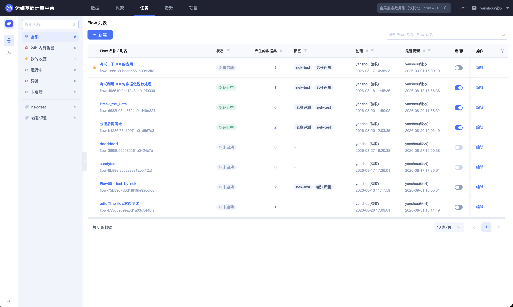
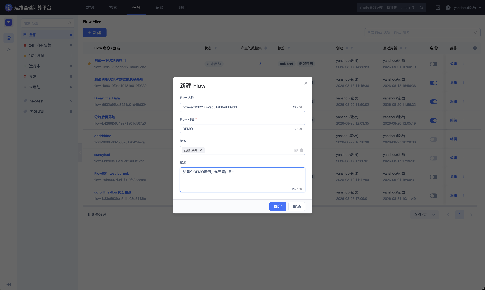
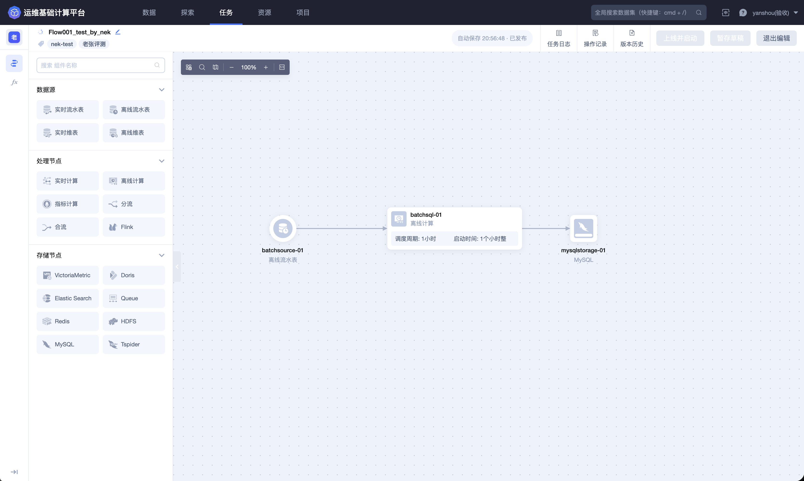
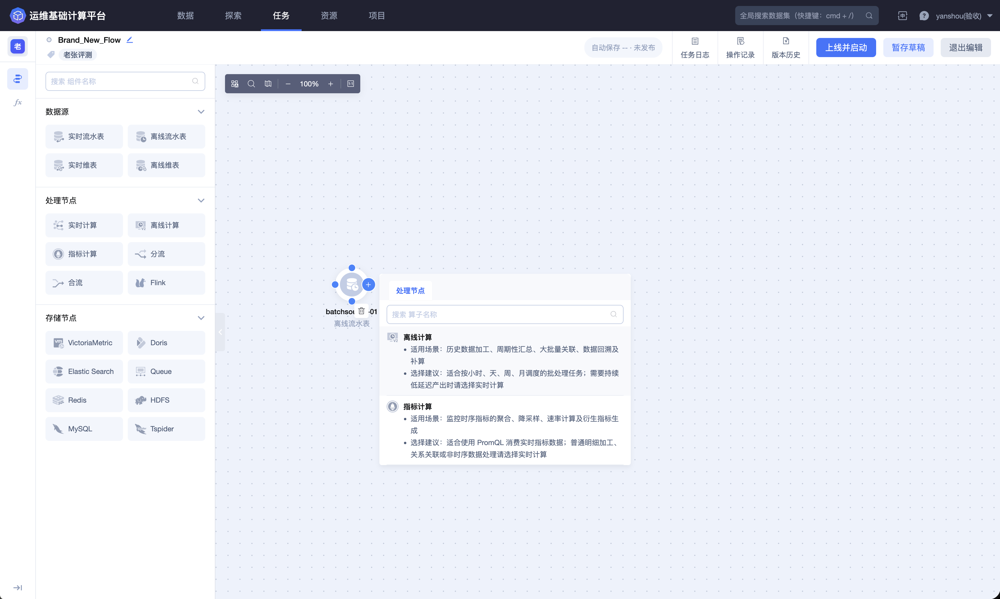
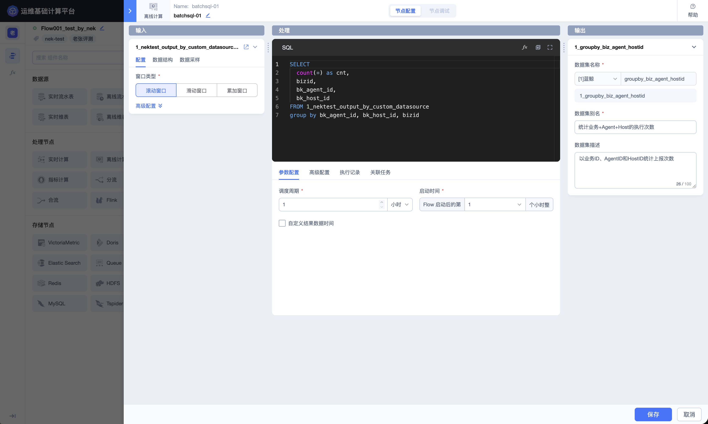
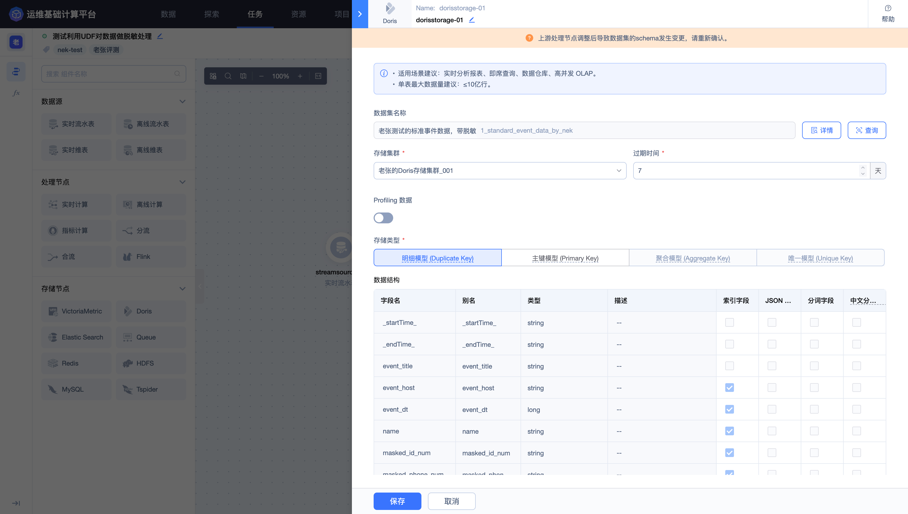
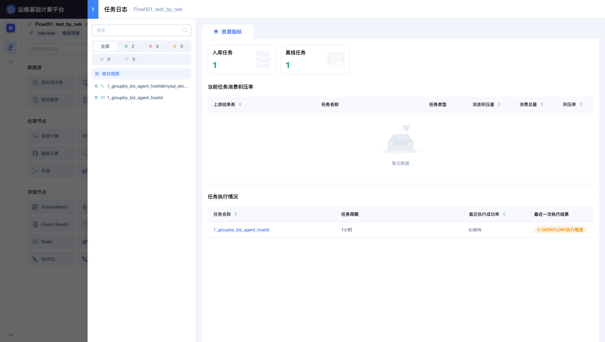
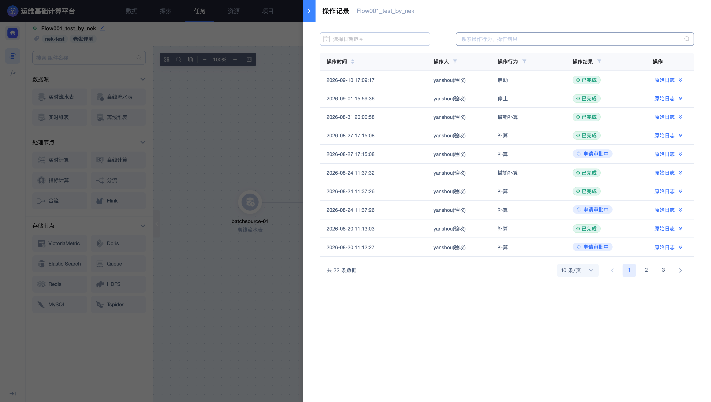
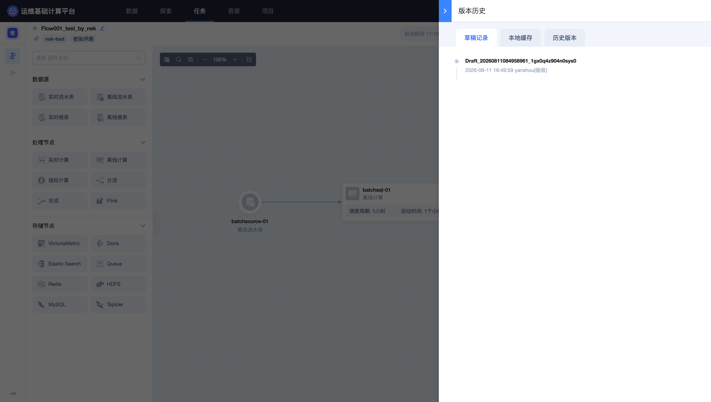

## Dataflow

「Dataflow」用于在可视化画布中编排数据处理任务。用户可以把实时或离线结果表接入 Flow，添加计算、分流、合流等处理节点，再把处理结果写入目标存储。任务上线后，页面持续展示拓扑、运行状态、日志和历史记录，便于维护完整的数据链路。

进入平台后，点击顶部导航栏的 **`任务`**，再点击左侧的 **`Dataflow`**。

### 查看 Flow 列表



Flow 列表用于定位和管理项目内的数据处理任务。页面支持按名称搜索，并可通过以下条件快速筛选：

- 全部 Flow；

- 24h 内有告警；

- 我的收藏；

- 运行中、异常、未启动；

- 标签。

列表展示 Flow 名称与别名、运行状态、产出数据集、标签、创建人、更新时间、启停状态和操作入口。排查任务时，应先确认 Flow 的运行状态，再检查产出数据集和最近更新时间是否符合预期。

### 新建 Flow

点击列表右上角的 **`新建`**，打开「新建 Flow」并填写基础信息。



| 配置项 | 说明 |
| --- | --- |
| Flow 名称 | 平台自动生成以 `flow-` 开头的初始值；名称长度为 2～50 个字符，并应符合页面显示的字符规则 |
| Flow 别名 | 面向用户显示的任务名称，建议直接表达数据处理目的 |
| 标签 | 用于列表筛选和任务分类 |
| 描述 | 说明数据来源、处理逻辑、产出和使用场景 |

名称和别名应能区分环境、数据域和处理目标。对于周期任务或关键链路，可在描述中补充更新频率、责任范围和下游用途。

### 认识编辑器

进入 Flow 后点击 **`编辑`**，页面切换到可视化编排画布。



编辑器由节点面板、拓扑画布、节点配置区和顶部工具栏组成：

- **节点面板**：按数据源、数据处理和数据存储分类提供可拖入画布的节点；

- **拓扑画布**：通过节点和连线表达数据从输入、计算到存储的流向；

- **节点配置区**：选中节点后配置输入、SQL、输出、窗口或存储参数；

- **顶部工具栏**：查看任务日志、操作记录和版本历史，暂存草稿，或将任务上线并启动；

- **画布工具**：缩放、适应画布和快速定位节点。

暂存草稿只保留当前配置；上线并启动会使新版本进入运行链路。修改已运行 Flow 前，应先确认字段变更、窗口逻辑和存储结构对下游的影响。

### 选择节点

当前编辑器可见的节点如下：

| 分类 | 节点 |
| --- | --- |
| 数据源 | 实时流水表、离线流水表、实时维表、离线维表 |
| 处理节点 | 实时计算、离线计算、指标计算、分流、合流、Flink |
| 数据存储 | VictoriaMetric、Doris、Elastic Search、Queue、Redis、HDFS、MySQL、Tspider |



处理节点的适用场景如下：

| 节点 | 适用场景 |
| --- | --- |
| 实时计算 | 使用实时 SQL 完成清洗、过滤、转换、关联、聚合和窗口计算 |
| 离线计算 | 对离线数据执行批量处理 |
| 指标计算 | 使用 PromQL 计算指标数据 |
| 分流 | 按字段或属性把同一数据流拆为多个分支，分支保持相同表结构 |
| 合流 | 合并结构一致的多路数据流 |
| Flink | 使用自定义 Flink 逻辑处理 SQL 难以表达的复杂场景 |

存储节点应根据消费方式选择。例如，Doris 适合实时分析、即席查询、数据仓库和高并发 OLAP；HDFS 更适合离线或长期存储；Redis、Queue 等存储则更偏向低延迟读取或消息消费。节点能否使用还取决于项目可用资源和结果表结构。

### 编排一条处理链路

典型的 Dataflow 由“数据源 → 数据处理 → 数据存储”组成。下面的运行拓扑使用实时结果表作为输入，通过实时 SQL 调用自定义函数处理字段，最后写入 Doris。


编排时可按以下顺序操作：

1. 把数据源节点拖入画布，选择项目内有权限的结果表；

2. 添加实时计算、离线计算或其他处理节点，并连接上游输出；

3. 在处理节点中确认输入字段，编写 SQL 或处理逻辑；

4. 配置输出结果表名称、字段和数据时间；

5. 添加存储节点，配置资源、保留周期和存储类型；

6. 暂存草稿并检查完整拓扑；

7. 上线并启动，随后通过任务日志确认链路正常运行。

连接节点前，应确认上下游的数据类型和字段结构兼容。分流后的各分支可以连接不同的处理或存储节点；合流节点的各路输入则必须具有一致的表结构。

### 配置实时 SQL 节点

实时计算节点把输入字段、SQL 逻辑、窗口和输出结果表集中在同一配置页。



#### 输入数据

输入区展示上游结果表及字段 Schema。编写 SQL 时应以页面显示的字段名称和类型为准。上游 Schema 变化后，现有 SQL 可能失效，页面会要求重新确认配置。

#### SQL 逻辑

SQL 编辑器支持字段选择、类型转换、过滤、关联、聚合和自定义函数调用。例如，可在 `SELECT` 中调用已上线的脱敏函数：

```sql
SELECT
  event_title,
  event_host,
  event_dt,
  name,
  udf_mask_pii_test2(CAST(id_card AS STRING), 'id_card') AS masked_id_num,
  udf_mask_pii_test2(CAST(phone AS STRING), 'phone') AS masked_phone_num,
  project AS project_name,
  role,
  status,
  team
FROM 1_nek_ramdom_event_data
```

自定义函数的参数个数、顺序和类型必须与函数定义一致。对数值或其他类型字段调用字符串函数时，可先使用 `CAST(... AS STRING)` 进行显式转换。

#### 窗口配置

实时 SQL 页面提供以下窗口类型：

| 窗口 | 说明 |
| --- | --- |
| 无窗口 | 对每条到达的数据持续计算，适合逐条转换和过滤 |
| 滚动窗口 | 按固定长度划分互不重叠的时间段 |
| 滑动窗口 | 按固定步长移动，窗口之间可以重叠 |
| 累加窗口 | 在周期内逐步扩大统计范围 |
| 会话窗口 | 按事件之间的空闲间隔划分会话 |

只有需要时间聚合时才配置窗口。窗口大小、滑动步长和数据时间字段应与业务口径一致，否则可能产生重复统计、延迟或边界偏差。

#### 输出数据

输出区定义处理节点产出的结果表和字段。应重点核对：

- 结果表名称和别名；

- 输出字段名称、类型和说明；

- 事件时间或数据时间字段；

- 字段是否与 SQL 的别名及表达式一致；

- 敏感字段是否已按要求脱敏或移除。

### 配置 Doris 存储

将处理节点连接到 Doris 节点后，可配置存储资源、保留周期、存储类型和字段索引。



主要配置项包括：

| 配置项 | 说明 |
| --- | --- |
| 存储集群 | 选择项目可用的 Doris 资源 |
| 过期时间 | 设置数据保留周期 |
| 数据剖析 | 控制是否为结果数据提供剖析能力 |
| 存储类型 | 根据写入和更新方式选择明细模型（Duplicate Key）、主键模型（Primary Key）、聚合模型（Aggregate Key）或唯一模型（Unique Key）；呈灰色的模型在当前配置下不可用 |
| Key 字段 | 决定存储模型的键，应选择稳定、符合业务语义的字段 |
| 字段与索引 | 检查类型、顺序和查询索引设置 |

Doris 页面建议单表规模控制在 10 亿行以内。预计数据量较大时，应提前评估分区、保留周期、字段宽度和查询模式，避免任务上线后再频繁调整表结构。

### 上线与运行管理

完成配置后，先点击 **`暂存草稿`**，再使用 **`上线并启动`** 发布运行版本。运行页顶部提供任务日志、节点重做、停止、重启、编辑和更多操作。

- **停止**：中断 Flow 的持续处理，期间新数据可能积压；

- **重启**：重新拉起运行任务，适合配置不变但运行状态异常的场景；

- **节点重做**：对指定节点重新处理，应先确认消费起点、影响范围和下游幂等性；

- **编辑**：进入草稿配置，新配置需要重新上线后才会成为运行版本。

停止、重启和节点重做都会影响正在处理的数据。操作前应确认上游数据是否可回放、下游写入是否幂等、监控是否正常以及业务是否允许短时中断。

### 查看任务日志

点击顶部的 **`任务日志`**，可查看资源指标、数据接入和实时任务状态。



日志面板重点展示：

- 当前任务的运行状态；

- 数据消费和积压情况；

- 接入与实时计算任务的执行信息；

- 资源指标和异常提示。

排查无产出或延迟时，建议依次检查数据源是否持续上报、任务是否运行、是否存在积压、SQL 或函数是否报错、存储节点是否可写，以及输出结果表是否有新数据。

### 查看操作记录



「操作记录」按时间记录操作人、操作行为、操作结果和原始日志，可用于确认任务何时被保存、上线、启动、停止或修改。发生异常变更时，可结合操作时间和版本历史定位对应配置。

### 查看版本历史



「版本历史」包含草稿记录、本地缓存和历史版本。使用版本记录时应注意：

- 草稿用于继续编辑尚未发布的配置；

- 本地缓存用于恢复编辑器中的临时内容；

- 历史版本用于查看已经保存或上线过的拓扑与配置；

- 回到旧版本前，应先核对当前运行版本和下游依赖，避免覆盖仍在使用的新配置。

### 任务维护建议

- 为 Flow、处理节点和结果表使用可识别的名称与说明；

- 在实时 SQL 中显式选择字段，避免上游新增字段被无意带入输出；

- 变更字段类型、Key、窗口或消费起点前，检查所有下游任务和存储；

- 运行后持续关注积压、延迟、资源指标和存储写入状态；

- 停止、重启、节点重做和删除属于高影响操作，应先确认任务责任人、影响范围和恢复方案；

- 删除 Flow 前，应确认其产出结果表已无下游消费，并按平台权限和审批要求执行。
