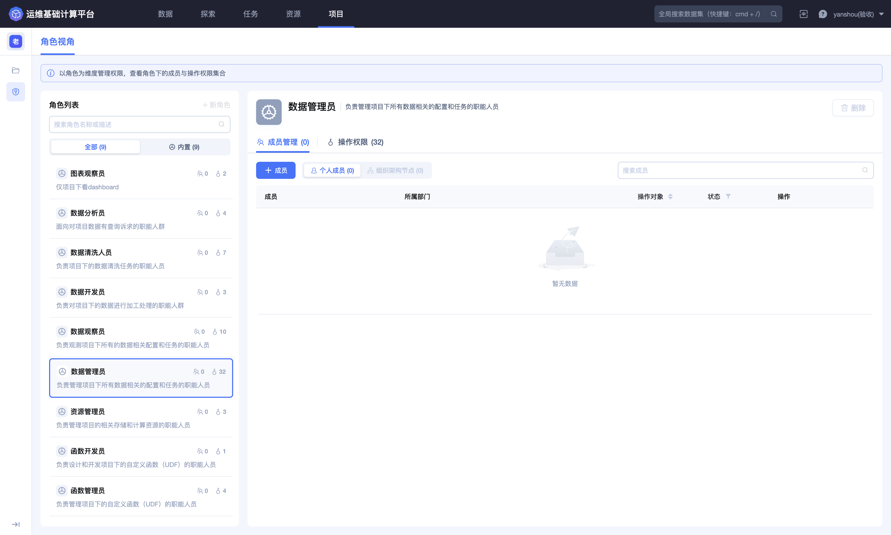
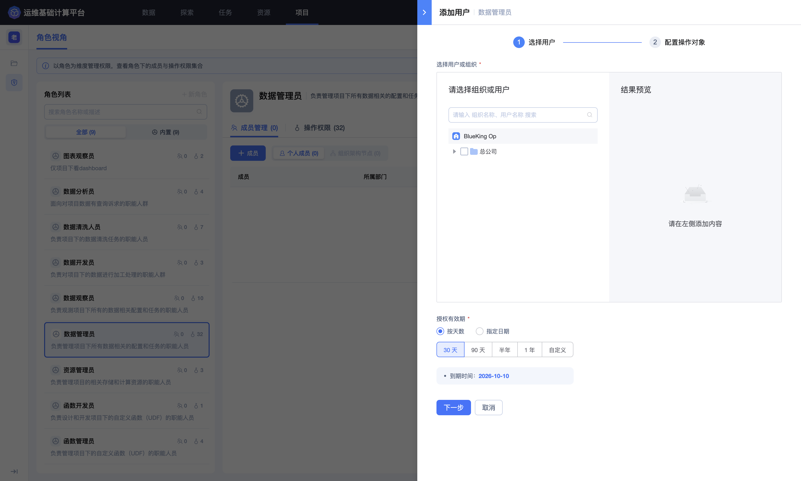
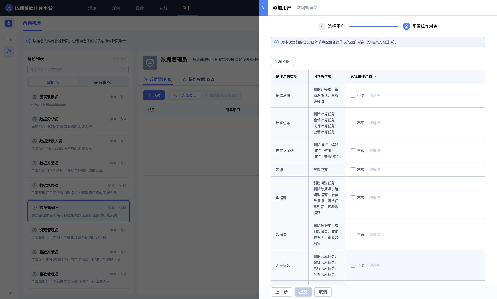
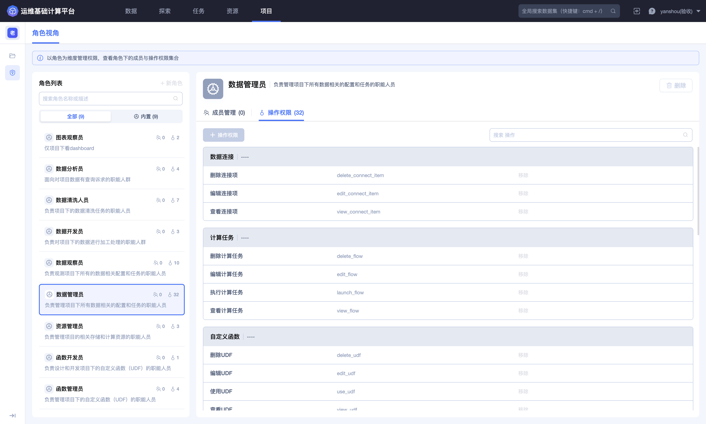
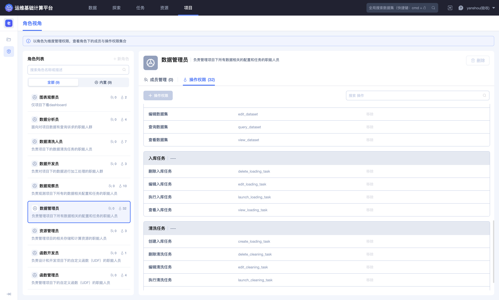
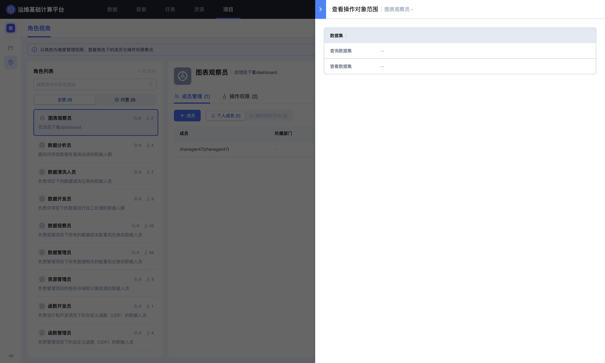
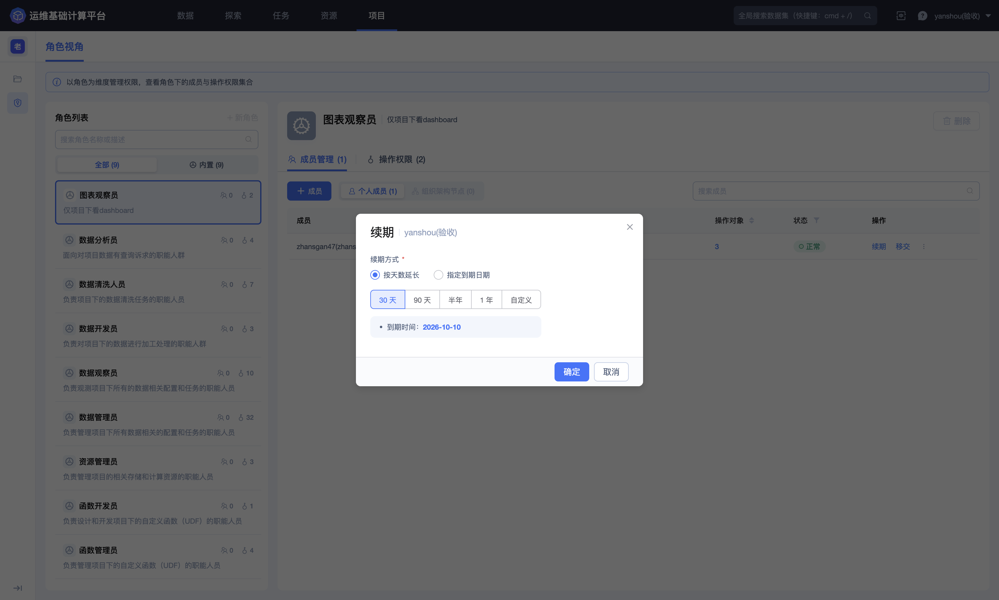
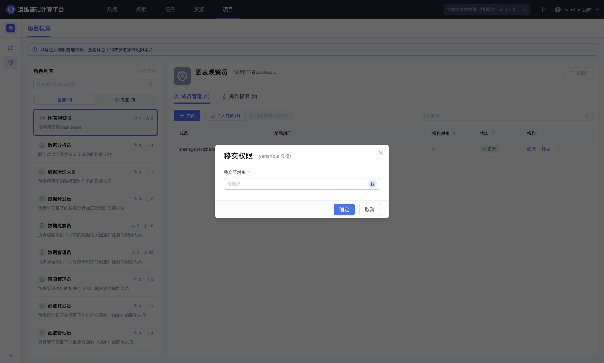
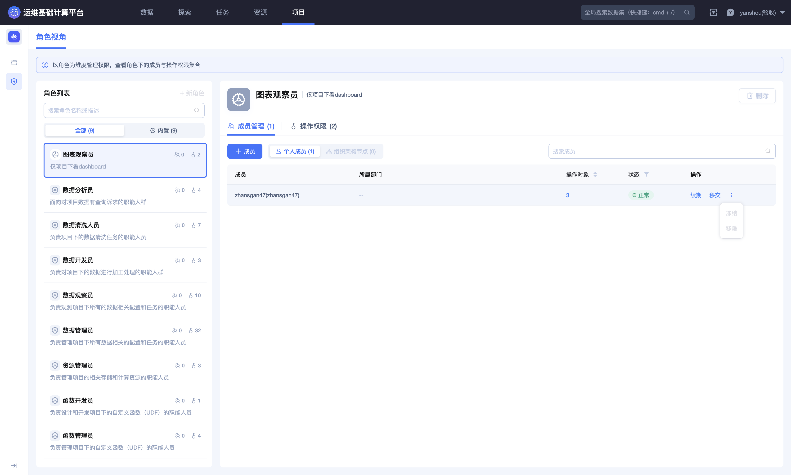

## 权限管理

「权限管理」以角色为维度组织项目权限。每个角色由成员、操作权限和操作对象范围共同构成：操作权限决定“能做什么”，操作对象决定“可以对哪些对象执行”。

进入平台后，点击顶部导航栏的 **`项目`**，再点击左侧的 **`权限管理`**。

### 认识角色视角

页面左侧为角色列表，支持按角色名称或描述搜索，并可筛选全部角色或内置角色。选择角色后，右侧显示角色说明、成员数量以及操作权限数量。

平台提供以下内置角色：

| 角色 | 适用职责 |
| --- | --- |
| 数据管理员 | 管理项目下与数据相关的配置和任务 |
| 数据清洗人员 | 负责项目下的数据清洗任务 |
| 数据观察员 | 查看项目下与数据相关的配置和任务 |
| 数据开发员 | 对项目数据进行加工处理 |
| 图表观察员 | 查看项目下的 Dashboard |
| 数据分析员 | 查询和分析项目数据 |
| 函数管理员 | 管理项目下的自定义函数（UDF） |
| 函数开发员 | 设计和开发项目下的自定义函数（UDF） |
| 资源管理员 | 管理项目使用的存储和计算资源 |

不同角色的操作权限集合不同。分配角色时应按岗位职责选择最接近的角色，避免为了完成单一操作授予范围过大的管理角色。

项目详情中的「项目管理员」和「项目观察员」字段也是角色授权入口。人员加入字段并保存后，会直接获得对应的项目管理员或项目观察员权限；这两类角色不需要在此页面重复分配。其他职能角色及其操作对象范围在「权限管理」中维护。

内置角色的 **`删除`**、**`+ 操作权限`** 和权限项 **`移除`** 入口在页面中为灰显状态，表示其权限模板由平台统一维护。若需要调整授权，应优先更换成员角色或收窄操作对象范围。

### 管理角色成员

角色的「成员管理」页展示以下信息：

| 列 | 说明 |
| --- | --- |
| 成员 | 获得当前角色的个人成员 |
| 所属部门 | 成员所在组织部门 |
| 操作对象 | 当前成员在此角色下可操作的对象数量，可点击查看明细 |
| 状态 | 授权是否处于正常、冻结或其他平台状态 |
| 操作 | 续期、移交以及更多成员管理操作 |

成员页区分 **`个人成员`** 和 **`组织架构节点`**。若组织架构节点入口灰显，表示当前环境不支持通过组织节点批量授权，应按个人成员进行配置。

### 添加成员：选择用户与有效期

点击 **`+ 成员`**，进入两步式授权向导。

第一步为「选择用户」：

1. 在组织树中展开节点，或通过用户名称、组织名称搜索；

2. 勾选用户后，在右侧「结果预览」中核对成员和所属组织；

3. 选择授权有效期。

有效期支持两种方式：

- **按天数**：可选择 30 天、90 天、半年、1 年或自定义天数；

- **指定日期**：直接选择授权到期日期。

页面会显示计算后的到期时间。授权周期应与工作任务周期一致；临时协作、故障处理或短期评审不应默认授予长期权限。

### 添加成员：配置操作对象

点击 **`下一步`** 进入「配置操作对象」。

页面按对象类型汇总当前角色包含的操作项，并要求为各对象类型指定可操作范围。数据管理员角色涉及：资源、自定义函数、清洗任务、数据连接、入库任务、计算任务、数据源和数据集。

每类对象可使用以下配置方式：

- 勾选 **`不限`**：授权覆盖该类型下的全部对象，包括授权期内可能新增的对象；

- 在 **`请选择`** 中指定对象：只允许成员操作已选对象，适合项目分工、外部协作和最小权限控制；

- 点击 **`批量不限`**：一次把多类对象设置为不限，应仅在成员确实承担项目级管理职责时使用。

创建类操作不要求选择已有操作对象；查看、编辑、执行、启停和删除等作用于既有对象的操作，应配置明确范围。

提交前应逐类检查：

1. 成员是否属于正确的角色；

2. 授权有效期是否符合任务周期；

3. 是否误把某一对象类型设置为不限；

4. 是否包含删除、启停或执行等高影响操作；

5. 指定对象是否与成员负责的数据域和任务一致。

### 查看操作权限

切换到角色的 **`操作权限`** 页，可按操作名称搜索，并查看权限名称和权限标识。

以数据管理员角色为例，页面列出以下 28 个操作权限：

| 对象类型 | 操作权限 | 权限标识 |
| --- | --- | --- |
| 资源 | 查看资源 | `view_resource` |
| 自定义函数 | 使用 UDF | `use_udf` |
| 自定义函数 | 查看 UDF | `view_udf` |
| 自定义函数 | 编辑 UDF | `edit_udf` |
| 自定义函数 | 删除 UDF | `delete_udf` |
| 清洗任务 | 查看清洗任务 | `view_cleaning_task` |
| 清洗任务 | 执行清洗任务 | `launch_cleaning_task` |
| 清洗任务 | 编辑清洗任务 | `edit_cleaning_task` |
| 清洗任务 | 删除清洗任务 | `delete_cleaning_task` |
| 数据连接 | 查看连接项 | `view_connect_item` |
| 数据连接 | 编辑连接项 | `edit_connect_item` |
| 数据连接 | 删除连接项 | `delete_connect_item` |
| 入库任务 | 查看入库任务 | `view_loading_task` |
| 入库任务 | 执行入库任务 | `launch_loading_task` |
| 入库任务 | 编辑入库任务 | `edit_loading_task` |
| 入库任务 | 删除入库任务 | `delete_loading_task` |
| 计算任务 | 查看计算任务 | `view_flow` |
| 计算任务 | 执行计算任务 | `launch_flow` |
| 计算任务 | 编辑计算任务 | `edit_flow` |
| 计算任务 | 删除计算任务 | `delete_flow` |
| 数据源 | 查看数据源 | `view_datasource` |
| 数据源 | 编辑数据源 | `edit_datasource` |
| 数据源 | 删除数据源 | `delete_datasource` |
| 数据源 | 启停数据源 | `launch_datasource` |
| 数据集 | 查看数据集 | `view_dataset` |
| 数据集 | 编辑数据集 | `edit_dataset` |
| 数据集 | 删除数据集 | `delete_dataset` |
| 数据集 | 查询数据集 | `query_dataset` |

权限标识主要用于权限排查、接口对接或与管理员沟通。实际授权范围应以成员所属角色和操作对象配置为准；其他内置角色拥有各自的权限组合。

### 查看成员的操作对象范围

点击成员列表中的「操作对象」数量，可查看该成员在当前角色下，各操作权限对应的对象范围。

核对时应重点关注：

- 同一对象类型下，不同操作的范围是否一致；

- 编辑、执行、启停和删除权限是否比查看权限更窄；

- 页面中的 `--`、空值或不限状态是否符合平台对该权限的解释；

- 成员职责变化后，原有对象范围是否仍然必要。

### 为授权续期

点击成员行的 **`续期`**，可延长当前角色授权。

续期支持 **`按天数延长`** 和 **`指定到期日期`**，并提供 30 天、90 天、半年、1 年和自定义选项。确定前应重新确认成员职责和对象范围，不要把续期当作自动延长长期访问的手段。

### 移交权限

点击成员行的 **`移交`**，选择接收对象。

移交前应确认接收人身份、岗位职责、授权有效期和操作对象范围，并与项目管理员完成交接。提交后还应复核原成员和接收成员的状态，确保权限没有重复保留或遗漏。

### 冻结与移除成员

成员行的更多菜单提供 **`冻结`** 和 **`移除`** 入口；入口是否可用取决于当前角色、成员关系和平台策略。

- **冻结**：用于暂停成员在该角色下的访问。恢复方式和冻结后的实际影响以页面确认信息为准；

- **移除**：用于解除成员与当前角色的授权关系，可能同时影响其操作对象范围。

移除属于删除类操作。处理前应检查成员是否还承担数据源维护、清洗与入库、Dataflow、UDF、资源管理或数据查询职责，并确认是否需要先移交权限。若只是暂时不允许访问，应优先评估冻结或缩短有效期是否更合适。

### 权限配置原则

- 按职责分配角色，不以个人资历代替权限需求判断；

- 优先指定操作对象，谨慎使用不限和批量不限；

- 查看权限、编辑权限和高影响权限分层授予；

- 临时授权设置明确到期时间，并在续期时重新评审；

- 人员转岗或离岗时先移交，再冻结或移除；

- 定期复核成员状态、角色数量、对象范围和高影响权限。
