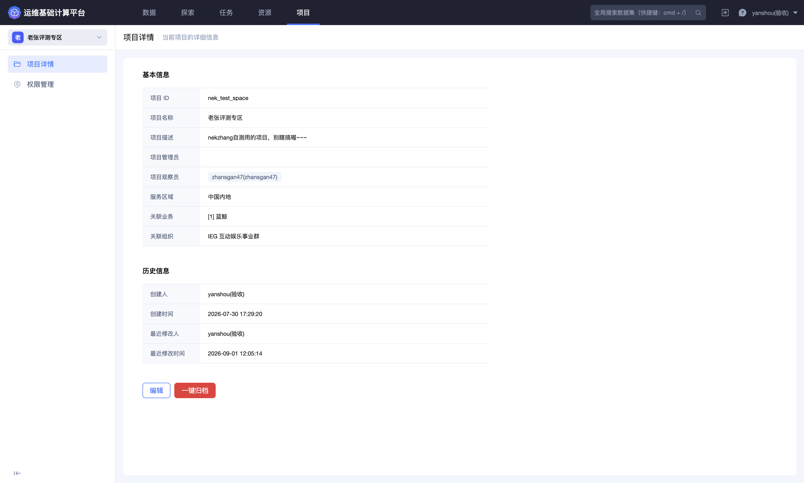
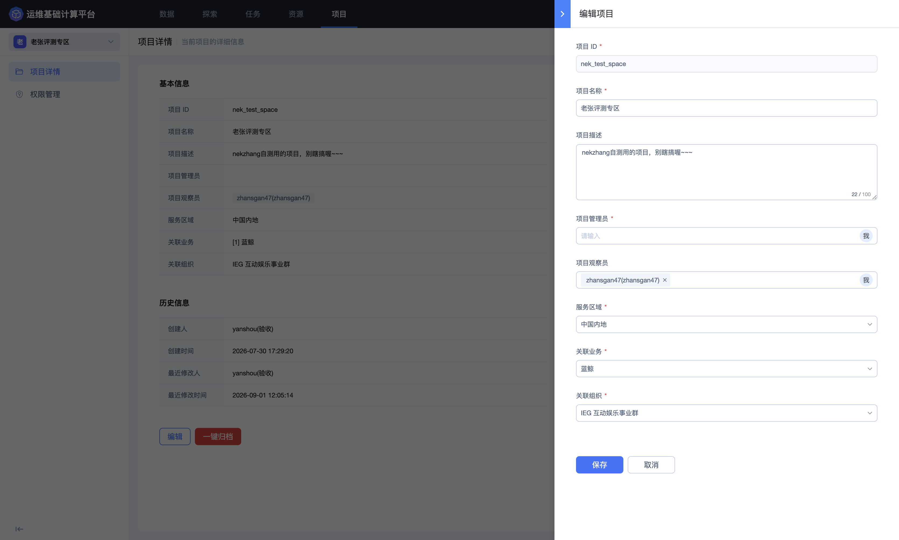

## 项目详情

「项目详情」集中展示项目标识、项目角色、服务区域、关联范围和历史信息，并提供项目资料维护与归档入口。

进入平台后，点击顶部导航栏的 **`项目`**，再点击左侧的 **`项目详情`**。

### 查看项目概况

项目详情分为「基本信息」和「历史信息」两部分。

| 字段 | 说明 |
| --- | --- |
| 项目 ID | 项目的唯一标识，创建后不能在编辑页修改；调用接口、定位权限范围或排查问题时，应优先使用此标识 |
| 项目名称 | 面向用户展示的项目名称 |
| 项目描述 | 说明项目用途、服务对象或数据范围 |
| 项目管理员 | 项目管理员角色的成员；加入后即获得该角色对应的管理权限 |
| 项目观察员 | 项目观察员角色的成员；加入后即获得该角色对应的观察权限 |
| 服务区域 | 项目所使用的服务地域 |
| 关联业务 | 项目归属或服务的业务范围 |
| 关联组织 | 项目对应的组织范围 |

「项目管理员」和「项目观察员」字段已经与角色权限模型关联。把人员加入任一字段后，平台会直接为其授予对应角色的权限；从字段中移除人员时，对应角色权限也会受到影响。因此，这两个字段不仅用于展示项目成员，还属于项目级角色授权配置。

若成员还需要数据管理员、数据开发员、数据分析员或资源管理员等其他职责，再到「权限管理」中分配相应角色并配置操作对象范围。

「历史信息」展示创建人、创建时间、最近修改人和最近修改时间，可用于确认项目来源与配置变更时间。

### 编辑项目资料

点击页面右下角的 **`编辑`**，在侧边面板中修改项目资料。

| 配置项 | 是否必填 | 填写说明 |
| --- | --- | --- |
| 项目 ID | 是 | 只读；命名规则为以字母或下划线开头，只能包含字母、数字和下划线 |
| 项目名称 | 是 | 最多 50 个字符，应使用稳定、易识别的名称 |
| 项目描述 | 否 | 最多 100 个字符，建议写明业务目标、主要数据范围和负责人 |
| 项目管理员 | 是 | 选择负责项目管理的成员；保存后，所选人员获得项目管理员角色权限。成员选择器提供 **`我`** 快捷入口 |
| 项目观察员 | 否 | 选择需要查看项目的成员；保存后，所选人员获得项目观察员角色权限 |
| 服务区域 | 是 | 从平台提供的区域中选择；可选项由平台部署和组织策略决定 |
| 关联业务 | 是 | 选择项目归属或服务的业务 |
| 关联组织 | 是 | 选择项目所属组织 |

修改后点击 **`保存`** 提交；点击 **`取消`** 放弃编辑。保存前应重点核对管理员、关联业务和关联组织，避免项目责任人与权限治理范围不一致。

### 成员信息维护建议

- 至少保留一名能够承担日常维护工作的项目管理员；

- 管理员发生岗位调整时，先完成接替人员配置，再移除原管理员；

- 项目观察员字段会直接授予对应角色权限，应只添加确实需要项目观察权限的人员；

- 定期核对管理员和观察员名单，清理已离岗、已转岗或不再需要访问项目的成员；

- 需要授予其他职能角色，或控制具体数据集、数据源、任务和资源的访问范围时，到「权限管理」中继续配置。

### 一键归档

页面右下角的 **`一键归档`** 用于结束项目的活跃使用状态。归档属于高影响操作，可能影响项目成员访问、数据任务维护以及后续资源使用。

执行归档前应完成以下检查：

1. 确认数据源采集、清洗任务、入库任务和 Dataflow 不再需要运行；

2. 确认重要数据集、查询结果、函数定义和配置已经按组织要求备份或完成交接；

3. 检查项目使用的计算、存储和授权资源是否仍被其他项目或任务依赖；

4. 核对项目成员、数据责任人和业务负责人已经知晓影响范围；

5. 根据页面确认信息和组织审批流程，确认归档后的访问、恢复及数据保留策略。

若只是暂时停止部分任务，应优先在对应的数据源、清洗、入库或 Dataflow 功能中处理，不要用项目归档代替任务级停用。
