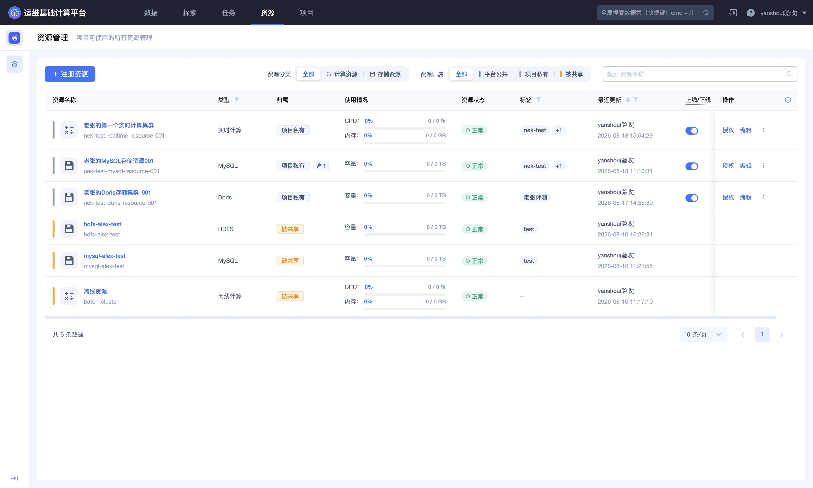
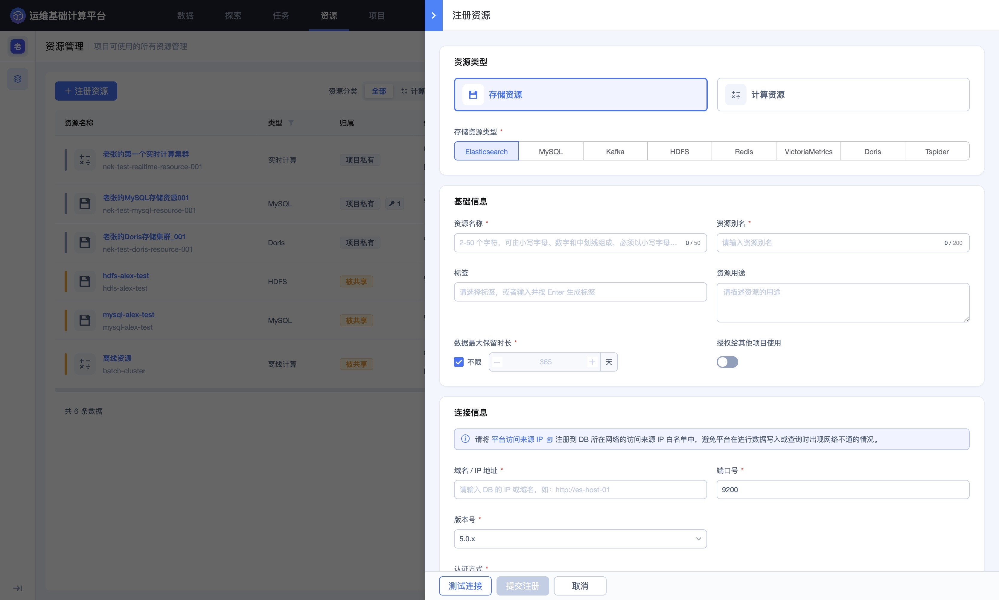
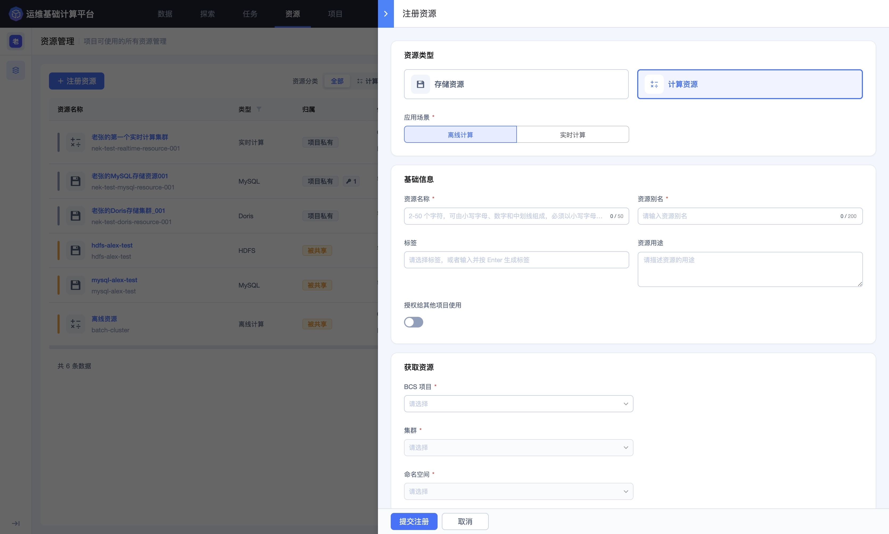
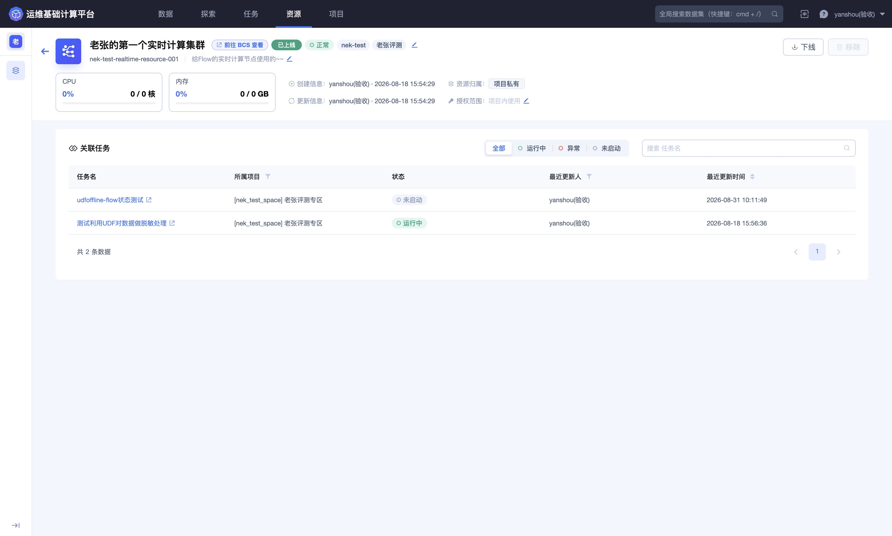
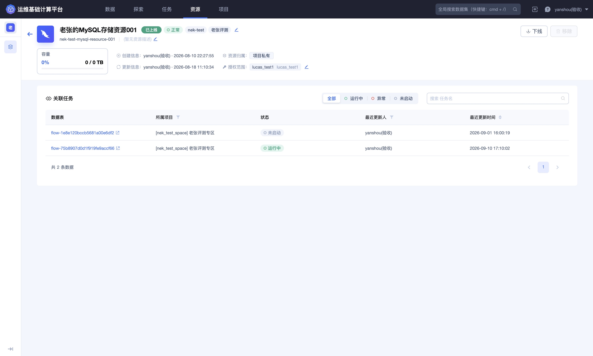
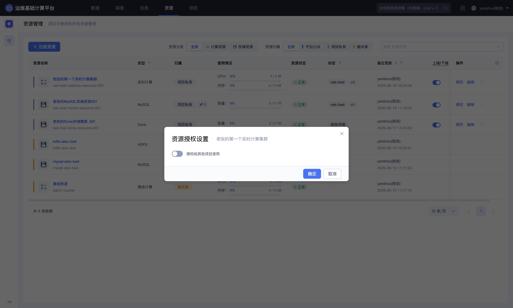
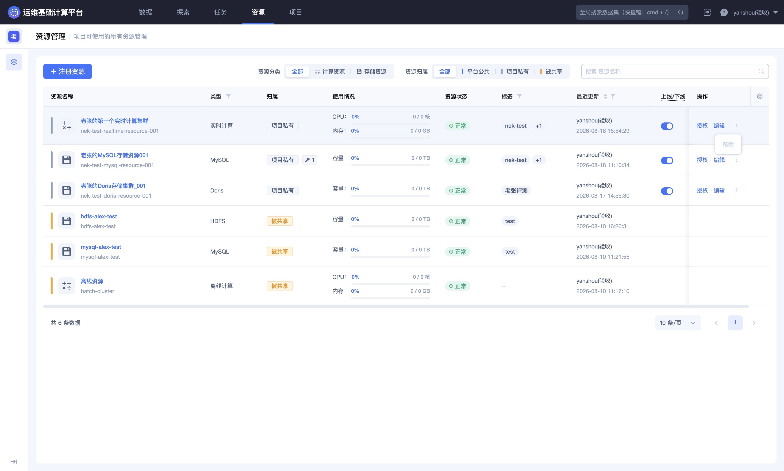

## 资源管理

「资源」用于统一管理项目可以使用的计算集群和存储集群。计算资源为实时、离线等计算任务提供 CPU 和内存；存储资源用于承载处理结果，并向查询和下游任务提供数据。

进入平台后，点击顶部导航栏的 **`资源`**，进入「资源管理」页面。

### 查看资源列表

资源列表展示资源名称与标识、类型、归属、使用情况、资源状态、标签、最近更新时间以及可执行操作。

页面提供两组常用筛选条件：

- **资源分类**：查看全部资源、计算资源或存储资源；

- **资源归属**：查看全部、平台公共、项目私有或其他项目共享给当前项目的资源。

也可通过页面右上角的搜索框按资源名称定位目标资源。

#### 计算资源

计算资源包括实时计算和离线计算等应用场景。列表通过 CPU、内存使用率和已使用/总量展示当前资源情况。

计算任务启动前，需要具备与任务类型匹配的可用计算资源。资源不足、状态异常或已经下线时，任务可能无法启动或稳定运行。

#### 存储资源

存储资源用于将数据集写入具体存储引擎。列表通过容量使用率和已使用/总量展示资源情况，并可能显示当前关联或授权数量。

配置入库任务前，应确认目标存储类型、资源状态、最大保留时长和项目权限与数据使用场景匹配。

### 理解资源归属

- **平台公共**：由平台统一提供，可供符合条件的项目使用；

- **项目私有**：由当前项目注册和管理，默认仅在项目范围内使用；

- **被共享**：由其他项目注册并授权给当前项目使用。当前项目通常只能使用，不能编辑、下线或移除该资源。

资源归属决定管理权限，资源标签用于补充环境、用途或数据域等信息。筛选资源时，应同时检查归属、类型和状态。

### 注册存储资源

点击页面左上角的 **`注册资源`**，选择 **`存储资源`**。当前页面支持 Elasticsearch、MySQL、Kafka、HDFS、Redis、VictoriaMetrics、Doris 和 Tspider 等类型；实际可用类型以当前环境为准。

1. 选择存储资源类型；

2. 填写资源名称、资源别名、标签和资源用途；

3. 设置数据最大保留时长。选择不限前，应结合存储容量和数据治理要求评估；

4. 按存储类型填写域名或 IP、端口、版本和认证方式等连接信息；

5. 根据页面提示，将平台访问来源 IP 加入目标集群的网络白名单；

6. 检查高级设置，点击 **`测试连接`**；

7. 测试通过并确认配置无误后，点击 **`提交注册`**。

不同存储类型需要的连接字段和高级参数不同，应以所选类型的页面表单为准。测试连接成功只说明当前网络和认证配置可用，还需确认账号权限、容量、版本兼容性和源端负载满足使用要求。

> 密码、令牌、认证请求头、私钥和内部连接地址属于敏感配置，只应在受控注册页面中填写，请勿通过非受控渠道传播。

### 注册计算资源

在注册资源页面选择 **`计算资源`**，再根据用途选择 **`离线计算`** 或 **`实时计算`**。

1. 选择应用场景；

2. 填写资源名称、资源别名、标签和资源用途；

3. 确认是否需要授权给其他项目使用；

4. 依次选择 BCS 项目、集群和命名空间；

5. 核对计算场景和底层集群后，点击 **`提交注册`**。

计算资源名称应体现环境和用途。实时与离线任务的资源需求不同，不应仅根据名称混用；启动数据开发任务时，平台会根据节点类型检查对应的可用资源。

### 查看资源详情

点击资源名称进入详情页。页面上方展示资源状态、标签、资源标识、用途、归属、授权范围、创建与更新信息，以及 CPU、内存或容量使用情况。

#### 计算资源详情

计算资源详情页展示 CPU 和内存使用情况，并列出使用该资源的关联任务。可按运行中、异常或未启动筛选任务，也可按任务名搜索。

准备编辑、下线或移除计算资源时，应先检查关联任务。存在运行中任务时，资源变更可能造成计算中断或任务重新部署失败。

#### 存储资源详情

存储资源详情页展示容量使用情况，并列出使用该资源的数据表或存储任务。

调整存储连接、保留策略或资源状态前，应确认关联数据表、当前任务状态以及下游查询和消费情况。

### 授权给其他项目

对于当前项目拥有管理权限的资源，可点击列表操作列中的 **`授权`**，打开「资源授权设置」。

启用 **`授权给其他项目使用`** 后，其他项目可在被共享资源中看到并使用该资源。授权前应确认：

- 目标资源有足够的计算或存储容量；

- 数据安全、网络访问和账号权限允许跨项目使用；

- 资源负责人和使用方已经约定容量、保留时间及故障处理责任。

取消授权可能影响其他项目正在运行的任务，应先确认共享范围和关联任务，再保存变更。

> 授权或取消授权都会改变其他项目对资源的可用性。保存前应核对资源名称、授权范围和关联任务。

### 编辑资源

点击列表操作列中的 **`编辑`**，可调整当前资源允许修改的基础信息、授权或连接配置。不同资源类型的可编辑字段不同。

编辑连接地址、认证方式、集群或命名空间前，应先检查关联任务，并在修改后重新执行连接测试和状态检查。认证信息只应在受控页面中维护，请勿通过非受控渠道传播。

### 上线和下线

资源详情页会展示当前是 **`已上线`** 还是 **`已下线`**，并提供相应操作入口。

- **上线**：使资源进入可分配、可使用状态；

- **下线**：停止继续向任务提供该资源，可能影响关联任务的启动、重启或持续运行。

执行下线前，应检查资源状态、关联任务和影响范围，并与资源使用方确认维护窗口。

### 移除资源

项目私有资源的更多操作菜单中提供 **`移除`** 入口。

移除会从平台资源管理中取消该资源的登记。它是否同时影响底层集群或存储数据，应以页面确认提示和平台实现为准，不能将“移除登记”直接理解为已经删除底层资源。

页面可能在资源已上线或仍有关联任务时禁用移除。准备移除前，应依次确认：

1. 资源已经停止被任务使用；

2. 关联计算任务、存储任务和数据表已经迁移或停止；

3. 共享授权已经清理；

4. 需要保留的数据已经完成备份或迁移；

5. 已明确底层集群和数据的后续处理方式。

> **移除提示**：移除资源前，应完成任务迁移、授权清理和必要的数据备份，并在最终确认页再次核对资源名称及影响范围。
