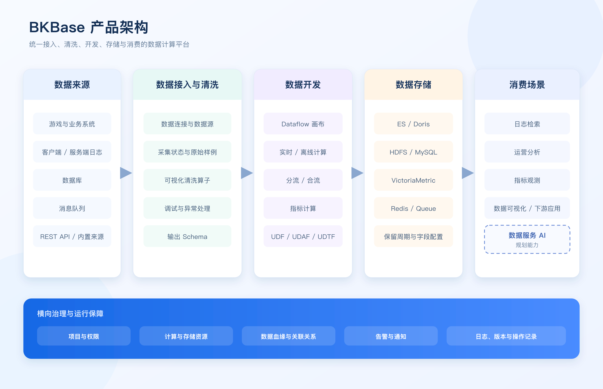

## 产品架构

BKBase 将数据来源、数据接入、清洗、开发、存储和消费组织为一条连续的数据链路，并通过项目权限、资源管理、血缘、告警和操作记录提供横向治理。

### 数据来源

业务数据可以来自游戏或业务系统、客户端与服务器日志、关系型或文档数据库、消息队列、REST API 以及平台内置数据源。

### 数据接入与清洗

数据连接保存可复用的连接配置，数据源定义具体采集项和采集范围。普通数据源取得样例后，可以通过清洗算子完成解析、提取、转换和异常处理，并在输出数据配置中建立最终字段 Schema。

CDC 数据源通常在接入阶段同步表结构并配置目标存储，不再单独建立传统清洗和入库任务，具体以接入向导为准。

### 数据开发

经过清洗的结果数据可以直接被查询，也可以进入 Dataflow 继续处理。Dataflow 通过实时计算、离线计算、指标计算、分流、合流和存储节点构建持续运行的数据链路。

UDF、UDAF 和 UDTF 用于封装可复用的业务逻辑。已上线函数可以在与其类型及适用场景匹配的计算节点中调用。

### 数据存储

结果数据根据消费方式写入不同存储：

- ES：日志和多条件检索；
- Doris：明细分析、聚合查询和高并发 OLAP；
- HDFS：长期保存和离线处理；
- MySQL：关系型查询与小规模结果；
- VictoriaMetric：时序指标；
- Redis：低延迟键值访问；
- Queue：消息订阅和下游流式消费。

### 消费场景

当前数据可以用于日志检索、运营分析、指标观测、数据可视化和下游系统消费。架构图同时预留“数据服务 AI”位置，用于表达未来面向 AI 应用提供数据服务的演进方向；该位置标注为规划能力，不代表当前版本已经提供对应功能。

### 横向治理

- **项目与权限**：管理成员角色、操作权限和操作对象范围；
- **资源管理**：管理计算资源和存储资源的归属、授权与状态；
- **血缘与关联关系**：追踪结果数据的来源、加工和下游使用；
- **告警与通知**：发现无数据、异常、波动或延迟；
- **日志、版本和操作记录**：支持运行排查、变更追踪和配置恢复。

### 核心对象关系

业务用于确定数据归属，项目用于组织开发协作。数据源接入原始数据并产出数据集；Dataflow 消费一个或多个数据集，经计算后产生新的结果数据；存储决定结果数据的查询与消费方式；血缘记录这些对象之间的上下游关系。
