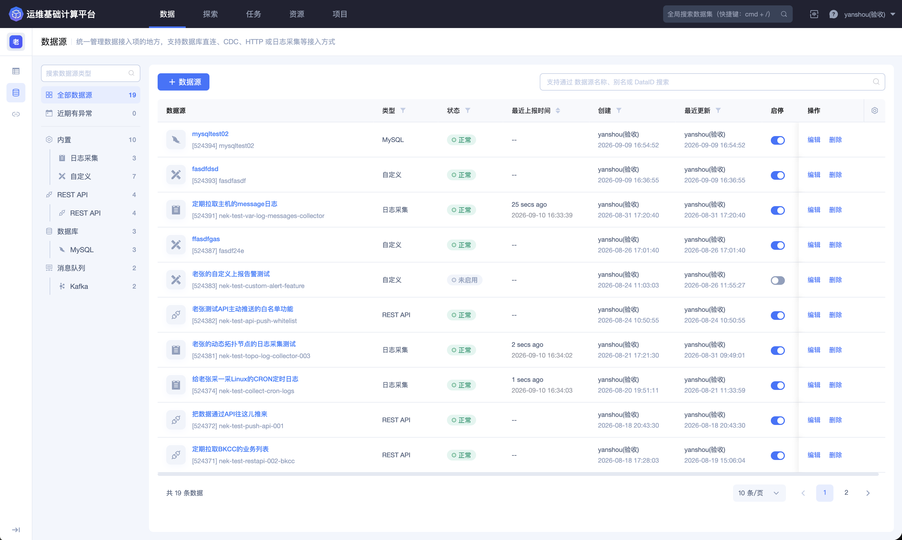
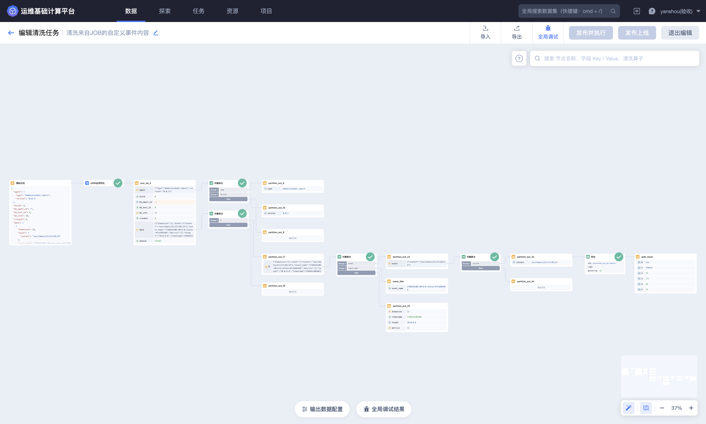
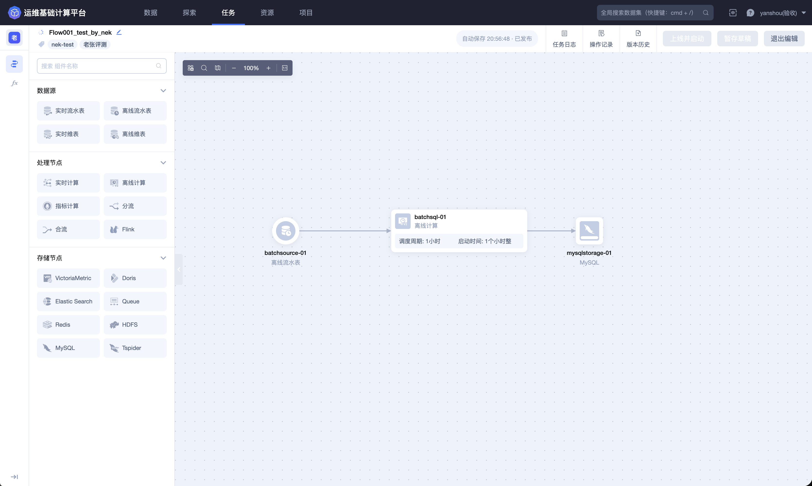
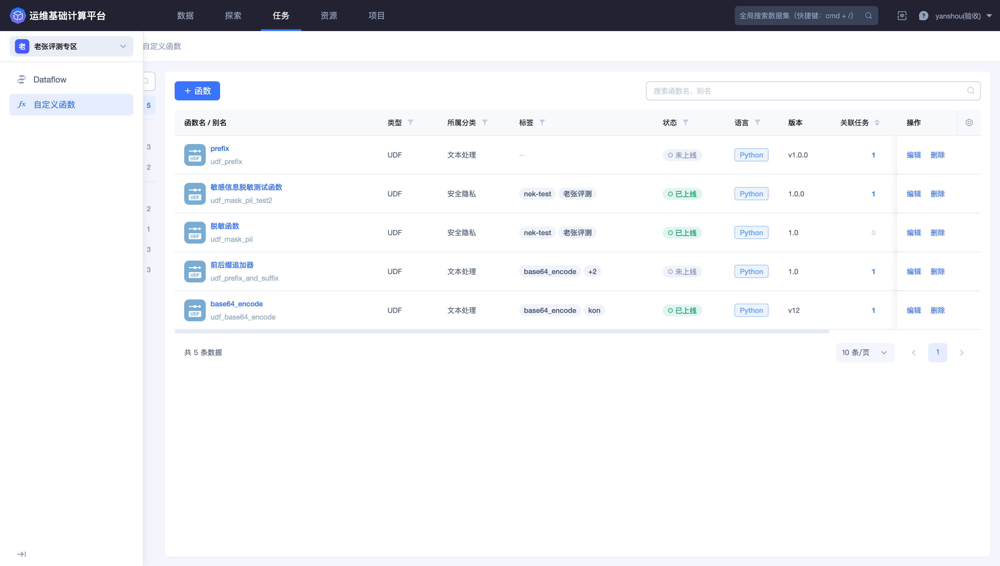
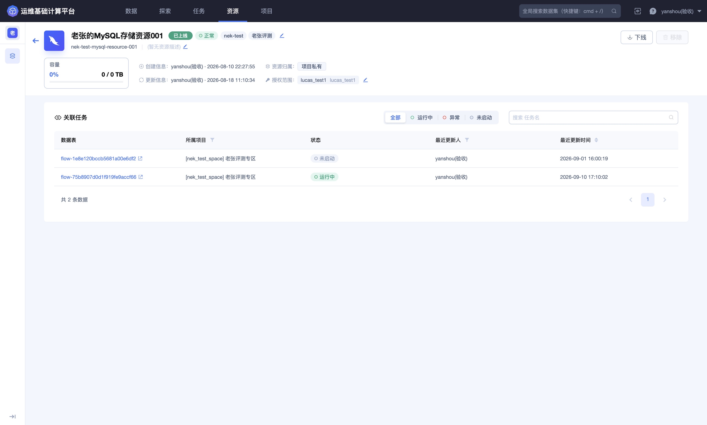
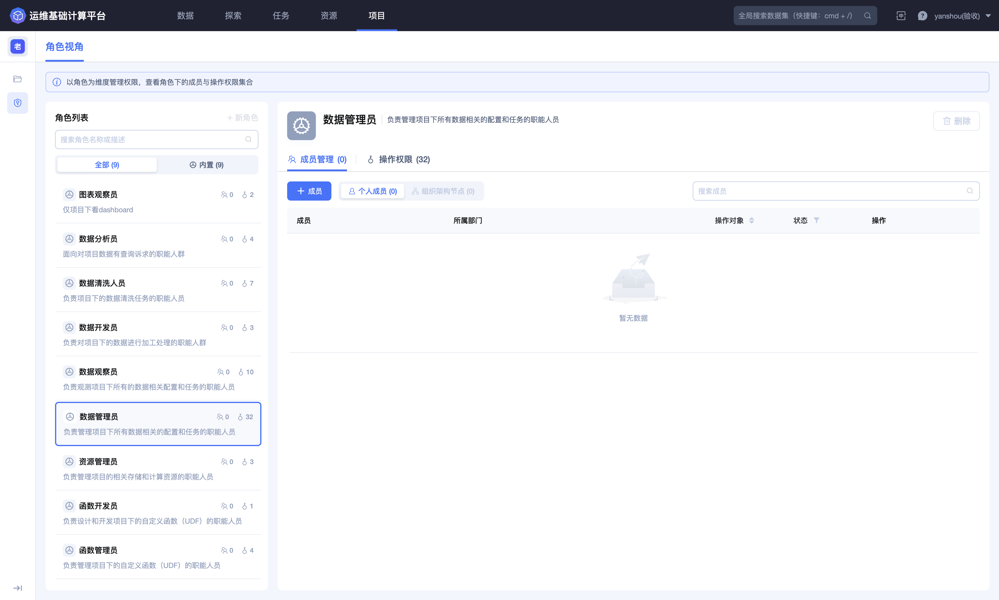

## 产品优势

BKBase 的价值不只是提供单个数据处理功能，而是把数据从产生到消费的关键环节连接起来，减少跨系统切换、重复开发和口径不一致。

### 统一接入异构数据

平台支持从内置系统、日志、数据库、消息队列和 REST API 等来源接入数据。数据连接可以复用外部系统的连接信息，数据源则负责定义具体采集项、采集范围和运行状态。

统一接入后，用户可以在一个入口检查最近上报时间、原始样例、接入点状态、通知历史和操作记录。

### 可视化完成数据清洗

清洗编辑器通过样例数据、数据树、算子画布、输出数据配置和全局调试结果，将原本分散在脚本中的处理逻辑可视化。

用户可以逐步观察每个节点的输入和输出，在发布前确认字段提取、格式转换、异常处理和最终 Schema，降低非结构化数据进入下游后才暴露问题的风险。

### 统一编排实时与离线任务

Dataflow 使用可视化拓扑连接数据源、处理和存储节点。实时计算、离线计算、分流、合流、指标计算和自定义 Flink 逻辑可以在同一画布中进行编排，并通过任务日志、操作记录和版本历史持续维护。

### 复用业务处理逻辑

对于 SQL 难以重复表达的文本处理、脱敏、聚合或拆分逻辑，可以创建 UDF、UDAF 或 UDTF。函数经过调试并上线后，可以被多个 Dataflow 引用，减少重复实现，并通过版本和关联任务追踪变更影响。

### 按消费方式选择存储

不同数据的消费方式不同。BKBase 可以将结果数据写入 ES、Doris、HDFS、MySQL、VictoriaMetric、Redis、Queue 等存储，并配置保留周期和字段属性。

用户可以根据检索、实时分析、离线处理、时序查询或低延迟读取需求选择存储，而不必让所有场景共用一种数据模型。

### 更快完成数据验证

探索模块支持 BKSQL 和 PromQL。用户可以查看结果表 Schema、编写查询、使用函数面板、检查查询详情、保存常用查询并查看历史记录，使数据开发和结果验收形成闭环。

### 数据链路可观测、可追溯

从数据源上报、清洗和入库，到 Dataflow 运行和结果查询，平台提供状态、日志、告警、版本、操作记录及关联关系。发生无数据、延迟或结果异常时，可以沿链路逐层定位。

### 基于项目安全协作

项目用于组织数据开发工作。项目管理员和项目观察员字段同时承载角色授权：将人员加入对应字段后，即获得该角色关联的权限。更细粒度的操作权限和操作对象范围则通过权限管理进行配置。

### 缩短数据交付周期

数据接入、清洗、计算、存储和查询使用一致的结果数据模型。开发人员不需要为每个消费方重新搭建一套独立链路，业务人员也能更快获得结构稳定、持续更新、权限清晰的数据。
