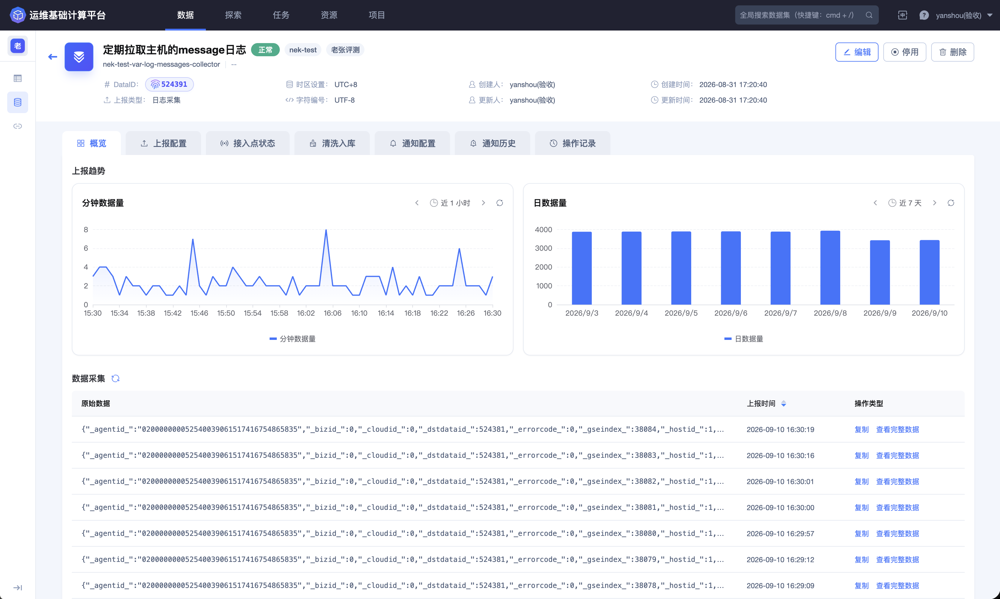
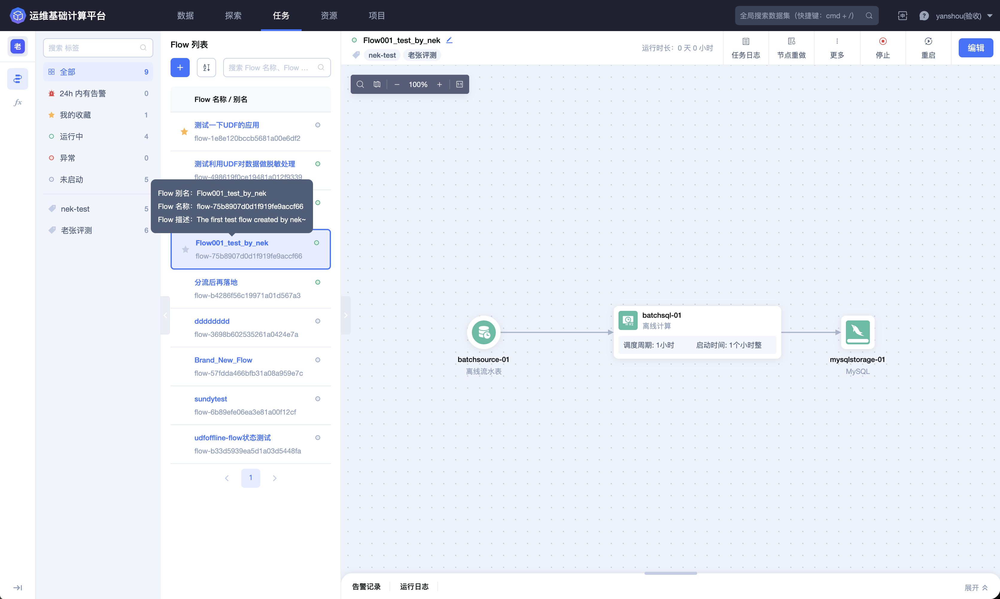
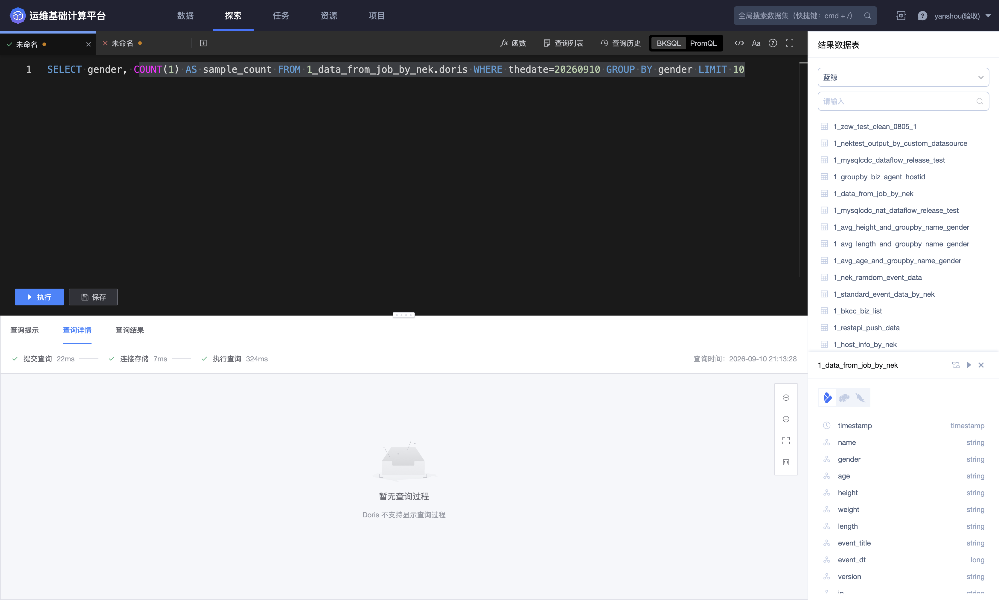

## 什么是 BKBase

BKBase 是一款面向业务运营、部署管理、数据开发和分析场景的基础计算平台。平台将来自业务系统、日志、数据库、消息队列和接口的数据统一接入，在同一套工作空间内完成清洗、结构化、加工、存储和查询，最终形成可供分析、观测、可视化及其他数据应用消费的数据资产。

### BKBase 解决什么问题

业务数据通常分散在不同系统中，格式、更新频率和使用方式各不相同。直接使用这些数据时，常见问题包括：

- 日志是非结构化文本，无法按字段检索；
- 同一指标在不同团队中存在不同计算口径；
- 数据处理脚本分散，缺少统一的运行状态和版本记录；
- 数据写入不同存储后，使用者难以判断应该从哪里查询；
- 数据权限、项目成员和资源归属缺少统一管理。

BKBase 通过“接入、清洗、开发、存储、探索、治理”一体化流程，把原始数据转化为结构清晰、口径稳定、可以持续更新的结果数据。

### 谁适合使用 BKBase

| 用户 | 典型工作 |
| --- | --- |
| 数据开发人员 | 接入数据、定义 Schema、创建 Dataflow、维护实时或离线处理任务 |
| 业务运营人员 | 查询业务数据、保存常用查询、分析活动或运营指标 |
| 数据分析人员 | 使用 BKSQL 或 PromQL 查询结果数据，验证口径并开展分析 |
| 平台管理员 | 管理项目成员、权限、计算资源和存储资源 |

### 核心能力

1. **数据接入**：通过数据连接和数据源统一接入日志、数据库、消息队列、REST API 及平台内置来源。

2. **数据清洗**：基于真实样例配置清洗算子，将文本或半结构化数据转换为稳定的字段 Schema。

3. **数据开发**：在 Dataflow 画布中编排实时计算、离线计算、分流、合流、指标计算和存储节点。

4. **自定义函数**：使用 UDF、UDAF 或 UDTF 封装可复用的业务处理逻辑，并在 Dataflow 中调用。

5. **数据存储**：根据检索、分析、长期保存、时序查询或低延迟访问需求选择目标存储。

6. **数据探索**：通过 BKSQL 或 PromQL 查询结果数据，查看 Schema、查询详情、结果和历史记录。

7. **项目治理**：通过项目、角色、权限、数据血缘、通知和操作记录管理协作边界。

### 核心页面示例

数据源详情集中呈现上报趋势、原始样例、清洗入库、通知和操作记录，是数据进入平台后的第一个管理入口。

清洗编辑器通过数据树、算子画布和输出数据配置，把原始日志转换为结构化结果数据。

Dataflow 使用节点和连线表示输入、计算与存储之间的数据流向，并展示运行状态。

探索模块提供结果表选择、Schema 查看、BKSQL／PromQL 编辑和查询结果展示。

### 一条数据在平台中的生命周期

一条典型的数据链路如下：

> 业务系统产生数据 → 创建数据源完成接入 → 获取样例并配置清洗 → 定义输出 Schema → 配置入库 → 在 Dataflow 中继续计算 → 写入目标存储 → 查询或提供给下游应用使用

数据连接保存可复用的外部连接配置；数据源描述具体的采集项和采集范围；数据集是经过清洗或计算后可供查询和下游使用的结果数据；Dataflow 则持续维护结果数据之间的加工关系。

### 典型使用场景

- 将游戏服务器日志标准化后写入 ES，实现按玩家、区服、事件和时间检索；
- 对手机号、证件号等敏感字段脱敏后提供给分析人员；
- 实时计算登录量、失败率、在线人数等运营指标；
- 将同一份结果数据分别写入 Doris、HDFS 或 ES，满足分析、归档与检索需求；
- 通过项目角色和操作权限控制数据的查看、开发和维护范围。

如需第一次跑通完整链路，请从 [接入游戏日志](../Quick-Starts/1.Access-game-log.md) 开始。
