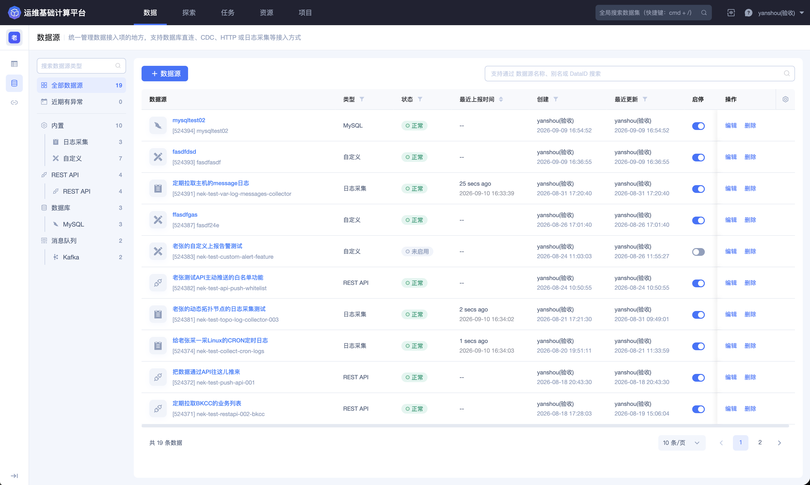
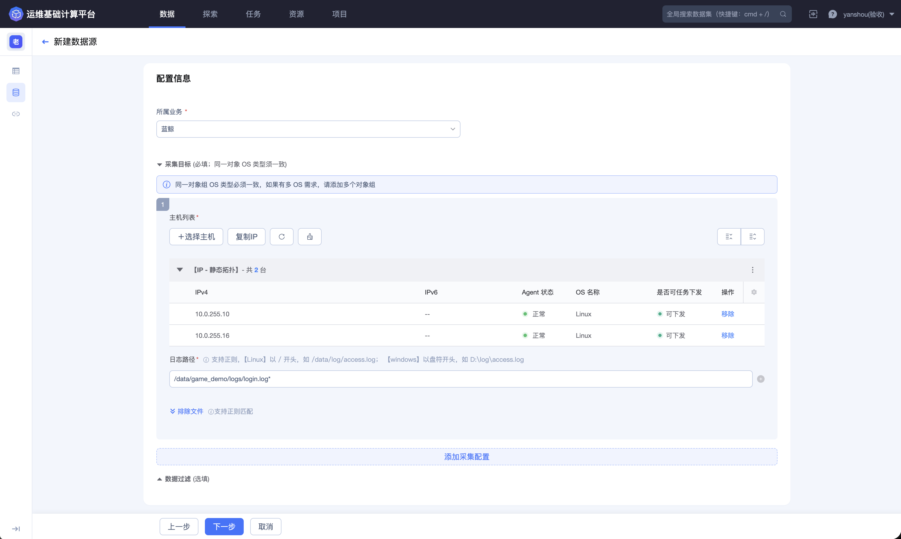
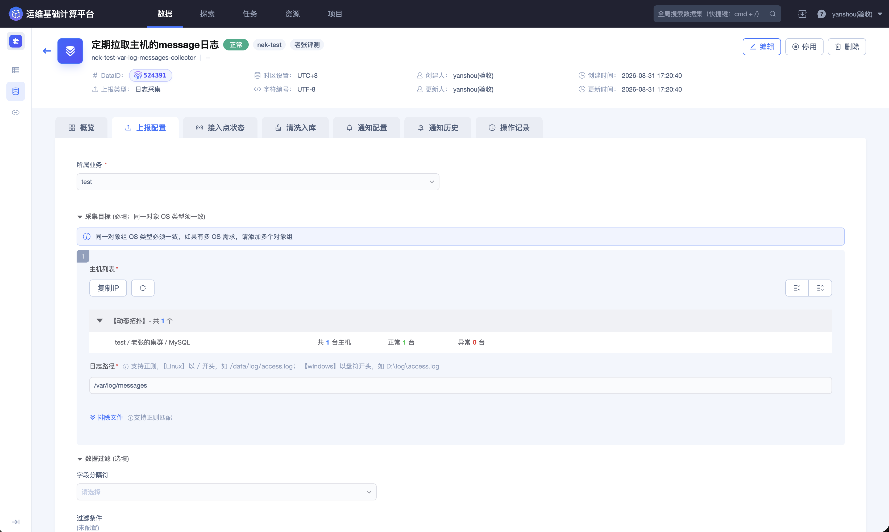
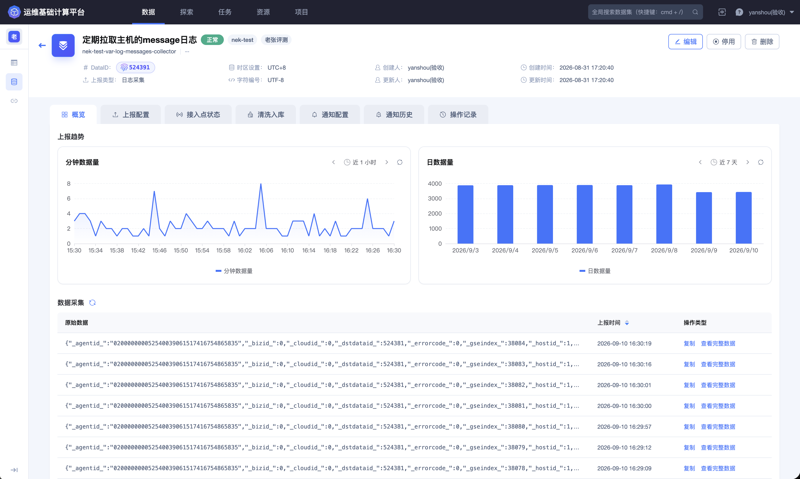
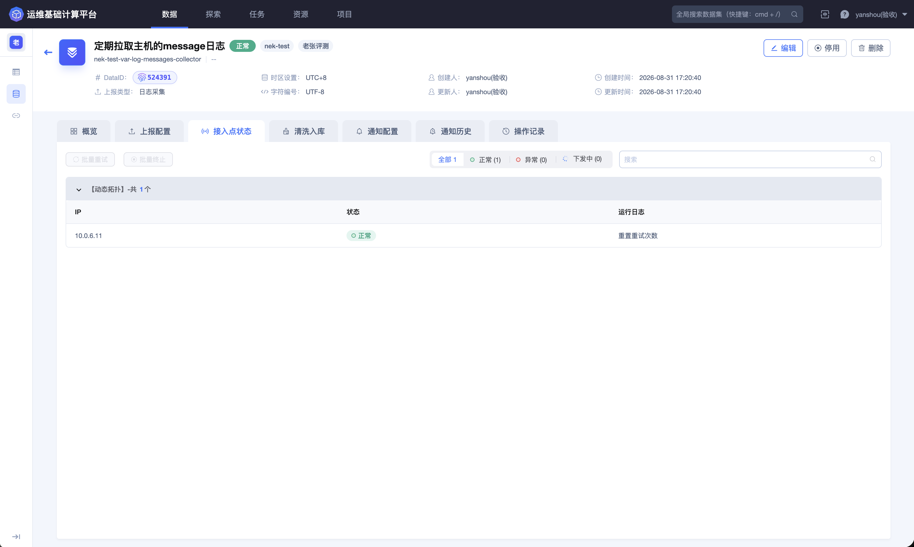

## 第一步：接入游戏登录日志

本快速接入使用一条游戏登录事件链路贯穿数据源、清洗、入库、自定义函数和 Dataflow。完成全部步骤后，原始日志将被转换为结构化结果数据，写入 ES，并在 Dataflow 中调用自定义函数继续加工。

### 目标数据

假设游戏服务器持续输出以下 JSON 日志：

```json
{
  "event_time": 1789006530,
  "game_id": "game_01",
  "zone_id": "zone_101",
  "player_id": "player_10001",
  "channel": " AppStore ",
  "device_os": "ios",
  "client_ip": "192.0.2.18",
  "phone": "13800138000",
  "login_result": "success"
}
```

示例中的手机号和 IP 仅用于说明字段格式。实际操作应使用已授权的测试数据，并避免在截图、查询结果或协作渠道中传播敏感值。

### 接入前准备

开始前确认：

- 已进入目标项目；
- 已获得创建和管理数据源的权限；
- 已确认日志上报方式、字符编码和时区；
- 上报端能够访问平台提供的接入地址；
- 已明确数据负责人、保留周期和敏感级别。

### 创建数据源

进入数据源列表后，先确认当前项目是否正确，再查看现有数据源，避免为同一上报链路重复创建采集项。



1. 进入顶部导航栏的 **`数据`**。

2. 在左侧选择 **`数据源`**，点击新建入口。

3. 根据实际上报方式选择日志采集、自定义上报、Kafka 或 REST API。本文以持续上报的 JSON 日志为例。

4. 填写数据源名称、别名、所属业务、时区、字符编码和说明。

5. 按向导配置上报目标或连接信息，完成连接调试后创建数据源。



数据源名称应表达数据域和用途，例如“游戏登录事件日志”，避免使用只在当前阶段有意义的临时名称。

创建完成后，进入 **`上报配置`** 查看与当前来源类型对应的接入参数和示例。实际使用时应替换示例值，并将认证信息保留在受控配置环境中。



### 验证数据上报

进入数据源详情的 **`概览`**，检查：

- 数据源处于启用状态；
- 最近上报时间持续推进；
- 分钟数据量或日数据量出现变化；
- 原始数据区域能够看到符合预期的 JSON 结构；
- 字符没有乱码，时间戳单位与时区已经确认。



主动采集类数据源还应进入 **`接入点状态`** 检查采集实例。对于被动接收数据的来源，页面可能无法展示接入点，此时以概览中的最新数据为主要判断依据。



### 完成标准

能够连续看到新的原始样例，并确认字段格式稳定，即可进入 [第二步：清洗并定义 Schema](2.Clean-and-define-schema.md)。

如需了解不同数据源类型和详情页，请参阅 [数据源](../Features/Data/Data-source.md)。
