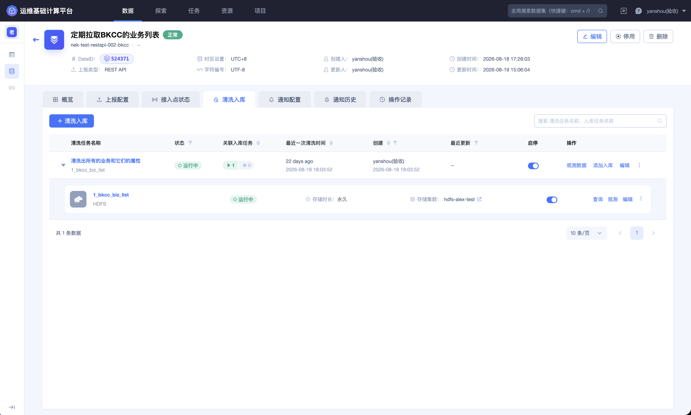
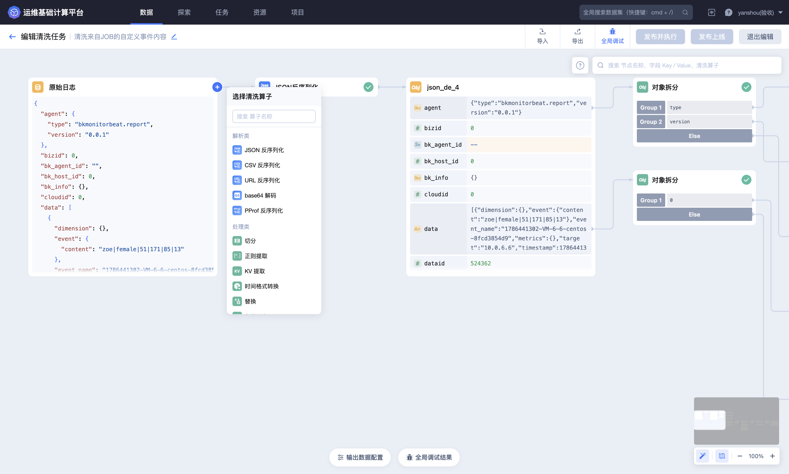
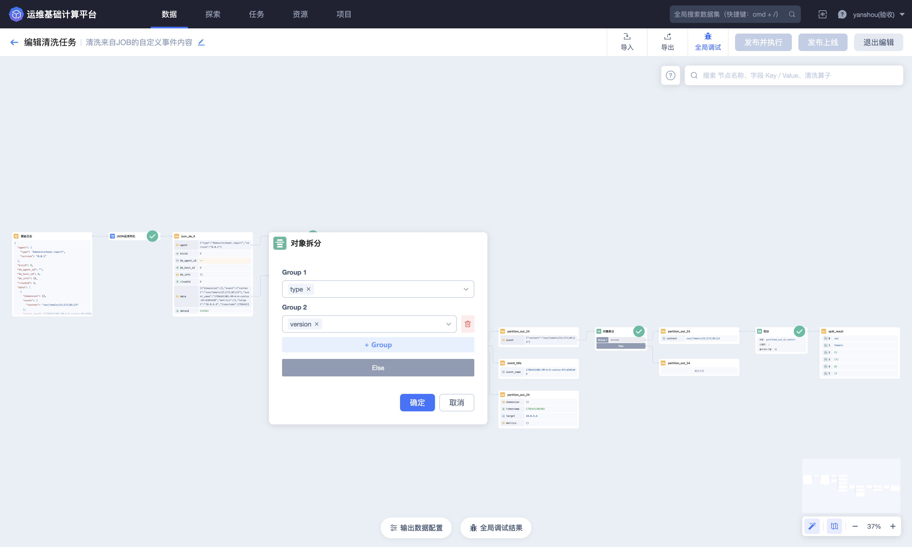
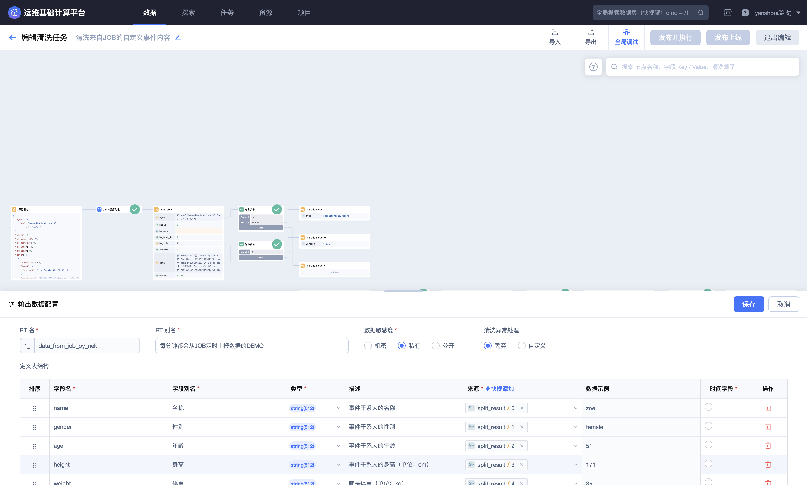
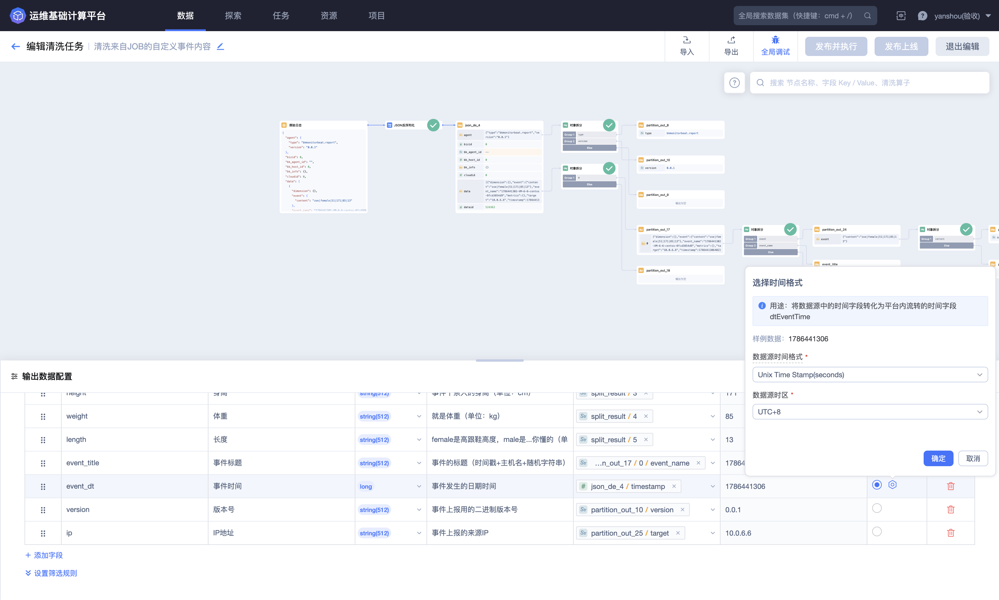
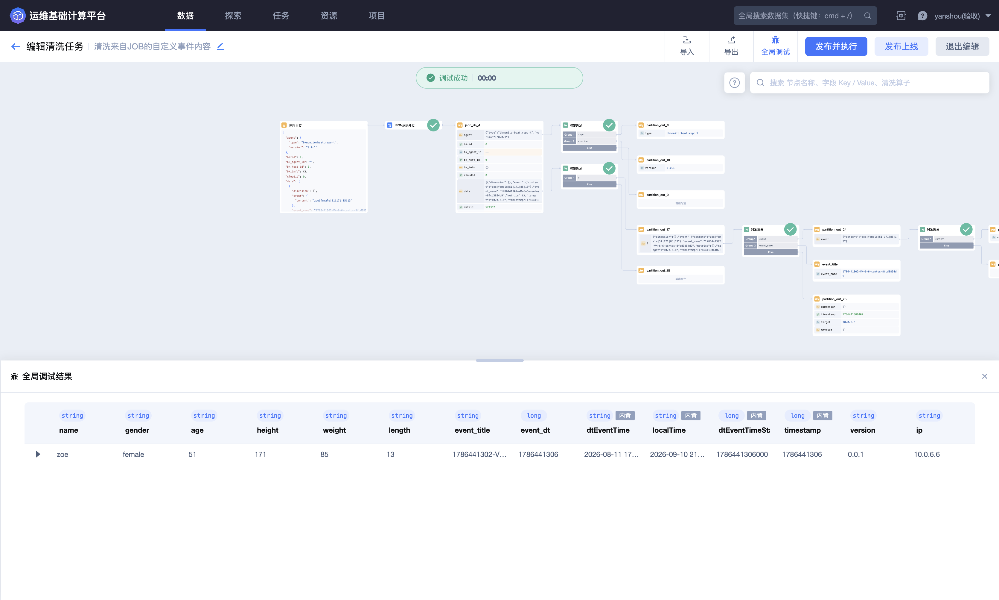
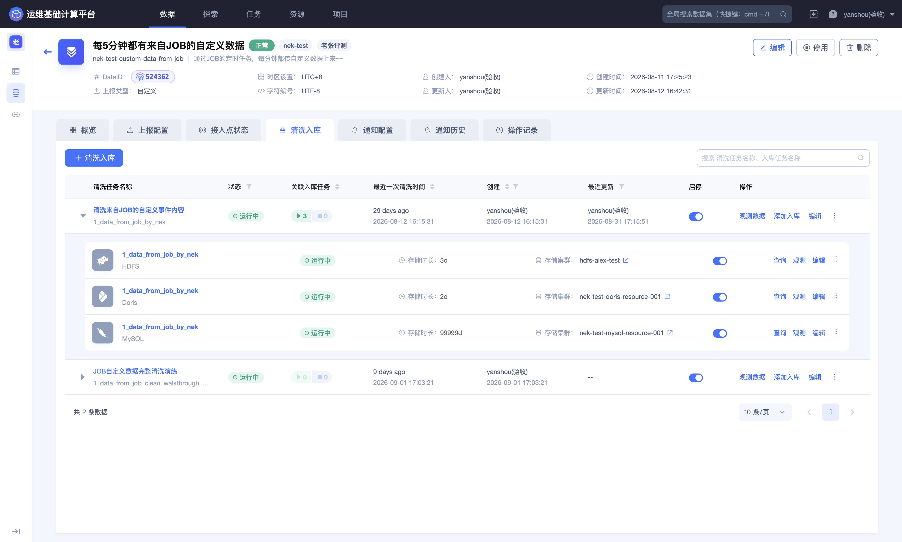

## 第二步：清洗并定义 Schema

本步骤将游戏登录 JSON 日志解析为结构化字段，并建立可供入库和 Dataflow 使用的结果数据表。

### 打开清洗编辑器

进入数据源详情的 **`清洗入库`** 标签，创建清洗任务。选择一条字段完整、格式正确的最近样例作为调试输入。

清洗编辑器包含原始样例、数据树、算子画布、输出数据配置和全局调试结果。应先用样例验证规则，再发布处理全量数据。

### 配置解析规则

点击原始日志右侧的 **`+`**，选择 **`JSON 反序列化`**。该算子把 JSON 字符串转换为字典，使后续步骤能够选择对象字段。

可用算子会随当前节点的数据类型变化。如果当前节点不是字符串，页面不会显示所有字符串解析算子；应先检查数据树中的输入类型，再选择后续处理步骤。

选择结构处理类算子后，右侧会打开参数表单。应在此确认输入来源、匹配字段、输出分支和兜底分支，再继续连接下游节点。

### 设计输出字段

在 **`输出数据配置`** 中定义结果表和字段映射。BKBase V4 不提供“赋值”算子，最终字段的名称、类型和来源均在此处配置。

建议 Schema：

| 字段 | 类型 | 来源 | 用途 |
| --- | --- | --- | --- |
| `event_time` | long | JSON 中的 `event_time` | 事件时间，并设置为时间字段 |
| `game_id` | string | JSON 中的 `game_id` | 游戏标识 |
| `zone_id` | string | JSON 中的 `zone_id` | 区服标识 |
| `player_id` | string | JSON 中的 `player_id` | 玩家标识 |
| `channel` | string | JSON 中的 `channel` | 登录渠道 |
| `device_os` | string | JSON 中的 `device_os` | 操作系统 |
| `client_ip` | string | JSON 中的 `client_ip` | 客户端地址 |
| `phone` | string | JSON 中的 `phone` | 待脱敏字段，敏感度按组织规范设置 |
| `login_result` | string | JSON 中的 `login_result` | 登录结果 |

结果表英文名可使用 `game_login_event_clean`，实际完整标识由平台结合所属业务生成。名称一旦被下游引用，不宜频繁修改。

输出数据配置会集中展示结果表信息、异常处理、字段名、类型、来源、示例值和时间字段。发布前应逐行核对，而不是只检查字段数量。

### 配置时间字段

选择 `event_time` 作为时间字段，并根据上报格式设置 Unix 时间戳单位和时区。秒和毫秒配置错误会导致时间偏移或超出合理范围。

### 配置异常处理

快速接入阶段可以先选择丢弃无法解析的记录，但生产使用前应明确：

- 哪些字段不能为空；
- 非法时间和非法 JSON 如何处理；
- 异常数据是否需要单独观测；
- 丢弃比例达到什么程度需要告警。

### 全局调试

点击 **`全局调试`**，不要只观察单个节点。调试结果应同时满足：

- 顶部显示调试成功；
- 九个业务字段均能取得预期值；
- 字段类型与 Schema 一致；
- `event_time` 转换结果与原始时间一致；
- 平台生成的时间字段处于合理范围；
- 当前样例没有意外进入异常分支。

### 发布清洗任务

确认规则和结果表后，选择 **`发布并执行`**。根据数据处理目标选择消费范围；首次接入通常使用页面推荐的顺序消费方式。任务返回详情页后，应等待状态从启用中切换为运行中。

清洗任务运行只代表已经持续产出结果数据，不代表数据已经写入可查询存储。下一步继续配置入库。

### 完成标准

清洗任务处于运行状态、异常数量符合预期，并且输出 Schema 已确认后，进入 [第三步：配置 ES 入库](3.Configure-storage.md)。

完整算子和调试说明请参阅 [数据源：清洗和入库](../Features/Data/Data-source.md#清洗和入库)。
