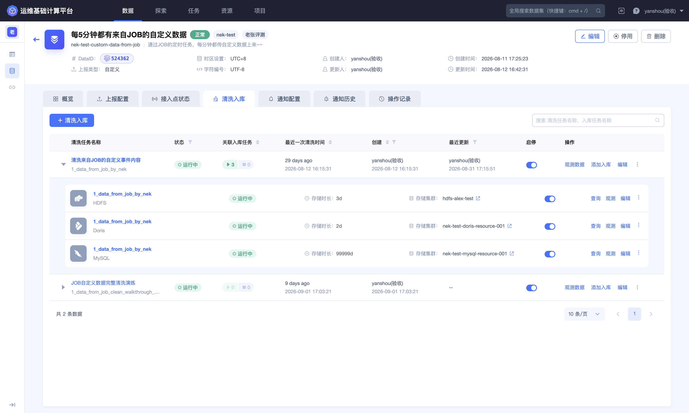
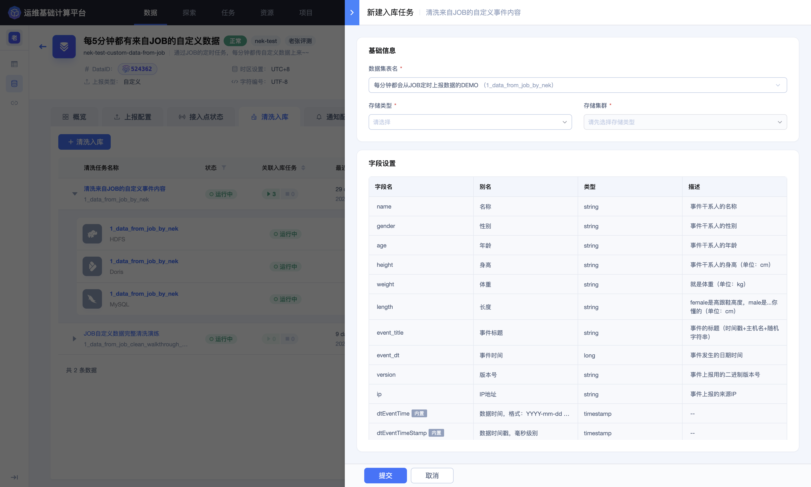
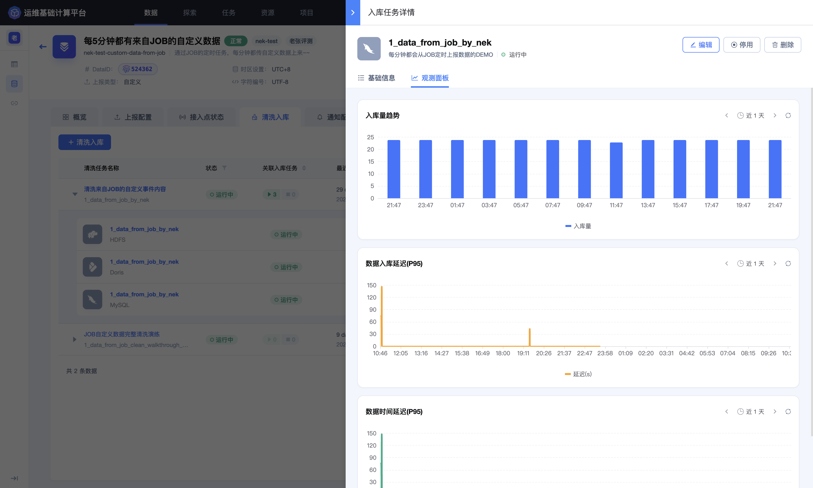
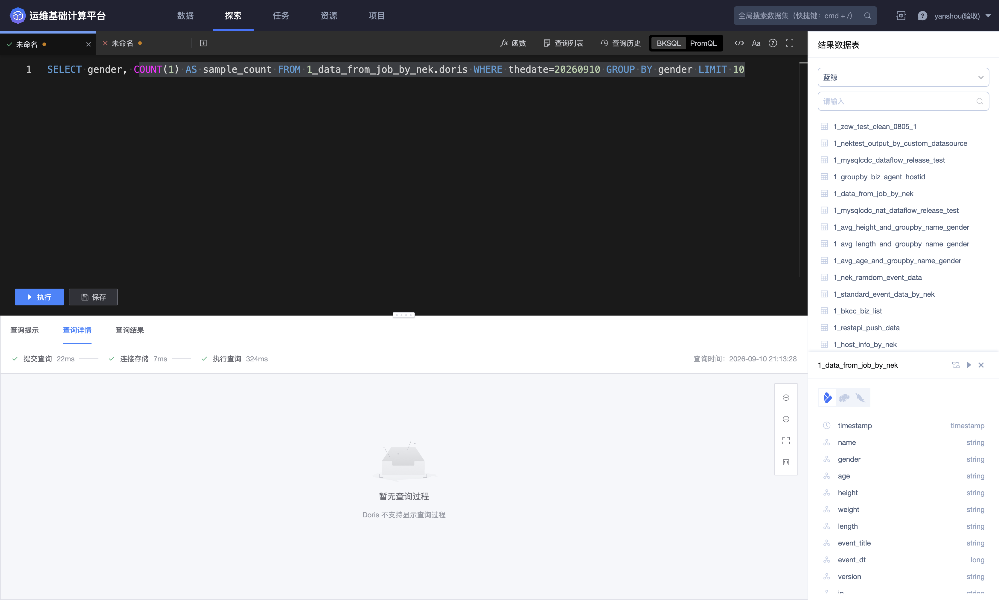

## 第三步：配置 ES 入库

本步骤把清洗后的游戏登录事件写入 ES，使数据可以按事件、区服、玩家、渠道和登录结果进行检索。

### 添加入库任务

1. 进入数据源详情的 **`清洗入库`**。

2. 展开刚刚创建的清洗任务。

3. 点击添加入库任务，选择 **`ES`**。

4. 选择当前项目可用的 ES 存储资源。

清洗任务是列表主行，入库任务显示在展开区域。先确认选中的是刚刚发布的结果表，再添加目标存储。





如果没有可选资源，应先确认项目是否已获得对应存储资源授权，而不是随意切换到另一种存储。

### 设置保留周期

保留周期应根据检索频率、数据规模、合规要求和存储成本确定。快速接入可以选择一个便于验证的有限周期；生产日志应由数据负责人确认正式策略。

缩短保留周期可能导致历史数据到期不可查，延长周期则会增加容量消耗。

### 设计检索字段

建议优先为以下字段提供精确筛选能力：

- `game_id`
- `zone_id`
- `player_id`
- `channel`
- `device_os`
- `login_result`

`event_time` 用于时间范围过滤。`phone` 和 `client_ip` 属于敏感字段，不应仅因为便于查询就扩大可见范围或建立不必要的索引。

### 启动并观察入库

保存并启动入库任务后，在清洗任务下方检查：

- 存储类型为 ES；
- 任务状态正常；
- 最近写入时间持续推进；
- 延迟和异常数量在可接受范围；
- 存储集群与保留周期符合预期。



### 查询验证

进入 **`探索`**，选择清洗结果数据表，先从小范围查询开始：

```sql
SELECT
  event_time,
  game_id,
  zone_id,
  player_id,
  channel,
  device_os,
  login_result
FROM <结果数据表ID>
LIMIT 20
```

实际查询前应以页面 Schema 为准替换表名和字段名。包含个人信息的字段只在获得权限且确有必要时查询。



### 完成标准

能够在探索模块查询到持续更新的结构化登录事件后，进入 [第四步：创建并上线 UDF](4.Create-and-publish-UDF.md)。
