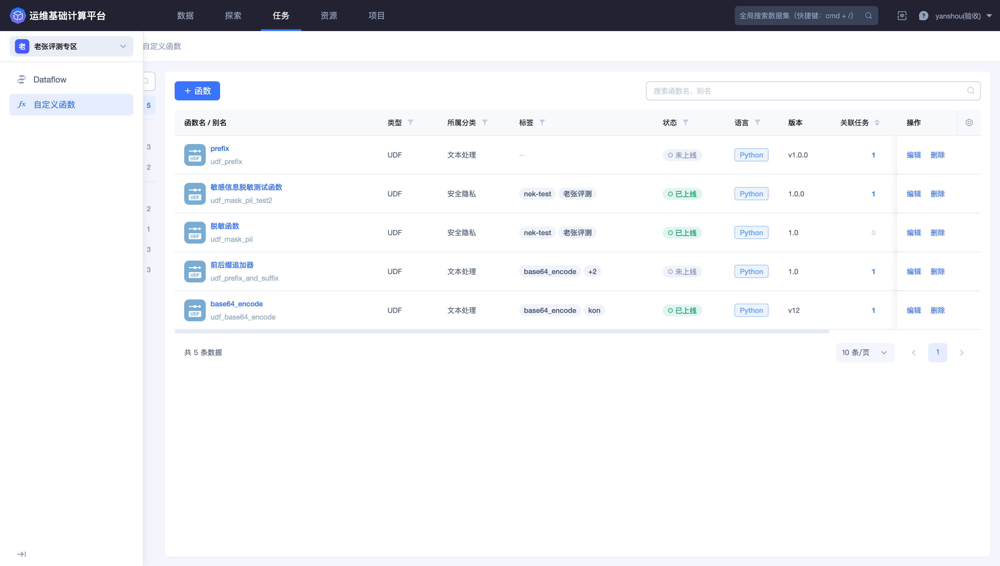
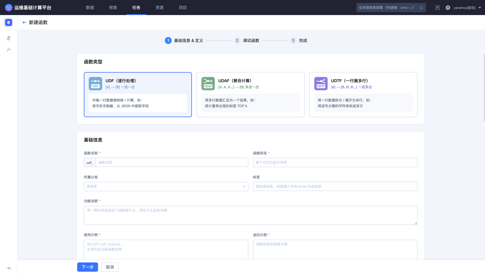
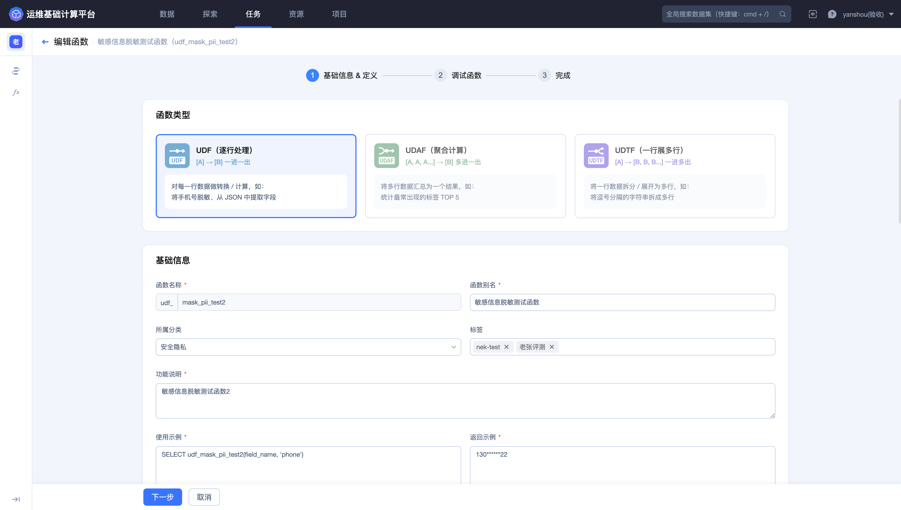
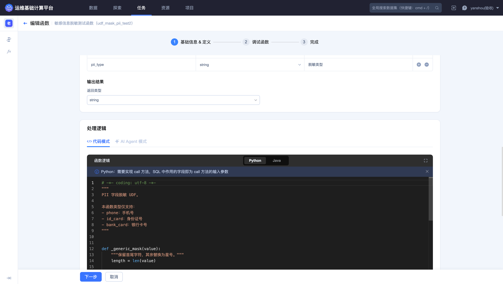
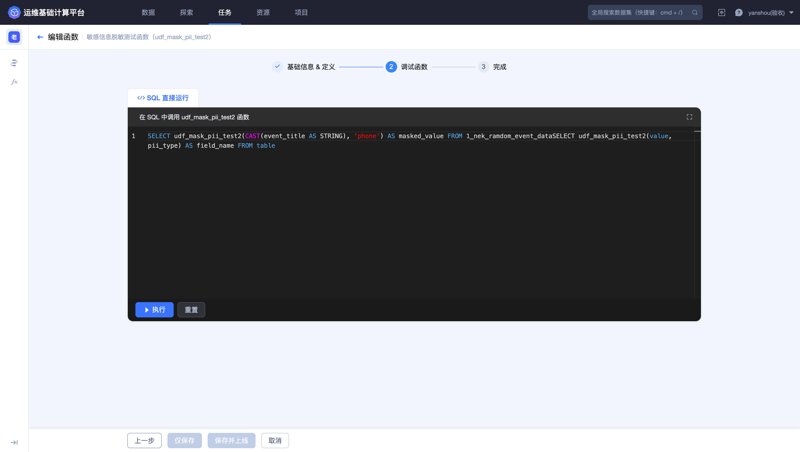
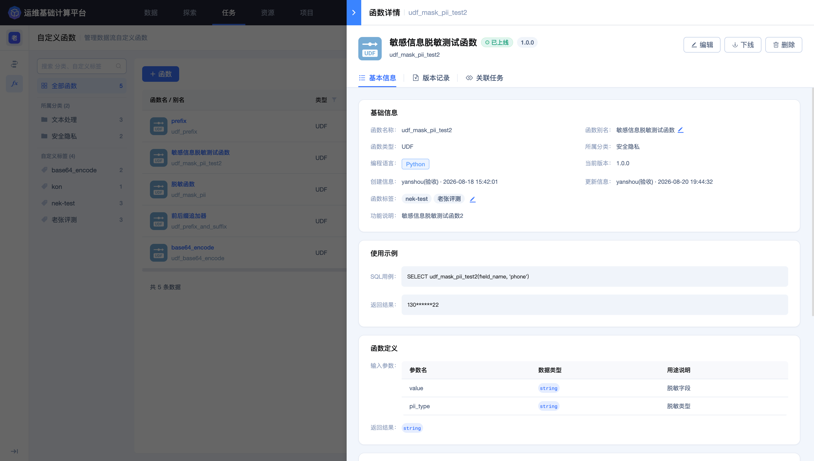

## 第四步：创建并上线 UDF

本步骤创建一个逐行处理函数，把不同写法的渠道名称转换为统一的小写格式，供 Dataflow 重复使用。

### 创建函数

进入顶部导航栏的 **`任务`**，选择 **`自定义函数`**，点击 **`+ 函数`**。

函数列表可以按名称和状态定位已有函数。创建前先搜索目标名称，避免产生用途和签名重复的函数。



选择 **`UDF（逐行处理）`**。该类型对每行输入产生一个输出，适合文本标准化、字段提取和脱敏等逻辑。



### 填写基础信息

建议配置：

| 配置项 | 示例 |
| --- | --- |
| 函数名称 | `normalize_channel`，最终名称以页面生成结果为准 |
| 函数别名 | 渠道名称标准化 |
| 所属分类 | 文本处理 |
| 功能说明 | 去除渠道名称首尾空格并转换为小写 |
| 使用示例 | `udf_normalize_channel(channel)` |
| 返回示例 | `appstore` |

函数名称和签名会被 Dataflow 引用，上线后应保持稳定。

基础信息、参数定义、代码和依赖应在进入调试前一次核对完整。



### 定义输入与输出

添加一个输入参数：

| 参数 | 类型 | 说明 |
| --- | --- | --- |
| `value` | string | 原始渠道名称 |

返回类型设置为 `string`。

### 编写函数代码

Python 示例：

```python
def call(value):
    if value is None:
        return None
    return str(value).strip().lower()
```

代码必须实现页面要求的 `call` 方法，参数数量、顺序和返回类型必须与函数定义一致。该示例只使用 Python 标准能力，不需要添加第三方依赖。



### 调试函数

进入 **`调试函数`**，选择包含 `channel` 字段的结果数据表，使用页面最终生成的函数名称执行：

```sql
SELECT
  channel AS original_channel,
  udf_normalize_channel(CAST(channel AS STRING)) AS normalized_channel
FROM <清洗结果数据表ID>
```

如果函数名称、输入类型或页面适用的 SQL 规则不同，应以当前函数详情和调试提示为准。调试时重点验证：

- `NULL` 输入仍返回 `NULL`；
- ` AppStore ` 返回 `appstore`；
- 已经是小写的值保持不变；
- 返回值类型为 string；
- SQL 和代码校验均通过。



### 创建并上线

调试通过后选择 **`创建并上线`**。仅创建的函数不能作为稳定的 Dataflow 依赖；计划立即在任务中使用时，应确认其已处于上线状态。

创建完成后进入函数详情，核对状态、当前版本、输入参数、返回类型、函数代码和 SQL 使用示例。



### 完成标准

函数详情显示已上线，输入参数、返回类型和使用示例均正确，即可进入 [第五步：在 Dataflow 中应用 UDF](5.Apply-UDF-in-Dataflow.md)。

更多函数类型和版本管理说明请参阅 [自定义函数](../Features/Flow/Custom-function.md)。
