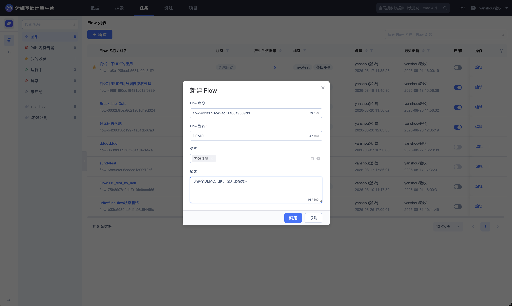
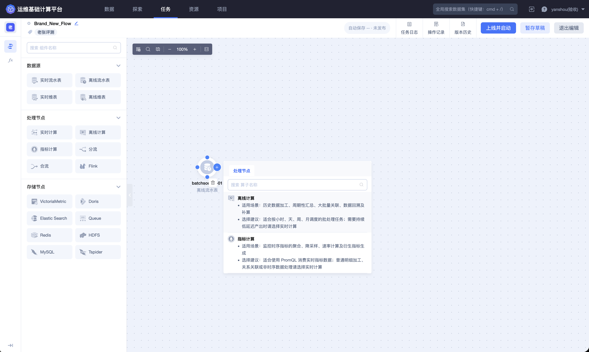
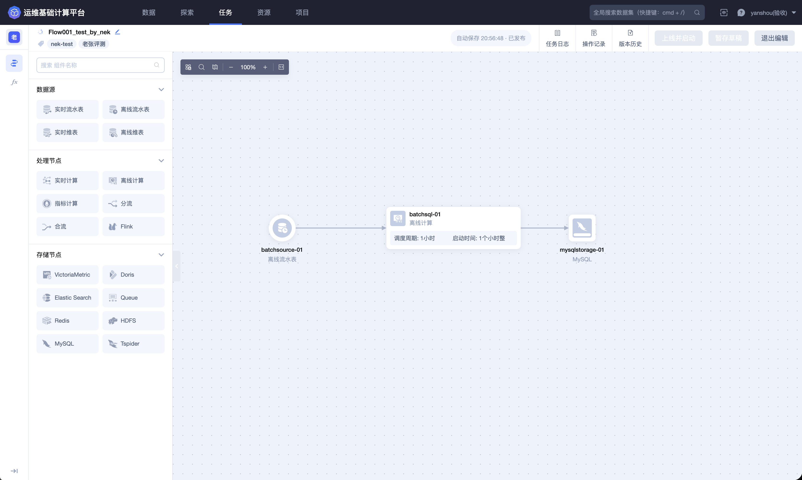
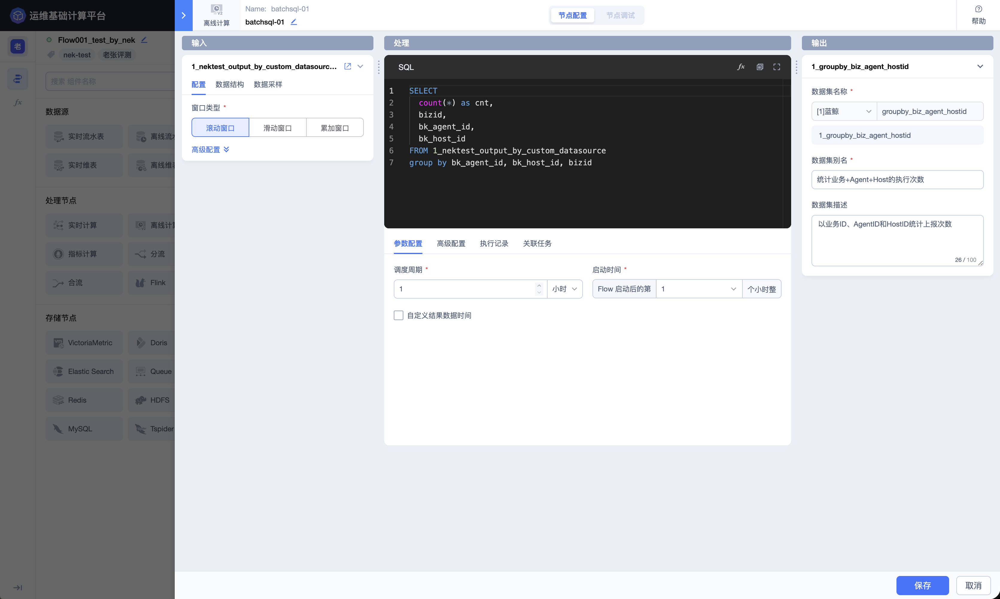
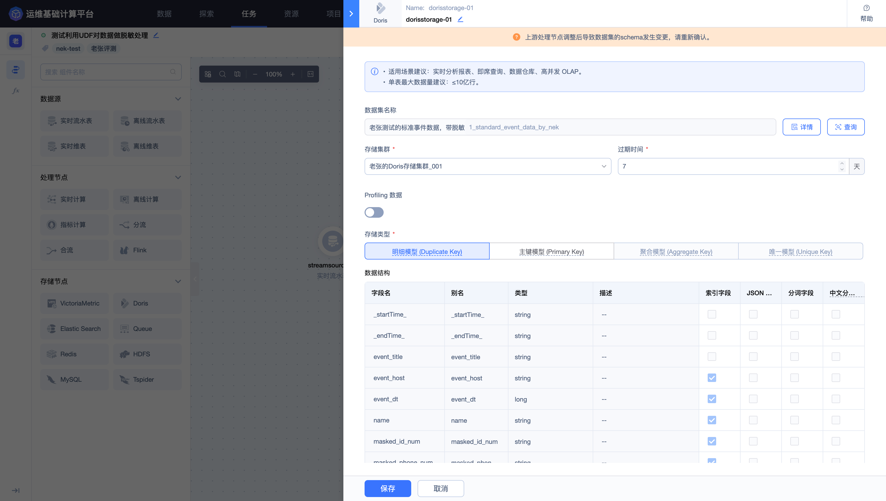
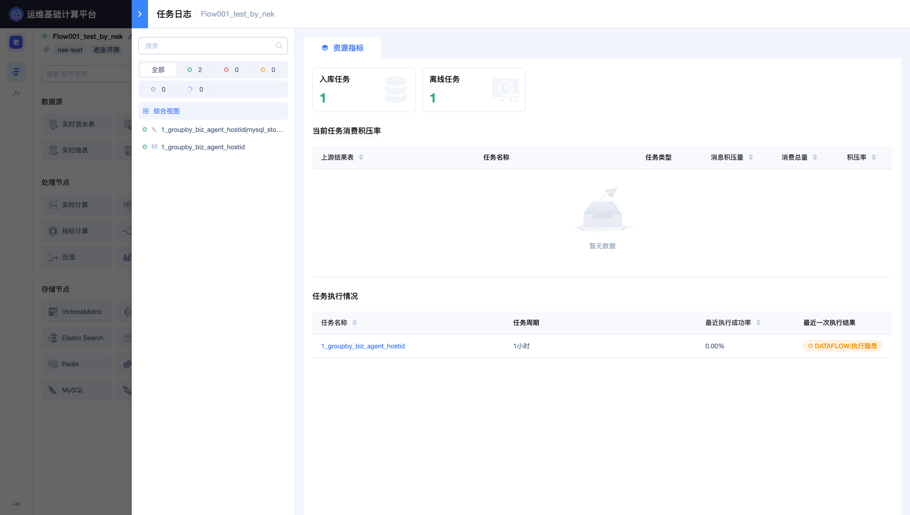

## 第五步：在 Dataflow 中应用 UDF

本步骤使用清洗后的登录事件作为输入，在实时计算节点中调用渠道标准化 UDF，并把加工结果写入目标存储。

### 新建 Dataflow

进入顶部导航栏的 **`任务`**，选择 **`Dataflow`**，点击 **`新建`**。

建议填写：

| 配置项 | 示例 |
| --- | --- |
| Flow 名称 | 按页面规则生成，例如 `game-login-channel-standardization` |
| Flow 别名 | 游戏登录渠道标准化 |
| 标签 | 游戏、登录、实时处理 |
| 描述 | 对清洗后的登录事件标准化渠道名称并输出分析结果 |



### 编排节点

进入编辑器后，按以下顺序搭建拓扑：

> ① 实时流水表 → ② 实时计算 · 无窗口 → ③ Doris 或 ES 存储

实时流水表选择上一步产生的清洗结果数据表。选择后先查看输入字段 Schema，确认 `channel` 及其他字段真实存在、类型正确。

如需确认节点用途，可在节点帮助中查看实时计算、离线计算、指标计算、分流、合流和各类存储节点的说明。





### 调用 UDF

在实时计算节点中编写 BKSQL。以下为示例，表名、函数名和字段必须替换为当前页面中的真实值：

```sql
SELECT
  event_time,
  game_id,
  zone_id,
  player_id,
  udf_normalize_channel(CAST(channel AS STRING)) AS channel,
  device_os,
  client_ip,
  phone,
  login_result
FROM <清洗结果数据表ID>
```

该处理是逐条标准化，不需要进行时间聚合，因此窗口选择 **`无窗口`**。需要按时间段统计登录量时，应另建聚合节点并使用节点窗口配置，不要在此步骤混入新的指标口径。



### 配置输出

设置输出结果表名称和别名，并核对：

- SQL 别名与输出字段一致；
- `channel` 仍为 string；
- 事件时间配置正确；
- 不需要的敏感字段已经移除或按组织要求处理；
- 输出表说明写清数据来源和标准化规则。

### 配置目标存储

连接存储节点，选择项目可用的存储资源和保留周期。若选择 Doris，还需根据更新方式配置存储模型和 Key 字段；若继续写入 ES，则应检查检索字段和敏感字段策略。



### 暂存、上线与启动

1. 点击 **`暂存草稿`**，确认所有节点配置完整。

2. 检查拓扑连线、输入结果表、SQL、UDF 名称、输出字段和目标存储。

3. 点击 **`上线并启动`**，按页面提示确认本次上线影响和消费范围。

4. 等待任务进入运行状态，再检查任务日志。

上线后，运行页会显示完整拓扑和每个节点的状态。应确认输入、实时计算和存储节点均处于预期状态。


任务日志用于继续检查数据接入、实时任务、资源指标和异常信息。



停止、重启、节点重做和改变消费起点都可能造成处理中断、数据积压或重复写入，应在生产链路中完成影响评估后再操作。

### 完成标准

Dataflow 处于运行状态、任务日志没有 SQL 或函数异常、存储节点持续产生数据后，进入 [第六步：验证完整链路](6.Verify-the-data-chain.md)。

完整节点配置和运行管理请参阅 [Dataflow](../Features/Flow/Dataflow.md)。
