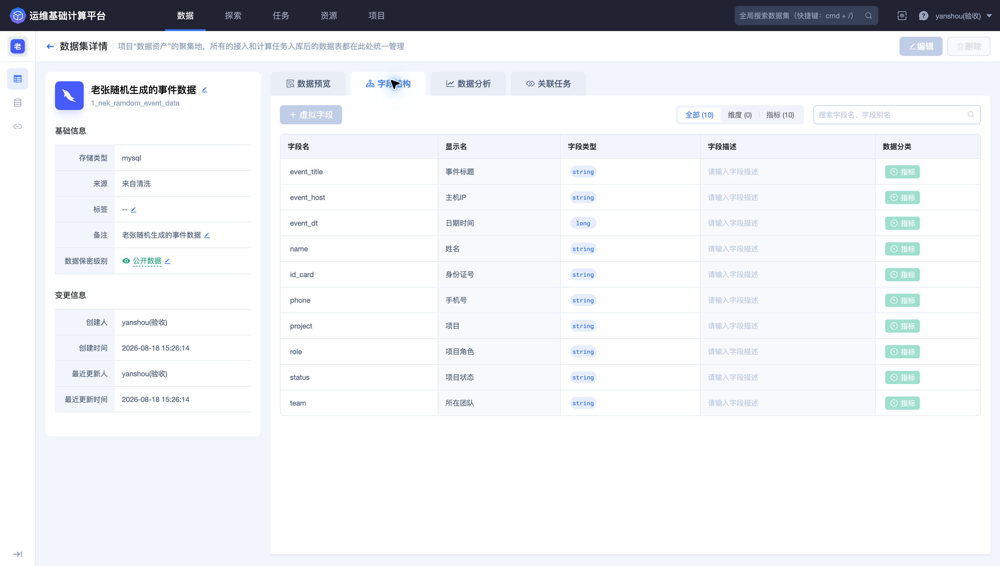
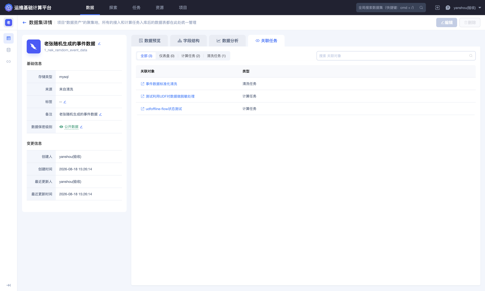
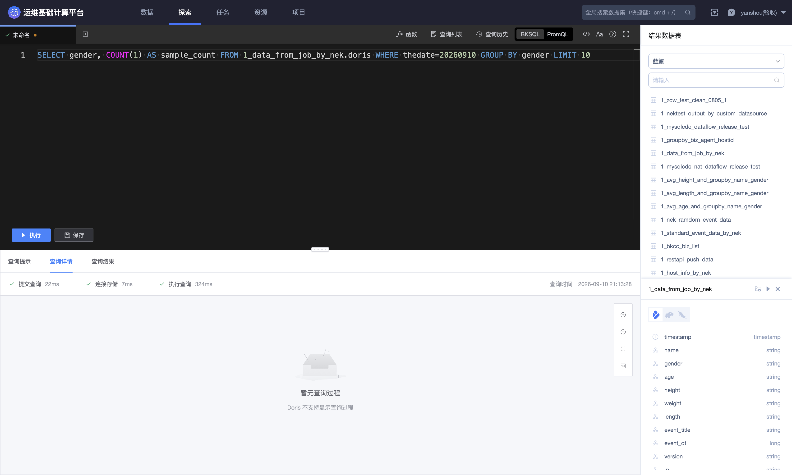

## 第六步：验证完整数据链路

完成接入、清洗、入库、UDF 和 Dataflow 后，应从状态、结构、内容和持续性四个方面验收，而不是只确认某个页面显示“运行中”。

### 检查链路状态

按数据流向依次确认：

1. 数据源处于启用状态，最近上报时间持续推进；

2. 清洗任务处于运行状态，最近清洗时间更新，异常量符合预期；

3. ES 入库任务正常，写入延迟没有持续增长；

4. 自定义函数处于上线状态；

5. Dataflow 处于运行状态；

6. 实时计算和存储节点日志没有持续异常。

运行拓扑应显示从结果数据输入、实时计算到目标存储的完整连接，并且各节点状态一致。


### 检查结果 Schema

进入输出数据集详情，核对字段名称、类型、说明和关联任务。重点检查：

- 九个登录事件字段是否完整；
- `event_time` 是否为预期类型；
- `channel` 是否为标准化后的 string；
- SQL 中未选出的字段是否没有意外进入结果；
- 敏感字段的保留方式是否符合约定。



同时查看关联任务，确认该结果数据确实由预期 Dataflow 产出，并识别是否还有其他上下游依赖。



### 查询结果数据

进入 **`探索`**，选择 Dataflow 输出结果表，先执行小范围查询：

```sql
SELECT
  event_time,
  game_id,
  zone_id,
  player_id,
  channel,
  device_os,
  login_result
FROM <Dataflow输出结果表ID>
LIMIT 20
```


确认：

- ` AppStore ` 等原始渠道已转换为 `appstore`；
- 新数据持续进入结果表；
- 登录结果、区服和玩家字段没有错位；
- 时间值处于合理范围；
- 查询使用的是预期存储。

需要进一步定位查询执行情况时，打开查询详情查看执行阶段和耗时。



### 验收清单

| 检查项 | 通过标准 |
| --- | --- |
| 接入 | 原始数据持续上报，无乱码或明显格式漂移 |
| 清洗 | 全局调试通过，运行任务异常量符合预期 |
| Schema | 字段名称、类型、来源、说明和时间字段正确 |
| 入库 | ES 可查询，延迟和保留周期符合要求 |
| UDF | 已上线，空值和典型输入输出通过调试 |
| Dataflow | 拓扑完整，任务运行，日志无持续异常 |
| 结果 | 渠道已标准化，字段完整，新数据持续产生 |
| 安全 | 查询、截图和共享内容不包含不必要的敏感值 |

### 下一步

- 需要设计可检索的日志 Schema，请阅读 [游戏日志标准化与检索](../Best-Practices/Game-log-standardization-and-search.md)；
- 需要处理敏感字段，请阅读 [敏感数据脱敏](../Best-Practices/Sensitive-data-masking.md)；
- 遇到无数据或函数调用问题，请从 [数据源与清洗常见问题](../FAQs/Data-source-and-cleaning.md) 和 [Dataflow 与自定义函数常见问题](../FAQs/Dataflow-and-custom-function.md) 开始排查。
