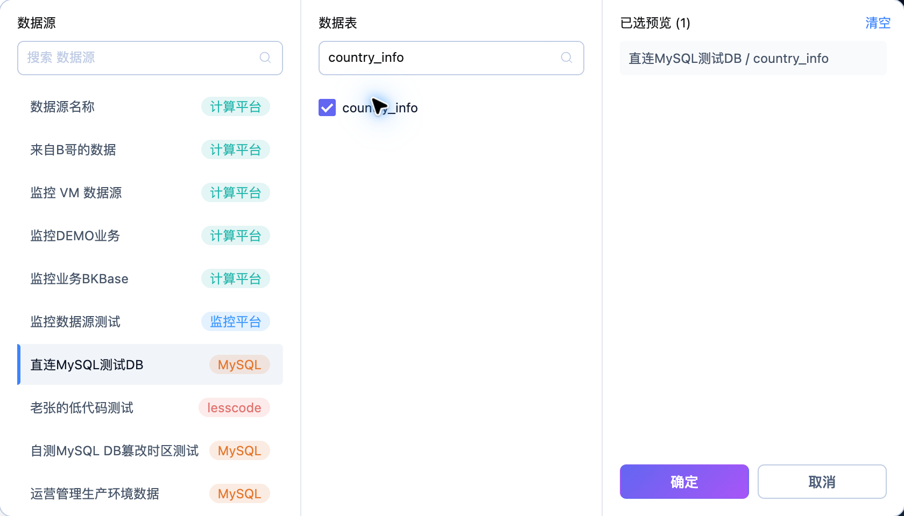
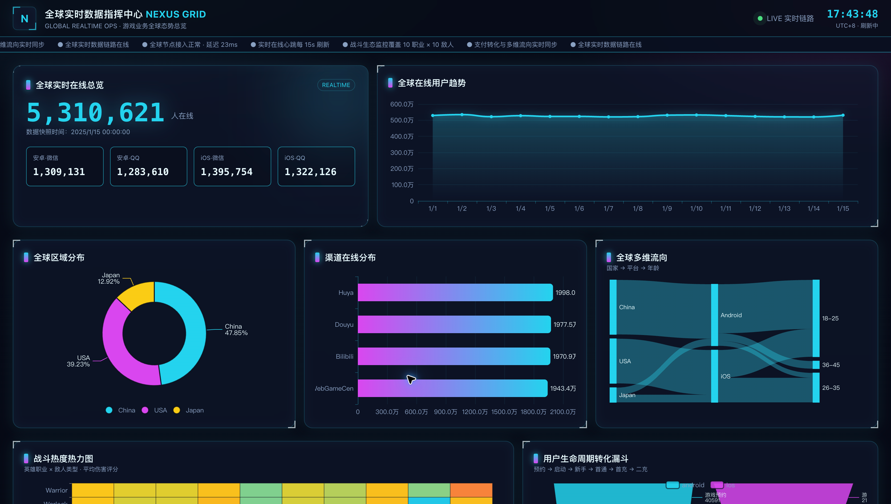
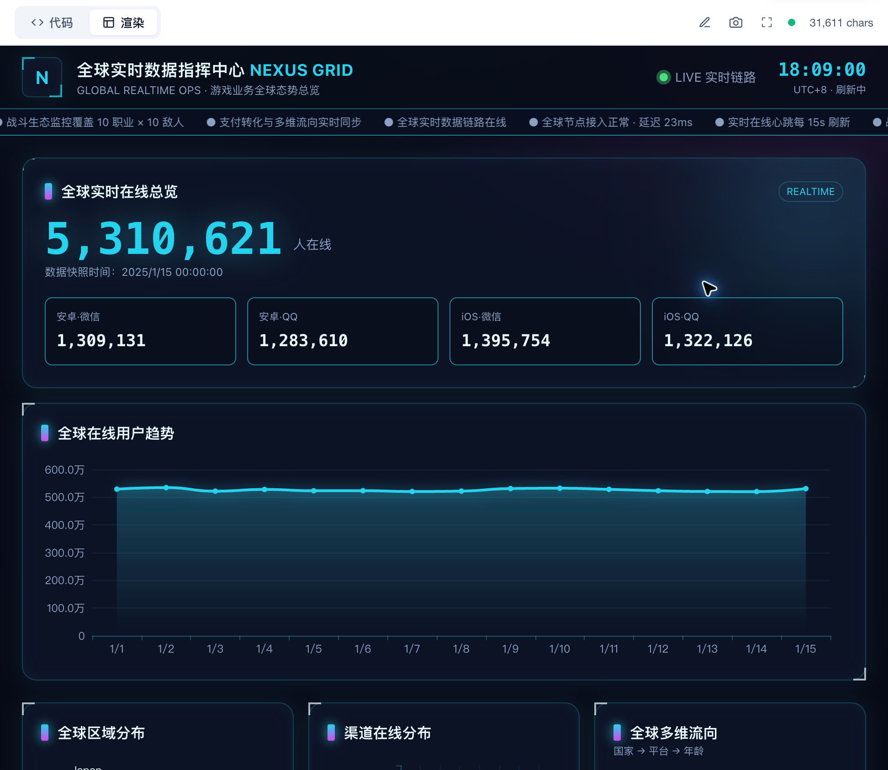

# 使用 AI 报告分析业务数据

业务团队需要围绕一个问题组织指标、图表与文字说明。AI 报告可以根据数据集和自然语言需求生成 HTML 页面，再由用户核对与完善。

## 描述可验证的问题

通过“添加数据表”选择来源及实际表名（例如 `country_info`），说明指标、维度、时间范围、比较对象与输出形式。问题应可用所选字段回答。例如：“比较各国家的空气质量和幸福指数，按国家展示，给出指标总览及差异说明。”

需求不要把需要验证的判断写成既定事实。对波动、排名或异常的解释，应要求列出依据并复核查询结果。

## 检查与调整报告

本页以 **全球实时数据指挥中心 · NEXUS GRID** 展示已有 HTML 报告的查看方式。该报告的已有内容与新需求示例分别核对，不据报告标题推断其数据来源。

检查关键数字、图表口径、单位、文字说明和刷新状态。需要修改时进入编辑页，调整后预览，单击“保存报告”，再回到列表核对正式状态与访问链接。

## 交付业务使用

交付前将主要结论与对应图表逐一核对，删除无数据依据的表述。检查目标屏幕的可读性与筛选功能，并在报告中写清业务统计口径及数据时效。
