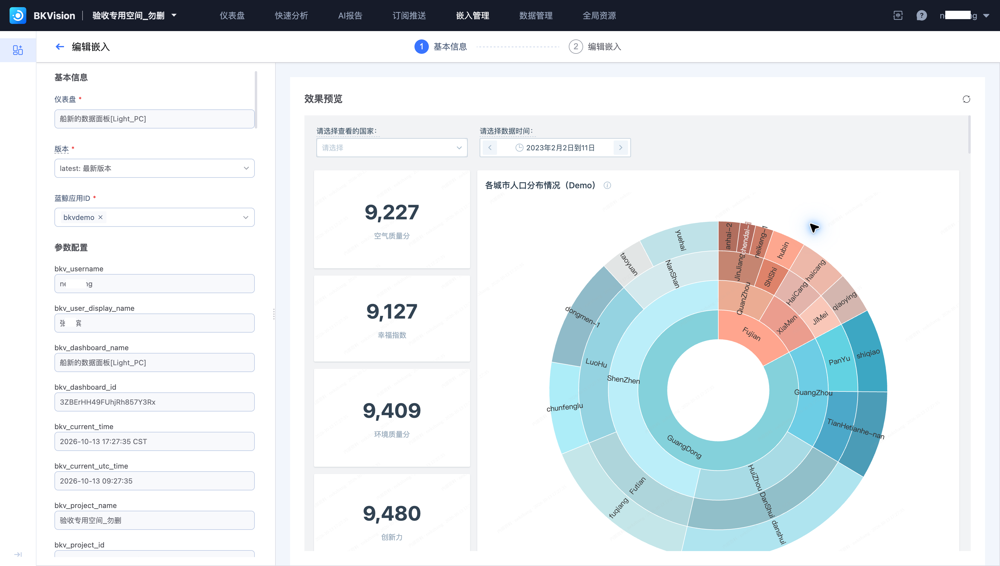
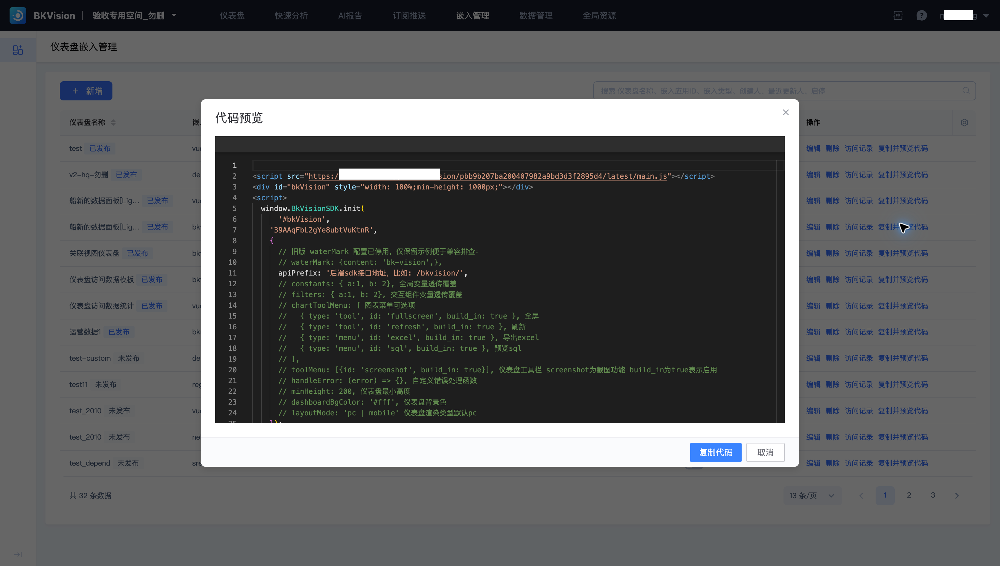

# 在蓝鲸 SaaS 中集成仪表盘

将业务看板放入已有 SaaS，让用户在工作入口直接分析数据。本例沿用 **船新的数据面板[Light_PC]** 和应用 **bkvdemo** 的 JS-SDK 嵌入项。

## 确定应用与版本

核对应用 ID、仪表盘和版本。`latest` 会跟随最新发布；固定版本用于需要稳定展示的应用。按需要设置水印。

## 集成与传参

在列表“复制并预览代码”，按页面的 JS-SDK 教程完成前端容器与后端接口配置。将 `apiPrefix` 指向应用配置的 SDK 接口地址；使用该嵌入项生成的标识，不混用其他应用的代码。

业务筛选可通过 `filters` 传入交互组件变量，通过 `constants` 覆盖全局变量。参数名称、类型和取值必须与仪表盘定义相符；权限检查应在应用和接口侧完成。

## 验收上线

使用目标用户身份验证加载和数据范围，再检查筛选、图表菜单、PC/移动布局及水印。通过嵌入项“访问记录”检查使用情况。后续更换仪表盘版本或变量定义时，同步验证 SaaS 内的展示。

完整设置见[仪表盘嵌入管理](../Features/Embedded-management/Embedded-management.md)。
