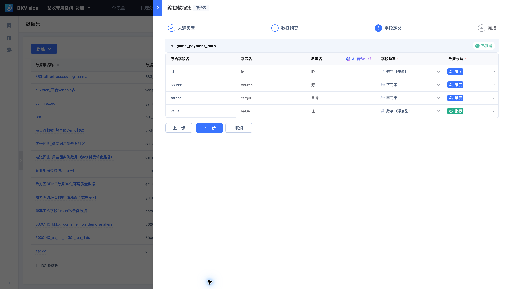
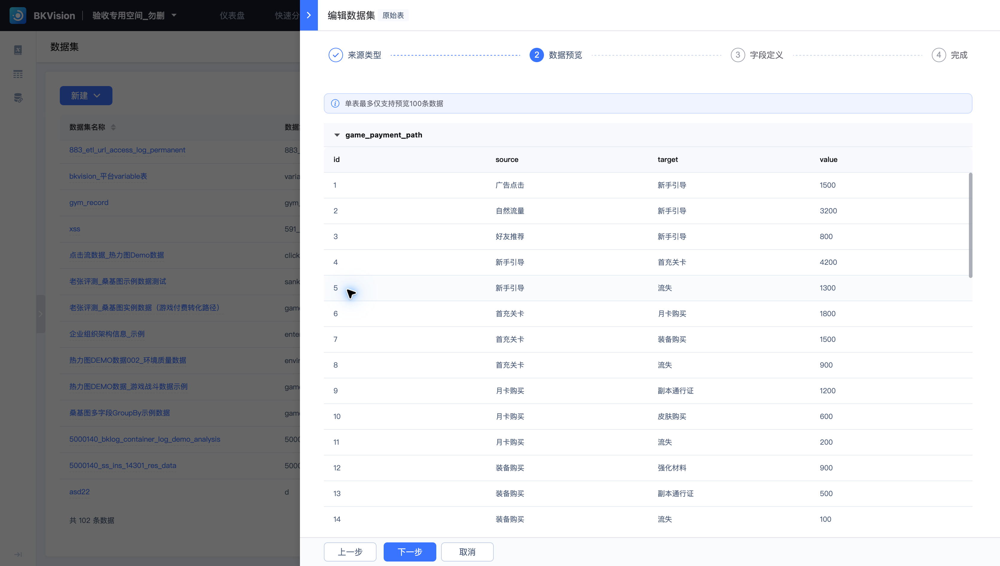
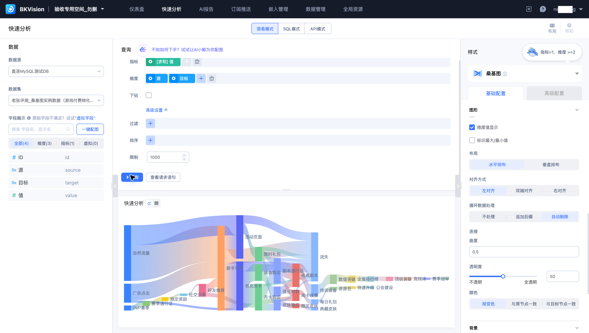

# 分析游戏付费转化路径

业务希望识别玩家从引导、首充到后续付费环节的主要路径，并定位流失分支。使用 **老张评测_桑基图实例数据（游戏付费转化路径）**，以桑基图展示节点之间的流量。

## 核对数据定义



数据源为“直连MySQL测试DB”，物理表为 `game_payment_path`。`source` 为源节点，`target` 为目标节点，`value` 为路径数值；`id` 仅用于识别记录，不参与路径聚合。



先明确 `value` 表示人数、次数还是金额。重复经过节点的玩家可能被多次计数，不能直接把路径总和当作去重用户数。

## 配置桑基图



在快速分析选择该数据集与“桑基图”，使用一个指标和至少两个维度：指标 `SUM(value)`，维度按 `source`、`target` 排列。使用中文别名时，查询结果映射为“值”指标和“源”“目标”维度。SQL 查询可写为：

```sql
SELECT source AS 源, target AS 目标, SUM(value) AS 值
FROM game_payment_path
GROUP BY source, target
LIMIT 1000
```

检查源节点与目标节点顺序、连接方向以及提示窗数值。用水平布局展示由左向右的转化过程。本例使用“循环数据处理 → 自动剔除”完成展示。该选项会影响展示路径，应对照查询结果核对被处理的边；追加后缀是另一种展示方式，应按业务含义选择。

## 分析与校验

优先关注流量最大的路径及进入“流失”的分支，再回到查询结果核对原始数值。例如样例中“新手引导 → 首充关卡”为 4200，“新手引导 → 流失”为 1300。

计算转化率前，确认同一统计周期、同一人群和一致的计数单位；分母使用该节点符合口径的进入量。若节点流入与流出不平衡，先检查缺失路径、重复计数和统计边界，再解释业务原因。

需要持续观察时，将相同查询与字段映射配置到仪表盘，预览后发布。有关组件要求见[图表组件分类](../Features/Dashboard/Chart-Classification-and-Function-Description.md)。
