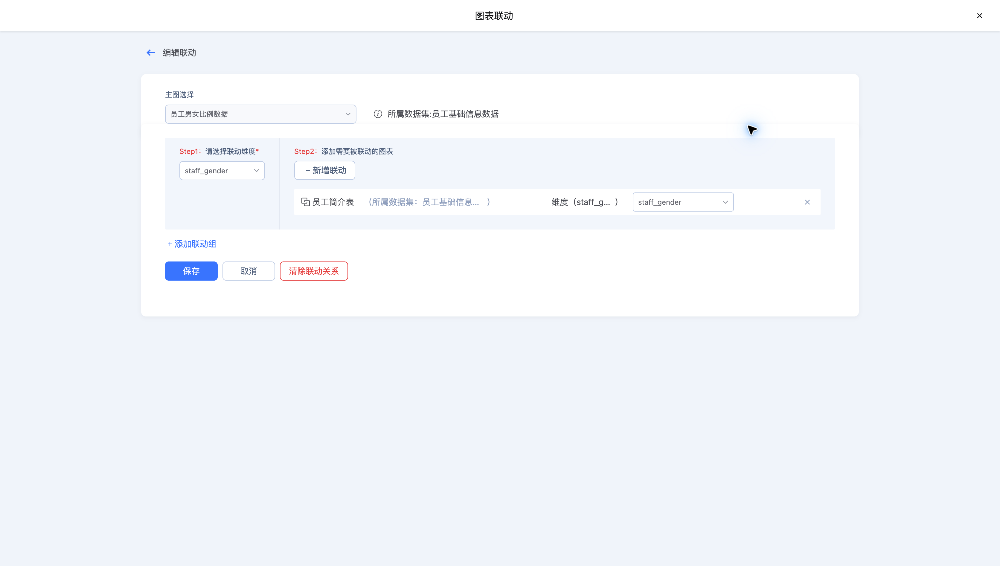
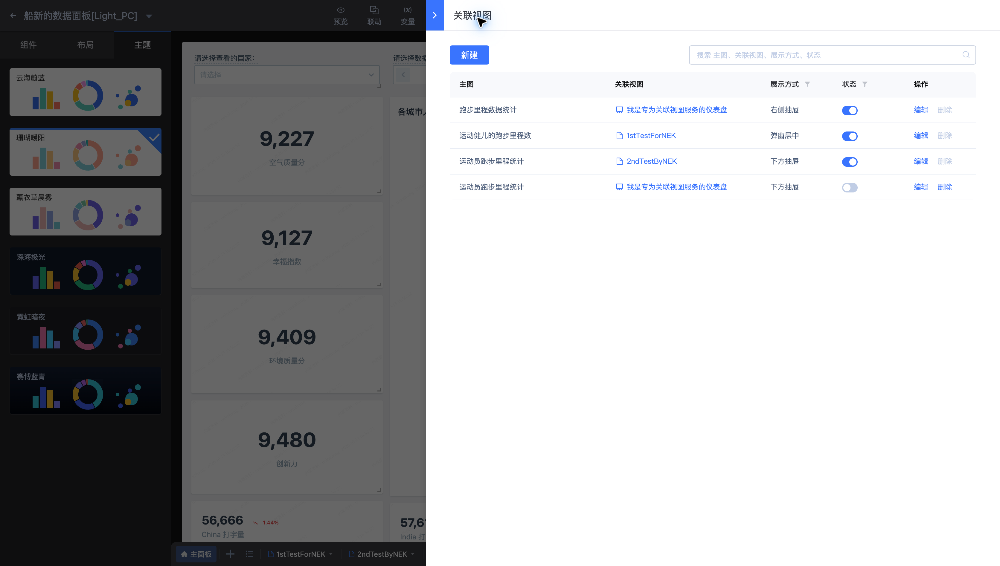

# 使用联动和关联视图定位业务变化

在 **船新的数据面板[Light_PC]** 中，可用联动筛选同一看板的明细，再通过关联视图打开更多信息。

## 先配置联动

示例规则从“员工男女比例数据”联动到“员工简介表”，字段为 `staff_gender`。源图表与目标图表使用员工基础信息数据。

1. 在编辑页打开“联动”，选择触发图表与目标图表。
2. 将源字段和目标字段匹配，并确认类型与取值一致。
3. 预览，在源图表选中一个性别，核对员工明细范围；清除选择后检查是否恢复。

## 再配置关联视图

“跑步里程数据统计”的规则关联“我是专为关联视图服务的仪表盘”，打开方式为右侧抽屉。按分析场景选择目标视图、打开方式和传入字段，预览后检查目标内容与上下文。

联动适合在当前画布内缩小范围；关联视图适合展示另一页详细分析。为触发图表添加简短备注，说明用户可点击哪些数据。
