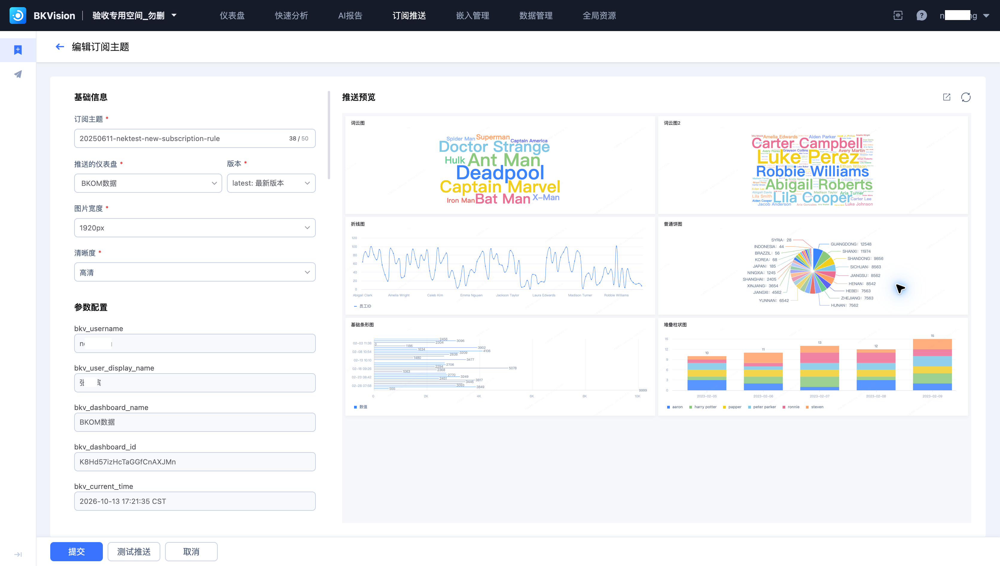
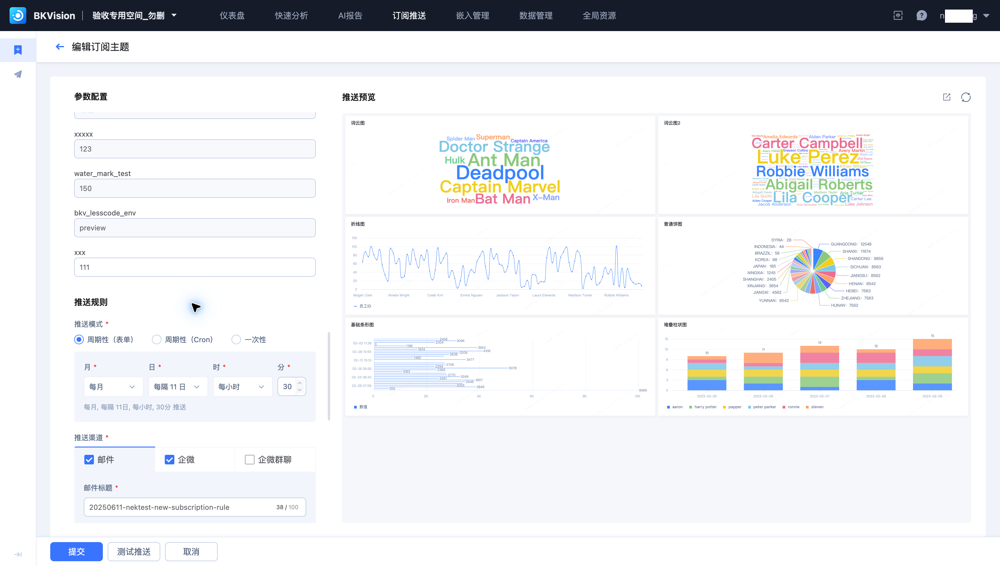
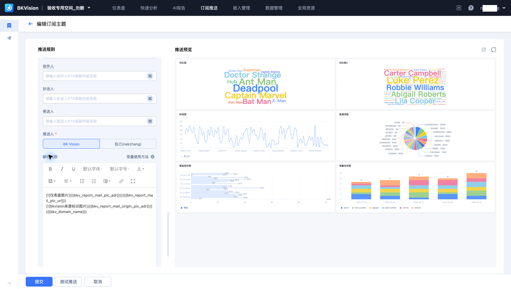
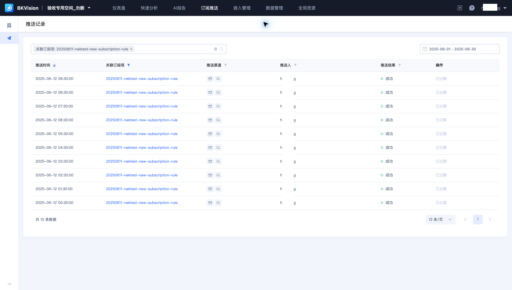

# 周期性推送业务看板

运营团队希望在固定时间收到看板快照，无需每天打开平台。本例使用订阅 **20250611-nektest-new-subscription-rule**，目标为“BKOM数据”。

## 固定查询口径

先确定仪表盘版本、时间范围和变量值。需要跟随发布内容时选择 `latest`；需要固定展示时选择指定版本。预览确认数据范围符合收件人的业务职责。

## 配置周期和渠道

按月、日、时、分设置周期，并复核生成的时间摘要。示例为“每月，每隔 11 日，每小时，30 分”；实际业务日报应按所需每日时刻重新配置。

设置邮件标题、接收人和内容，需要归档时选择 PDF 附件。确认范围后执行测试推送，收到通知并核对图片、变量及链接后，再提交正式配置。

## 跟踪执行

在“推送记录”按任务与日期检查结果。若列表为空，先确认日期包含推送时间。区分任务成功与收件人实际阅读；失败时检查任务参数和渠道配置。旧内容可能已过期，应及时归档需要保存的输出。
