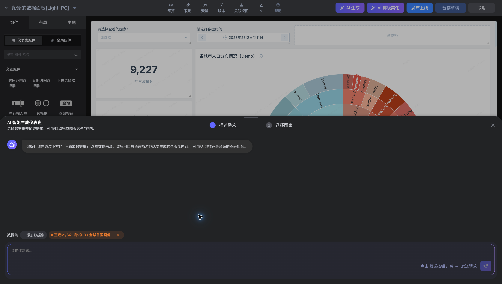
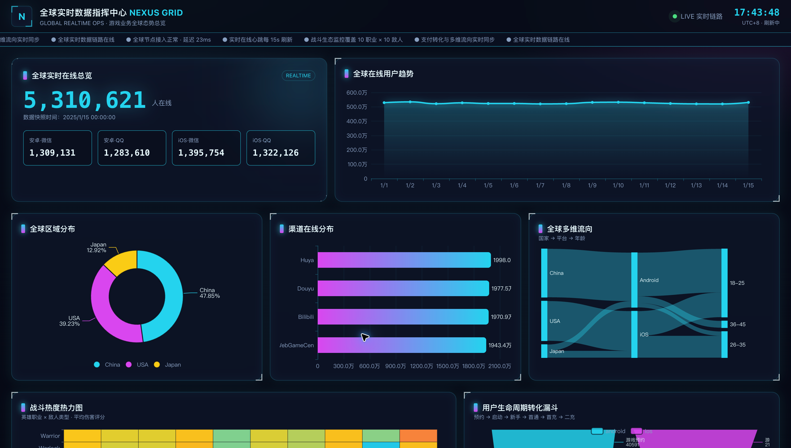
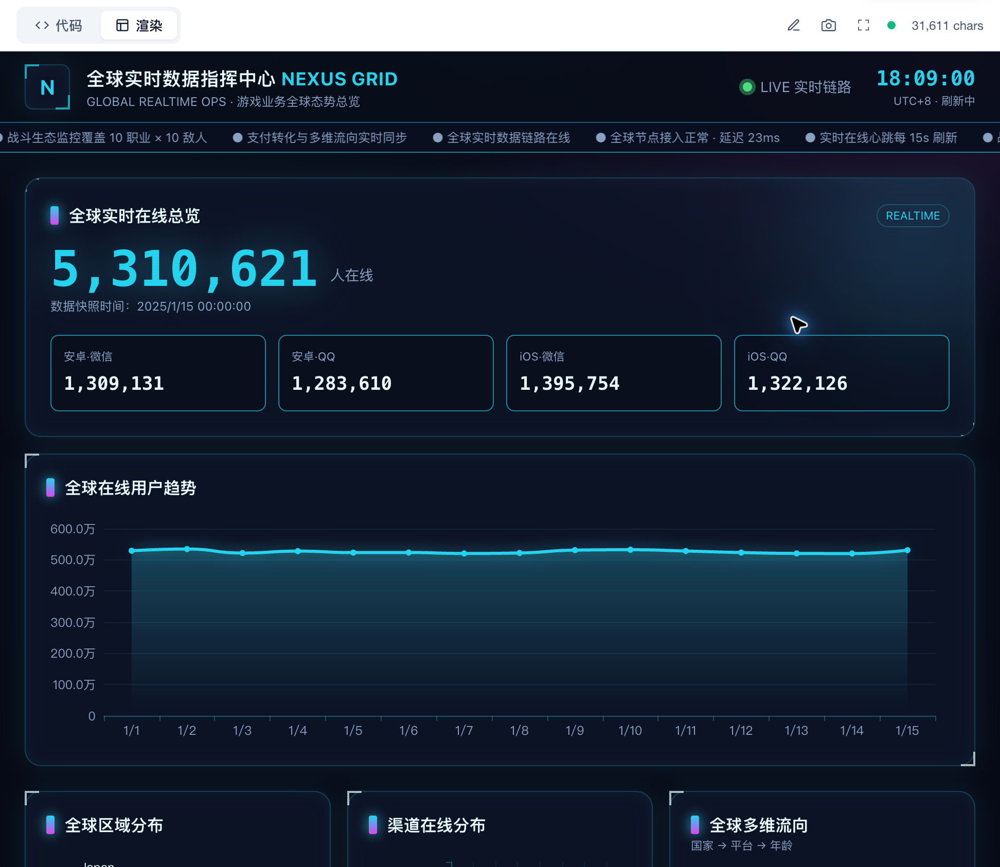

# AI 分析与报告常见问题

## AI 仪表盘与 AI 报告如何选择？

需要在画布内配置、调整和持续观察图表时，使用 AI 生成仪表盘；需要围绕业务问题组织 HTML 分析页面时，使用 AI 报告。

## 怎样描述需求更有效？

说明数据集、指标、维度、时间范围、对比对象和输出形式。例如“按国家比较空气质量与幸福指数，给出国家对比图和指标概览”。使用数据中实际存在的字段，不要求 AI 推断不存在的数据。

## 报告中的数字能直接作为业务结论吗？

核对数据范围、字段含义、聚合方式和更新时间，再用同条件查询检查关键数字。结论涉及因果关系时，还应结合业务证据；相关性不能单独证明原因。

## 编辑报告后怎样验证？

先预览报告，检查标题、文字、图表、筛选及不同屏幕下的布局。单击“保存报告”后，回到列表核对正式版与草稿状态以及访问链接。

## 图表或分析结果不完整怎么办？

先检查所选数据集和问题范围，再检查查询结果、字段类型、限制条数与过滤条件。对关键指标提出明确的口径要求，必要时拆分为几个可验证的问题。
