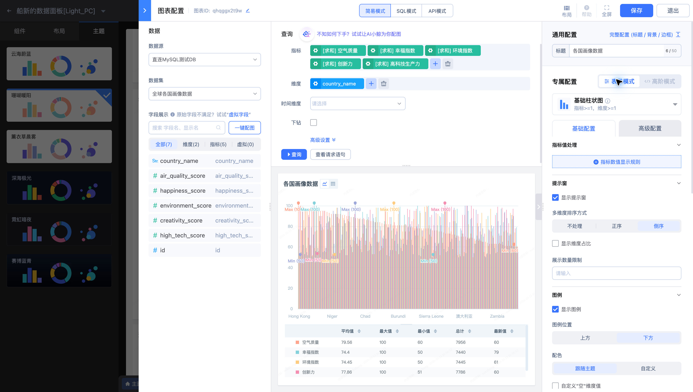
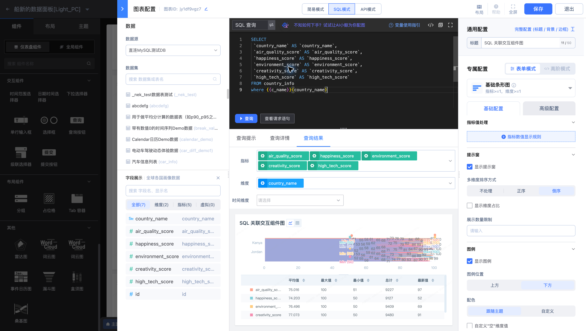
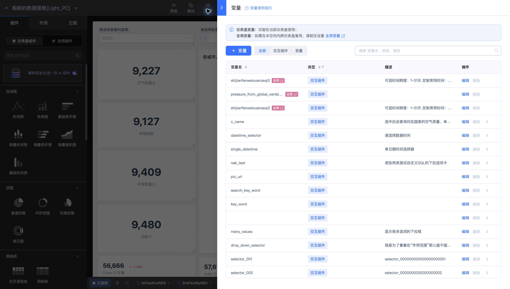

# 图表查询与变量引用常见问题

## 应该选择哪种查询模式？

简易模式适合通过指标、维度、聚合和过滤完成查询；SQL 模式适合自定义数据查询；API 模式适合已接入的接口数据。可用方式由来源类型与当前页面决定。已有图表切换模式可能清空配置，先保存需要保留的版本。

## 查询成功后为什么仍不显示图表？

检查结果字段是否正确映射为指标与维度，并满足组件数量和类型要求。例如桑基图需要一个指标、至少两个维度。数值被返回为字符串时，先核对字段定义或查询输出类型。

## 如何在 SQL 中使用筛选变量？

从当前编辑器的“变量使用指引”选择适配的引用方式。示例图表使用 `{{c_name}}(country_name)` 将国家交互变量作用到字段。变量必须先定义，名称应一致，空值与多选值的处理应按指引设置。

内置变量无需自行定义。变量类型、正向与排除条件，以及时间格式化、取数和条件输出方法，见[变量类型、作用域与方法参考](../Features/Dashboard/Variables-and-methods.md)。

## 全局变量与交互组件变量有什么不同？

全局变量用于复用统一定义；交互组件变量随用户输入或选择变化。先核对作用范围，再检查查询是否引用变量、输入是否通过校验，以及查询按钮是否触发刷新。

## 更改变量后数据仍不变？

核对查询中的变量名称、字段、过滤方法和返回结果。订阅或嵌入场景应检查各自传入的参数，不能只以平台浏览页的当前筛选值判断。
