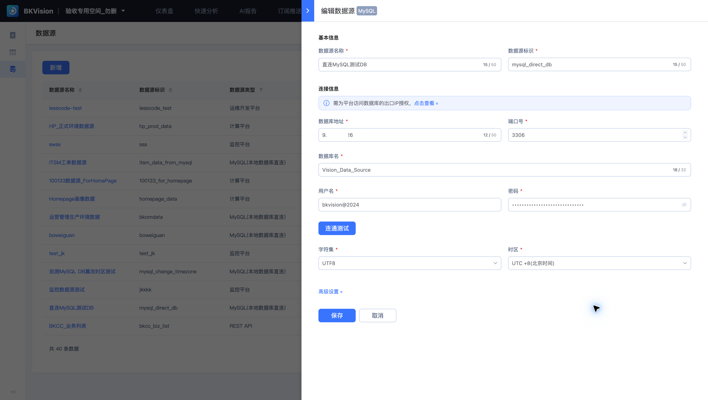
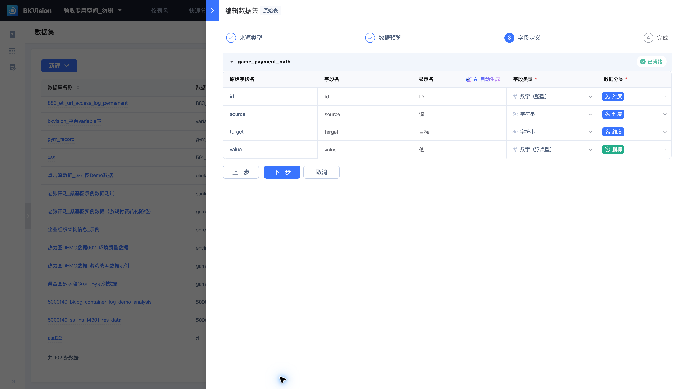

# 数据源连接与数据集字段常见问题

## 数据源连接失败，先检查什么？

核对数据源类型、地址、端口、库名、账号权限、字符集与时区。检查数据库是否允许平台出口 IP 访问，再执行页面的连通测试。认证材料在数据源配置中维护，不放入图表 SQL 或业务描述。

## 数据源与数据集有什么区别？

数据源保存连接信息；数据集将物理表或接口数据映射为可复用字段。多个图表可以引用同一数据集，避免重复定义显示名、字段类型和分类。

## 字段能看到，但无法作为指标使用？

检查类型是否为可计算的数值类型、分类是否为指标，以及聚合方式是否符合口径。示例中 `value` 是数值指标，`source`、`target` 是字符串维度。编号 `id` 虽为整数，仍作为维度使用。

## 预览有数据，图表却为空？

比较数据集、过滤条件、变量值、时间范围与查询限制。数据预览只显示部分样本；图表还会执行聚合和过滤。优先查看图表查询结果与请求语句，再排查样式。

## 可以直接删除被引用的数据源或数据集吗？

先检查列表中的关联数量和资源依赖。修改或删除连接与字段定义可能影响多个图表；删除入口不可用时，处理关联资源后再检查。
