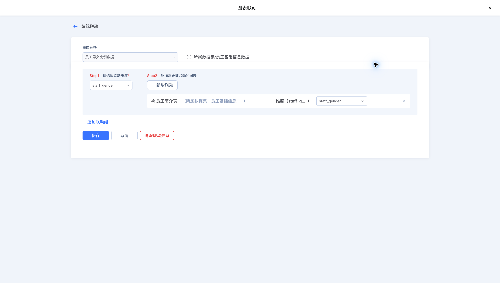
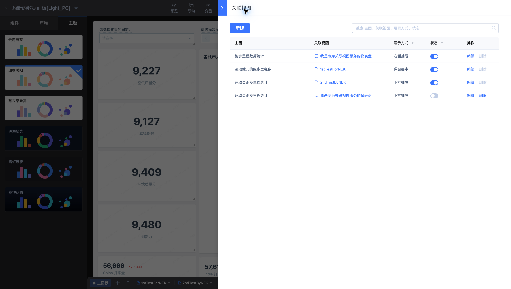
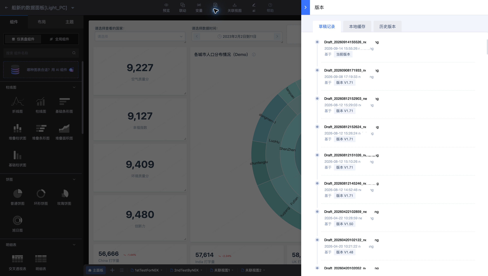
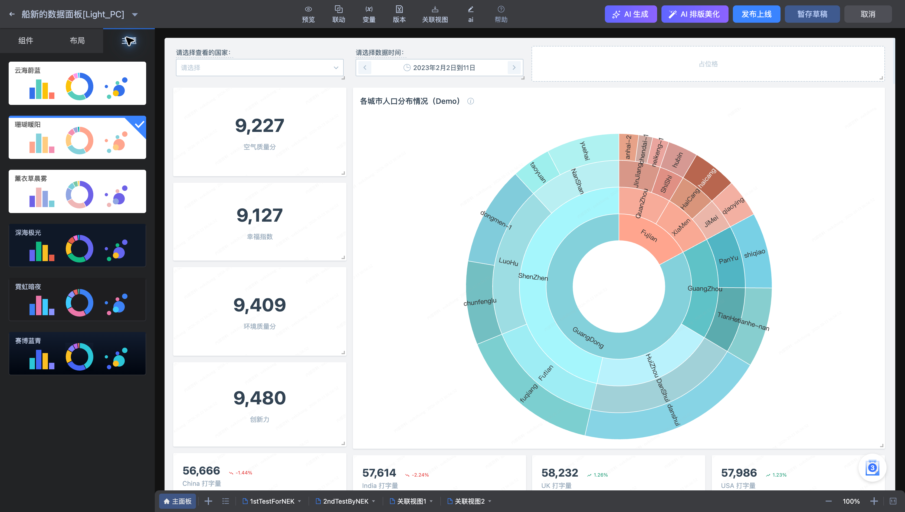

# 联动、关联视图与版本常见问题

## 联动为什么没有筛选目标图表？

检查联动规则是否已保存、源和目标图表是否正确，以及两端字段类型和取值是否匹配。SQL 模式还应核对查询中的联动配置。先在预览页使用一个已知值验证，再增加规则。

## 联动与关联视图如何选择？

需要筛选当前画布的其他图表时使用联动；需要打开另一仪表盘或视图面板展示详情时使用关联视图。关联视图还需核对目标资源、打开方式和传入参数。

## 已暂存草稿，为什么浏览页看不到修改？

草稿用于继续编辑。预览并确认后使用“发布上线”，再检查正式浏览页。编辑页可能自动加载最近草稿，核对工具栏显示的草稿名称，避免误以为正在修改已发布版本。

## 切换主题后部分图表颜色没有改变？

检查该图表是否使用自定义配色。需要统一主题时选择跟随主题，并复查文字对比度、图例与背景。
