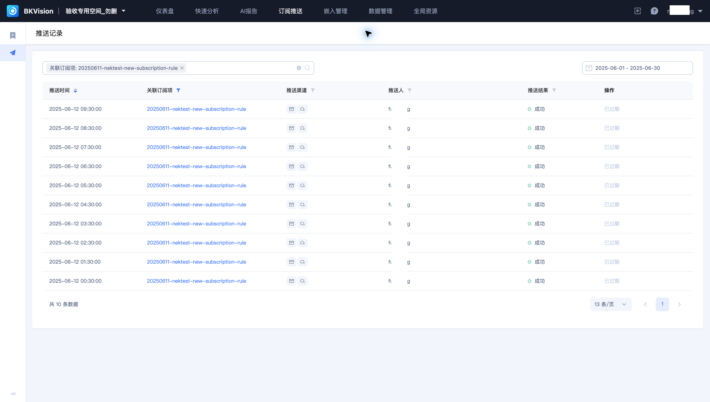
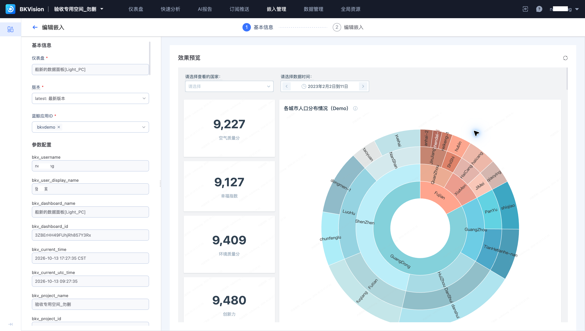
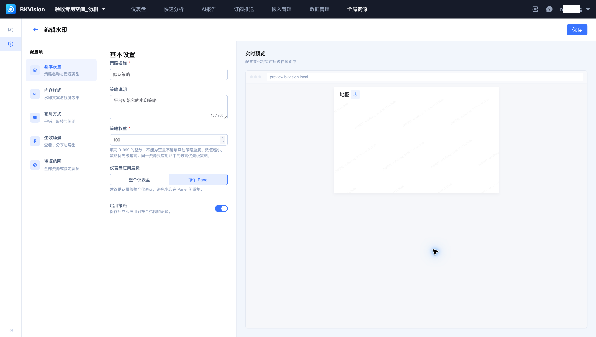

# 订阅、嵌入与水印常见问题

## 订阅记录列表为空，是不是没有执行？

先核对关联订阅和日期范围。示例任务的记录位于 2025 年 6 月，选择“最近一个月”不会显示。检查任务启停状态、推送规则及最后一次执行时间后再判断。

## 订阅图片的数据与浏览页面不同？

检查仪表盘版本、订阅参数、截图时刻和时间范围。浏览页临时输入的筛选条件不能替代订阅配置。通过订阅右侧预览核对，再执行测试推送。

## 嵌入页无法加载，先看哪里？

核对仪表盘、应用 ID、启停状态、版本和嵌入类型。使用该项生成的代码，按教程检查后端 SDK 接口地址及应用侧权限。`filters`、`constants` 的变量名称与类型须匹配仪表盘定义。

## 多条水印策略同时命中会怎样？

权重数值越小，优先级越高；只应用最高优先级策略。检查启用状态、生效场景、资源范围及排除项。

## 为什么每个图表都有水印？

检查水印模式是否选择“每个 Panel”。需要覆盖整个画布时，选择“整个仪表盘”，再核对预览的密度、透明度与可读性。水印标识展示来源，访问权限仍由资源和集成配置控制。
